# 制作一艘基本舰船

本节将引导您制作游戏可加载的第一艘舰船，并简单解析 `.ship` 船体定义和 `data/hulls/ship_data.csv` 文件。

*本节预期阅读时间：~15 分钟。*

*本节预期操作时间：~20 分钟。*

## 学习目标

完成后，您将能够：

- 准备一张尺寸合规的舰船贴图，并为它命名、归位；
- 使用舰船编辑器设置碰撞圈、护盾范围、碰撞箱、槽位与引擎；
- 在 `ship_data.csv` 中登记舰船数据，让船体被游戏加载；
- 从控制台生成船体，并在战斗与装配界面验证制作结果。

## 前置知识

本节从零制作第一艘舰船，建议先熟悉 MOD 目录组织与命名规则：

- MOD 根目录与贴图、数据目录的定位 ([C01-S01])；
- 全局 ID 的命名规则与 `GearIn_` 前缀 ([C01-S01])。

## 获取贴图

制作舰船首先需要一张贴图。

**编者并不擅长画图，但刚好也能展示获取贴图对于绝大多数人来说都不是一件困难的事情**。

这里以一艘 `锤头` 与 `斗士` 的简单拼接为例，在使用 `Photoshop` 拼接之后做了一些简单画笔涂抹和颜色修正，耗时共计 16 秒，但最终效果已经勉强能看。

::: caution 特别注意！

舰船贴图的宽和高**必须**都是 2 的倍数。否则中心点会落在半像素位置，编辑器坐标与游戏采样可能不一致，贴图和挂载组件会出现模糊或偏移。

如无特殊要求，贴图四周只保留完成边缘抗锯齿所需的透明像素，避免无意义地扩大贴图。

本教程的舰船贴图必须使用偶数尺寸，非隐藏武器槽坐标必须使用整数。

:::

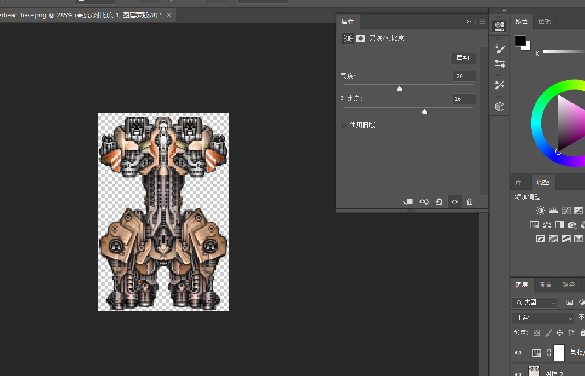

完成品如下，若您需要 (如果您真的看得上的话)，可以随意取用：

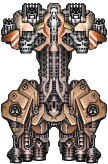

## 命名并将贴图放入正确的位置

对舰船进行命名时，**请有意避开已经存在的舰船名**，以便于您 MOD 的交流和推广。另外，若您希望制作一个整体的势力 MOD**，建议提前想好一整套命名风格**，来体现它的统一。一味追求高端、玄奥、霸气等风格的名字可能会令其他用户感到不适。

您需要为舰船命名，想好它的**中文名称和英文名称**。在本例中，这一艘舰船将被命名为 `工匠-级(Artizan)`。

然后为它分配 ID，格式为：前缀名+舰船名。在本例中，舰船的 ID 是 `GearIn_artizan`。

将贴图命名为与舰船 ID 相同。在本例中，贴图文件名为 `GearIn_artizan.png`，它在 `.ship` 中由 `spriteName` 字段指向：`graphics/ships/GearIn_artizan.png`。

最后放入对应贴图文件夹 (`graphics/ships`)：

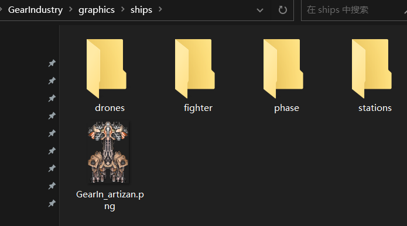

## 制作舰船文件

打开此前您下载的舰船编辑器，选择游戏目录。

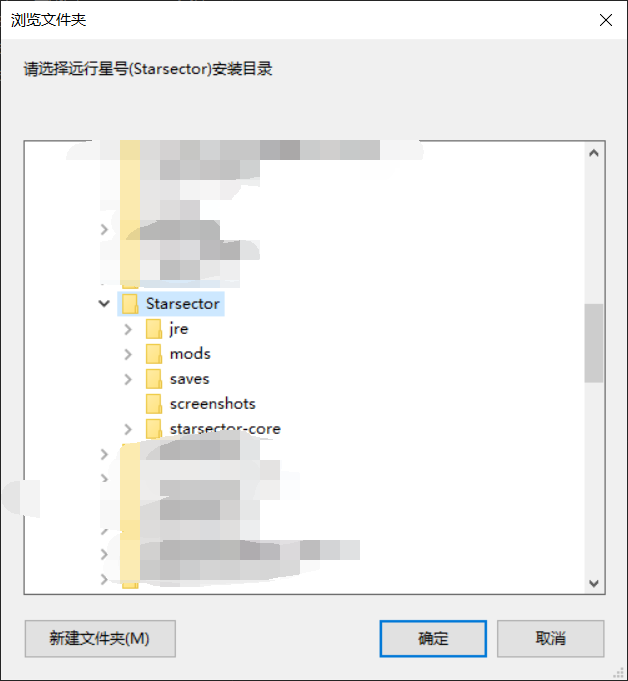

### 开始制作

制作过程中**记得多保存**，以防闪退。

制作舰船文件的流程十分明确：**导入贴图，然后从按键 C 开始一路向下**。

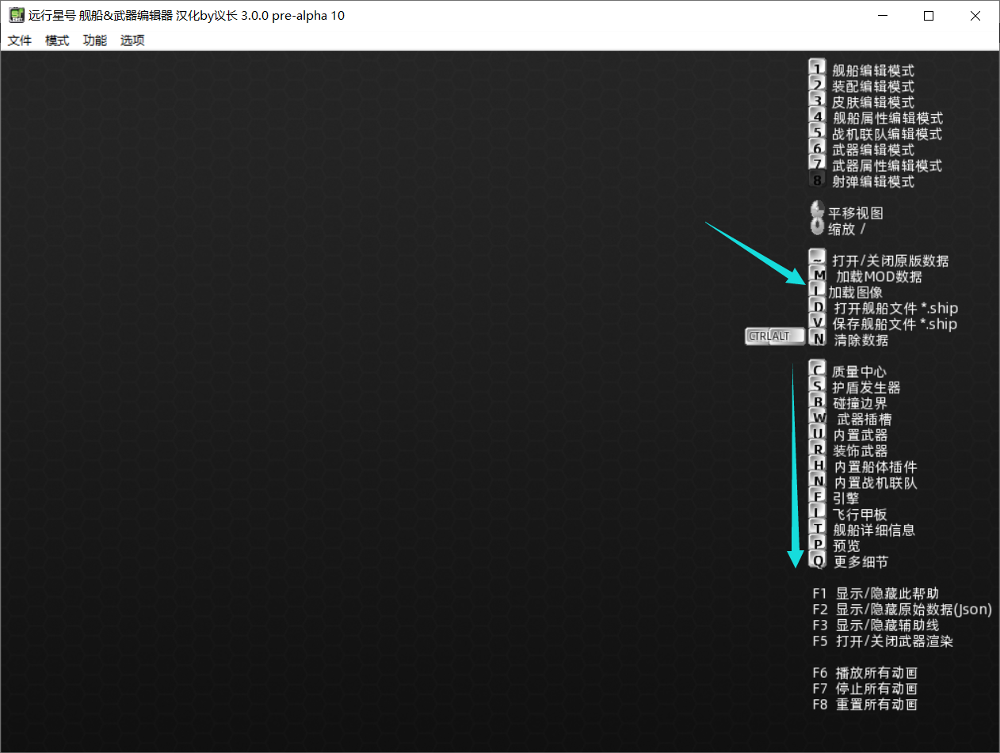

### 设置碰撞圈

首先按 C 设置质量中心和碰撞圈 (俗称 `黄圈`)：

除非有极特殊的要求，否则**质量中心一般设为贴图中心**。

::: caution 黄圈设置

黄圈**必须**包括贴图的所有部分在内。超出黄圈的贴图部分没有碰撞判定：弹丸会直接穿过它，该区域既无法阻挡也无法被命中，舰船的实际判定会比外观小一圈。

黄圈**必须**显著地略大于贴图，但别太大。太小则舰船判定小于外观；太大则弹丸会在离船体很远的地方就进入命中判定，影响您的游戏性能。

:::

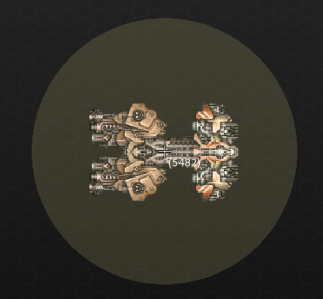

### 设置护盾范围

然后按 S 设置护盾中心和护盾范围 (俗称 `蓝圈`)：

除非有极特殊的要求，否则**护盾中心一般和质量中心重合**。

::: caution 蓝圈设置

蓝圈**必须**全部在黄圈的范围内。否则护盾判定圈会探出船体碰撞体积：导致超出黄圈范围的护盾基本失效，判定与视觉错位。

蓝圈**非常建议**覆盖整个贴图，否则将产生某些预期之外的后果：贴图露出护盾的部分没有护盾保护，敌方弹丸会直接命中护盾范围外的装甲，而这可不是一个好的设计。

:::

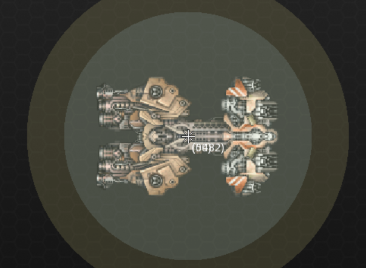

### 设置碰撞箱

然后按 B 设置碰撞箱。设置碰撞箱时，可以按空格键切换是否对称设置：

::: caution 碰撞箱设置

碰撞箱的每一个端点都**必须**在有完全不透明像素的位置，否则可能在装甲完好的情况下异常损失结构：端点悬空时对应的装甲格没有贴图遮挡，被命中后伤害会绕过装甲漏到结构。

碰撞箱**不应该**过度密集，否则会显著影响您的游戏性能。

碰撞箱**不应该**过度稀疏。

:::

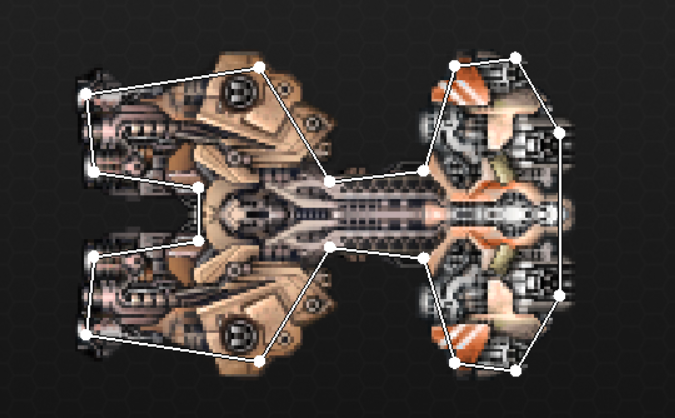

### 设置槽位

然后按 W 设置槽位。使用 Shift + 鼠标等拖拽、切换槽位的位置和朝向。可以按空格键切换是否对称设置。详细可用操作见编辑器的右下角。

在设置完毕所有槽位后，可以按 T 对每一个槽位的具体属性进行设置。

每一个非隐藏槽位的坐标都**必须**为整数，否则武器会糊。

| 槽位形态 (mount) | 实际意义                                                     |
| --------------- | ------------------------------------------------------------ |
| TURRET          | 炮塔                                                         |
| HARDPOINT       | 固定槽位，武器不能旋转，朝向固定为槽位角度。原版固定槽位角度几乎都为 0(正前方)，射角 (arc) 常见 5–10 度。固定槽位上的武器后坐力减半、血量更多 |
| HIDDEN          | 隐藏槽位，安装在隐藏槽位的武器永远不会下线。|

| 槽位大小 (size) | 实际意义 |
| -------------- | -------- |
| SMALL          | 小型     |
| MEDIUM         | 中型     |
| LARGE          | 大型     |

| 槽位类型 (type) | 实际意义                                                     |
| -------------- | ------------------------------------------------------------ |
| BALLISTIC      | 实弹槽位                                                     |
| ENERGY         | 能量槽位                                                     |
| MISSILE        | 导弹槽位                                                     |
| HYBRID         | 混合槽位，实弹+能量                                          |
| SYNERGY        | 协同槽位，能量+导弹                                          |
| COMPOSITE      | 复合槽位，实弹+导弹                                          |
| UNIVERSAL      | 通用槽位，全类型                                             |
| BUILT_IN       | 内置槽位，不可手动安装武器，舰船内置武器 (详见 C01-S06)     |
| SYSTEM         | 系统槽位，进阶类型，**当前阶段不必掌握**                     |
| DECORATIVE     | 装饰槽位，进阶类型，**当前阶段不必掌握**                     |
| STATION_MODULE | 模块连接点，进阶类型，**当前阶段不必掌握**                   |
| LAUNCH_BAY     | 可能导致 BUG，**务必不要把武器设置为这个类型**。若需要添加甲板，详见 C01-S03 |

| 其它有意义数据 | 实际意义                                                     |
| -------------- | ------------------------------------------------------------ |
| angle          | 槽位基础朝向                                                 |
| arc            | 槽位射角大小                                                 |
| renderOrderMod | 槽位渲染高度补正。在默认情况下，大型武器高于中型武器高于小型武器，炮塔武器高于固定点武器。可以通过调整此数据来调整武器渲染高度，数字越大越倾向于渲染在上层 |

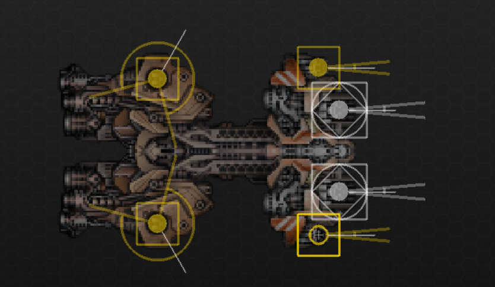

### 设置引擎

然后**跳过中间的部分**，按 E 设置引擎。使用 Shift + 鼠标等拖拽、切换引擎的位置和朝向。可以按空格键切换是否对称设置。详细可用操作见编辑器的右下角。

在设置完毕所有引擎后，可以按 T 对每一个引擎的具体属性进行设置。

引擎**应当**被设置在像素最边缘。引擎可以适当拉长一些，过短往往会导致视觉效果不佳。

| 原版预设引擎风格 (style) | 与其它引擎风格的主要区别 |
| ----------------------- | ------------------------ |
| LOW_TECH                | 黄色，偏向于橘色         |
| MIDLINE                 | 黄色，偏向于亮黄色       |
| HIGH_TECH               | 蓝色                     |
| OMEGA                   | 紫色，带有光带拖尾       |
| COBRA_BOMBER            | 红色，带有大光晕         |

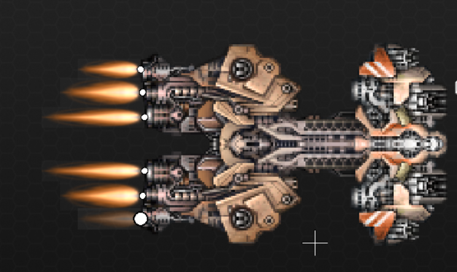

### 设置甲板？

`工匠-级` 驱逐舰并不是一艘航母，所以它没有甲板。关于甲板与战机的设置，将在此后的航母专题中详细解释。

### 设置最终属性

按下 P，然后按下 T，设置最终属性。

| 舰船分级 (hullSize) | 实际意义 |
| ------------------ | -------- |
| FRIGATE            | 护卫舰   |
| DESTROYER          | 驱逐舰   |
| CRUISER            | 巡洋舰   |
| CAPITAL_SHIP       | 主力舰   |
| FIGHTER            | 战机     |

| 原版预设舰船风格 (style) | 与其它舰船风格的主要区别 |
| ----------------------- | ------------------------ |
| LOW_TECH                | 红色护盾                 |
| MIDLINE                 | 蓝色护盾                 |
| HIGH_TECH               | 蓝色护盾                 |

对于 `hullId` 和 `hullName` 两项，它们目前仅作为占位符，理论上没有作用，但编者建议您全部填写舰船 ID。

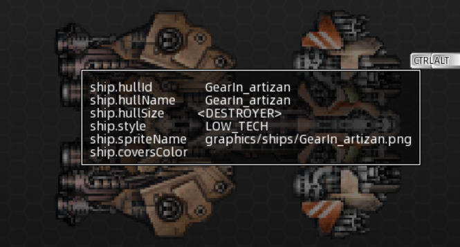

按 V 保存。

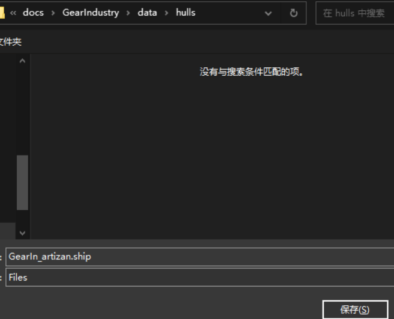


您已经完成了制作一艘船最麻烦的部分了。

## 制作舰船数据

舰船数据的格式是 `CSV`。打开 `ship_data.csv`，这个文件里即为舰船数据，且编者在里面留下了一些数据标本以供您参考。

**CSV 基础**：`CSV` 的第一行是标签，从第二行开始则会被当做数据读取。但是，如果某一行的最前方有一个 `#` 符号，则这一行会被忽略。

在默认情况下，CSV 以 `英文逗号` 对数据进行分割。因此如果数据本身包括 `英文逗号`，则需要 `英文引号` 包络。

**最为简单的做法自然是复制粘贴**。您可以在原版寻找各类舰船的数据，将其复制粘贴到本文件。而在本例，选择 `锤头-级` 驱逐舰的数据，将其复制，然后修改：

::: warning 复制样本时注意

复制时不要忘记删除最前方的 `#` 符号。

:::

```csv {6}
name,id,designation,tech/manufacturer,system id,fleet pts,hitpoints,armor rating,max flux,8/6/5/4%,flux dissipation,ordnance points,fighter bays,max speed,acceleration,deceleration,max turn rate,turn acceleration,mass,shield type,defense id,shield arc,shield upkeep,shield efficiency,phase cost,phase upkeep,min crew,max crew,cargo,fuel,fuel/ly,range,max burn,base value,cr %/day,CR to deploy,peak CR sec,CR loss/sec,supplies/rec,supplies/mo,c/s,c/f,f/s,f/f,crew/s,crew/f,hints,tags,logistics n/a reason,codex variant id,rarity,breakProb,minPieces,maxPieces,travel drive,number
#Lasher,lasher,Frigate,Low Tech,ammofeed,5,1750,300,2100,1750,140,55,,120,110,90,60,90,200,FRONT,,210,0.4,1,,,25,50,40,25,1,25,10,9000,8,10,240,0.25,4,4,,,,,,,,"lowtech_bp, merc, ind",,,,0.4,2,2,,204
#Hammerhead,hammerhead,Destroyer,Midline,ammofeed,10,5000,500,4200,4167,250,95,,90,60,40,30,60,400,FRONT,,300,0.4,0.8,,,50,100,100,60,2,30,9,40000,5,12,360,0.25,10,10,,,,,,,,"midline_bp, merc, ind",,,,0.5,2,3,,300
#Eagle,eagle,Cruiser,Midline,maneuveringjets,14,8000,1000,11000,14000,700,155,,60,40,30,15,20,1200,FRONT,,270,0.4,0.8,,,150,250,150,100,3,33,8,100000,3,12,480,0.25,20,20,,,,,,,,"rare_bp, merc, ind",,,,0.5,2,3,,401
#Conquest,conquest,Battlecruiser,Midline,maneuveringjets,24,12000,1200,20000,30000,1200,315,,45,20,15,6,4,2500,OMNI,,90,0.4,1.4,,,400,500,300,300,10,30,8,300000,3,15,600,0.25,40,40,,,,,,,,"rare_bp, merc",,,,0.5,2,4,,503
工匠,GearIn_artizan,驱逐舰,未知,ammofeed,10,5000,500,3800,4167,200,95,,80,60,40,30,60,400,FRONT,,300,0.4,0.8,,,50,100,100,60,2,30,9,40000,5,12,360,0.25,10,10,,,,,,,,GearIn_bp,,,,0.5,2,3,,300
```

**一艘船最重要的特征是要有趣**。

在本例中，`工匠-级` 驱逐舰将 `锤头-级` 的中实弹替换为中通用，可以安装强力的导弹武器。编者对于歼灭者的表现十分感兴趣，因此将它的幅能容量、幅能耗散与速度都设为略低于 `锤头-级`，来让这艘船更需要依赖它的导弹优势。

将新船的 `tag` 中的内容修改为 `前缀名_bp`，在本例中为 `GearIn_bp`。日后将会有用。除非它是您不希望大量出现的舰船 —— 在这种情况下，您可以将 `tag` 中的内容清空。

### 实用数据速查表

**不在本表上的数据要么是游戏已不再读取的旧列 (如 8/6/5/4%)，要么是对于当前阶段而言过于深入的进阶列 (如 logistics n/a reason、codex variant id、c/s 等)。对于这些列，编者建议您照抄原版样本的值即可。**

| 英文              | 实际意义                                                     |
| ----------------- | ------------------------------------------------------------ |
| name              | 舰船的名称，可以为空。为空时将以 `designation` 作为舰船的名称  |
| id                | 在此填写舰船 ID                                              |
| designation       | 设计类型，会显示在舰船名称后面的那一段字，可随意填写         |
| tech/manu         | 科技类型，原版包括诸如 `Low Tech`、`Midline`、`High Tech`、`Pirate` 等，可随意填写 |
| system id         | 战术系统 ID，原版的战术系统在 `data/shipsystems/ship_systems.csv` |
| fleet pts         | 在大地图自动作战时的战斗力系数。但因为生成舰队本就是按固定总量战斗力生成，因此写得太高也没有用 |
| hitpoints         | 结构                                                         |
| armor             | 装甲                                                         |
| max flux          | 幅能容量                                                     |
| flux dissipation  | 幅能耗散                                                     |
| ordnance points   | 装配点数                                                     |
| fighter bays      | 甲板数量                                                     |
| max speed         | 战斗中最大速度，往往不认为最大速度是 `机动性` 的一部分         |
| acceleration      | 加速度，是 `机动性` 的一部分                                   |
| deceleration      | 减速度，是 `机动性` 的一部分                                   |
| max turn rate     | 转向速度上限，是 `机动性` 的一部分                             |
| turn acceleration | 转向加速度，是 `机动性` 的一部分                               |
| mass              | 舰船质量，舰船撞击伤害和双方的质量之和成正比，而不是质量乘积 |
| shield type       | 右键防御类型，有 `NONE(无盾)` `FRONT(前盾)` `OMNI(全盾)` `PHASE(右键战术系统。相位也是战术系统的一种)` |
| defense id        | 仅当 `shield type` 填写了 `PHASE` 才起效，右键战术系统的 ID      |
| shield arc        | 仅当 `shield type` 填写了 `FRONT` 或 `OMNI` 才起效，护盾角度       |
| shield upkeep     | 仅当 `shield type` 填写了 `FRONT` 或 `OMNI` 才起效，护盾维持幅能倍率，最终基础护盾维持幅能为 `基础耗散 * 护盾维持幅能倍率`。当填写 0.1 时，开启护盾时每秒产生 10% 基础耗散的软幅能 |
| shield efficiency | 仅当 `shield type` 填写了 `FRONT` 或 `OMNI` 才起效，护盾效率。当填写 1.4 时，护盾每受到 1 等效伤害就提高 1.4 硬幅能 |
| phase cost        | 仅当 `shield type` 填写了 `PHASE` 才起效，右键战术系统的激活幅能倍率，最终右键战术系统激活幅能为 `基础容量 * 激活幅能倍率` |
| phase upkeep      | 仅当 `shield type` 填写了 `PHASE` 才起效，右键战术系统的维持幅能倍率，最终右键战术系统维持幅能为 `基础耗散 * 维持幅能倍率` |
| min crew          | 最小船员需求                                                 |
| max crew          | 最大载员量                                                   |
| cargo             | 最大货物容量                                                 |
| fuel              | 最大燃料容量                                                 |
| fuel/ly           | 在超空间中，每航行 `1 ly(1 光年)` 消耗的燃料数                 |
| max burn          | 大地图中最大速度                                             |
| base value        | 成本价                                                       |
| cr %/day          | 在补给充足的情况下，每日回复的 `CR` 数量                       |
| CR to deploy      | 部署所需的最低 `CR` 比例，每次部署也会消耗等量 `CR`(如 12 表示 12%)|
| peak CR sec       | 峰值时间                                                     |
| CR loss/sec       | 当峰值时间耗尽后，每秒下降的 `CR` 量                           |
| supplies/rec      | 部署点，且还是每次部署消耗的补给数量                         |
| supplies/mo       | 每月消耗的补给数                                             |
| hints             | 进阶内容，不可随意编纂，取值见下方 hints 速查表               |
| tags              | 进阶内容，可随意编纂。示例中的 `GearIn_bp` 用于蓝图与销售规则 |
| rarity            | 稀有度。该列会被加载器读入，影响生涯中某些环节里蓝图抽选的权重，对战斗与装配数值无影响。照抄样本留空即可 |
| breakProb         | 停机时被炸个粉碎的概率                                       |
| minPieces         | 如果停机时被炸碎了，那么至少变成多少块                       |
| maxPieces         | 如果停机时被炸碎了，那么至多变成多少块                       |
| travel drive      | 进场与出场时使用的战术系统                                   |

### 实用 Hints 速查表

**不在本表上的数据均为无意义 Hints(如 TRANSPORT) 或不重要 Hints(如 WEAPONS_FRONT_TO_BACK)。**

| 英文                         | 实际意义                                                     |
| ---------------------------- | ------------------------------------------------------------ |
| PHASE                        | 这艘船在战斗中的 AI 行为被设为相位舰，且在某些生涯判定中被认为是相位舰。此外它的右键战术系统会被以相位的文字格式显示 |
| CIVILIAN                     | 这艘船在战斗中的 AI 行为被设为民用船，且在某些生涯判定中被认为是民用船 |
| FREIGHTER                    | 这艘船被认为有相对强大的货运能力                             |
| TANKER                       | 这艘船被认为有相对强大的油运能力                             |
| LINER                        | 这艘船被认为有相对强大的载员能力                             |
| CARRIER                      | 这艘船在战斗中的 AI 行为被设为航母                           |
| COMBAT                       | 配合 `CIVILIAN` 或 `CARRIER` 使用，让舰船的 AI 行为稍偏向于正常战舰 |
| NO_AUTO_ESCORT               | 配合 `CARRIER` 使用，除非刻意给出指挥命令，否则这艘船在战斗中不会主动用战机掩护队友 |
| UNBOARDABLE                  | 除非 `tag` 中包含 `auto_rec` 且用户点了 `无人战舰`，否则不可打捞  |
| STATION                      | 这艘船在战斗中的 AI 行为被设为空间站，且无法手动操控         |
| SHIP_WITH_MODULES            | 这艘船被设为模块船的本体，与 `STATION` 互斥。如果没有这个 `hints`，则船上的模块将在某些情况下出现严重的表现异常 |
| HIDE_IN_CODEX                | 这艘船不会在数据库中出现                                     |
| UNDER_PARENT                 | 仅对模块船的模块生效，让这艘船从视觉上被安置在主体的底下     |
| INDEPENDENT_ROTATION         | 仅对模块船的模块生效，让这艘船的旋转不跟随它的主体           |
| ALWAYS_PANIC                 | 这艘船在战斗中的 AI 行为被设为更容易退缩，且更频繁地使用导弹武器 |
| RENDER_ENGINES_BELOW_HULL    | 这艘船的引擎被渲染在舰船贴图的底下而非上方                   |
| NO_NEURAL_LINK               | 这艘船无法安装 `神经链接`                                     |
| PLAY_FIGHTER_OVERLOAD_SOUNDS | 仅对战机生效，过载时播放如同舰船一样的过载音效               |

## 首舰下水

**无论您的数据风格是贴合原版，亦或明显过强、过弱，甚至强度紊乱，本教程都将一视同仁**。

当您按照您的意愿填写完毕舰船数据之后，这艘船就能被游戏读取了。目前您还没有为它添加合理的获取方式，因此您只能使用 `控制台` 的 `Addship [您的舰船 ID]` 来获取它。

控制台来自 Console Commands MOD(可在 FOSSIC 论坛下载并安装)；命令名不区分大小写，但 ID 区分大小写。

`Addship` 接收的是装配 ID—— 游戏加载船体时会自动生成一个空的 `<hullId>_Hull` 装配，因此直接输入 `Addship GearIn_artizan_Hull` 即可。

但在做下一步之前，强烈推荐您亲自试一下您制作的舰船。

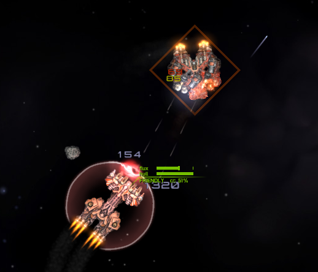

这艘 `工匠-级` 驱逐舰的表现相当不错，可以利用源源不断的火箭弹进行近距离压制，不过一旦被同等重火力盯上就会陷入僵局，而且难以利用它的战术系统。

它也许还可以使用安超配置并搭载离子脉冲。总体而言，作为一艘高手感驱逐舰来说还算成功，但再加上一些微调会更好。

## 验证方案

前置数据：已经完成本节的舰船贴图、`.ship` 文件和 `ship_data.csv` 登记，并启用 Console Commands MOD。

1. 启动游戏，确认本 MOD 已在 Mods 列表启用并进入主菜单。
2. 进入任何一个生涯存档，打开控制台执行 `Addship GearIn_artizan`。
3. 进入装配界面，核对幅能容量 (3800)、耗散 (200)、速度 (80) 与 CSV 一致。
4. 进入任意战斗，观察贴图、碰撞、护盾、五类机动输入、武器槽与引擎。

预期结果：

- 船体成功加载，贴图无白块或错位，碰撞边界、护盾范围、武器槽与引擎位置与编辑器设定一致；
- 战斗中机动手感符合 CSV 设定 (速度 80，机动性略低于 `锤头-级`)；
- 装配界面幅能容量、耗散、速度与 `ship_data.csv` 中的登记值一致；
- 日志中没有 `GearIn_artizan` 相关的错误。

## 故障分析

- 控制台报错找不到装配或船体：CSV 行未加载 (例如行首仍带 `#`)，或 `.ship` 的 `hullId`、CSV 的 `id` 与装配引用的 ID 不一致；统一为 `GearIn_artizan` 后重启游戏。
- 舰船显示为白块或缺图：`.ship` 的 `spriteName` 路径未指向 MOD 根目录下的实际 PNG；核对大小写和扩展名。
- 武器或引擎偏半个像素：贴图中心、槽位坐标或引擎坐标落在不一致的像素网格；保持偶数贴图尺寸并重新在编辑器中对齐。
- 装配界面数值与 CSV 不一致：确认当前装配引用的是 `GearIn_artizan` 船体，并核对 `ship_data.csv` 中 ID 唯一且修改已经保存；重启游戏后再次检查。
- 舰船一加载就报错：先查 `starsector.log` 中 hull ID 附近的首个异常，再依次核对 CSV 列数、`.ship` 宽松 JSON 和资源路径。

## 总结

本节完成了从一张贴图到一艘可玩舰船的完整流程：命名与归位决定 ID 和外观，`.ship` 决定几何与表现，`ship_data.csv` 决定性能与生成入口，三者构成一条完整的数据链。

作为对您 (或许是新人？) 的建议，编者必须强调的是：排错时从 CSV 的 ID 沿链逐项追到资源文件，这比凭空臆测更可靠。Java 不承认猜。

本节登记的 `GearIn_artizan` ID 与 `GearIn_bp` 标签还会用于蓝图、装配和市场销售等机制。保持这些标识稳定，后续数据才能继续沿同一条所有权链使用它们。

## 建议参考项

- `data/hulls/ship_data.csv`：舰船数据注册表，`id`、性能列与 `tags` 的落点。
- `data/hulls/GearIn_artizan.ship`：船体几何定义，含贴图引用、碰撞、护盾、槽位与引擎。
- `graphics/ships/GearIn_artizan.png`：舰船贴图，由 `.ship` 的 `spriteName` 字段指向。
- `data/config/engine_styles.json`：原版引擎风格的颜色定义。
- `data/config/hull_styles.json`：原版舰船与护盾样式的颜色定义。
- `data/shipsystems/ship_systems.csv`：战术系统 ID 注册，`system id` 列的取值来源。
- `Starsector/starsector-core/starsector.log`：游戏运行日志，故障分析时定位首个异常。
