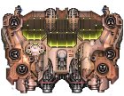
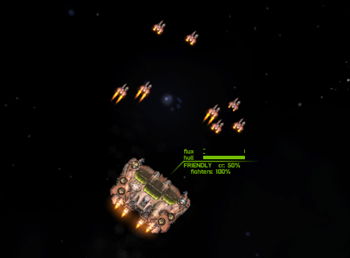
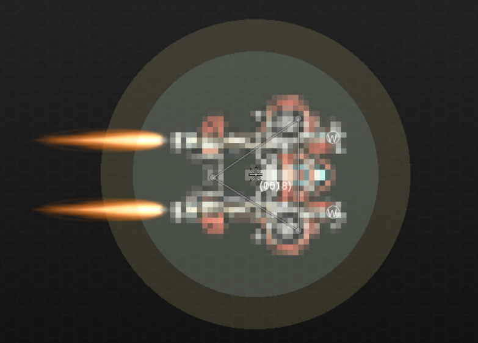
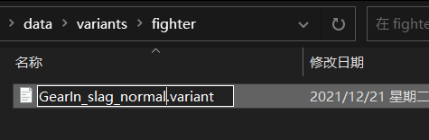
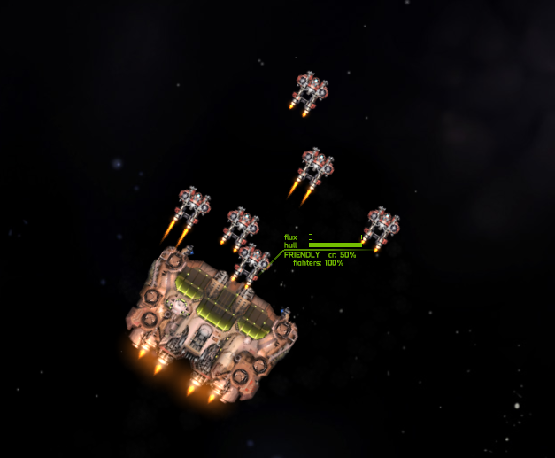

# 制作一艘航母与战机

本节将引导您制作一艘航母，即带有甲板与港口的舰船。既然有航母，自然还需要包括战机。

*本节预期阅读时间：\~12 分钟。*

*本节预期操作时间：\~15 分钟。*

## 学习目标

完成后，您将能够：

- 制作带甲板与港口的航母，并为其填写含甲板数量的舰船数据；
- 制作战机，并完成 hull、variant、wing 的配置；
- 从可观察症状判断错误位于船体、装配还是联队。

## 前置知识

- [C1-S2] 的舰船编辑器操作与普通舰船制作流程；
- [C1-S2] 的 `ship_data.csv` 登记规则；
- [C1-S2] 的 `Addship` 使用方法与 `starsector.log` 排错方法。

## 获取贴图

相信获取贴图的部分已经无需赘述了，这些被提供的贴图制作时长共计不到 1 分钟：




## 命名并将贴图放入正确的位置

::: tip 位置建议

所有战机都应该被放入 `fighter` 文件夹，有助于后续维护。

:::


`守炉人-级 (Furnaceman)` 航母，ID 为 `GearIn_furnaceman`。

`炉渣-级 (Slag)` 战机，ID 为 `GearIn_slag`。

## 制作航母舰船文件

### 预先制作

按照与寻常舰船无异的过程，制作 `守炉人-级` 航母的舰船文件，但有额外的 1 步。


### 设置甲板

按 `L` 设置甲板：

::: warning 甲板设置

每个甲板建议设置至少 2 个港口 (Port)，设置 4 个为最佳建议。

港口数为 0 时，战机从舰船中心生成。

港口数过少时，战机的生成将异常缓慢。

:::


**每一个图标右下角的数字说明它属于第 x 个甲板**，由于 `守炉人-级` 航母只有 2 个甲板，所以右下角最大数字为 2\*\*。而图标的数量则说明这个甲板有多少个港口\*\*。

其它属性设置完毕后，按 `V` 保存。

## 制作航母舰船数据

如前文所述，最为简单的做法是复制黏贴。打开原版的 `ship_data.csv`，将 `赶牛人-级` 航母的数据复制过来，然后稍作修改：

```csv {13}
name,id,designation,tech/manufacturer,system id,fleet pts,hitpoints,armor rating,max flux,8/6/5/4%,flux dissipation,ordnance points,fighter bays,max speed,acceleration,deceleration,max turn rate,turn acceleration,mass,shield type,defense id,shield arc,shield upkeep,shield efficiency,phase cost,phase upkeep,min crew,max crew,cargo,fuel,fuel/ly,range,max burn,base value,cr %/day,CR to deploy,peak CR sec,CR loss/sec,supplies/rec,supplies/mo,c/s,c/f,f/s,f/f,crew/s,crew/f,hints,tags,logistics n/a reason,codex variant id,rarity,breakProb,minPieces,maxPieces,travel drive,number
,,,,,,,,,,,,,,,,,,,,,,,,,,,,,,,,,,,,,,,,,,,,,,,,,,,,,
#Lasher,lasher,Frigate,Low Tech,ammofeed,5,1750,300,2100,1750,140,55,,120,110,90,60,90,200,FRONT,,210,0.4,1,,,25,50,40,25,1,25,10,9000,8,10,240,0.25,4,4,,,,,,,,"lowtech_bp, merc, ind",,,,0.4,2,2,,204
,,,,,,,,,,,,,,,,,,,,,,,,,,,,,,,,,,,,,,,,,,,,,,,,,,,,,
#Hammerhead,hammerhead,Destroyer,Midline,ammofeed,10,5000,500,4200,4167,250,95,,90,60,40,30,60,400,FRONT,,300,0.4,0.8,,,50,100,100,60,2,30,9,40000,5,12,360,0.25,10,10,,,,,,,,"midline_bp, merc, ind",,,,0.5,2,3,,300
,,,,,,,,,,,,,,,,,,,,,,,,,,,,,,,,,,,,,,,,,,,,,,,,,,,,,
#Eagle,eagle,Cruiser,Midline,maneuveringjets,14,8000,1000,11000,14000,700,155,,60,40,30,15,20,1200,FRONT,,270,0.4,0.8,,,150,250,150,100,3,33,8,100000,3,12,480,0.25,20,20,,,,,,,,"rare_bp, merc, ind",,,,0.5,2,3,,401
,,,,,,,,,,,,,,,,,,,,,,,,,,,,,,,,,,,,,,,,,,,,,,,,,,,,,
#Conquest,conquest,Battlecruiser,Midline,maneuveringjets,24,12000,1200,20000,30000,1200,315,,45,20,15,6,4,2500,OMNI,,90,0.4,1.4,,,400,500,300,300,10,30,8,300000,3,15,600,0.25,40,40,,,,,,,,"rare_bp, merc",,,,0.5,2,4,,503
,,,,,,,,,,,,,,,,,,,,,,,,,,,,,,,,,,,,,,,,,,,,,,,,,,,,,

工匠,GearIn_artizan,驱逐舰,未知,ammofeed,10,5000,500,3800,4167,200,95,,80,60,40,30,60,400,FRONT,,300,0.4,0.8,,,50,100,100,60,2,30,9,40000,5,12,360,0.25,10,10,,,,,,,,"GearIn_bp",,,,0.5,2,3,,300
守炉人,GearIn_furnaceman,轻型航母,未知,targetingfeed,11,4500,400,3000,2813,225,75,2,75,50,30,25,25,450,FRONT,,300,0.4,0.8,,,90,150,40,40,2,20,9,52000,5,15,360,0.25,11,13,,,,,,,CARRIER,"GearIn_bp",,,,0.5,2,3,,318
```

在本例中，`守炉人-级` 航母的战术系统被替换为 `苍鹭-级` 的同款，来提供一种类似的 "命令式" 操作感。因为它的槽位大多数都被替换为防御型小型实弹槽位，因此为它提供更高的结构与更低的部署点作为幅度恰当的补偿。

航母需要填写 `甲板数量`，此处为 2。

tag 也作了与 `工匠-级` 相似的处理。

### 验证方案

前置数据：已经完成 `GearIn_furnaceman` 的船体文件和 `ship_data.csv` 登记，并准备一套可搭载战机联队的测试装配。

1. 使用控制台命令 `Addship GearIn_furnaceman` 获取该航母。
2. 进入任意战斗并部署它，观察战机是否从甲板港口生成 (而非舰体中心)，以及联队补充与返航是否正常。

预期结果：

- 船体成功加载；
- 战机从甲板港口生成，联队补充与返航正常；
- 日志中没有 `GearIn_furnaceman` 相关的错误。



## 制作战机舰船文件

按照与寻常舰船无异的过程，制作 `炉渣-级` 战机的舰船文件。虽然 "战机舰船文件" 听上去很奇怪。

::: warning 战机制作注意点

战机的碰撞箱**应该尽可能简单**，甚至可以为此牺牲一些精度。

战机的武器 **不应该选用** `内置`，因为战机的装配是基于装配文件的，而对内置槽位进行装配可能会产生一些问题。

不要选错 `hullSize` —— 游戏以 `hullSize == FIGHTER` 判定战机身份 (`ShipAPI.isFighter()`)，选错时该单位不会被分配战机 AI，也不会被计入联队成员、返航与补充。

:::



## 制作战机舰船的数据

"战机舰船的数据" 听上去更奇怪了。

继续复制黏贴。打开原版的 `ship_data.csv`，将 `阔剑-级` 战机的数据复制过来，然后稍作修改：

```csv {12}
name,id,designation,tech/manufacturer,system id,fleet pts,hitpoints,armor rating,max flux,8/6/5/4%,flux dissipation,ordnance points,fighter bays,max speed,acceleration,deceleration,max turn rate,turn acceleration,mass,shield type,defense id,shield arc,shield upkeep,shield efficiency,phase cost,phase upkeep,min crew,max crew,cargo,fuel,fuel/ly,range,max burn,base value,cr %/day,CR to deploy,peak CR sec,CR loss/sec,supplies/rec,supplies/mo,c/s,c/f,f/s,f/f,crew/s,crew/f,hints,tags,logistics n/a reason,codex variant id,rarity,breakProb,minPieces,maxPieces,travel drive,number
,,,,,,,,,,,,,,,,,,,,,,,,,,,,,,,,,,,,,,,,,,,,,,,,,,,,,
#Lasher,lasher,Frigate,Low Tech,ammofeed,5,1750,300,2100,1750,140,55,,120,110,90,60,90,200,FRONT,,210,0.4,1,,,25,50,40,25,1,25,10,9000,8,10,240,0.25,4,4,,,,,,,,"lowtech_bp, merc, ind",,,,0.4,2,2,,204
,,,,,,,,,,,,,,,,,,,,,,,,,,,,,,,,,,,,,,,,,,,,,,,,,,,,,
#Hammerhead,hammerhead,Destroyer,Midline,ammofeed,10,5000,500,4200,4167,250,95,,90,60,40,30,60,400,FRONT,,300,0.4,0.8,,,50,100,100,60,2,30,9,40000,5,12,360,0.25,10,10,,,,,,,,"midline_bp, merc, ind",,,,0.5,2,3,,300
,,,,,,,,,,,,,,,,,,,,,,,,,,,,,,,,,,,,,,,,,,,,,,,,,,,,,
#Eagle,eagle,Cruiser,Midline,maneuveringjets,14,8000,1000,11000,14000,700,155,,60,40,30,15,20,1200,FRONT,,270,0.4,0.8,,,150,250,150,100,3,33,8,100000,3,12,480,0.25,20,20,,,,,,,,"rare_bp, merc, ind",,,,0.5,2,3,,401
,,,,,,,,,,,,,,,,,,,,,,,,,,,,,,,,,,,,,,,,,,,,,,,,,,,,,
#Conquest,conquest,Battlecruiser,Midline,maneuveringjets,24,12000,1200,20000,30000,1200,315,,45,20,15,6,4,2500,OMNI,,90,0.4,1.4,,,400,500,300,300,10,30,8,300000,3,15,600,0.25,40,40,,,,,,,,"rare_bp, merc",,,,0.5,2,4,,503
,,,,,,,,,,,,,,,,,,,,,,,,,,,,,,,,,,,,,,,,,,,,,,,,,,,,,

炉渣,GearIn_slag,,未知,flarelauncher_fighter,,750,100,200,,100,0,,180,400,350,90,180,30,NONE,,0,0,0,,,1,1,,,,,,,,,,,,,,,,,,,,,,,,0,,,,104

工匠,GearIn_artizan,驱逐舰,未知,ammofeed,10,5000,500,3800,4167,200,95,,80,60,40,30,60,400,FRONT,,300,0.4,0.8,,,50,100,100,60,2,30,9,40000,5,12,360,0.25,10,10,,,,,,,,"GearIn_bp",,,,0.5,2,3,,300
守炉人,GearIn_furnaceman,轻型航母,未知,targetingfeed,11,4500,400,3000,2813,225,75,2,75,50,30,25,25,450,FRONT,,300,0.4,0.8,,,90,150,40,40,2,20,9,52000,5,15,360,0.25,11,13,,,,,,,CARRIER,"GearIn_bp",,,,0.5,2,3,,318
```

在本例中，`炉渣-级` 战机由 `阔剑-级` 修改而来，max flux 与 flux dissipation 两列被调高至 200/100。而对应地，它将搭载双管轻型自动炮，且最大速度降低了 20。

## 制作战机的装配

虽然舰船编辑器的确拥有制作装配的功能，但编者**极度不推荐使用它**，因为它不利于建立文件直觉，且对于后期的进一步调整没有任何正面价值。

继续复制黏贴。打开原版的 `variants/fighters/` 文件夹，找到 `阔剑-级` 的装配，将其复制到您 MOD 的对应位置。然后将文件名改为 `舰船 ID + 某个后缀`，一般来说推荐后缀为 `normal` 或 `variant`：



然后打开文件，准备修改：

```json
{
	"quality":0.5,
	"displayName":"Heavy Fighter",
	"hullId":"broadsword",
	"variantId":"broadsword_Fighter",
	"fluxVents":0,
	"fluxCapacitors":0,
	"hullMods":[], # array of strings

	# mode is either LINKED or ALTERNATING
	# slot ids (WS ***) must match what's in the .ship file
	"weaponGroups":[
		{"mode":"LINKED",
		 "weapons":{
		 			"WS 001":"lightmg",
		 			"WS 002":"lightmg",
		 		   },
		},
		{"mode":"LINKED",
		 "weapons":{
		 			#"WS 003":"swarmer_fighter",
		 		   },
		},
	],
}
```

### 战机装配文件速查表

**不在本表上的数据均为对于战机而言不必修改的数据或无意义数据。**

| 英文 | 实际意义 |
|---|---|
| displayName | 战机本装配的装配名，会在战机的数据页面被展示 |
| hullId | 战机本装配的舰船 ID，在本例为 `GearIn_slag` |
| variantId | 战机本装配的装配 ID，建议与文件名相同，在本例为 `GearIn_slag_normal` |
| hullMods | 战机本装配所安装的插件 |
| weaponGroups | 战机本装配的武器列表，在 `weapons` 项目里的则是具体武器。注意，图中诸如 `WS 001` 的是槽位 ID，**必须是战机本身确实拥有的槽位**，否则游戏将报错。而槽位 ID 后的则是武器 ID，可以查询 `weapon_data.csv`。|

```json {3-5,15,16}
{
	"quality":0.5,
	"displayName":"重型战机",
	"hullId":"GearIn_slag",
	"variantId":"GearIn_slag_normal",
	"fluxVents":0,
	"fluxCapacitors":0,
	"hullMods":[], # array of strings

	# mode is either LINKED or ALTERNATING
	# slot ids (WS ***) must match what's in the .ship file
	"weaponGroups":[
		{"mode":"LINKED",
		 "weapons":{
		 			"WS0001":"lightdualac",
		 			"WS0002":"lightdualac",
		 		   },
		},
		{"mode":"LINKED",
		 "weapons":{
		 			#"WS 003":"swarmer_fighter",
		 		   },
		},
	],
}
```

**再次强调：一定要注意那些武器槽 (**`WSxxx`**) 是否存在于战机的船体文件里。**

## 制作战机的战机数据

"战机的战机数据" 听上去比前两个还更奇怪。

打开 `wing_data.csv`，继续复制粘贴。编者认为，既然 `炉渣-级` 是从 `阔剑-级` 修改而来的，那么就直接修改到底，战机数据也从 `阔剑-级` 里复制并修改：

```csv {12}
id,variant,tags,tier,rarity,fleet pts,op cost,formation,range,attackRunRange,attackPositionOffset,num,role,role desc,refit,base value,,,,,,,,,,,,,number
,,,,,,,,,,,,,,,,,,,,,,,,,,,,
#broadsword_wing,broadsword_Fighter,"fighter4, fighter, low, lowtech_bp, merc, ind",0,,6,8,V,4000,500,,3,FIGHTER,Heavy Fighter,10,6000,,,,,,,,,,,,,1
,,,,,,,,,,,,,,,,,,,,,,,,,,,,
#talon_wing,talon_Interceptor,"interceptor1, interceptor, low, base_bp, merc, ind",0,,3,2,V,4000,200,600,4,INTERCEPTOR,Interceptor,5,2000,,,,,,,,,,,,,6
,,,,,,,,,,,,,,,,,,,,,,,,,,,,
#dagger_wing,dagger_Bomber,"bomber4, bomber, high, hightech_bp, merc, ind",2,,5,18,V,4000,2000,600,3,BOMBER,Bomber,18,9000,,,,,,,,,,,,,11
,,,,,,,,,,,,,,,,,,,,,,,,,,,,
#xyphos_wing,xyphos_Fighter,"support3, fighter, high, rare_bp, hist1t, merc, ind",3,0.5,7,18,V,0,500,,2,SUPPORT,Support,15,10000,,,,,,,,,,,,,2
,,,,,,,,,,,,,,,,,,,,,,,,,,,,

GearIn_slag_wing,GearIn_slag_normal,"fighter4, fighter, low, GearIn_bp",0,,6,8,V,4000,500,,3,FIGHTER,重型战机,12,6000,,,,,,,,,,,,,1
```

该行的 `tags` 已按上文 "提前准备" 的建议处理：蓝图 tag 被替换为 `GearIn_bp`，并清掉了 `merc, ind`。

::: caution 战机的 wing id 绝对不能和 ship id 一致

如果战机的 wing id 和 ship id 一致，那么某些用于处理战机生成的方法就无法正确生成整个联队。

如果您真的这么干了，虽然您不会在正常测试中感觉到任何问题，但一旦您后期有类似需求，或您的 MOD 和其它有类似功能的 MOD 一同运行，那么您会迅速理解为什么这一则警告是**红色**的而非黄色的。

:::

### wing\_data.csv 数据速查表

**不在本表上的数据均为本教程用不到的数据 (如 fleet pts) 或不重要数据 (如 number)，照抄原版样本即可。**

| 英文 | 实际意义 |
|---|---|
| id | 战机的战机 ID，如果没有特别要求，应当以 `_wing` 结尾 |
| variant | 战机所对应的装配文件，在本例中是 `GearIn_slag_normal` |
| tags | 进阶内容，不可随意编纂 |
| tier | 科技等级，影响市场、突袭等权重，照抄原版样本即可 |
| rarity | 稀有度，影响市场、突袭等权重，照抄原版样本即可 |
| op cost | 装配点数需求 |
| formation | 战机队形，允许的有 `BOX`、`V`、`CLAW` 和 `DIAMOND`，分别是簇团、正 V 编队、反 V 编队和棱形编队 |
| range | 最大交战距离 |
| attackRunRange | 当战机与敌舰交战时，最大允许的可后撤距离 |
| attackPositionOffset | 战机攻击距离补正 |
| num | 每联队的战机数 |
| role | 战机的 AI 种类，允许的有 `FIGHTER`、`INTERCEPTOR`、`BOMBER`、`SUPPORT`、`ASSAULT`。`INTERCEPTOR` 目标选取独走一条路径 (优先锁定范围内最近的敌方战机)，攻击环绕距离最大 (500)；`ASSAULT` 最小 (75)，贴得最近；`BOMBER` 是轰炸机，`SUPPORT` 是不会主动离开母舰的支援机 |
| role desc | 战机类型文字描述 |
| refit | 战机整备所需秒数 |
| base value | 每联队的成本价 |

原版 `MilitarySubmarketPlugin` 等通过 `addFighters` 生成常规市场战机池时，只纳入 tier 不大于 3 的联队。这个限制属于上述原版调用链；直接生成或显式添加联队不受该筛选限制。

### wing\_data.csv tags 速查表

**本表未列出的 tags 与战机性能无关，例如 `rare_bp`，照抄原版样本即可。**

| 英文 | 实际意义 |
|---|---|
| fighter\* | 当进行自动装配时，优先使用 \* 所处的位置较高的战机。例如 fighter2 总是会替代 fighter1 |
| interceptor\* | 当进行自动装配时，优先使用 \* 所处的位置较高的战机。例如 interceptor2 总是会替代 interceptor1 |
| bomber\* | 当进行自动装配时，优先使用 \* 所处的位置较高的战机。例如 bomber2 总是会替代 bomber1 |
| support\* | 当进行自动装配时，优先使用 \* 所处的位置较高的战机。例如 support2 总是会替代 support1 |
|  | **以上 4 条只应当包含 1 条** |
| fighter | 与 `role` 列 FIGHTER 同义的分类 tag。|
| interceptor | 与 `role` 列 INTERCEPTOR 同义的分类 tag，同上 |
| bomber | 与 `role` 列 BOMBER 同义的分类 tag，同上 |
|  | **以上 3 条只应当包含 1 条** |
| auto\_fighter | 只有包含此 tag 的战机才能被无人战舰使用 |
| drone | tag 存在于数据中，引擎侧无消费点、不产生行为 |
| rapid\_reform | 联队将倾向于保持严格的阵型而非四散而开 |
| leader\_no\_swarm | 联队中的首机一旦接敌就会拉开距离，而非无脑蜂蛹而上 |
| wingmen\_no\_swarm | 联队中的首机以外的战机旦接敌就会拉开距离，而非无脑蜂蛹而上 |
| match\_leader\_facing | 联队中的其它所有战机与首机保持朝向完全一致 |
| attack\_at\_an\_angle | 战机 AI 将倾向于使用最大武器倾角侧舷对敌，而非正面对敌 |
| independent\_of\_carrier | 当航母被消灭或无所属航母时，依然正常运作而非四散溃逃。且当场上没有任何同侧舰船时，这些战机不会自动自爆而是需要被手动消灭 |
| rd\_no\_extra\_craft | `后备部署` 专供，使本战机不响应它的效果 |

### 验证方案

前置数据：已经完成 `GearIn_slag` 船体、`GearIn_slag_normal` 装配和 `GearIn_slag_wing` 联队登记，并准备一艘可搭载该联队的航母。

1. 使用控制台命令 `Addwing GearIn_slag_wing` 来获取该联队。
2. 进入战斗部署一艘搭载该联队的航母，观察战机从甲板生成、武器开火、返航与补充。
3. 在装配界面核对战机的分类。

预期结果：

- 船体成功加载；
- 战机的数据符合预期，`role desc` 显示为 `重型战机`，在战斗机一栏出现；
- 日志中没有 `GearIn_slag_wing` 相关的错误。



## 故障分析

- **`AddShip` 找不到航母**：`ship_data.csv` 的 `GearIn_furnaceman` 行未加载，或 `.ship`、CSV 与装配引用的船体 ID 不一致。

    - **解决方案**：统一 ID 并重启游戏。

- **航母战机从舰体中心生成**：对应甲板没有港口，无法提供出入位置。

    - **解决方案**：在舰船编辑器中补齐并保存甲板港口。

- **联队无法补充或返航**：战机船体的 `hullSize` 不是 `FIGHTER`，或 wing、variant、hull 三段 ID 没有依次指向现有对象。

    - **解决方案**：修正引用后重新部署航母。

- **`Addwing` 报 `No LPC found with id [...]`**：ID 未加载，或误用了 hull、variant ID。命令会自动补 `_wing` 后缀。

    - **解决方案**：核对后使用 wing ID，重启。

- **战机生成后没有武器**：variant 中的槽位 ID 与 `.ship` 不一致，武器无法挂载到目标槽位。

    - **解决方案**：统一槽位 ID 并重新生成联队。

- **装配界面的联队分类与 `role` 不一致**：`wing_data.csv` 的 `role`、`role desc` 或分类 tag 配置不匹配，或修改尚未重新加载。

    - **解决方案**：修正并重启游戏。

- **日志出现航母或战机加载错误**：从首个异常开始，沿最终 ID 依次核对 CSV、wing、variant、hull 和资源路径。

    - **解决方案**：修正首个断点并重启。

## 总结

本节在普通舰船链的基础上完成了两种专用约束的完整流程。航母通过甲板与港口投放战机，战机必须依次完成 hull、variant、wing 的注册。

虽然对于装配文件的介绍并不详细，且手搓 `.variant` 的方式可能太过于原始，但对于战机这种小体量对象而言正合适。另外，编者建议您多加练习此类能力，若能从装配文件中直接读出实际内容、直接简单地修改几个位点就完成调整，将省下很多调试时间。

## 建议参考项

- `data/hulls/ship_data.csv`：舰船数据表，航母行需填写 `fighter bays` 与 `CARRIER` hint。
- `data/hulls/wing_data.csv`：联队数据表，`GearIn_slag_wing` 行落点。
- `data/variants/fighters/`：战机装配文件 (`GearIn_slag_normal.variant`) 的落点。
- `data/variants/fighters/broadsword_Fighter.variant`：战机装配基线，本例装配由它修改而来。
- `data/weapons/weapon_data.csv`：武器 ID 查询 (`lightdualac` 等)。
- `Starsector/starsector-core/starsector.log`：游戏日志，排查加载错误与最终 ID 报错。
- `Starsector/mods/Console Commands/data/console/commands.csv`：`Addship`/`Addwing` 控制台命令条目。
- `com.fs.starfarer.api.loading.FormationType`：联队队形枚举全集；
- `com.fs.starfarer.api.loading.WingRole`：联队内战机角色枚举全集。
