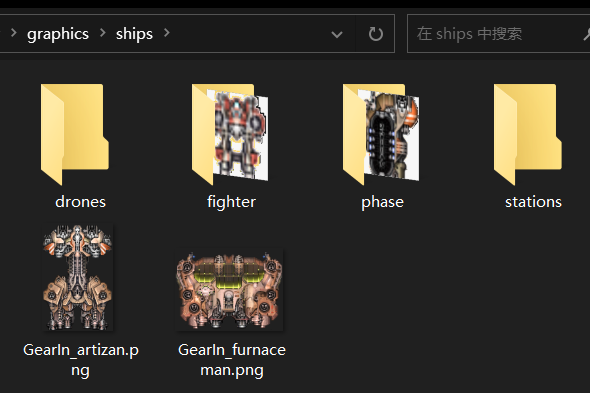
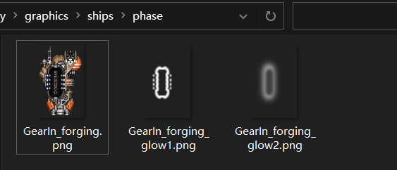
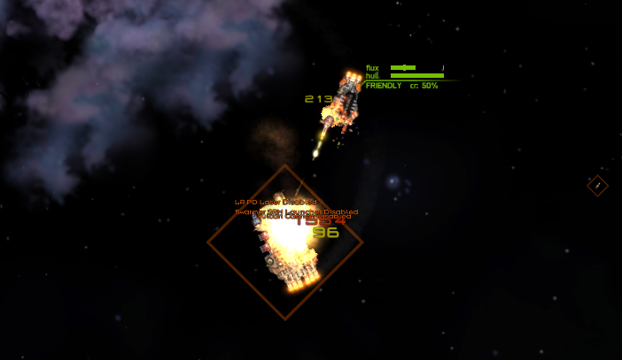

# 制作一艘相位舰

本节将引导您制作一艘相位舰船，即右键系统为 `PHASE` 类的舰船。

*本节预期阅读时间：~8 分钟。*

*本节预期操作时间：~10 分钟。*

## 学习目标

完成后，您将能够：

- 制作相位舰，并配置相位防御数据与两张相位光效贴图；
- 从可观察症状判断错误位于防御数据还是光效资源。

## 前置知识

- [C1-S2] 的舰船编辑器操作与普通舰船制作流程；
- [C1-S2] 的 `ship_data.csv` 登记规则；
- [C1-S2] 的 `Addship` 使用方法与 `starsector.log` 排错方法。

## 获取贴图

我们再次花费宝贵的 30 秒，糊出一张贴图：


## 命名并将贴图放入正确的位置

::: tip 位置建议

所有相位相关舰船都应该被放入 `phase` 文件夹，有助于后续维护。

:::



`锻件-级(Forging)` 相位护卫舰，ID 为 `GearIn_forging`。

## 制作相位舰船文件

**相位舰的舰船文件，与寻常舰船相比没有任何区别**。

**即使是相位舰，也必须设置合理的护盾范围**。


## 制作相位舰船的数据

天下数据一大抄。相信您已经能熟练地复制 `小精灵-级` 相位舰的数据，然后稍作修改：

```csv
name,id,designation,tech/manufacturer,system id,fleet pts,hitpoints,armor rating,max flux,8/6/5/4%,flux dissipation,ordnance points,fighter bays,max speed,acceleration,deceleration,max turn rate,turn acceleration,mass,shield type,defense id,shield arc,shield upkeep,shield efficiency,phase cost,phase upkeep,min crew,max crew,cargo,fuel,fuel/ly,range,max burn,base value,cr %/day,CR to deploy,peak CR sec,CR loss/sec,supplies/rec,supplies/mo,c/s,c/f,f/s,f/f,crew/s,crew/f,hints,tags,logistics n/a reason,codex variant id,rarity,breakProb,minPieces,maxPieces,travel drive,number
,,,,,,,,,,,,,,,,,,,,,,,,,,,,,,,,,,,,,,,,,,,,,,,,,,,,,
#Lasher,lasher,Frigate,Low Tech,ammofeed,5,1750,300,2100,1750,140,55,,120,110,90,60,90,200,FRONT,,210,0.4,1,,,25,50,40,25,1,25,10,9000,8,10,240,0.25,4,4,,,,,,,,"lowtech_bp, merc, ind",,,,0.4,2,2,,204
,,,,,,,,,,,,,,,,,,,,,,,,,,,,,,,,,,,,,,,,,,,,,,,,,,,,,
#Hammerhead,hammerhead,Destroyer,Midline,ammofeed,10,5000,500,4200,4167,250,95,,90,60,40,30,60,400,FRONT,,300,0.4,0.8,,,50,100,100,60,2,30,9,40000,5,12,360,0.25,10,10,,,,,,,,"midline_bp, merc, ind",,,,0.5,2,3,,300
,,,,,,,,,,,,,,,,,,,,,,,,,,,,,,,,,,,,,,,,,,,,,,,,,,,,,
#Eagle,eagle,Cruiser,Midline,maneuveringjets,14,8000,1000,11000,14000,700,155,,60,40,30,15,20,1200,FRONT,,270,0.4,0.8,,,150,250,150,100,3,33,8,100000,3,12,480,0.25,20,20,,,,,,,,"rare_bp, merc, ind",,,,0.5,2,3,,401
,,,,,,,,,,,,,,,,,,,,,,,,,,,,,,,,,,,,,,,,,,,,,,,,,,,,,
#Conquest,conquest,Battlecruiser,Midline,maneuveringjets,24,12000,1200,20000,30000,1200,315,,45,20,15,6,4,2500,OMNI,,90,0.4,1.4,,,400,500,300,300,10,30,8,300000,3,15,600,0.25,40,40,,,,,,,,"rare_bp, merc",,,,0.5,2,4,,503
,,,,,,,,,,,,,,,,,,,,,,,,,,,,,,,,,,,,,,,,,,,,,,,,,,,,

锻件,GearIn_forging,相位护卫舰,未知,ammofeed,6,2000,350,1200,2000,100,35,,90,120,90,45,90,200,PHASE,phasecloak,90,,,0.075,0.075,4,10,10,20,1,20,9,26000,10,20,180,0.25,6,6,,,,,,,PHASE,GearIn_bp,,,,0.5,2,2,,228

工匠,GearIn_artizan,驱逐舰,未知,ammofeed,10,5000,500,3800,4167,200,95,,80,60,40,30,60,400,FRONT,,300,0.4,0.8,,,50,100,100,60,2,30,9,40000,5,12,360,0.25,10,10,,,,,,,,"GearIn_bp",,,,0.5,2,3,,300
守炉人,GearIn_furnaceman,轻型航母,未知,targetingfeed,11,4500,400,3000,2813,225,75,2,75,50,30,25,25,450,FRONT,,300,0.4,0.8,,,90,150,40,40,2,20,9,52000,5,15,360,0.25,11,13,,,,,,,CARRIER,"GearIn_bp",,,,0.5,2,3,,318

```

在本例中，`锻件-级` 相位护卫舰全船上下只有一个中型实弹武器槽位，因此它将专注于疯狂的实弹火力。

为了加强手感，它的战术系统被替换为 `加速填弹器` 来在需要的时候提供超级输出，同时也弥补失去小型导弹的爆发不足。

不过为了让这个过程显得更加紧张刺激，它的幅能耗散被直接砍到 100，来让它必须斟酌何时使用突击链炮。

最后再略微抬升一些相位产生幅能，一艘相当有驾驶手感的相位船就做好了。

相位舰船的 `shield type` **必须填写 `PHASE`**，`defense id` 必须填写实际右键相位系统，例如原版 `phasecloak`。CSV 中的相位激活与维持幅能字段也必须填写。

该行的 `tags` 同样建议填写为 `GearIn_bp`。

## 设置相位光效贴图

**但上述准备还不够，此时进入游戏必然出现报错**。

**因为相位舰船还需要 2 个额外的光效贴图文件**，作为进入相位后的亮紫色/粉色尾迹。所幸粗糙贴图的处理一直都不是什么难事：


在明亮模式下看不到它们吗？

如果您不愿意切换黑暗模式，编者将帮您切换：



::: caution 光效贴图文件

光效贴图文件**必须**位于和相位舰船同一位置。

光效贴图文件的文件名**必须**是 `相位舰船的贴图文件名+_glow1` 和 `相位舰船的贴图文件名+_glow2`。

光效贴图文件**应当**是纯白色的，否则将出现影响观感的颜色异常。

:::

### 验证方案

1. 使用控制台命令 `Addship GearIn_forging` 获取该相位护卫舰。
2. 进入战斗部署它，右键进入/退出相位，确认外观为相位而非护盾，右键激活的是相位系统。

预期结果：

- 船体成功加载；
- 右键可进入/退出相位，出现亮紫粉色光效，与 `_glow1`/`_glow2` 贴图一致；
- 日志中没有 `GearIn_forging` 相关的错误。



## 故障分析

- 相位舰加载时报缺图：`_glow1`、`_glow2` 名称或目录错误；两张图必须与主贴图同目录并使用规定后缀。
- 相位舰加载时报系统缺失：`shield type` 与 `defense id` 写反；前者必须是 `PHASE`，后者必须是可用系统 ID。

## 总结

本节在普通舰船链的基础上完成了一种专用约束的完整流程：相位舰必须同时满足 CSV 防御字段与命名资源约定。

虽然相位舰给人一种非常酷炫的感觉，但它的本质和常规带盾舰船一样简单，甚至严格来说它还更那么不稳定一些。另外，相位舰船最好内置 `phasefield` 插件；内置船插的处理见 [C1-S6]。

## 建议参考项

- `data/hulls/ship_data.csv`(原版蓝本，本 MOD 同路径)：舰船数据表，相位舰行需填写 `PHASE`/`phasecloak` 与相位幅能字段。
- `data/shipsystems/phasecloak.system`(原版)：相位系统定义，`phaseHighlight`/`phaseDiffuse` 提供光效后缀 (`_glow1`/`_glow2`)。
- `Starsector/starsector-core/starsector.log`：游戏日志，排查加载错误与最终 ID 报错。
- `Starsector/mods/Console Commands/data/console/commands.csv`：`Addship` 控制台命令条目。
