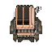
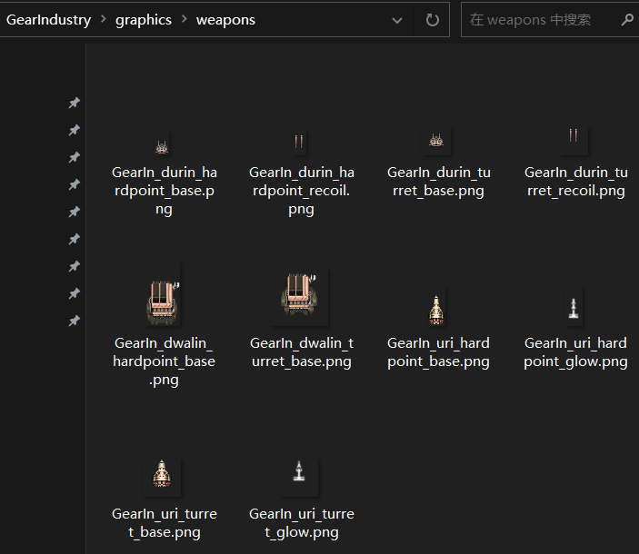
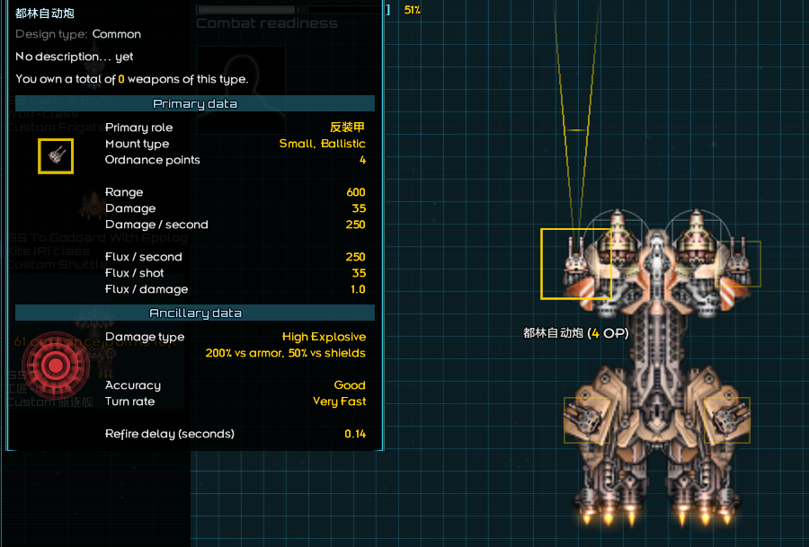
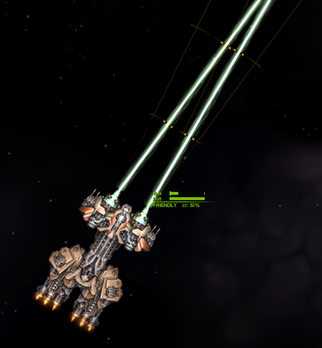
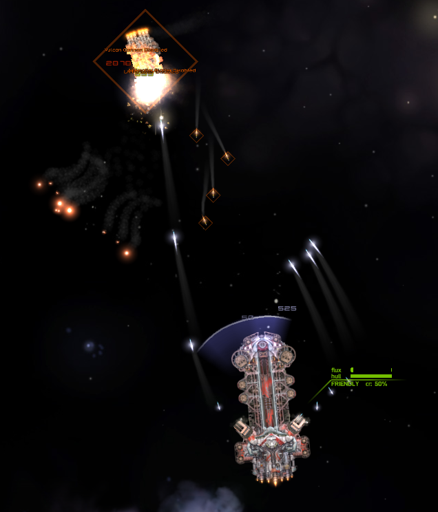
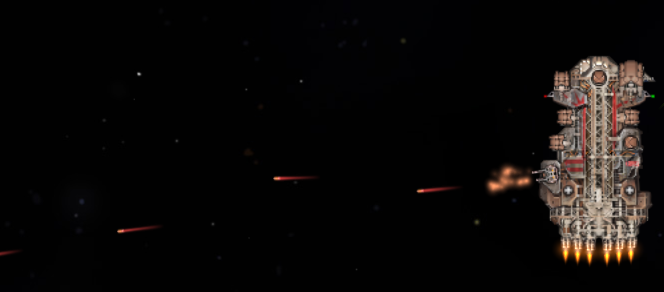
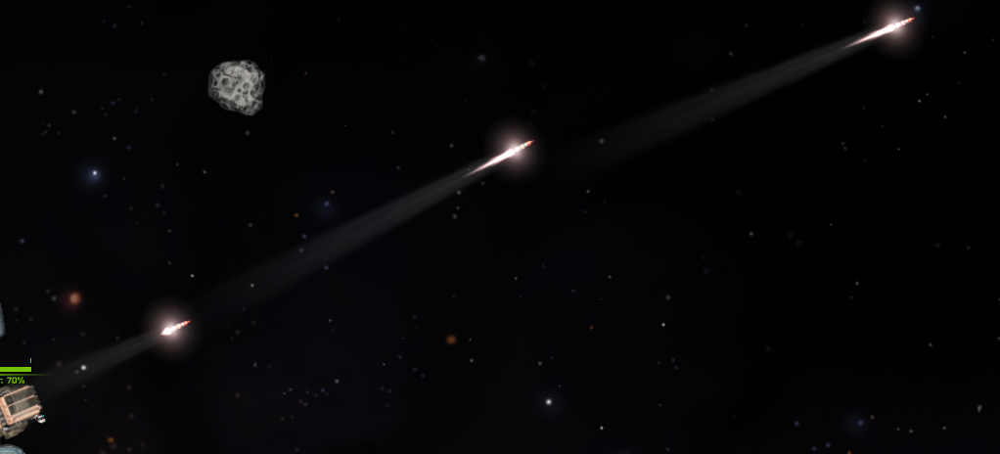

# 制作火炮、光束与导弹

本节将引导您制作远行星号常见的原版武器，包括两门射弹武器 (即，一门火炮武器和一门导弹武器)，和一门光束武器。除此之外，还包括射弹武器的实际弹体。本节将简单解析 `.wpn` 武器定义、`.proj` 弹体定义和 `data/weapons/weapon_data.csv` 文件。

*本节预期阅读时间：\~20 分钟。*

*本节预期操作时间：\~30 分钟。*

## 学习目标

完成后，您将能够：

- 制作一门射弹武器、一门光束武器与一门导弹武器，覆盖贴图准备、武器文件、数据行与弹体文件。
- 关联武器 ID、弹体 ID、资源路径与声音 ID，确认每项数据写入对应文件。
- 在装配界面与战斗中定位错误，判断问题出在 CSV、武器文件还是弹体文件。

## 前置知识

- [C1-S1] 的 MOD 目录、`gear_in` MOD ID 与 `GearIn_` 数据前缀；
- [C1-S2] 的舰船武器槽、装配界面与战斗验证方法；
- 理解 UTF-8 无 BOM 的含义，并能检查和修复格式错误的文本。

## 获取贴图

武器的贴图和舰船相比略有不同。

::: info 为什么炮塔与固定槽位需要两套贴图

**远行星号的武器表现形式根据槽位不同而分为 `炮塔` 和 `固定槽位`，它们各自需要一套贴图**。一般来说，`固定槽位` 的武器贴图比 `炮塔` 的更细更长。且 `炮塔` 武器的重心往往就在贴图中央，而 `固定槽位` 武器的重心则往往偏向于图片底部。

**而除了武器本身之外，还包括 `光效`、`炮管`、`底座` 这三个可选补充**。绝大多数武器至少有 `光效` 或 `炮管` 中的一种，而少数武器可能拥有两种，甚至全部三种。

:::

本例将制作一个小型带炮管射弹武器，一个中型带光效光束武器，与一个大型不带炮管也不带光效的导弹武器。

所以先准备它们的贴图：





耗时约 45 秒。

## 命名并将贴图放入正确的位置

**武器命名也有规范可言**。

武器的基础名称是 `MOD 前缀名 + 武器 ID`，例如本例中一个武器叫 `都林自动炮 (Durin)`，则它的 ID 应当为 `GearIn_durin`。以此类推，为所有武器命名并分配 ID。

而武器各个贴图则是在基础名称的基础上继续扩写。

首先扩写它是 `炮塔` 或 `固定插槽`：如果是 `炮塔` 则在后面加上 `_turret`，否则加上 `_hardpoint`。

然后扩写它的可选补充：如果是武器本身，则加上 `_base`；如果是炮管，则加上 `_recoil`；如果是光效，则加上 `_glow`；如果是底座，则加上 `_under`。

**听上去有些复杂，但是见过例子之后只需要不断地复制粘贴即可**。

最后，把这些武器放入 `graphics/weapons` 武器贴图文件夹内：



## 制作武器文件

制作武器文件也与制作舰船文件相比有所不同。**编者非常不推荐使用舰船编辑器的武器编辑模式，因为它相较而言难以上手、操作不便**。编者推荐寻找一门与目标武器类似的原版武器，然后复制粘贴修改。

### 制作火炮武器

编者设想的 `都林自动炮` 是一种发射高爆弹药的近距离速射武器，类似于 `轻型突击炮` 的低配版本。

直接进入原版储存武器文件的 `data/weapons` 文件夹内，将它的 `lightag.wpn` 复制到 MOD 中 `data/weapons` 文件夹内，文件名改为 `GearIn_durin.wpn`，然后准备修改：

```json
{
	"id":"lightag",  # this id must match what's in the spreadsheet
	"specClass":"projectile",
	"type":"BALLISTIC",
	"size":"SMALL",
	"displayArcRadius":400,
	"turretSprite":"graphics/weapons/light_assault_gun_turret_base.png",
	"turretGunSprite":"graphics/weapons/light_assault_gun_turret_recoil.png",
	"hardpointSprite":"graphics/weapons/light_assault_gun_hardpoint_base.png",
	"hardpointGunSprite":"graphics/weapons/light_assault_gun_hardpoint_recoil.png",
	"visualRecoil":5.0,  # the gun sprites are only used if this is non-0
	"renderHints":[RENDER_BARREL_BELOW],
	"turretOffsets":[10, 0],
	"turretAngleOffsets":[0],
	"hardpointOffsets":[15, 0],
	"hardpointAngleOffsets":[0],
	"barrelMode":"ALTERNATING", # or LINKED.  whether barrels fire at the same time or alternate.
	"animationType":"MUZZLE_FLASH",  # NONE, GLOW, MUZZLE_FLASH, SMOKE
	"muzzleFlashSpec":{"length":30.0,   # only used if animationType = MUZZLE_FLASH
					   "spread":16.0,
					   "particleSizeMin":8.0,
					   "particleSizeRange":10.0,
					   "particleDuration":0.35,
					   "particleCount":12,
					  "particleColor":[255,155,105,185]},
	"projectileSpecId":"lightag_shot",  # projectile that will be fired
	"fireSoundTwo":"light_assault_gun_fire",
}
```

### 火炮武器文件字段速查表

看似一大片英文，但实际上要改的条目不多。

| 英文 | 实际意义 |
|---|---|
| id | 武器的 ID |
| type | 武器的类型，在本例中表示这是 `实弹` 类型武器 |
| size | 武器的型号，在本例中表示这是 `小型` 武器 |
| `turretSprite`、`turretGunSprite`、`hardpointSprite`、`hardpointGunSprite` | 炮塔主体贴图、炮塔炮管贴图、固定槽位主体贴图、固定槽位炮管贴图，在本例中分别替换为前文贴图的路径 |
| visualRecoil | 炮管缩退距离 |
| renderHints | 武器渲染模式，本例中表示这门武器将炮管渲染在主体的下方 |
| `turretOffsets`、`turretAngleOffsets`、`hardpointOffsets`、`hardpointAngleOffsets` | 炮塔开火点、炮塔开火角度、固定槽位开火点、固定槽位开火角度。因为本例的武器是双管自动炮，所以需要进行对应调整 —— 每 2 个开火点数字表示 1 个坐标并对应 1 个开火角度数字。**开火点的坐标原点是武器的旋转枢轴：炮塔贴图的中心，固定槽位贴图底部约 1/4 高度处。第一个数字正/负沿炮口方向 (正数为朝炮口)，第二个数字正/负是贴图的左/右** |
| barrelMode | 炮管射击模式，在本例中为交替射击 |
| animationType、muzzleFlashSpec | 开火烟雾的视觉属性 |
| projectileSpecId | 武器所发射的弹体 ID |
| fireSoundTwo | 武器开火音效 |

**上表的内容并不完全**，在介绍完毕本章的三门武器之后，将重新总结一份速查表。

总而言之，只需要修改 `id`、各个 sprite、各个 offsets 和 angleOffsets 即可。由于目前没有弹体，`projectileSpecId` 会在更晚些时候才修改：

```json {2,7-10,13-16}
{
	"id":"GearIn_durin",  # this id must match what's in the spreadsheet
	"specClass":"projectile",
	"type":"BALLISTIC",
	"size":"SMALL",
	"displayArcRadius":400,
	"turretSprite":"graphics/weapons/GearIn_durin_turret_base.png",
	"turretGunSprite":"graphics/weapons/GearIn_durin_turret_recoil.png",
	"hardpointSprite":"graphics/weapons/GearIn_durin_hardpoint_base.png",
	"hardpointGunSprite":"graphics/weapons/GearIn_durin_hardpoint_recoil.png",
	"visualRecoil":5.0,  # the gun sprites are only used if this is non-0
	"renderHints":[RENDER_BARREL_BELOW],
	"turretOffsets":[15, 3, 15, -3],
	"turretAngleOffsets":[0, 0],
	"hardpointOffsets":[8, 3, 8, -3],
	"hardpointAngleOffsets":[0, 0],
	"barrelMode":"ALTERNATING", # or LINKED.  whether barrels fire at the same time or alternate.
	"animationType":"MUZZLE_FLASH",  # NONE, GLOW, MUZZLE_FLASH, SMOKE
	"muzzleFlashSpec":{"length":30.0,   # only used if animationType = MUZZLE_FLASH
					   "spread":16.0,
					   "particleSizeMin":8.0,
					   "particleSizeRange":10.0,
					   "particleDuration":0.35,
					   "particleCount":12,
					  "particleColor":[255,155,105,185]},
	"projectileSpecId":"lightag_shot",  # projectile that will be fired
	"fireSoundTwo":"light_assault_gun_fire",
}
```

### 制作光束武器

编者设想的 `乌里光束` 是一种造成远距离能量伤害的光束武器，类似于 `引力子束` 的能量版本。

直接将它的 `gravitonbeam.wpn` 复制到 MOD 中 `data/weapons` 文件夹内，文件名改为 `GearIn_uri.wpn`，然后准备修改：

```json
{
	"specClass":"beam",
	"id":"gravitonbeam",
	"type":"ENERGY",
	"size":"MEDIUM",
	"displayArcRadius":550,
	"turretSprite":"graphics/weapons/graviton_beam_turret_base.png",
	"turretGlowSprite":"graphics/weapons/graviton_beam_turret_glow.png",
	"hardpointSprite":"graphics/weapons/graviton_beam_hardpoint_base.png",
	"hardpointGlowSprite":"graphics/weapons/graviton_beam_hardpoint_glow.png",
	"turretOffsets":[15, 0],
	"turretAngleOffsets":[0],
	"hardpointOffsets":[23, 0],
	"hardpointAngleOffsets":[0],
	"fringeColor":[5,135,175,255],
	"coreColor":[200,225,255,255],
	"glowColor":[25,215,255,255],
	"width":20.0,
	"textureType":ROUGH,
	"textureScrollSpeed":260.0,
	"pixelsPerTexel":5.0,
	"pierceSet":[PROJECTILE_FF,PROJECTILE_NO_FF,PROJECTILE_FIGHTER,MISSILE_FF,MISSILE_NO_FF],
	#"fireSoundOne":"graviton_beam_intro",
	"fireSoundTwo":"graviton_beam_loop",
}
```

::: warning 复制原版武器文件时，先删去专属特效行

原文件在 `id` 之后还有一行 `beamEffect`，指向引力子束专属的特效类 (推开目标并干扰护盾)。乌里光束是普通光束，不需要这个效果，所以这一行直接删去。

:::

实际上要改的依然不多。

`id`、各个 sprite、各个 offsets 和 angleOffsets 都已经是上面见过一次的熟面孔了。所以接下来列出的是此前没有出现过的条目。

### 光束武器文件字段速查表

| 英文 | 实际意义 |
|---|---|
| turretGlowSprite、hardpointGlowSprite | 炮塔光效贴图、固定槽位光效贴图 |
| fringeColor | 光束边缘部分的颜色 |
| coreColor | 光束核心部分的颜色 |
| glowColor | 武器开火时光效贴图的颜色 |
| width | 光束宽度 |
| textureType、textureScrollSpeed、pixelsPerTexel | 光束的材质相关内容，相对较为进阶。作为初学者，只需要掌握 textureScrollSpeed 和 pixelsPerTexel 分别对应光束材质的滚动速度与拉伸程度即可 |
| pierceSet | 光束可以穿透的碰撞类型 |
| fireSoundTwo | 光束的持续时播放的循环音效 |

上表的内容依然并不完全。

总而言之，只需要修改 `id`、各个 sprite、各个 offsets 和 angleOffsets、以及光束的颜色即可，工作量依然极小：

```json {3,7-10,15,17}
{
	"specClass":"beam",
	"id":"GearIn_uri",
	"type":"ENERGY",
	"size":"MEDIUM",
	"displayArcRadius":550,
	"turretSprite":"graphics/weapons/GearIn_uri_turret_base.png",
	"turretGlowSprite":"graphics/weapons/GearIn_uri_turret_glow.png",
	"hardpointSprite":"graphics/weapons/GearIn_uri_hardpoint_base.png",
	"hardpointGlowSprite":"graphics/weapons/GearIn_uri_hardpoint_glow.png",
	"turretOffsets":[15, 0],
	"turretAngleOffsets":[0],
	"hardpointOffsets":[23, 0],
	"hardpointAngleOffsets":[0],
	"fringeColor":[135,175,135,255],
	"coreColor":[200,255,225,255],
	"glowColor":[25,255,215,255],
	"width":20.0,
	"textureType":ROUGH,
	"textureScrollSpeed":260.0,
	"pixelsPerTexel":5.0,
	"pierceSet":[PROJECTILE_FF,PROJECTILE_NO_FF,PROJECTILE_FIGHTER,MISSILE_FF,MISSILE_NO_FF],
	#"fireSoundOne":"graviton_beam_intro",
	"fireSoundTwo":"graviton_beam_loop",
}
```

### 制作导弹武器

编者设想的 `德瓦林 发射架` 是一种远距离持续发射高爆导弹的武器，类似于 `暴风 MLRS` 的高爆版本。

直接将它的 `squall.wpn` 复制到 MOD 中 `data/weapons` 文件夹内，文件名改为 `GearIn_dwalin.wpn`，然后准备修改：

```json
{
	"id":"squall",
	"specClass":"projectile",
	"type":"MISSILE",
	"size":"LARGE",
	"turretSprite":"graphics/weapons/squall_turret_base.png",
	"turretUnderSprite":"graphics/weapons/squall_turret_under.png",
	"hardpointSprite":"graphics/weapons/squall_hardpoint_base.png",
	"hardpointUnderSprite":"graphics/weapons/squall_hardpoint_under.png",
	"hardpointOffsets":[26, 9, 26, 5, 26, 1, 26, -3, 26, -7],
	"turretOffsets":[14, 8, 14, 4, 14, 0, 14, -4, 14, -8],
	#"hardpointAngleOffsets":[0, 0],
	#"turretAngleOffsets":[0, 0],
	"hardpointAngleOffsets":[0, 0, 0, 0, 0],
	"turretAngleOffsets":[0, 0, 0, 0, 0],
	"barrelMode":"ALTERNATING",
	"animationType":"SMOKE",
	"renderHints":[RENDER_LOADED_MISSILES],
	"interruptibleBurst":false,
	"smokeSpec":{"particleSizeMin":10.0,
							 "particleSizeRange":14.0,
							 "cloudParticleCount":3,
							 "cloudDuration":1.5,
							 "cloudRadius":12.0;
							 "blowbackParticleCount":3,
							 "blowbackDuration":0.45,
							 "blowbackLength":20.0,
							 "blowbackSpread":6.0,
							 "particleColor":[190,180,160,95]},
	"projectileSpecId":"squall_rocket",
	"fireSoundTwo":"squall_fire",
}
```

这次已经几乎完全没有生面孔了。仅有未出现的 `turretUnderSprite` 和 `hardpointUnderSprite` 是底座贴图，而本武器没有底座，所以在修改时直接删去即可：

```json {2,6,8,10,11,14,15}
{
	"id":"GearIn_dwalin",
	"specClass":"projectile",
	"type":"MISSILE",
	"size":"LARGE",
	"turretSprite":"graphics/weapons/GearIn_dwalin_turret_base.png",

	"hardpointSprite":"graphics/weapons/GearIn_dwalin_hardpoint_base.png",

	"hardpointOffsets":[26, 7, 26, -1],
	"turretOffsets":[14, 6, 14, -2],
	#"hardpointAngleOffsets":[0, 0],
	#"turretAngleOffsets":[0, 0],
	"hardpointAngleOffsets":[0, 0],
	"turretAngleOffsets":[0, 0],
	"barrelMode":"ALTERNATING",
	"animationType":"SMOKE",
	"renderHints":[RENDER_LOADED_MISSILES],
	"interruptibleBurst":false,
	"smokeSpec":{"particleSizeMin":10.0,
							 "particleSizeRange":14.0,
							 "cloudParticleCount":3,
							 "cloudDuration":1.5,
							 "cloudRadius":12.0,
							 "blowbackParticleCount":3,
							 "blowbackDuration":0.45,
							 "blowbackLength":20.0,
							 "blowbackSpread":6.0,
							 "particleColor":[190,180,160,95]},
	"projectileSpecId":"squall_rocket",
	"fireSoundTwo":"squall_fire",
}
```

### .wpn 武器文件速查表

| 英文 | 实际意义 |
|---|---|
| id | 武器的 ID |
| specClass | 武器发射弹体亦或是光束，弹体为 `projectile`，光束为 `beam`。导弹也是弹体的一种，因此也是 `projectile` |
| beamEffect | 光束本身的每帧特效路径，仅对光束武器有效 |
| type | 武器的类型。可开火的武器类型只有 `BALLISTIC`、`ENERGY`、`MISSILE`；原版还用 `DECORATIVE` 制作纯装饰物 (不能开火)，其余类型不要用于武器文件 |
| size | 武器的型号，可以是 `SMALL`、`MEDIUM` 或 `LARGE` |
| everyFrameEffect | 武器的每帧特效代码路径 |
| 各类 sprite | 武器在 `炮塔`、`固定槽位` 模式下的各类组件贴图，部分可适当留空 |
| visualRecoil | 炮管缩退距离，大于 0 时才会加载炮管数据 |
| fringeColor | 光束边缘部分的颜色，仅对光束武器有效 |
| coreColor | 光束核心部分的颜色，仅对光束武器有效 |
| glowColor | 武器开火时光效贴图的颜色 |
| width | 光束宽度，仅对光束武器有效 |
| renderHints | 武器渲染模式，可以是 `RENDER_BARREL_BELOW`、`RENDER_LOADED_MISSILES`、`RENDER_LOADED_MISSILES_UNLESS_HIDDEN`、`RENDER_ADDITIVE`、`SUSPEND_RECOIL`、`NEVER_RENDER_IN_CAMPAIGN` 中有逻辑的排列组合，分别是将炮管渲染在主体底部、渲染导弹、非隐藏槽位时渲染导弹、以叠加模式渲染、炮管默认不移动、生涯界面中不渲染 |
| 各类 offsets 和 angleOffsets | 与 `turretOffsets` / `hardpointOffsets` 一行相同：坐标原点、正负方向与调整 |
| barrelMode | 炮管射击模式，可以是 `LINKED`、`ALTERNATING`、`ALTERNATING_BURST` 或 `DUAL`，分别是齐射、轮流发射、每炮管波次发射、每次发射 2 发 |
| autocharge | 设为 true 时，按下左键即可自动完成前摇，否则必须按住左键直到前摇完成为止。仅对非光束武器有效 |
| beamFireOnlyOnFullCharge | 设为 true 时，光束在渐入阶段不会产生光束也不会造成伤害。仅对光束武器有效 |
| darkCore | 当光束核心颜色为暗色时，将此项设为 true 将表现地更暗。仅对光束武器有效 |
| animationType | 武器开火时产生的额外特效，可以是 `NONE`、`GLOW`、`MUZZLE_FLASH`、`GLOW_AND_FLASH` 或 `SMOKE`，分别是无特效、流动渲染光效贴图、产生炮口集束粒子、流动渲染光效贴图且产生炮口集束粒子、产生烟雾 |
| muzzleFlashSpec | 内容过多，自行百度翻译 |
| projectileSpecId | 武器所发射的弹体 ID，仅对非光束武器有效 |
| textureType | 光束材质预设或光束材质路径，仅对光束武器有效 |
| textureScrollSpeed | 光束材质的滚动速率，仅对光束武器有效 |
| pixelsPerTexel | 光束材质的拉伸程度，仅对光束武器有效 |
| pierceSet | 光束可以穿透的碰撞类型，仅对光束武器有效 |
| fireSoundOne | 武器开火前摇 (chargeup) 时播放一次的音效；对光束武器是光束渐入时的一次性音效 (如 `graviton_beam_intro`) |
| fireSoundTwo | 武器开火音效；对光束武器是持续播放的循环音效 (如 `graviton_beam_loop`) |

## 制作武器数据

**能复制粘贴就绝不硬写。**

### 制作火炮武器数据

将 `轻型突击炮` 的数据复制到 MOD 中 `weapon_data.csv` 内，然后修改：

```csv {2}
name,id,tier,rarity,base value,range,damage/second,damage/shot,emp,impact,turn rate,OPs,ammo,ammo/sec,reload size,type,energy/shot,energy/second,chargeup,chargedown,burst size,burst delay,min spread,max spread,spread/shot,spread decay/sec,beam speed,proj speed,launch speed,flight time,proj hitpoints,autofireAccBonus,extraArcForAI,hints,tags,groupTag,tech/manufacturer,for weapon tooltip>>,primaryRoleStr,speedStr,trackingStr,turnRateStr,accuracyStr,customPrimary,customPrimaryHL,customAncillary,customAncillaryHL,noDPSInTooltip,number
都林自动炮,GearIn_durin,1,,300,600,,35,,3,40,4,,,,HIGH_EXPLOSIVE,35,,0,0.14,1,,0,5,1,5,,800,,,30,,,,"he6, lowtech_bp, GearIn_bp",,,,反装甲,,,,,,,,,,3
```

**一门武器最重要的特征同样是要有趣**。

在本例中，`都林自动炮` 作为 `轻型突击炮` 的低配版本，拥有更低的基础射程和更低的装配消耗。

但仅仅如此是无法抵消它 100 射程削弱带来的劣势，所以为它提供了极强的射速增益。

射速增益似乎让它加强过头了，所以再次降低单发伤害与幅能产生，来让这门武器变成绝佳的近距离泼水炮，低 DPH 让它不会造成高到过分的伤害。

### 制作光束武器数据

将 `引力子束` 的数据复制到 MOD 中 `weapon_data.csv` 内，然后修改：

```csv {3}
name,id,tier,rarity,base value,range,damage/second,damage/shot,emp,impact,turn rate,OPs,ammo,ammo/sec,reload size,type,energy/shot,energy/second,chargeup,chargedown,burst size,burst delay,min spread,max spread,spread/shot,spread decay/sec,beam speed,proj speed,launch speed,flight time,proj hitpoints,autofireAccBonus,extraArcForAI,hints,tags,groupTag,tech/manufacturer,for weapon tooltip>>,primaryRoleStr,speedStr,trackingStr,turnRateStr,accuracyStr,customPrimary,customPrimaryHL,customAncillary,customAncillaryHL,noDPSInTooltip,number
都林自动炮,GearIn_durin,1,,300,600,,35,,3,40,4,,,,HIGH_EXPLOSIVE,35,,0,0.14,1,,0,5,1,5,,800,,,30,,,,"he6, lowtech_bp, GearIn_bp",,,,反装甲,,,,,,,,,,3
乌里光束,GearIn_uri,2,,1500,1000,175,,,,15,9,,,,ENERGY,,200,0.1,0.1,,,,,,,2400,,,,,,,,"beam12, energy11, LR, GearIn_bp",,,,压制,,,,,,,,,,21
```

在本例中，`乌里光束` 作为 `引力子束` 的另一个版本，事实上更像两门绑在一起的 `战术激光炮`。

它的装配点让它足以支持两倍的 DPS，不过编者打算进一步提高一些，然后用稍高的幅能产生作为相应的代价。

最后删除它 `impact` 里的数据和额外描述。

### 制作导弹武器数据

将 `暴风 MLRS` 的数据复制到 MOD 中 `weapon_data.csv` 内，然后修改：

```csv {4}
name,id,tier,rarity,base value,range,damage/second,damage/shot,emp,impact,turn rate,OPs,ammo,ammo/sec,reload size,type,energy/shot,energy/second,chargeup,chargedown,burst size,burst delay,min spread,max spread,spread/shot,spread decay/sec,beam speed,proj speed,launch speed,flight time,proj hitpoints,autofireAccBonus,extraArcForAI,hints,tags,groupTag,tech/manufacturer,for weapon tooltip>>,primaryRoleStr,speedStr,trackingStr,turnRateStr,accuracyStr,customPrimary,customPrimaryHL,customAncillary,customAncillaryHL,noDPSInTooltip,number
都林自动炮,GearIn_durin,1,,300,600,,35,,3,40,4,,,,HIGH_EXPLOSIVE,35,,0,0.14,1,,0,5,1,5,,800,,,30,,,,"he6, lowtech_bp, GearIn_bp",,,,反装甲,,,,,,,,,,3
乌里光束,GearIn_uri,2,,1500,1000,175,,,,15,9,,,,ENERGY,,200,0.1,0.1,,,,,,,2400,,,,,,,,"beam12, energy11, LR, GearIn_bp",,,,压制,,,,,,,,,,21
德瓦林 发射架,GearIn_dwalin,2,,4000,2500,,600,,15,20,20,100,,,HIGH_EXPLOSIVE,0,,0,10,10,0.5,0,0,0,0,,600,100,4.75,300,,,"DO_NOT_AIM, CONSERVE_3, STRIKE, USE_VS_FRIGATES, MISSILE_SPREAD","missile19, strike15, GearIn_bp",,,,压制,非常快,特殊,,,瞄准后失去制导能力。,,,,,16.2
```

因为需要在发射次数与总效果之间考虑，所以大型导弹并不那么好设计，要设计得有趣就更难了。

在本例中，`德瓦林 发射架` 作为高爆 `暴风`，需要提高 DPH 来取得对装甲的有效打击效果，然后降低一些单波次发射量和总备弹量来与修改过的贴图匹配。

EMP 保持留空 (原版暴风的 EMP 本就为空)，这有助于提高设计的**纯粹性**。

::: tip 提前准备

将新武器的 `tag` 中不希望保留的原版蓝图 tag(如 `midline_bp`) 替换为 `前缀名_bp`，在本例中为 `GearIn_bp`；仍然希望保留的原版蓝图来源 (如 `lowtech_bp`) 可以留下。日后将会有用。

除非它是您不希望大量出现的武器或它是内置武器 —— 在这种情况下，您可以将 `tag` 中的内容清空。

:::

### weapon\_data.csv 武器数据速查表

**不在本表上的数据均为无意义数据 (如 for weapon tooltip>>) 或不重要数据 (如 number)。**

| 英文 | 实际意义 |
|---|---|
| name | 武器名称 |
| id | 武器 ID |
| tier | 科技等级，正常范围是 0\~3，大于 3 将导致不会市场上正常出现。科技等级越大则越稀有且购买所需关系越高。|
| rarity | 稀有度，数字越小越罕见，作为抽选权重，≤0 将导致不出现 |
| base value | 武器的成本价 |
| range | 对于非导弹武器而言是武器的射程，对于导弹武器而言是 AI 理解中的武器射程 |
| damage/second | 每秒伤害，仅对光束武器有效 |
| damage/shot | 单发伤害，仅对非光束武器有效 |
| emp | 对于非光束武器而言是单发 EMP，对于光束武器而言是每秒 EMP |
| impact | 对于非光束武器而言几乎无作用，对于光束武器而言是可以偏转、固定目标的偏转力 |
| turn rate | 武器转速，单位是度/秒 |
| OPs | 装配点数需求 |
| ammo | 弹药限制，留空则为无限弹药 |
| ammo/sec | 每秒弹药恢复量，留空则为无法恢复弹药 |
| reload size | 每秒弹药恢复量不为空时，每波次恢复多少枚弹药 |
| type | 伤害类型，可以是 `KINETIC`、`ENERGY`、`HIGH_EXPLOSIVE` 或 `FRAGMENTATION`，分别是动能、能量、高爆和破片。还可以是 `OTHER` 但极度不建议使用 |
| energy/shot | 每发产生幅能，仅对非光束武器有效 |
| energy/second | 每秒产生幅能；不建议在非光束武器中使用 |
| chargeup | 对于非光束武器而言是开火前摇，对于光束武器而言是光束从不存在渐入为存在的时间 |
| chargedown | 对于非光束武器而言是开火后摇，对于光束武器而言是光束从存在渐出为不存在的时间 |
| burst size | 对于非光束武器而言是每波发射弹数，对于光束武器而言，填写了此数据后武器变为爆发光束，是爆发光束的爆发时长 |
| burst delay | 对于非光束武器而言是波内每发射弹的间隔时间，对于光束武器而言，填写了此数据后武器变为爆发光束，是爆发光束的冷却时长 |
| min spread | 最小弹道散布，单位是度，仅对非光束武器有效 |
| max spread | 最大弹道散布，单位是度，仅对非光束武器有效 |
| spread/shot | 每发射一次所导致的弹道散布增加量，单位是度，仅对非光束武器有效 |
| spread decay/sec | 武器停火时弹道散布的衰减，单位是度/秒，仅对非光束武器有效 |
| beam speed | 光束飞行速率，仅对光束武器有效 |
| proj speed | 弹体飞行速率或导弹最大速率，仅对非光束武器有效 |
| launch speed | 导弹初速，仅对导弹武器有效 |
| flight time | 导弹飞行时间，仅对导弹武器有效。导弹武器的真实射程是导弹速度 \* 导弹飞行时间，而不是前文的 `range` |
| proj hitpoints | 弹体血量，仅对非光束武器有效，且仅对导弹武器有实际作用 |
| autofireAccBonus | 自动开火的精确度补正，非常建议为空 |
| extraArcForAI | 开火判断 AI 的角度补正，非常建议为空 |
| hints | 进阶内容，常用写法见本页的武器 Hints 速查表 |
| tags | 进阶内容，常用写法见本页的武器 tags 速查表 |
| groupTag | 如果本项不为空，则本项相同的武器将优先编入同一组，且优先在本组不编入其它武器 |
| tech/manufacturer | 科技类型，原版包括诸如低端科技、中线科技等，可随意填写 |
| primaryRoleStr | 武器类型，文字描述 |
| speedStr | 导弹飞行速度，文字描述，非导弹武器建议留空 |
| trackingStr | 导弹跟踪能力，文字描述，非导弹武器建议留空 |
| turnRateStr | 武器转速速度，文字描述，无特别要求建议留空 |
| accuracyStr | 武器精准度，文字描述，无特别要求建议留空 |
| customPrimary | 首要说明文本，在相对上方的框内 |
| customPrimaryHL | 首要说明文本的高亮部分，多个高亮文本用 `\|` 分隔 |
| customAncillary | 次要说明文本，在相对下方的框内 |
| customAncillaryHL | 次要说明文本的高亮部分，多个高亮文本用 `\|` 分隔 |
| noDPSInTooltip | 设为 true 时，武器数据界面不会显示 DPS，仅适合不可恢复弹药且弹药量较少的武器 |

## 验证方案

前置数据：`gear_in` MOD[C1-S1] 与测试舰船 ([C1-S2] 或任意原版舰船)。

1. 使用控制台的 `Addweapon [您的武器 ID]` 获取三门武器，或在各类战役里使用它们。
2. 为新船安装新的武器。
3. 分别验证持续射击、停止射击、过载目标、耗尽弹药与导弹被拦截。

预期结果：

- 装配面板数值与 `weapon_data.csv` 一致。
- 开火表现与 `.wpn`/`.proj` 一致。
- `starsector.log` 中三个 GearIn ID 均无加载或运行时错误。







## 新弹体与新导弹

在拥有了新武器之后，您可能会对某些射弹武器依然使用原版弹体这一事实并不满意。套用原版弹体虽然简单，但这意味着它的大小、颜色等并不够自定义。

### 制作非导弹弹体

**能复制粘贴就绝不硬写。**

编者认为 `都林自动炮` 的弹体颜色应当设定为红色，但其它方面不会和 `轻型突击炮` 的弹体相比有太多差距。

将 `lightag_shot.proj` 复制到 `data/weapons/proj` 这个弹体目录下，然后将文件名改为 `GearIn_durin_shot.proj`，准备修改：

```json
{
	"id":"lightag_shot",
	"specClass":"projectile",
	"spawnType":"BALLISTIC",
	"collisionClass":"PROJECTILE_FF",
	"collisionClassByFighter":"PROJECTILE_FIGHTER",
	"length":30.0,
	"hitGlowRadius":40,
	"width":5.0,
	"fadeTime":0.2,
	#"fringeColor":[255,125,125,255],
	#"coreColor":[255,200,200,150],
	"fringeColor":[255,200,70,235],
	"coreColor":[255,200,200,180],
	"textureScrollSpeed":64.0,
	"pixelsPerTexel":5.0,
	"bulletSprite":"graphics/missiles/shell_large_yellow.png"
}
```

### .proj 非导弹弹体速查表

| 英文 | 实际意义 |
|---|---|
| id | 弹体的 ID |
| specClass | 弹体类型，`projectile` 是正常射弹，`missile` 是导弹。导弹、鱼雷、惯性炸弹都算 `missile` |
| spawnType | 生成类型；`projectile` 可用 `BALLISTIC`、`BALLISTIC_AS_BEAM`、`PLASMA`、`BEAM`、`MISSILE`、`OTHER`。原版等离子炮即用 `PLASMA` |
| onHitEffect | 弹体的命中特效代码路径，不填默认为无特效 |
| onFireEffect | 弹体的开火特效代码路径，不填默认为无特效 |
| collisionClass | 弹体的碰撞类型。`BALLISTIC` 类型的弹体用 `PROJECTILE_FF`(能命中包括友方在内的舰船，有友伤) 或 `PROJECTILE_NO_FF`(只命中敌方，无友伤)。`BALLISTIC_AS_BEAM` 类型的弹体用 `RAY`(能命中包括友方在内的舰船) 或 `RAY_FIGHTER`(只命中敌方舰船与战机)。全部碰撞类型：`NONE`、`RAY`、`RAY_FIGHTER`、`FIGHTER`、`SHIP`、`PROJECTILE_NO_FF`、`PROJECTILE_FF`、`MISSILE_NO_FF`、`MISSILE_FF`、`HITS_SHIPS_AND_ASTEROIDS`、`HITS_SHIPS_ONLY_FF`、`HITS_SHIPS_ONLY_NO_FF`、`PROJECTILE_FIGHTER`、`ASTEROID`、`PLANET`、`GAS_CLOUD`、`STAR`(后几类用于实体，弹体不会用到) |
| collisionClassByFighter | 若这个弹体是由战机发射的，则它使用这个碰撞类型。一般来说根据类型而分别使用 `PROJECTILE_FIGHTER` 或 `RAY_FIGHTER` 来与舰船发射的弹体做区分 |
| length | 弹体长度 |
| width | 弹体宽度 |
| hitGlowRadius | 弹体命中时的光效范围 |
| glowRadius | 弹体飞行时的光效范围，在本例中不填，默认为 0 |
| coreColor | 弹体核心部分的颜色 |
| fringeColor | 弹体边缘部分的颜色 |
| glowColor | 弹体光效颜色 |
| bulletSprite | 弹体贴图位置 |
| textureType | 弹体材质，默认为 SMOOTH |
| textureScrollSpeed | 弹体材质滚动速率 |
| pixelsPerTexel | 弹体材质拉伸程度 |
| behaviorSpec | 弹体的行为设置，一般来说用来制作高射炮型溅射 |

据此修改它的弹体 ID 和颜色：

```json {2,13,14}
{
	"id":"GearIn_durin_shot",
	"specClass":"projectile",
	"spawnType":"BALLISTIC",
	"collisionClass":"PROJECTILE_FF",
	"collisionClassByFighter":"PROJECTILE_FIGHTER",
	"length":30.0,
	"hitGlowRadius":40,
	"width":5.0,
	"fadeTime":0.2,
	#"fringeColor":[255,125,125,255],
	#"coreColor":[255,200,200,150],
	"fringeColor":[255,70,70,235],
	"coreColor":[255,200,200,180],
	"textureScrollSpeed":64.0,
	"pixelsPerTexel":5.0,
	"bulletSprite":"graphics/missiles/shell_large_yellow.png"
}
```

::: tip 颜色和伤害类型

在原版里，弹体的颜色和伤害类型一般来说具有相关性。能量伤害的弹体一般来说是蓝色系的，动能伤害的弹体一般来说是黄色系的，高爆伤害的弹体一般来说是红色系的。例外存在，但较少。

:::

然后在此前的 `GearIn_durin.wpn` 里调用它：

```json {26}
{
	"id":"GearIn_durin",  # this id must match what's in the spreadsheet
	"specClass":"projectile",
	"type":"BALLISTIC",
	"size":"SMALL",
	"displayArcRadius":400,
	"turretSprite":"graphics/weapons/GearIn_durin_turret_base.png",
	"turretGunSprite":"graphics/weapons/GearIn_durin_turret_recoil.png",
	"hardpointSprite":"graphics/weapons/GearIn_durin_hardpoint_base.png",
	"hardpointGunSprite":"graphics/weapons/GearIn_durin_hardpoint_recoil.png",
	"visualRecoil":5.0,  # the gun sprites are only used if this is non-0
	"renderHints":[RENDER_BARREL_BELOW],
	"turretOffsets":[15, 3, 15, -3],
	"turretAngleOffsets":[0, 0],
	"hardpointOffsets":[8, 3, 8, -3],
	"hardpointAngleOffsets":[0, 0],
	"barrelMode":"ALTERNATING", # or LINKED.  whether barrels fire at the same time or alternate.
	"animationType":"MUZZLE_FLASH",  # NONE, GLOW, MUZZLE_FLASH, SMOKE
	"muzzleFlashSpec":{"length":30.0,   # only used if animationType = MUZZLE_FLASH
					   "spread":16.0,
					   "particleSizeMin":8.0,
					   "particleSizeRange":10.0,
					   "particleDuration":0.35,
					   "particleCount":12,
					  "particleColor":[255,155,105,185]},
	"projectileSpecId":"GearIn_durin_shot",  # projectile that will be fired
	"fireSoundTwo":"light_assault_gun_fire",
}
```



其它简单调整也是如此。

### 制作导弹弹体

**能复制粘贴就绝不硬写。**

::: caution 务必为新导弹武器制作新导弹弹体

CSV 的导弹行会直接修改它引用的弹体 spec：当原版 `暴风 MLRS` 和您的 `德瓦林 发射架` 都引用同一个 `squall_rocket` 弹体时，两个武器行都会往同一个弹体 spec 写入 `flight time`、`proj hitpoints` 等数值。

后加载的 MOD 行会把原版行的设定覆盖掉，导致两个武器的射程、血量互相污染，表现与装配面板不一致。

为避免意料之外的 BUG，请务必为新导弹武器制作新导弹弹体。

:::

编者认为 `德瓦林 发射架` 的弹体过小，且颜色并不合适，但其它方面不会和 `暴风 MLRS` 的弹体相比有太多差距。

将 `squall_rocket.proj` 复制到 `data/weapons/proj` 这个弹体目录下，然后将文件名改为 `GearIn_dwalin_rocket.proj`，开始修改：

```json
{
	"id":"squall_rocket",
	"specClass":"missile",
	#"missileType":"ROCKET",
	"missileType":"MISSILE_TWO_STAGE_SECOND_UNGUIDED",
	"sprite":"graphics/missiles/missile_squall.png",
	"size":[6,20],
	"center":[3,10],
	"collisionRadius":15,
	"collisionClass":"MISSILE_NO_FF",
	"explosionColor":[200,200,255,235],  # purely visual, will get a white additively blended core on top of this color
	"explosionRadius":85, # purely visual
	"flameoutTime":1, # total time from flameout to full fadeout
	"noEngineGlowTime":0.5, # time spent without the engine glow being rendered
	"fadeTime":0.5, # fadeout duration
	"engineSpec":{"turnAcc":360,
				  "turnRate":180,
				  "acc":1000,
				  "dec":0},
	"engineSlots":[{"id":"ES1",
					"loc":[-9, 0],
				    "style":"CUSTOM",
					"styleSpec":{
						"mode":"QUAD_STRIP", # PARTICLES or QUAD_STRIP, determines which params are used
						"engineColor":[200,200,255,255],
						"contrailDuration":.5,
						"contrailWidthMult":2,
						"contrailWidthAddedFractionAtEnd":2,  # can be negative. makes trail spread out/narrow at the end
						"contrailMinSeg":5, # min segment length, in pixels
						"contrailMaxSpeedMult":.0f,
						"contrailAngularVelocityMult":0.5f,
						"contrailSpawnDistMult":0f, # how far away from engine it starts
						"contrailColor":[75,75,75,150],
						"type":"SMOKE" # GLOW or SMOKE; additive or regular blend mode
					},
				    "width":8.0,
				    "length":50.0,
				    "angle":180.0}]
}
```

::: warning 复制原版弹体文件时，先删去专属特效行

原文件在 `missileType` 之后还有一行 `onFireEffect`，指向暴风专属的开火特效类。德瓦林的导弹不需要它，所以这一行直接删去。

:::

### .proj 导弹弹体速查表

**不在本表上的数据均为上文提及过且无歧义的数据。**

| 英文 | 实际意义 |
|---|---|
| missileType | 导弹类型，常见的导弹类型有 `MISSILE`、`ROCKET`、`BOMB`、`HEATSEEKER`、`MIRV`、`PHASE_CHARGE`、`PHASE_MINE`、`MISSILE_TWO_STAGE_SECOND_UNGUIDED` 和 `MOTE`。此外存在一些罕见的类型，比如耀斑。需要时自行寻找并复制 |
| sprite | 导弹贴图。注意，非导弹的 `bulletSprite` 在此处不起效 |
| size | 导弹的大小，前一个数字为宽，后一个为高。如果和贴图大小不同则会进行拉伸 |
| center | 导弹的中心位置，影响碰撞判定，数值一般各设置为导弹大小的一半 |
| collisionRadius | 导弹的碰撞圈大小，与舰船的 `黄圈` 性质相同 |
| collisionClass | 导弹的碰撞类型，除去某些不合理的设置之外，可以是 `MISSILE_FF` 或 `MISSILE_NO_FF`，前者有友伤，后者没有。|
| explosionColor | 导弹爆炸产生的光效颜色 |
| explosionRadius | 导弹爆炸产生的光效大小，不影响伤害溅射范围 |
| explosionSpec | 导弹爆炸的溅射伤害设置。不填默认为无伤害溅射 |
| armingTime | 导弹的引信时间，在引信时间到达之前不会爆炸。不填默认为 0 |
| flameoutTime | 导弹的飞行时间耗尽 (超出射程) 后，从引擎熄火到完全淡出消失的总时长。熄火后导弹仍凭惯性飞行，且仍能碰撞并造成伤害 |
| noEngineGlowTime | 熄火淡出阶段的末尾，引擎光效停止渲染的时间段；只影响视觉，与伤害无关 |
| fadeTime | 熄火淡出阶段的末尾淡出 (贴图渐隐) 时长；若 `noCollisionWhileFading` 为 true，淡出期间不再有碰撞判定 |
| useHitGlowWhenDestroyed | 如果设为 true，则导弹自爆或被拦截时不会产生导弹型爆炸特效，而是产生非导弹型命中光效。不填默认为否 |
| noDebrisWhenDestroyed | 如果设为 true，则导弹自爆或被拦截时不会产生残骸碎片。不填默认为否 |
| useHitGlowWhenDealingDamage | 若弹体没有 `explosionSpec`，命中造成伤害时产生命中光效；设为 false 则命中时没有任何爆炸/光效特效。不填默认为是 (true) |
| noCollisionWhileFading | 如果设为 true，则引擎熄火后不再有撞击判定。不填默认为否 |
| renderTargetIndicator | 如果设为 false，则导弹被敌方发射时下方不会出现红色棱形指示标。不填默认为是 |
| engineSpec | 导弹的机动性设置，在本例顺序分别是 `转向加速度`、`最大转向速度`、`加速度` 和 `减速度` |
| engineSlots | 导弹的引擎设置，一个导弹可以有多个引擎，它们的 `id` 必须不同。引擎的 `styleSpec` 属性与 [C4-S3] 的引擎风格相关。|

据此修改它的弹体 ID、贴图和爆炸颜色等属性：

```json {2,6,11}
{
	"id":"GearIn_dwalin_rocket",
	"specClass":"missile",
	#"missileType":"ROCKET",
	"missileType":"MISSILE_TWO_STAGE_SECOND_UNGUIDED",
	"sprite":"graphics/missiles/GearIn_dwalin_rocket.png",
	"size":[6,20],
	"center":[3,10],
	"collisionRadius":15,
	"collisionClass":"MISSILE_NO_FF",
	"explosionColor":[255,200,200,235],  # purely visual, will get a white additively blended core on top of this color
	"explosionRadius":85, # purely visual
	"flameoutTime":1, # total time from flameout to full fadeout
	"noEngineGlowTime":0.5, # time spent without the engine glow being rendered
	"fadeTime":0.5, # fadeout duration
	"engineSpec":{"turnAcc":360,
				  "turnRate":180,
				  "acc":1000,
				  "dec":0},
	"engineSlots":[{"id":"ES1",
					"loc":[-9, 0],
				    "style":"CUSTOM",
					"styleSpec":{
						"mode":"QUAD_STRIP", # PARTICLES or QUAD_STRIP, determines which params are used
						"engineColor":[255,200,200,255],
						"contrailDuration":.5,
						"contrailWidthMult":2,
						"contrailWidthAddedFractionAtEnd":2,  # can be negative. makes trail spread out/narrow at the end
						"contrailMinSeg":5, # min segment length, in pixels
						"contrailMaxSpeedMult":.0f,
						"contrailAngularVelocityMult":0.5f,
						"contrailSpawnDistMult":0f, # how far away from engine it starts
						"contrailColor":[75,75,75,150],
						"type":"SMOKE" # GLOW or SMOKE; additive or regular blend mode
					},
				    "width":8.0,
				    "length":50.0,
				    "angle":180.0}]
}
```

临时赶工做一份导弹弹体图片：


然后把它放入 `graphics/missiles` 目录，这个目录约定俗成用来存放各类弹体。

然后在此前的 `GearIn_dwalin.wpn` 里调用它：

```json {30}
{
	"id":"GearIn_dwalin",
	"specClass":"projectile",
	"type":"MISSILE",
	"size":"LARGE",
	"turretSprite":"graphics/weapons/GearIn_dwalin_turret_base.png",

	"hardpointSprite":"graphics/weapons/GearIn_dwalin_hardpoint_base.png",

	"hardpointOffsets":[26, 7, 26, -1],
	"turretOffsets":[14, 6, 14, -2],
	#"hardpointAngleOffsets":[0, 0],
	#"turretAngleOffsets":[0, 0],
	"hardpointAngleOffsets":[0, 0],
	"turretAngleOffsets":[0, 0],
	"barrelMode":"ALTERNATING",
	"animationType":"SMOKE",
	"renderHints":[RENDER_LOADED_MISSILES],
	"interruptibleBurst":false,
	"smokeSpec":{"particleSizeMin":10.0,
							 "particleSizeRange":14.0,
							 "cloudParticleCount":3,
							 "cloudDuration":1.5,
							 "cloudRadius":12.0, # 原文件在此处错打成了 ; 号，但似乎依然有效
							 "blowbackParticleCount":3,
							 "blowbackDuration":0.45,
							 "blowbackLength":20.0,
							 "blowbackSpread":6.0,
							 "particleColor":[190,180,160,95]},
	"projectileSpecId":"GearIn_dwalin_rocket",
	"fireSoundTwo":"squall_fire",
}
```



## 命中特效？开火特效？每帧插件？

弹体的命中特效将不可避免地涉及基础代码。由于命中特效对于一个基本弹体而言不是必要的，本教程将在涉及代码的进阶主题中再展开。

## 武器 Hints 速查表

**不在本表上的数据均为与武器本身性能无关的 Hints。**

| 英文 | 实际意义 |
|---|---|
| ANTI\_FTR | 让 AI 认为这种武器主要用于对抗战机 |
| AUTOZOOM | 使视点自动与目标对齐，**极度不建议使用** |
| BOMB | 对任意类型武器生效，让 AI 尽可能频繁且无脑地使用此武器 |
| CONSERVE\_1 | 仅对弹药有限的武器有效，让 AI 倾向于至少保留 1 轮发射量以供不时之需 |
| CONSERVE\_2 | 仅对弹药有限的武器有效，让 AI 倾向于至少保留 2 轮发射量以供不时之需 |
| CONSERVE\_3 | 仅对弹药有限的武器有效，让 AI 倾向于至少保留 3 轮发射量以供不时之需 |
| CONSERVE\_4 | 仅对弹药有限的武器有效，让 AI 倾向于至少保留 4 轮发射量以供不时之需 |
| CONSERVE\_5 | 仅对弹药有限的武器有效，让 AI 倾向于至少保留 5 轮发射量以供不时之需 |
| CONSERVE\_FOR\_ANTI\_ARMOR | 让 AI 认为这种武器主要用于对抗装甲，效果较为极端 |
| DIRECT\_AIM | 仅对未自定义过导弹 AI 的导弹武器有效，让导弹的 AI 在靠近目标时不乱晃 |
| DO\_NOT\_AIM | 让 AI 认为这种武器是强全向追踪的，无视射角开火 |
| GUIDED\_POOR | 让 AI 认为这种武器带有轻微制导能力，比射角略大也可开火 |
| DO\_NOT\_CONSERVE | 仅对弹药有限的武器有效，让 AI 不保留任何弹药完全倾泻 |
| EXTRA\_RANGE\_ON\_FIGHTER | 让 AI 认为这种武器被安装在战机上时有 500 额外射程 (仅影响 AI，不代表射程真的增加) |
| FIRE\_WHEN\_INEFFICIENT | 让 AI 认为这种武器可以不分场合地使用，例如 `离子束` |
| HEATSEEKER | 仅对未自定义过导弹 AI 的导弹武器有效，让导弹的 AI 持续追踪目标舰船 (带随机航线偏移，接近时切换为拦截航向) |
| MISSILE\_SPREAD | 仅对未自定义过导弹 AI 的导弹武器有效，让导弹的 AI 在即将命中目标时倾向于分散 |
| NO\_TURN\_RATE\_BOOST\_WHEN\_IDLE | 武器在不开火时转速大幅提高，带有此 Hint 的武器在不开火时不会提高转速 |
| PD | 武器将自动且优先瞄准导弹，且被游戏机制理解为点防御武器 |
| PD\_ALSO | 必须与 `PD` 共同使用，将瞄准舰船的权重提高到瞄准导弹之上 |
| PD\_ONLY | 必须与 `PD` 共同使用，除非手动操作否则不瞄准舰船。但当与 `ANTI_FTR` 共同使用时，则依然会自动瞄准战机 |
| SYSTEM | 让这个武器不出现在数据库中，且无法在战后被打捞 |
| SHOW\_IN\_CODEX | 必须与 `SYSTEM` 共同使用，让这个武器出现在数据库中 |
| STRIKE | 让 AI 认为这种武器是一种极长冷却、大伤害的武器，应该被谨慎考虑使用，且不建议对护卫舰使用。面对它的舰船也会认为这种武器有极大威胁 |
| DANGEROUS | 标记会被 AI 视为高威胁的武器；是否与其他 hint 组合应以原版同类武器为依据 |
| USE\_VS\_FRIGATES | 必须与 `STRIKE` 共同使用，取消 `不建议对护卫舰使用` |

## 武器 tags 速查表

**本表未列出的 tags 与武器性能无关，例如 `rare_bp`，照抄原版样本即可。**

| 英文 | 实际意义 |
|---|---|
| kinetic\* | 当进行自动装配时，优先使用 \* 所处的位置较高的武器。例如 kinetic2 总是会替代 kinetic1 |
| he\* | 当进行自动装配时，优先使用 \* 所处的位置较高的武器。例如 he2 总是会替代 he1 |
| energy\* | 当进行自动装配时，优先使用 \* 所处的位置较高的武器。例如 energy2 总是会替代 energy1 |
|  | **以上 3 条只应当包含 1 条** |
| missile\* | 与上面三个类似，常规型导弹 |
| strike\* | 与上面四个类似，打击型导弹 |
| rocket\* | 与上面五个类似，无制导火箭 |
| utility\* | 与上面六个类似，奇奇怪怪的导弹武器 |
|  | **以上 4 条只应当包含 1 条**，且只应当给导弹武器使用 |
| pd\* | 与上面七个类似，点防御武器 |
| beam\* | 与上面八个类似，光束武器 |
| SR | 当一艘舰船使用了带有 SR 的武器，那么自动装配会倾向于给它装满带有 SR 的武器 |
| LR | 当一艘舰船使用了带有 LR 的武器，那么自动装配会倾向于给它装满带有 LR 的武器 |
|  | **以上 2 条互斥** |

## 文件链与预期结果

- 火炮：`weapon_data.csv:GearIn_durin` → `GearIn_durin.wpn` → `GearIn_durin_shot.proj` → 武器/弹体贴图和开火音效。
- 光束：`weapon_data.csv:GearIn_uri` → `GearIn_uri.wpn` → 光束颜色、材质和循环音效。
- 导弹：`weapon_data.csv:GearIn_dwalin` → `GearIn_dwalin.wpn` → `GearIn_dwalin_rocket.proj` → 导弹贴图、引擎和爆炸表现。

对应的加载后接口：`WeaponSpecAPI`(`.wpn` 与 `weapon_data.csv` 的合并结果)、`ProjectileSpecAPI`(`.proj` 射弹)、`MissileSpecAPI`(`.proj` 导弹)。

数据读取入口是 `SettingsAPI.getMergedSpreadsheetData(...)`(按 id 列合并 CSV) 与 `SettingsAPI.getMergedJSON(...)`(按 MOD 合并语义读取 JSON)。

加载成功时，三门武器能在装配界面找到并安装；战斗中的伤害类型、射程、弹速/光束、导弹寿命、贴图和声音与对应数据一致。

## 故障分析

- **装配界面找不到武器**：`weapon_data.csv` 文件名、行首注释、ID 或 tags 配置错误，或日志已有 CSV 列错位。

    - **解决方案**：修正数据并重启。

- **武器显示但贴图缺失**：`.wpn` 的 sprite 路径大小写或文件名不一致。

    - **解决方案**：逐个核对 `turretSprite` 和 `hardpointSprite` 并重新载入。

- **武器不发射或发射错误弹体**：`.wpn` 的 `projectileSpecId` 没有对应 `.proj`，或弹体 `id` 不一致。

    - **解决方案**：统一两处 ID 并重启。

- **导弹数据沿用了原版弹体**：多个武器共用原版弹体 ID，导致本武器的参数修改影响其他武器。

    - **解决方案**：为本武器提供独立 `.proj` 并同步 `projectileSpecId`。

- **武器声音缺失**：`fireSoundOne` 和 `fireSoundTwo` 使用 sound ID，OGG 文件、声音注册和播放链分别见 [C5-S1]、[C5-S2]、[C5-S3]。

    - **解决方案**：修正注册和路径后开火。

## 总结

本节完成了三种不同武器的制作。`weapon_data.csv` 决定战斗数值，`.wpn` 与 `.proj` 决定大部分表现和行为，对于非光束武器而言，两者需要共同成立。

您可能注意到了，本节的长度明显长于此前几节，因为编者需要假定您已经具备了一定程度上的素养，并开始熟悉环境、触类旁通。如果一切都按前几节的节奏进行，那想必 1 年也不一定能完成基础介绍。而且，更长的还在后头呢。

此往，命中特效、开火特效与每帧逻辑都已经挂在链路的对应字段上，只需把字段的值替换为代码路径即可。

## 建议参考项

- `data/weapons/weapon_data.csv`：武器数据表，按 id 列合并加载。
- `data/weapons/`：武器文件目录 (`.wpn`)。
- `data/weapons/proj/`：弹体目录 (`.proj`)。
- `graphics/weapons/`：武器贴图目录。
- `graphics/missiles/`：弹体贴图目录 (含本例的导弹弹体贴图)。
- `data/config/sounds.json`：声音 ID 注册表；`fireSoundOne`/`fireSoundTwo` 的最终落点。
