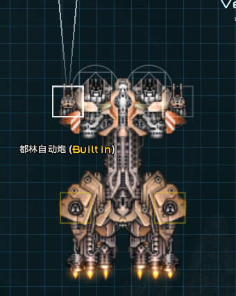
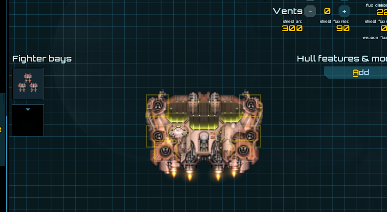

# 为舰船加入内置武器、船插与战机

本节把三张 "永远焊死在船体上" 的配置写进 `.ship` 文件：内置武器 (`builtInWeapons`)、内置舰船插件 (船插，`builtInMods`) 和内置战机 (`builtInWings`)；它们由船体定义直接提供，不占用装配点，也无法在装配界面拆卸或更换，适用于必须随船体存在、与船体强绑定的内容 (主炮、信号灯、相位立场、专属护航机等)。

*本节预期阅读时间：~12 分钟。*

*本节预期操作时间：~15 分钟。*

## 学习目标

完成后，您将能够：

- 在 `.ship` 文件中声明 `builtInWeapons`、`builtInMods`、`builtInWings` 三组键，并说出读取并应用它们的使用方；
- 说出内置内容与普通装配内容的区别 (不占装配点、不可拆卸、内置战机占据前几个甲板)；
- 解释为什么战机不应该设置内置武器，并给出可观察结果；
- 从日志报错和战斗表现反推三组键的常见错误。

## 前置知识

本节把三组 "内置" 配置写进 `.ship` 文件，直接使用前置章节建立的舰船、武器与战机数据，先确认以下基础：

- `.ship` 结构、武器槽位 (`mount`/`type`/`size`)、`ship_data.csv` 注册链、控制台 `Addship`(C01-S02)。
- 航母甲板、战机 hull/variant/wing 三层结构，以及 `GearIn_slag_wing` 等战机 ID(C01-S03)。
- `weapon_data.csv` 与武器 ID、`.wpn` 的 `id` 字段 (C01-S05)。
- 术语：hullmod 写作 "舰船插件 (船插)"，正文沿用简称 "船插"；本节只涉及 "内置" 这一安装方式 (船插的完整讲解见 C02-S02)。

## 三组键与文件/API 链路

三种内置内容都写在 `.ship` 文件**顶层**，与 `weaponSlots`、`engineSlots`、`center` 同级。

原版 `onslaught.ship` 中，`builtInMods` 与 `builtInWeapons` 紧邻 `weaponSlots` 数组之后：

| 键 | JSON 类型 | 含义 | 原版参考 |
|---|---|---|---|
| `builtInWeapons` | 对象 (槽位 ID → 武器 ID)| 随船安装的武器，不占装配点、不可拆卸 | `onslaught.ship`：`"WS 016": "tpc"` |
| `builtInMods` | 数组 (船插 ID)| 随船安装的船插，不占装配点、不可移除 | `shade.ship`：`["phasefield", "delicate"]` |
| `builtInWings` | 数组 (战机 ID)| 占据前几个甲板的战机联队，不可更换、不占装配点 | `tempest.ship`：`["terminator_wing"]` |

使用这三组键的完整链路为：

1. `data/hulls/<hullId>.ship`：声明三组键 (数据入口)。
2. 加载期把 `.ship` 的声明读入 `ShipHullSpecAPI` 的 `builtInWeapons`/`builtInMods`/`builtInWings` 三个字段。
3. 装配构建时把三组内置内容应用到**每一个**装配 —— 包括游戏按船体自动生成的 `<hullId>_Hull` 空装配。
4. 使用方：装配点计算 (`computeWeaponOPCost`/`computeHullModOPCost`)、战斗部署 (舰船生成时)、装配界面 (refit 的武器槽/船插列表/甲板列表)。

公开 API 面 (`com.fs.starfarer.api.*`) 中，只读访问入口在 `com.fs.starfarer.api.combat.ShipHullSpecAPI`：

- `getBuiltInWeapons()`、`getBuiltInMods()`、`getBuiltInWings()`；
- `isBuiltIn(String slotId)`、`isBuiltInMod(String modId)`、`isBuiltInWing(int index)`；
- 槽位类型枚举 `com.fs.starfarer.api.combat.WeaponAPI.WeaponType` 含 `BUILT_IN` 与 `DECORATIVE`。
- 槽位访问入口为 `com.fs.starfarer.api.loading.WeaponSlotAPI.getWeaponType()`。

::: info 为什么要在设计舰船时就把内置槽位规划好

**内置槽位应该在设计舰船的时候就提前设计、设置好**。舰船编辑器 (前置章节的按键流程) 可以设置槽位类型，但 `builtInWeapons` 等三组键位于编辑器流程之外，后期手动修改会略显麻烦。

:::

## 内置武器 (builtInWeapons)

为舰船加入内置武器需要先有对应的内置槽位。内置槽位在 `.ship` 文件中看上去大概是这样的 (本例为 `GearIn_artizan.ship` 的两门内置武器槽位，来自前置章节制作的工匠-级)：

```json {3,4,5,6}
    {
      "id": "WS0003",
      "size": "SMALL",
      "type": "BUILT_IN",
      "mount": "HARDPOINT",
      "arc": 10,
      "angle": 0,
      "locations": [59, 45]
    },
    {
      "id": "WS0004",
      "size": "SMALL",
      "type": "BUILT_IN",
      "mount": "HARDPOINT",
      "arc": 10,
      "angle": 0,
      "locations": [59, -45]
    },
```

槽位与普通槽位一样有三个关键维度：`mount`(形态：TURRET/HARDPOINT/HIDDEN)、`type`(类型：`BUILT_IN` 表示内置槽位)、`size`(大小，与所装武器一致)。

`mount` 与 `type` 相互独立：原版攻势的两门内置 TPC 槽位是 `"mount": "HARDPOINT"`、`"arc": 5`(武器固定朝向)，守卫者的内置槽位则是 `"mount": "TURRET"`。

装饰槽位同理，例如原版 `buffalo.ship` 是 `"mount": "TURRET"` 配 `"type": "DECORATIVE"`。

::: caution 槽位类型

`type` 写成 `BUILT_IN` 的槽位**不能**在装配界面手动安装武器 ——`isWeaponSlot()` 只认 `BALLISTIC`、`ENERGY`、`MISSILE`、`UNIVERSAL`、`HYBRID`、`SYNERGY`、`COMPOSITE` 七种类型 (`WeaponSlotAPI.isWeaponSlot()`)。

内置武器只能由 `builtInWeapons` 提供。

:::

::: tip 操作方式

增加内置武器建议手动打开 `.ship` 文件进行修改，但**能复制粘贴修改就不手写**。

:::

本例将对 `GearIn_artizan.ship` 加入两门内置武器。

从原版攻势的 `onslaught.ship` 文件中抄出如下内容：

```json
    "builtInWeapons": {
        "WS 016": "tpc",
        "WS 017": "tpc"
    },
```

修改为所需武器 (`GearIn_durin` 是前置章节制作的都林自动炮)。

::: warning 槽位 ID 必须逐字符一致

**反复确定槽位 ID 的正确**——`builtInWeapons` 的键必须与 `.ship` 中 `weaponSlots` 数组里的槽位 `id` 完全一致。

:::

然后插入到 `.ship` 文件内的对应位置：

```json {2,3}
    "builtInWeapons": {
        "WS0003": "GearIn_durin",
        "WS0004": "GearIn_durin"
    },
```



### 内置武器的行为

- **不占装配点**：`computeWeaponOPCost` 跳过内置槽位 (`!hullSpec.isBuiltIn(slotId)`)，装配界面显示 OP 只按非内置武器计算。
- **不可拆卸**：装配界面的 "清空武器/返还货舱" 只处理 `getNonBuiltInWeaponSlots()`，内置武器永远留在装配里。
- `.variant` 文件也无法覆盖内置槽位 (`addWeapon(..., false)` 对内置槽位直接拒绝写入)。
- **自动开火**：普通舰船会自动生成武器组 (`autoGenerateWeaponGroupsV2`)。
- 内置武器只要不是装饰槽就会并入武器组，随 AI 自动开火。
- **武器 ID 必须真实存在**：`setHullSpec` 按武器 ID 查询武器注册表，未知 ID 会在装配构建时抛 `Weapon spec [<id>] not found!`(见故障分析)。
- **建议清空掉落标签**：内置武器通常不希望出现在市场和打捞中。
- 此前武器数据章节给出的提示同样适用：清空或精简 `weapon_data.csv` 行的 `tags`。
- 需要彻底隐藏时可用 `SYSTEM` hint(原版 `tpc` 就是 `SYSTEM, SHOW_IN_CODEX`，默认不出现在数据库、不掉落)。

### 验证方案 (基于本例)

前置数据：`gear_in` MOD(C01-S01)+ 本处 `.ship` 修改 + 前置章节已注册的船体 `GearIn_artizan`(C01-S02) 与武器 `GearIn_durin`(C01-S05)。

操作：用 dev 控制台 `Addship GearIn_artizan` 生成测试舰船，在装配界面确认两门内置都林自动炮已安装；随后进入任意战斗，观察它们是否随 AI 自动开火。

通过信号：装配点数与未安装时相同 (不占 OP)；两门内置武器无法拆卸或替换；战斗中自动开火正常；`starsector.log` 中 `GearIn_artizan` 无 `ERROR`。

清理：移除测试舰船。

## 内置装饰性武器

装饰性武器的安装方式和通常的内置武器几乎完全一样，只是需要将槽位类型改为 `DECORATIVE` 即可。装饰武器**不会**出现在武器组或舰船数据列表中：

- **不进武器组**：`autoGenerateWeaponGroupsV2` 与 `hasUnassignedWeapons` 都跳过装饰槽，AI 不会把它们纳入自动开火判定。
- **不计入舰船数据面板**：装配界面的舰船数据面板统计 "武器幅能消耗/秒" 时跳过装饰武器。
- **不被 AI 瞄准开火**：进攻机动、侧舷压制和各战术系统 AI 的武器选择都跳过装饰武器。
- **不会被永久损坏**：装饰槽武器不会因损坏而失效。
- **仍然渲染**：战斗中和生涯舰船界面都会显示装饰武器。

装饰武器适合纯视觉内容。原版例子：`buffalo.ship` 的红色/绿色信号灯 ——`builtInWeapons` 里装 `blinker_red`/`blinker_green`

(`data/weapons/blinker_red.wpn`、`blinker_green.wpn`，`.wpn` 的 `"type": "DECORATIVE"`)，

信号灯槽位为 `"type": "DECORATIVE"` 的 TURRET 槽。

## 战机的内置武器？

战机**不应该**设置内置武器，而应该设置正常的槽位、在装配文件里设置武器 (前置章节已建立的战机装配流程)。

::: caution 有什么不好？

战机设置内置武器可能导致武器无法追踪目标、导弹类内置武器转速归零。这是数据路径决定的确定性行为，不是偶发问题：

- 战机**不会**自动生成或补全武器组。
- 舰船生成时只为非战机执行 `autoGenerateWeaponGroups`/`assignUnassignedWeapons`。
- 战机只使用 `.variant` 装配文件里显式写出的 `weaponGroups`。
- 舰船 AI 只给 "当前选中武器组" 内的武器设置瞄准目标。
- 内置武器的槽位如果没有写进装配文件的 `weaponGroups`，它就不属于任何武器组，永远得不到瞄准目标，只能停在槽位朝向，不追踪、不转动。
- 更直接的情况：内置槽位若按常见做法用 `HARDPOINT` 挂载，导弹武器装在固定槽位上时最大转速被直接设为 0(除非船体带 `MISSILE_HARDPOINTS_ROTATE` 提示且槽位角小于 90 度)。
- 无论 `mount` 是哪种，未进武器组的内置武器都拿不到瞄准目标。
- 可观察结果：战机内置武器只朝固定方向开火、无法追踪目标；`HARDPOINT` 挂载的导弹类内置武器完全不转动。

因此战机请保持正常槽位 + `.variant` 装配文件的 `weaponGroups` 方案。内置三件套是为舰船准备的。

:::

## 内置船插 (builtInMods)

增加内置船插也建议手动打开 `.ship` 文件进行修改，但**能复制粘贴修改就不手写**。本例将对 `GearIn_forging.ship`(前置章节的锻件-级相位护卫舰) 加入相位对应内置船插。

从原版阴影的 `shade.ship` 文件中抄出如下内容：

```json
    "builtInMods": [
        "phasefield",
        "delicate"
    ],
```

由于无需精密机械，因此简单修改后插入到 `.ship` 文件内的对应位置：

```json {2}
    "builtInMods": [
        "phasefield"
    ],
```


`builtInMods` 数组里的每个元素是**船插 ID**，取值来自 `hull_mods.csv` 的 `id` 列。

例如 `phasefield` 是原版 "Phase Field" 船插，`delicate` 是 "Delicate Machinery"。

### 内置船插的行为

- **不占装配点**：`computeHullModOPCost` 跳过内置船插 (`!hullSpec.isBuiltInMod(id)`)。
- **不可移除**：`removeMod` 对内置船插直接返回；船插选择器把内置船插排除在可装卸列表之外；清空装配时 `clear(false)` 会把内置船插重新加回。
- **船插 ID 必须真实存在**：装配构建阶段不校验，但舰船部署时 `getAllMods()` 会解析每个船插 ID，未知 ID 抛 `Hullmod <id> not found!`(见故障分析)。
- 船插的完整讲解 (effect 脚本、S-mod 等) 在后续章节展开；本节只涉及 "内置" 这一安装方式。

### 验证方案 (基于本例)

前置数据：`gear_in` MOD(C01-S01)+ 本处 `.ship` 修改 + 前置章节已注册的船体 `GearIn_forging`(C01-S04)。

操作：用 dev 控制台 `Addship GearIn_forging` 生成测试舰船，在装配界面确认船插列表出现 `phasefield`(原版 Phase Field)；随后进入任意战斗，观察相位立场效果是否生效。

通过信号：`phasefield` 无法移除；其余装配不受影响；相位立场正常降低探测范围；`starsector.log` 中 `GearIn_forging` 无 `ERROR`。

清理：移除测试舰船。

## 内置战机 (builtInWings)

增加内置战机也建议手动打开 `.ship` 文件进行修改，但**能复制粘贴修改就不手写**。本例将对 `GearIn_furnaceman.ship`(前置章节的守炉人-级航母，2 个甲板) 加入一甲板对应内置战机。

从原版暴雨的 `tempest.ship` 文件中抄出如下内容：

```json
"builtInWings": [
    "terminator_wing"
],
```

修改为所需的战机 ID 后插入到 `.ship` 文件内的对应位置：

```json {2}
"builtInWings": [
    "GearIn_slag_wing"
],
```



### 内置战机行为

- **占据前几个甲板**：`setHullSpec` 按顺序把内置战机填入甲板 0、1、2...(`setWingId(i, ...)` 对内置甲板索引强制使用内置战机)。
- 本例中 `GearIn_slag_wing` 占据守炉人的第一个甲板，第二个甲板仍可在装配界面正常装配。
- **不可更换**：`setWingId` 对内置甲板索引强制覆盖；装配界面的 "清空战机槽" 按 `isBuiltInWing` 判断、跳过内置甲板。
- **不占装配点**：`computeWeaponOPCost` 的战机循环跳过内置战机；舰队成员的造价与 CR 计算也使用 `getNonBuiltInWings()` 排除内置战机。
- **战机 ID 必须真实存在**(`wing_data.csv` 的 `id` 列)：未知 ID 不会报错，而是该甲板**静默不生成联队**(见故障分析)。

### 验证方案 (基于本例)

前置数据：`gear_in` MOD(C01-S01)+ 本处 `.ship` 修改 + 前置章节已注册的船体 `GearIn_furnaceman` 与战机 `GearIn_slag_wing`(C01-S03)。

操作：用 dev 控制台 `Addship GearIn_furnaceman` 生成测试舰船，在装配界面确认第一个甲板固定为 `GearIn_slag_wing`(炉渣联队)；随后进入任意战斗，观察联队出动、返航与补充。

通过信号：第二个甲板空置、可正常装配其它战机；内置联队无法在装配界面更换；`starsector.log` 中 `GearIn_furnaceman` 与 `GearIn_slag_wing` 无 `ERROR`。

清理：移除测试舰船。如需复测 "内置战机甲板静默为空" 的故障模式，可临时把 `builtInWings` 改成不存在的 ID，验证后改回。

## 预期结果

按前文完成三处修改后，进入任意战斗验证整体表现：

- 内置武器正常开火 (普通舰船)；
- 内置船插效果生效 (相位立场降低探测范围)；
- 内置战机从对应甲板出动、返航与补充正常。

`starsector.log` 中三个船体 ID(`GearIn_artizan`、`GearIn_forging`、`GearIn_furnaceman`) 与 `GearIn_slag_wing` 均无 `ERROR`。

## 实例驱动故障分析

- **游戏加载阶段报 `Weapon spec [<id>] not found!`**：`builtInWeapons` 里的武器 ID 不在武器注册表 (`weapon_data.csv` 无此行、拼写或大小写错误)。
- 装配构建会立即解析武器 ID，因此该错误在启动/装配构建阶段就会出现。
- 修正：核对 `weapon_data.csv` 的 `id` 列，统一两边写法。
- **部署时报 `slot id [<槽位>] not found for weapon [<武器>]`**：`builtInWeapons` 的键不是真实槽位 ID，或槽位片段与 `builtInWeapons` 键不一致。
- 舰船生成时挂载每个已装配槽位都会检查槽位存在性。
- 修正：**反复确定槽位 ID 的正确**，让两处 `id` 逐字符一致。
- **部署时抛 `Hullmod <id> not found!`**：`builtInMods` 里的船插 ID 不存在 (`hull_mods.csv` 无此行)。
- 装配构建阶段不校验，错误在舰船生成时由 `getAllMods()` 抛出。
- 修正：核对 `hull_mods.csv` 的 `id` 列。
- **内置战机甲板静默为空**：`builtInWings` 里的战机 ID 不存在 (`wing_data.csv` 无此行)。
- 联队 ID 解析失败时该甲板不生成联队，**没有任何报错**。
- 排查：核对 `wing_data.csv` 的 `id` 列；日志中应能看到翼 ID 缺失但不会指向本船体。
- **内置武器可以拆卸或计入 OP**：不会发生。
- 内置三件套在 OP 计算与装配界面均有专门排除逻辑 (见上文行为小节)。
- 若出现此现象，检查 `.ship` 键名是否拼错 (例如写成 `builtInWeapon` 而非 `builtInWeapons`)，键名不匹配时内容会被静默忽略。
- **战机内置武器不转动/不追踪**：见 "战机的内置武器？" 一节，按数据路径修正：取消内置槽位，改为正常槽位 + `.variant` 装配。
- **装饰武器仍然被 AI 开火或计入面板**：检查槽位 `type` 是否真的是 `DECORATIVE`(而非 `BUILT_IN`)，以及武器 `.wpn` 的 `"type": "DECORATIVE"` 是否一致。
- 装饰判定同时看槽位类型 (武器组/面板/AI 跳过) 与武器类型 (`isDecorative()`)。

## 总结

内置三件套是船体对装配的强制约束：`builtInWeapons` 按槽位挂武器、`builtInMods` 按 ID 挂船插、`builtInWings` 按顺序填甲板。

三者都不占装配点、不可在装配界面改动，且各自有独立的失败模式：武器 ID 错→加载期报错，槽位 ID 错→部署期报错，船插 ID 错→部署期报错，战机 ID 错→静默无联队。

排错时先确认键名正确，再从 `.ship` 三组键沿 ID 追到对应的 CSV 注册行。

## 建议参考项

- `com.fs.starfarer.api.combat.ShipHullSpecAPI`：内置武器/船插/战机的只读访问入口。
- 访问方法：`getBuiltInWeapons()`/`getBuiltInMods()`/`getBuiltInWings()` 与 `isBuiltIn(...)` 系列。
- `com.fs.starfarer.api.combat.WeaponAPI`：`WeaponType` 枚举，含 `BUILT_IN` 与 `DECORATIVE` 两种类型。
- `com.fs.starfarer.api.loading.WeaponSlotAPI`：槽位类型访问入口 `getWeaponType()`。
- `data/hulls/onslaught.ship`：原版 `builtInMods`/`builtInWeapons` 与 BUILT_IN 槽位示例。
- `data/hulls/shade.ship`：原版 `builtInMods` 示例 (`phasefield`/`delicate`)。
- `data/hulls/tempest.ship`：原版 `builtInWings` 示例 (`terminator_wing`)。
- `data/hulls/buffalo.ship`：装饰槽位与信号灯 `builtInWeapons` 示例。
- `data/weapons/blinker_red.wpn`、`data/weapons/blinker_green.wpn`：装饰武器 `.wpn` 示例 (`"type": "DECORATIVE"`)。
- `data/hullmods/hull_mods.csv`：船插 ID 注册表 (`phasefield`/`delicate`)。
- `data/weapons/weapon_data.csv`：武器 ID 注册表 (`tpc` 行、`tags`/`hints` 列)。
- `data/hulls/wing_data.csv`：战机 ID 注册表 (`terminator_wing`)。
- `data/hulls/GearIn_artizan.ship`、`data/hulls/GearIn_forging.ship`、`data/hulls/GearIn_furnaceman.ship`：本节三个例子修改的文件。
- 以上均为 MOD 内相对路径。
