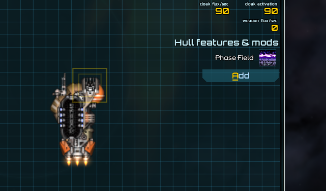

# 为舰船加入内置武器、船插与战机

本节将进一步讲解定义在 `.ship` 文件里的内置组件，包括武器、船插、战机。它们将随船体而存在。

*本节预期阅读时间：\~12 分钟。*

*本节预期操作时间：\~15 分钟。*

## 学习目标

完成后，您将能够：

- 在 `.ship` 文件中分别声明 `builtInWeapons`、`builtInMods` 与 `builtInWings`；
- 用 `ShipHullSpecAPI` 判断槽位、船插和战机是否属于船体内置内容；
- 区分内置内容与普通装配内容 (不占装配点、不可拆卸、内置战机占据前几个甲板)；
- 解释为什么战机不应该设置内置武器，并给出可观察结果；
- 从日志报错和战斗表现反推三组键的常见错误。

## 前置知识

- [C1-S2] 的 `.ship` 结构、武器槽位、`ship_data.csv` 登记与 `Addship` 使用方法；
- [C1-S3] 的航母甲板与战机 hull、variant、wing 三层结构；
- [C1-S4] 的相位舰船体与防御数据；
- [C1-S5] 的 `weapon_data.csv`、武器 ID 与 `.wpn` 文件结构。

## 内置武器 (builtInWeapons)

`builtInWeapons` 存在于 `.ship` 文件，键是槽位 ID，值是武器 ID。

::: info 在设计舰船时规划内置槽位

内置槽位必须在设计舰船时设置好。舰船编辑器可以设置槽位类型，`builtInWeapons` 则需要在编辑器流程之外写入 `.ship` 文件；先确定槽位位置和 ID，再填写武器映射。

:::

内置槽位在 `.ship` 文件中看上去大概是这样的：

```json {4,13}
    {
      "id": "WS0003",
      "size": "SMALL",
      "type": "BUILT_IN",
      "mount": "HARDPOINT",
      "arc": 10,
      "angle": 0,
      "locations": [59, 45]
    },
    {
      "id": "WS0004",
      "size": "SMALL",
      "type": "BUILT_IN",
      "mount": "HARDPOINT",
      "arc": 10,
      "angle": 0,
      "locations": [59, -45]
    },
```

类型 `BUILT_IN` 表示内置。

本例将对 `GearIn_artizan.ship` 加入两门内置武器。

从原版攻势的 `onslaught.ship` 文件中抄出如下内容：

```json
    "builtInWeapons": {
        "WS 016": "tpc",
        "WS 017": "tpc"
    },
```

修改为所需武器 (`GearIn_durin` 是前置章节制作的都林自动炮)。

::: warning 槽位 ID 必须逐字符一致

**反复确定槽位 ID 的正确** —— `builtInWeapons` 的键必须与 `.ship` 中 `weaponSlots` 数组里的槽位 `id` 完全一致。这是一个初学者非常常见的错误。

:::

然后插入到 `.ship` 文件内的对应位置：

```json {2,3}
    "builtInWeapons": {
        "WS0003": "GearIn_durin",
        "WS0004": "GearIn_durin"
    },
```


::: tip 内置武器的其它建议

- **不要在 `.variant` 文件中写内置槽位的武器**：它无法覆盖内置槽位，无法产生实质性影响。
- **清空掉落标签**：内置武器通常不希望出现在市场和打捞中。
- 此前武器数据章节给出的提示同样适用：清空或精简 `weapon_data.csv` 行的 `tags`。
- 需要彻底隐藏时可用 `SYSTEM` hint(`SYSTEM` 单独使用时条目不出现在数据库)。

:::

## 验证方案

前置数据：`gear_in` MOD[C1-S1]\+ 本处 `.ship` 修改 + 前置章节已注册的船体 `GearIn_artizan`[C1-S2] 与武器 `GearIn_durin`[C1-S5]。

1. 用 dev 控制台 `Addship GearIn_artizan` 生成测试舰船。
2. 在装配界面确认两门内置都林自动炮已安装。
3. 进入任意战斗，观察两门内置武器是否随 AI 自动开火。

预期结果：

- 装配点数与未安装时相同 (不占 OP)。
- 两门内置武器无法拆卸或替换。
- 战斗中自动开火正常。
- `starsector.log` 中 `GearIn_artizan` 无 `ERROR`。

## 内置装饰性武器

装饰性武器的安装方式和通常的内置武器几乎完全一样，只是需要将槽位类型改为 `DECORATIVE` 即可。装饰武器**不会**出现在武器组或舰船数据列表中：

- **不进武器组**：而且 AI 不会把它们纳入自动开火判定。
- **不计入舰船数据面板**：装配界面的舰船数据面板统计 "武器幅能消耗/秒" 时跳过装饰武器。
- **不被 AI 瞄准开火**：进攻机动、侧舷压制和各战术系统 AI 的武器选择都跳过装饰武器。
- **不会被永久损坏**：装饰槽武器不会因损坏而失效。
- **仍然显示**：战斗中和生涯舰船界面都会显示装饰武器。

装饰武器适合纯视觉内容。原版例子是 `buffalo.ship` 的红色/绿色信号灯。

## 战机的内置武器？

战机**不应该**设置内置武器，而应该设置正常的槽位、在装配文件里设置武器 (前置章节已建立的战机装配流程)。

::: caution 有什么不好？

战机设置内置武器可能导致武器无法追踪目标、导弹类内置武器转速归零。这是数据路径决定的确定性行为，不是偶发问题：

- 战机**不会**自动生成或补全武器组，只使用 `.variant` 装配文件里显式写出的 `weaponGroups`。
- 舰船 AI 只给 "当前选中武器组" 内的武器设置瞄准目标。战机内置武器的槽位将不属于任何武器组，永远得不到瞄准目标，只能停在槽位朝向，不追踪、不转动。

因此战机请保持正常槽位 + `.variant` 装配文件的 `weaponGroups` 方案。内置武器是为舰船准备的。

:::

## 内置船插 (builtInMods)

`builtInMods` 是 `.ship` 顶层的船插 ID 数组。它会应用到该船体的每一个装配，装配点计算和装配界面都把这些船插视为船体自带内容。`ShipHullSpecAPI.getBuiltInMods()` 返回完整列表，`isBuiltInMod(modId)` 可以判断指定船插。

增加内置船插建议手动打开 `.ship` 文件进行修改，但**能复制粘贴修改就不手写**。本例将对 `GearIn_forging.ship`(前置章节的锻件-级相位护卫舰) 加入相位对应内置船插。

从原版阴影的 `shade.ship` 文件中抄出如下内容：

```json
    "builtInMods": [
        "phasefield",
        "delicate"
    ],
```

由于无需精密机械，因此简单修改后插入到 `.ship` 文件内的对应位置：

```json {2}
    "builtInMods": [
        "phasefield"
    ],
```



`builtInMods` 数组里的每个元素是**船插 ID**，取值来自 `hull_mods.csv` 的 `id` 列。本节只涉及 "内置" 这一安装方式；effect 脚本和 S-mod 见 [C9-S1]。

## 验证方案

前置数据：`gear_in` MOD[C1-S1]\+ 本处 `.ship` 修改 + 前置章节已注册的船体 `GearIn_forging`[C1-S4]。

1. 用 dev 控制台 `Addship GearIn_forging` 生成测试舰船。
2. 在装配界面确认船插列表出现 `phasefield`(原版 Phase Field)。
3. 进入任意战斗，观察相位立场效果。

预期结果：

- `phasefield` 无法移除。
- 其余装配不受影响。
- 相位立场正常降低探测范围。
- `starsector.log` 中 `GearIn_forging` 无 `ERROR`。

## 内置战机 (builtInWings)

`builtInWings` 是 `.ship` 顶层的战机联队 ID 数组，数组顺序对应航母最前面的甲板。它会应用到该船体的每一个装配；`ShipHullSpecAPI.getBuiltInWings()` 返回联队列表，`isBuiltInWing(index)` 可以判断对应甲板是否内置。

增加内置战机建议手动打开 `.ship` 文件进行修改，但**能复制粘贴修改就不手写**。本例将对 `GearIn_furnaceman.ship`(前置章节的守炉人-级航母，2 个甲板) 加入一甲板对应内置战机。

从原版暴雨的 `tempest.ship` 文件中抄出如下内容：

```json
"builtInWings": [
    "terminator_wing"
],
```

修改为所需的战机 ID 后插入到 `.ship` 文件内的对应位置：

```json {2}
"builtInWings": [
    "GearIn_slag_wing"
],
```


::: tip 内置战机的行其它建议

- **占据前几个甲板**：需要在数据里提前给它们预留好甲板数量。
- 本例中 `GearIn_slag_wing` 占据守炉人的第一个甲板，第二个甲板仍可在装配界面正常装配。

:::

## 验证方案

前置数据：`gear_in` MOD[C1-S1]\+ 本处 `.ship` 修改 + 前置章节已注册的船体 `GearIn_furnaceman` 与战机 `GearIn_slag_wing`[C1-S3]。

1. 用 dev 控制台 `Addship GearIn_furnaceman` 生成测试舰船。
2. 在装配界面确认第一个甲板固定为 `GearIn_slag_wing`(炉渣联队)。
3. 进入任意战斗，观察联队出动、返航与补充。

预期结果：

- 内置武器正常开火 (普通舰船)；
- 内置船插效果生效 (相位立场降低生涯探测范围)；
- 内置战机从对应甲板出动、返航与补充正常。

## 故障分析

- **游戏加载时报 `Weapon spec [<id>] not found!`**：`builtInWeapons` 中的武器 ID 不在 `weapon_data.csv` 注册表，或拼写、大小写不一致。装配构建会立即解析该 ID。
    - **解决方案**：统一 CSV 的 `id` 列后重启。

- **部署时报 `slot id [<槽位>] not found for weapon [<武器>]`**：`builtInWeapons` 的键不是真实槽位 ID，或槽位片段与该键不一致。舰船生成时会检查每个已装配槽位。
    - **解决方案**：把两处 ID 改成逐字符一致后重新部署。

- **部署时抛 `Hullmod <id> not found!`**：`builtInMods` 的船插 ID 不存在于 `hull_mods.csv`。装配构建阶段不会校验，错误会在舰船生成时由 `getAllMods()` 抛出。
    - **解决方案**：补齐或改正 `id` 后重启。

- **内置战机甲板静默为空**：`builtInWings` 中的战机 ID 不存在于 `wing_data.csv`，解析失败时甲板不会生成联队。
    - **解决方案**：核对 wing ID 并重新部署航母。

- **内置插件出现在可拆卸列表或 OP 计算中**：`.ship` 键名拼错 (例如写成 `builtInWeapon` 而不是 `builtInWeapons`) 时，内置内容会被静默忽略。
    - **解决方案**：改正键名后重启。

- **战机内置武器不转动或不追踪**：战机内置槽位不会提供正常武器的装配行为。
    - **解决方案**：取消内置槽位，改为正常槽位并在 `.variant` 中装配，再重新生成联队。

- **装饰武器仍被 AI 开火或计入面板**：槽位 `type` 不是 `DECORATIVE`，或武器 `.wpn` 的 `"type": "DECORATIVE"` 不一致。
    - **解决方案**：两处都改为装饰类型后重新载入。

## 总结

内置内容直接写在 `.ship` 顶层，并应用到该船体的每一个装配。`builtInWeapons` 按槽位挂武器，`builtInMods` 按 ID 挂船插，`builtInWings` 按顺序填入最前面的甲板；`ShipHullSpecAPI` 提供对应的只读查询方法。

不过，虽然和技术本身无关，但编者必须指出的是，滥用内置插件 (是的，单独点名内置插件，因为这种例子已经太多了) 可能并不会显得您的舰船如何牛逼，而更只可能令人觉得 "不过是又一个插件列表堆成墙的东西"。

## 建议参考项

- `com.fs.starfarer.api.combat.WeaponAPI`：`WeaponType` 枚举，含 `BUILT_IN` 与 `DECORATIVE` 两种类型。
- `data/hulls/onslaught.ship`：原版 `builtInMods`/`builtInWeapons` 与 BUILT\_IN 槽位示例。
- `data/hulls/shade.ship`：原版 `builtInMods` 示例 (`phasefield`/`delicate`)。
- `data/hulls/tempest.ship`：原版 `builtInWings` 示例 (`terminator_wing`)。
- `data/hulls/buffalo.ship`：装饰槽位与信号灯 `builtInWeapons` 示例。
- `data/weapons/blinker_red.wpn`：红色信号灯装饰武器示例 (`"type": "DECORATIVE"`)；
- `data/weapons/blinker_green.wpn`：绿色信号灯装饰武器示例 (`"type": "DECORATIVE"`)。
- `data/hullmods/hull_mods.csv`：船插 ID 注册表 (`phasefield`/`delicate`)。
- `data/weapons/weapon_data.csv`：武器 ID 注册表 (`tpc` 行、`tags`/`hints` 列)。
- `data/hulls/wing_data.csv`：战机 ID 注册表 (`terminator_wing`)。
