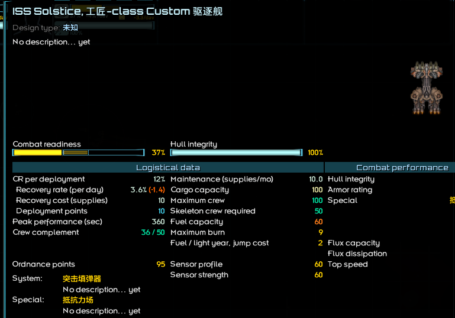
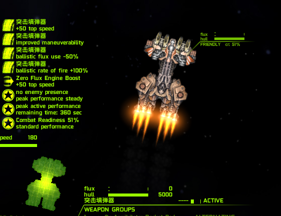
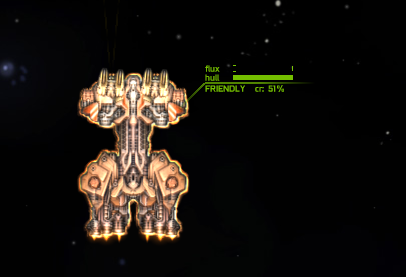

# 制作最小战术系统

本节为工匠制作 "突击填弹器"：以原版加速填弹器为基础，增加速度与机动加成，再为它设置持续时间和冷却。随后制作右键使用的抵抗力场。两种系统都由定义文件、CSV 参数和效果类组成，舰船数据决定安装哪个系统。

*本节预期阅读时间：\~20 分钟。*

*本节预期操作时间：\~25 分钟。*

## 学习目标

完成后，您将能够：

- 用 `.system` 声明战术系统类型和效果类；
- 在 `ship_systems.csv` 登记名称、时间和幅能参数，通过舰船数据挂载；
- 区分前摇、全功率、后摇与冷却；
- 根据效果强度修改加成，并在结束时撤销；
- 调整加成、持续时间与冷却，在模拟战中比较结果。

## 前置知识

- [C1-S2] 的工匠船体与 `ship_data.csv`；
- [C1-S7] 的 CSV 表头、空列与转义；
- [C2-S1] 的 Java 文件、参数修改、注册与回调；
- [C2-S2] 的效果类与数据登记对应关系。

## 从原版加速填弹器开始

把原版 `data/shipsystems/ammofeed.system` 复制到 MOD 的同目录，改名为 `GearIn_assaultfeed.system`。系统名称定为 "突击填弹器"，ID 为 `GearIn_assaultfeed`，效果类为 `GearInAssaultFeedSystem`。

编者准备让工匠在提高实弹射速的同时获得短暂的机动优势，便于压近距离或调整射击位置。**原版加速填弹器的武器收益继续保留，机动收益则写进同一个效果类。** 持续时间稍短一些，让使用时机也成为操作的一部分。

先修改定义文件，内容如下：

```json
{
    "id": "GearIn_assaultfeed",
    "type": "STAT_MOD",
    "aiType": "WEAPON_BOOST",
    "statsScript": "data.scripts.gearin.shipsystems.GearInAssaultFeedSystem",
    "weaponGlowColor": [255, 200, 0, 155],
    "weaponTypes": ["BALLISTIC"],
    "engineGlowLengthMult": 2.5,
    "engineGlowWidthMult": 3,
    "engineGlowGlowMult": 2,
    "useSound": "system_ammo_feeder",
    "outOfUsesSound": "gun_out_of_ammo"
}
```

`id` 与后面的 CSV 共用；`statsScript` 指向效果类。`type: "STAT_MOD"` 表示属性修改型系统，`aiType: "WEAPON_BOOST"` 沿用加速填弹器的使用判断。系统 AI 的详细写法由 [C9-S2] 讲解。

`weaponGlowColor` 与 `weaponTypes` 控制实弹武器的激活光效，三个 `engineGlow*` 字段调整引擎焰表现。`useSound` 继续使用原版激活声音。这里填的是声音 ID，文件关系按原版样本保留即可。

## 登记时间与使用参数

打开 MOD 的 `data/shipsystems/ship_systems.csv`，复制原版 `ammofeed` 行，修改名称、ID 与时间参数。本例登记行如下，已有表头时只追加系统数据：

```csv
name,id,flux/second,f/s (base rate),f/s (base cap),flux/use,f/u (base rate),f/u (base cap),cr/u,max uses,regen,charge up,active,down,cooldown,toggle,noDissipation,noHardDissipation,hardFlux,noFiring,noTurning,noStrafing,noAccel,noShield,noVent,isPhaseCloak,tags,icon
突击填弹器,GearIn_assaultfeed,,,,,,,,,,0.5,3,0.5,10,,,,,,,,,,,,offensive,graphics/icons/hullsys/ammo_feeder.png
```

本例前摇 0.5 秒、全功率 3 秒、后摇 0.5 秒、冷却 10 秒。**系统的强度既取决于效果，也取决于能维持多久、多久能再用。** 编者建议您先按这组值完成测试，再根据工匠的实际表现调整。

### 常用系统参数速查表

| 列 | 作用 |
|---|---|
| `charge up` | 前摇秒数，效果强度从 0 升至 1 |
| `active` | 全功率秒数，效果强度保持 1 |
| `down` | 后摇秒数，效果强度从 1 回到 0 |
| `cooldown` | 冷却秒数，结束后到下一次可用 |
| `flux/second` | 激活期间每秒产生的幅能 |
| `toggle` | `TRUE` 为开关式，再按一次关闭；留空按持续时间结束 |
| `max uses` | 可用次数，留空表示无限 |
| `noAccel`、`noFiring`、`noTurning` 等 | 激活期间禁止的对应操作，`TRUE` 表示禁止 |

突击填弹器的 `toggle` 留空，按一次后运行前摇、全功率、后摇与冷却周期。开关式系统采用同一组阶段，但关闭动作由再次按键触发。当前这行同时保留加速填弹器的使用参数；`f/s`、`f/u` 和 `cr/u` 等进阶列以后再结合具体系统处理。

## 把射速与机动效果写进同一个类

效果类参考原版 `data/shipsystems/scripts/AmmoFeedStats.java` 与 `ManeuveringJetsStats.java`。创建 `data/scripts/gearin/shipsystems/GearInAssaultFeedSystem.java`，包名和 import 按完整文件填写。

这两份原版效果分别提供实弹强化与辅助推进。组合时，我们选择当前设计需要的操作，在同一个 `apply` 中写入，随后在 `unapply` 中逐项解除。

### 参数与效果强度

本例的可调整参数为：

```java
public static final float SPEED_BONUS = 50f;
public static final float MANEUVER_BONUS = 200f;
public static final float ROF_BONUS = 1f;
public static final float FLUX_REDUCTION = 50f;
```

最大速度增加 50，前进加速、减速与转向加速采用 200% 加成；`ROF_BONUS = 1f` 表示额外增加一倍射速，`FLUX_REDUCTION = 50f` 表示实弹武器开火幅能降低 50%。

游戏在效果期间反复调用 `apply(...)`，并传入 `effectLevel`。**前摇时该值从 0 升至 1，全功率为 1，后摇时再回到 0。** 以速度为例，局部片段如下：

```java
stats.getMaxSpeed().modifyFlat(id, SPEED_BONUS * effectLevel);
```

`effectLevel` 为 0.5 时，加成是 25；为 1 时，加成是 50。本例让各项增益都随这个值变化，进入和退出系统时便有相应的过渡。

### 射速和幅能的倍率

实弹射速与开火幅能通过倍率修改，局部片段如下：

```java
stats.getBallisticRoFMult().modifyMult(id, 1f + ROF_BONUS * effectLevel);
stats.getBallisticWeaponFluxCostMod().modifyMult(id,
        1f - FLUX_REDUCTION * 0.01f * effectLevel);
```

`modifyMult` 写入倍率。满效果时，射速倍率为 2，幅能倍率为 0.5；200% 射速和 50% 单发幅能同时生效，持续开火的每秒幅能也会随射速变化。设计时把两项一起看，比只看某一条加成更有意义。

### 结束时撤销，状态栏显示参数

`unapply(...)` 在系统未生效或结束时解除修饰，舰船生成时也会调用它。下面是速度与射速清理的局部片段：

```java
stats.getMaxSpeed().unmodify(id);
stats.getBallisticRoFMult().unmodify(id);
```

完整文件把所有写入项都清理。**写入与解除使用相同的 `id`**，这样系统结束后才会恢复其余效果共同决定的数值。

`getStatusData(...)` 返回左下角状态栏文字，`index` 选择显示哪一行，`false` 表示增益，`true` 表示红色减益。本例显示速度、机动、幅能与射速四项状态，数值从当前参数和效果强度计算。

## 给工匠安装突击填弹器

打开 `data/hulls/ship_data.csv`，把工匠行的 `system id` 改为 `GearIn_assaultfeed`：

```csv
name,id,designation,tech/manufacturer,system id,fleet pts,hitpoints,armor rating,max flux,8/6/5/4%,flux dissipation,ordnance points,fighter bays,max speed,acceleration,deceleration,max turn rate,turn acceleration,mass,shield type,defense id,shield arc,shield upkeep,shield efficiency,phase cost,phase upkeep,min crew,max crew,cargo,fuel,fuel/ly,range,max burn,base value,cr %/day,CR to deploy,peak CR sec,CR loss/sec,supplies/rec,supplies/mo,c/s,c/f,f/s,f/f,crew/s,crew/f,hints,tags,logistics n/a reason,codex variant id,rarity,breakProb,minPieces,maxPieces,travel drive,number
工匠,GearIn_artizan,驱逐舰,未知,GearIn_assaultfeed,10,5000,500,3800,4167,200,95,,80,60,40,30,60,400,FRONT,,300,0.4,0.8,,,50,100,100,60,2,30,9,40000,5,12,360,0.25,10,10,,,,,,,,GearIn_bp,,,,0.5,2,3,,300
```

定义文件、系统 CSV 和舰船引用使用同一个系统 ID；效果类使用的是 `statsScript` 中的完整类名。保存这些文件后，主系统就接到了工匠上。

## 再制作右键抵抗力场

右键系统采用相同的注册过程。把原版 `data/shipsystems/damper.system` 复制为 `GearIn_resistfield.system`，改名为 "抵抗力场"，并填写自己的 ID 与效果类：

```json
{
    "id": "GearIn_resistfield",
    "type": "STAT_MOD",
    "aiType": "DAMPER_FIELD",

    "statsScript": "data.scripts.gearin.shipsystems.GearInResistFieldSystem",

    "jitterUnderColor": [255, 165, 90, 155],
    "jitterUnderCopies": 25,
    "jitterUnderMinRange": 0,
    "jitterUnderRange": 7,
    "jitterUnderRangeRadiusFraction": 0,

    "jitterColor": [255, 165, 90, 55],
    "jitterCopies": 2,
    "jitterMinRange": 0,
    "jitterRange": 5,
    "jitterRangeRadiusFraction": 0,

    "soundFilterType": "LOWPASS",
    "soundFilterGain": 0.75,
    "soundFilterGainHF": 0.25,

    "fadeActivationSoundOnChargedown": true,
    "useSound": "system_damper",
    "loopSound": "system_damper_loop",
    "deactivateSound": "system_damper_off",
    "outOfUsesSound": "gun_out_of_ammo"
}
```

`STAT_MOD` 和 `DAMPER_FIELD` 沿用阻尼力场的类型和 AI。橙色扰动与声音字段也由原版文件提供。

在 `ship_systems.csv` 追加：

```csv
name,id,flux/second,f/s (base rate),f/s (base cap),flux/use,f/u (base rate),f/u (base cap),cr/u,max uses,regen,charge up,active,down,cooldown,toggle,noDissipation,noHardDissipation,hardFlux,noFiring,noTurning,noStrafing,noAccel,noShield,noVent,isPhaseCloak,tags,icon
抵抗力场,GearIn_resistfield,1,,,,,,,2,0.05,0.25,3,0.25,0,,,,,TRUE,,,,TRUE,TRUE,,"uses_damper_ai, defensive",graphics/icons/hullsys/damper_field.png
```

该行的 `uses_damper_ai` 与 `defensive` 标签继续保留。效果类保存到 `data/scripts/gearin/shipsystems/GearInResistFieldSystem.java`。

### 设置分伤害类型的减伤

本例让高爆与 EMP 最高降低 75%，动能与能量最高降低 50%。局部写法如下：

```java
stats.getHighExplosiveDamageTakenMult().modifyMult(id,
        1f - HE_REDUCTION * 0.01f * effectLevel);
```

满效果时，高爆伤害倍率为 0.25，意味着承担原来 25% 的伤害。其他类型使用对应 getter，结束时各自清理。

最后把工匠行的 `shield type` 改为 `PHASE`，`defense id` 填为 `GearIn_resistfield`。这里的 `PHASE` 选择右键系统入口，实际行为由抵抗力场定义与脚本决定。

观察舰船详情中主系统与右键系统的位置：



主系统和右键系统分别显示在 System 与 Special 位置，两个名称来自各自的系统数据行。

## 完整最小例

两个效果类分别保存到上文指定的包目录。系统定义、CSV 和工匠挂载沿用上面的成品；CSV 表头只保留一次。

::: details 完整成品：GearInAssaultFeedSystem

```java
package data.scripts.gearin.shipsystems;

import com.fs.starfarer.api.combat.MutableShipStatsAPI;
import com.fs.starfarer.api.impl.combat.BaseShipSystemScript;

public class GearInAssaultFeedSystem extends BaseShipSystemScript {

    public static final float SPEED_BONUS = 50f;
    public static final float MANEUVER_BONUS = 200f;
    public static final float ROF_BONUS = 1f;
    public static final float FLUX_REDUCTION = 50f;

    @Override
    public void apply(MutableShipStatsAPI stats, String id, State state, float effectLevel) {
        stats.getBallisticRoFMult().modifyMult(id, 1f + ROF_BONUS * effectLevel);
        stats.getBallisticWeaponFluxCostMod().modifyMult(id,
                1f - FLUX_REDUCTION * 0.01f * effectLevel);
        stats.getMaxSpeed().modifyFlat(id, SPEED_BONUS * effectLevel);
        stats.getAcceleration().modifyPercent(id, MANEUVER_BONUS * effectLevel);
        stats.getDeceleration().modifyPercent(id, MANEUVER_BONUS * effectLevel);
        stats.getTurnAcceleration().modifyFlat(id, 30f * effectLevel);
        stats.getTurnAcceleration().modifyPercent(id, MANEUVER_BONUS * effectLevel);
        stats.getMaxTurnRate().modifyFlat(id, 15f * effectLevel);
        stats.getMaxTurnRate().modifyPercent(id, 100f * effectLevel);
    }

    @Override
    public void unapply(MutableShipStatsAPI stats, String id) {
        stats.getBallisticRoFMult().unmodify(id);
        stats.getBallisticWeaponFluxCostMod().unmodify(id);
        stats.getMaxSpeed().unmodify(id);
        stats.getAcceleration().unmodify(id);
        stats.getDeceleration().unmodify(id);
        stats.getTurnAcceleration().unmodify(id);
        stats.getMaxTurnRate().unmodify(id);
    }

    @Override
    public StatusData getStatusData(int index, State state, float effectLevel) {
        if (index == 0) {
            return new StatusData("+" + (int) (SPEED_BONUS * effectLevel) + " top speed", false);
        }
        if (index == 1) {
            return new StatusData("improved maneuverability", false);
        }
        if (index == 2) {
            return new StatusData("ballistic flux use -" + (int) (FLUX_REDUCTION * effectLevel) + "%", false);
        }
        if (index == 3) {
            return new StatusData("ballistic rate of fire +" + (int) (ROF_BONUS * effectLevel * 100f) + "%", false);
        }
        return null;
    }
}
```

:::

::: details 完整成品：GearInResistFieldSystem

```java
package data.scripts.gearin.shipsystems;

import com.fs.starfarer.api.combat.MutableShipStatsAPI;
import com.fs.starfarer.api.impl.combat.BaseShipSystemScript;
import com.fs.starfarer.api.plugins.ShipSystemStatsScript;

public class GearInResistFieldSystem extends BaseShipSystemScript {

    public static final float HE_REDUCTION = 75f;
    public static final float EMP_REDUCTION = 75f;
    public static final float OTHER_REDUCTION = 50f;

    @Override
    public void apply(MutableShipStatsAPI stats, String id, State state, float effectLevel) {
        stats.getHighExplosiveDamageTakenMult().modifyMult(id, 1f - HE_REDUCTION * 0.01f * effectLevel);
        stats.getKineticDamageTakenMult().modifyMult(id, 1f - OTHER_REDUCTION * 0.01f * effectLevel);
        stats.getEnergyDamageTakenMult().modifyMult(id, 1f - OTHER_REDUCTION * 0.01f * effectLevel);
        stats.getEmpDamageTakenMult().modifyMult(id, 1f - EMP_REDUCTION * 0.01f * effectLevel);
    }

    @Override
    public void unapply(MutableShipStatsAPI stats, String id) {
        stats.getHighExplosiveDamageTakenMult().unmodify(id);
        stats.getKineticDamageTakenMult().unmodify(id);
        stats.getEnergyDamageTakenMult().unmodify(id);
        stats.getEmpDamageTakenMult().unmodify(id);
    }

    @Override
    public StatusData getStatusData(int index, State state, float effectLevel) {
        if (index == 0) {
            return new StatusData("reduce damage taken", false);
        }
        return null;
    }
}
```

:::

## 验证方案

1. 保存两个效果类、系统定义、系统 CSV 与工匠数据，重启游戏，检查系统加载日志。
2. 获取工匠并进入模拟战，安装实弹武器，按 `F` 激活突击填弹器，观察射速、开火幅能、速度与转向。
3. 比较 0.5 秒前摇、3 秒全功率和 0.5 秒后摇中的变化，结束后等待 10 秒冷却。
4. 修改 `SPEED_BONUS`、`active` 或 `cooldown` 中的一项，保存并重启，在同一测试配置下比较结果。
5. 使用右键抵抗力场，观察橙色扰动、状态文字、持续时间及减伤效果。

预期结果：

- 日志包含 `GearIn_assaultfeed.system`、`GearIn_resistfield.system` 的加载与 CSV 应用记录。
- 突击填弹器满效果时，速度增加 50，机动提高，实弹射速增加 100%，开火幅能降低 50%。
- 增益随前摇上升、后摇回落，系统结束后各项修饰解除，冷却完成后可再次激活。
- 参数实验分别改变速度加成、持续时间或下一次可用时机。
- 抵抗力场满效果时，高爆与 EMP 减伤为 75%，动能与能量为 50%，结束后恢复。
- 左下角状态栏分别显示主系统增益与右键减伤说明。

观察突击填弹器激活后的引擎与四项状态：



图中额外的 "Zero Flux Engine Boost" 来自舰船的零幅能加速。核对本系统时，使用以 "突击填弹器" 为标题的四项状态与脚本参数比较。

再观察抵抗力场的橙色扰动：



主系统与右键系统可以分别验证。视效来自定义文件，减伤则由效果脚本写入。

## 故障分析

- **加载时报 Fatal: ship_systems.csv is missing systems**：系统定义已有 ID，但 CSV 缺少对应行或该行被注释。
    - **解决方案**：登记同一个系统 ID，检查行首与表头，保存后重启。

- **系统按键后立即结束**：前摇、全功率、后摇和冷却参数均为空或为 0，状态在一帧内完成。
    - **解决方案**：填写对应时间；定义与 CSV 的 ID 不一致时先修正加载错误。

- **舰船部署时报 System with id [...] not found**：舰船引用的系统 ID 拼错或没有注册。
    - **解决方案**：核对工匠的 `system id`、`defense id` 与两份系统定义和 CSV。

- **系统结束后加成保留**：`unapply` 缺少某个写入项的清理。
    - **解决方案**：按 `apply` 中的对象逐项补齐相同 ID 的 `unmodify`，重启后完整测试一个周期。

- **加载时报 Error loading [...]**：`statsScript` 与源码包名、类名或当前保存目录不一致。
    - **解决方案**：把源码保存到 MOD 根目录对应的 `data/scripts/gearin/shipsystems/`，核对完整类名后重启。

## 总结

主系统与右键系统采用相同的定义、登记和效果类结构，舰船数据使用不同字段挂载。系统的时间参数决定各阶段长度，`effectLevel` 把阶段进度交给效果类，`unapply` 负责解除当前系统的修饰。

本例组合了实弹强化与机动加成，右键则处理不同伤害类型。继续调整时，把数值、持续时间和冷却一起测试；系统 AI 与更深入的调用规则在 [C9-S2] 展开。

## 建议参考项

- `data/shipsystems/ammofeed.system`：突击填弹器的定义基础。
- `data/shipsystems/damper.system`：右键抵抗力场的定义基础。
- `data/shipsystems/ship_systems.csv`：名称、时间、幅能、使用限制与标签。
- `data/hulls/ship_data.csv`：`system id` 和 `defense id` 的挂载位置。
- `data/shipsystems/scripts/AmmoFeedStats.java`：实弹射速与幅能修改。
- `data/shipsystems/scripts/ManeuveringJetsStats.java`：速度与机动修改。
- `com.fs.starfarer.api.impl.combat.BaseShipSystemScript`：效果类的基类。
- `com.fs.starfarer.api.plugins.ShipSystemStatsScript`：状态、效果强度和效果回调。
- `com.fs.starfarer.api.combat.MutableShipStatsAPI`：各类舰船数值的修改入口。
