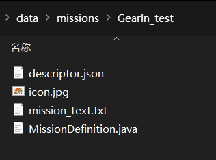
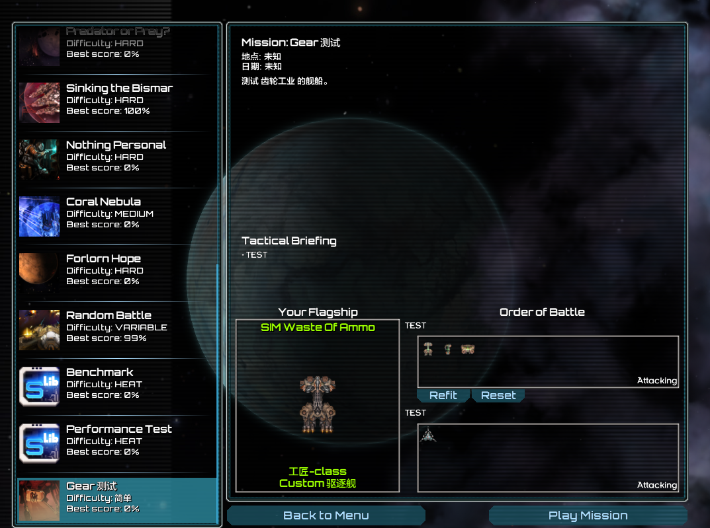
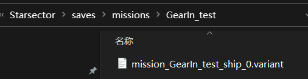

# 制作测试战役与装配

本节把「测试战役 → 装配导出 → 正式装配 → 常规战役」整条制作链路走通：先注册并制作一个自动列出本 MOD 所有舰船的测试战役，从它的装配界面导出装配，再按原版战役复制出常规战役。战役（mission）与装配（variant）是后续内容反复使用的两个枢纽。

*本节预期阅读时间：~12 分钟。*

*本节预期操作时间：~15 分钟。*

## 学习目标

完成后，您将能够：

- 用 `data/missions/mission_list.csv` 注册战役，并说出战役注册与启动的完整链路；
- 搭建一个自动列出本 MOD 所有舰船的测试战役，并从它的装配界面导出装配；
- 把导出的 `.variant` 文件放回 MOD 的 `data/variants`，改名、改 ID 后成为正式装配；
- 对照 RC8 的字段表修改装配 JSON，并设置自动装配目标（`goalVariant`）；
- 从原版战役复制出一个常规战役，并逐处替换内容。

## 前置知识

本节建立在前置单元的基础上。

- MOD 目录、`mod_info.json` 与数据合并规则（C01-S01）
- 船体注册，`GearIn_artizan`（C01-S02）
- 战机装配文件与战机三段注册（C01-S03）
- 武器注册，`GearIn_durin`（C01-S05）
- 船插注册（C02-S02）

## 术语：战役与生涯

Starsector 有两个主要游玩入口，本节开始会经常把两者并列：

- **战役（mission）**：主菜单 `Missions` 里的独立战斗场景。战役有自己固定的舰队、地图和文本，由数据文件夹 + 一个实现 `MissionDefinitionPlugin` 的脚本描述；进入战役不会读取生涯存档。
  - 本节要做的测试战役和常规战役都属于它。API 名称保留源码大小写：`MissionDefinitionPlugin`、`MissionDefinitionAPI`、`FleetSide`。
- **生涯（campaign）**：进入一个随机生成的星区自由游玩的模式。生涯里也有战斗、装配和舰队，但数据来源、保存方式和界面都与战役不同（生涯从 S03 系列后半与 S08 起逐步讲解）。战役与生涯共享舰船、武器、装配这些注册表，因此从战役里导出并验证过的装配，生涯里同样可以使用。

## 先有装配还是先有战役

制作常规战役之前，通常需要先有舰船装配；而舰船装配最好的制作方式又往往是从战役里导出来。这个 "先有鸡还是先有蛋" 的问题由**测试战役**解决：

1. 先做一个只为了自己调试的测试战役，它自动把您 MOD 中的所有舰船列成用户舰队；
2. 在测试战役的装配界面里为每艘船装配武器、插件，改完即被游戏导出为装配文件；
3. 把导出的装配文件整理进 MOD 的 `data/variants`，成为正式装配；
4. 之后任何战役（包括生涯里出现的船）都能引用这些装配。

## 文件与 API 链路

### 战役注册链路

1. 游戏读取 `data/missions/mission_list.csv`。该 CSV 在所有来源（原版与各 MOD）之间**按行合并**，所以 MOD 只需要提交自己的一行；每行第一列给出一个战役 ID（列名 `mission`）。以 `#` 开头的行被跳过。
2. 每个 ID 映射到同名目录 `data/missions/<mission_id>/`（文件夹名必须与 ID 完全一致，含大小写与下划线）。
3. 游戏读取该目录的 `descriptor.json`（`title`、`difficulty`、`icon` 为必填，`background` 可选），读取 `mission_text.txt`，并把 `icon` 指向的贴图加入资源加载队列。
4. 游戏把类名 `data.missions.<mission_id>.MissionDefinition` 注册为脚本类（由脚本类加载器登记）。类源文件在运行时由 Janino 按类名从 MOD 根目录解析编译，因此应位于 `<MOD>/data/missions/<mission_id>/` 目录下，包名必须是 `data.missions.<mission_id>`。这是游戏写死的类名，**不能**改成 `data.scripts.gearin.*` 之类自己的包。
5. 主菜单的 Missions 列表把所有已注册战役按合并顺序列出，不区分来源，也没有任何 "测试战役" 特殊过滤（`_test` 后缀只是命名惯例）。

### 战役启动链路

1. 用户点击战役条目，游戏加载并实例化脚本类 `data.missions.<id>.MissionDefinition`，随后调用它的 `defineMission(MissionDefinitionAPI api)`。
2. 脚本通过 `MissionDefinitionAPI` 写入两侧舰队（`initFleet` + `addToFleet`）、地图（`initMap`、`addNebula`、`addObjective`、`addAsteroidField`）、说明（`setFleetTagline`、`addBriefingItem`）等。
3. 游戏用写入结果创建战斗。`defineMission` 每次进入战役详情/战斗都会执行，脚本里的静态状态会跨多次调用保留。

### 装配注册链路

1. 游戏扫描 `data/variants/**/*.variant`（`data/variants` 直接子文件 + 它的每个子目录，`data/variants/fighters` 也在其中）。
2. 每个文件按 JSON 字段解析成装配规格并注册。`variantId` 是全局唯一的装配 ID；重复 ID 时**先注册者生效，后注册者被静默跳过，没有任何报错**。
3. 使用方入口：`Global.getSettings().getVariant(id)` 按 ID 读取 `ShipVariantAPI`，`getAllVariantIds()` 枚举全部装配 ID；`FactoryAPI.createFleetMember(...)` 按装配 ID 或装配对象创建舰队成员。每个注册船体自动生成一个 `<hullId>_Hull` 空装配（C01-S02），所以即使还没写过任何 `.variant` 文件，船体也能被装配 ID 引用。
4. 每个装配有一个 `VariantSource`：MOD 里 `data/variants` 加载的是 `STOCK`；战役导出的装配是 `MISSION_SAVE` / `MISSION_DESIGN`。来源不同，保存和清理的规则就不同（见下）。

### 装配导出链路

1. 在战役的装配界面修改任何舰船设计后，游戏立即把该船的设计写入 `<存档目录>/missions/<mission_id>/mission_<mission_id>_ship_<序号>.variant`（序号是该船在用户舰队列表中的位置，从 0 开始）。"另存为通用设计" 则写入 `<存档目录>/missions/variants/`，ID 形如 `missions_common_<hullId>_<随机串>`。
2. 存档目录由 `vmparams` 的 `-Dcom.fs.starfarer.settings.paths.saves` 决定。本机（`Starsector` 安装）为 `Starsector\saves`，因此导出位置是 `Starsector\saves\missions\<mission_id>\`。
3. 游戏启动时（装配加载之后）从 `saves/missions/<mission_id>/` 和 `saves/missions/variants/` 读回这些装配并注册（战役目录下来源 `MISSION_SAVE`，`variants` 目录下为 `MISSION_DESIGN`），所以战役里改过的舰队会在下次进入时保持一致。删除这些文件即可清除对应设计。
4. 这些导出文件与 `data/variants` 里的装配走同一个装配 spec 构造器、同一套字段，因此可以原样搬到 MOD 里使用 —— 只要改掉 `variantId`。

## 完整最小例：注册并制作测试战役

### 第一步：注册战役

在 MOD 中新建 `data/missions/mission_list.csv`，写入表头和战役 ID。**不要**复制整份原版 `mission_list.csv`—— 这个文件按行合并，您只需要自己的行：

```csv
mission
GearIn_test
```

第一行 `mission` 是列名（必须逐字一致，拼错会导致加载失败），第二行是战役 ID。多行时可以随时用 `#` 注释掉整行。

### 第二步：复制原版战役文件夹作为起点

随机挑选一个原版战役，例如 `Starsector\starsector-core\data\missions\afistfulofcredits`，把它文件夹里的所有东西复制到 `Starsector\mods\GearIndustry\data\missions\GearIn_test\`：



原版战役文件夹包含 `descriptor.json`、`icon.jpg`、`mission_text.txt` 和一个存放 `MissionDefinition` 类的源文件。接下来逐个修改。

### 第三步：descriptor.json

```json
{
	"title": "一次好买卖",
	"difficulty": "简单",
	"icon": "icon.jpg",
	"background": "graphics/backgrounds/background4.jpg"
}
```

（原版文件自带尾逗号，游戏解析器可以接受；教程示例保持标准 JSON，便于静态工具检查。）

| 字段 | 是否必需 | 实际意义 |
|---|---:|---|
| `title` | 是 | 战役名称，显示在 Missions 列表 |
| `difficulty` | 是 | 战役难度，可随意填写，只作显示 |
| `icon` | 是 | 战役图标贴图文件名，位于战役文件夹内（本例沿用复制的 `icon.jpg`）|
| `background` | 否 | 战役背景贴图路径（相对于 MOD 根目录，可指向原版 `graphics/`）|

`title`、`difficulty`、`icon` 缺失会让加载直接失败（见故障分析第 2 条）。

### 第四步：mission_text.txt

里面是战役的详细文本，显示在战役详情页，可以随意填写。保持该文件存在即可，缺失同样会让加载失败。

### 第五步：MissionDefinition 类

打开复制来的 `MissionDefinitionPlugin` 实现类源文件，整个替换为下面的测试战役模板。文件位置：`Starsector\mods\GearIndustry\data\missions\GearIn_test\`。

::: caution 包名是游戏写死的，不能改

**包名必须是 `data.missions.GearIn_test`**—— 这是游戏按战役 ID 写死的类名（`data.missions.<mission_id>.MissionDefinition`），不是教程的命名偏好，**不能**改成 `data.scripts.gearin.*` 之类自己的包。

包名不符时，点击战役会抛出 `Problem loading class`（见故障分析第 3 条）。

:::

```java
package data.missions.GearIn_test;

// 测试战役模板：把本 MOD 所有非战机装配自动加入玩家舰队，用于装配验证与导出。

import com.fs.starfarer.api.Global;
import com.fs.starfarer.api.combat.ShipAPI;
import com.fs.starfarer.api.combat.ShipVariantAPI;
import com.fs.starfarer.api.fleet.FleetGoal;
import com.fs.starfarer.api.fleet.FleetMemberType;
import com.fs.starfarer.api.mission.FleetSide;
import com.fs.starfarer.api.mission.MissionDefinitionAPI;
import com.fs.starfarer.api.mission.MissionDefinitionPlugin;

import java.util.ArrayList;
import java.util.Collections;
import java.util.List;

public class MissionDefinition implements MissionDefinitionPlugin {

	public static final String prefix = "GearIn_";

	@Override
	public void defineMission(MissionDefinitionAPI api) {
		api.initFleet(FleetSide.PLAYER, "SIM", FleetGoal.ATTACK, false, 5);
		api.initFleet(FleetSide.ENEMY, "SIM", FleetGoal.ATTACK, true, 5);

		api.setFleetTagline(FleetSide.PLAYER, "TEST");
		api.setFleetTagline(FleetSide.ENEMY, "TEST");

		api.addBriefingItem("TEST");

		List<String> variants = new ArrayList<>();
		for (String id : Global.getSettings().getAllVariantIds()) {
			ShipVariantAPI variant = Global.getSettings().getVariant(id);
			if (variant.getHullSpec().getHullId().startsWith(prefix)
					&& variant.getHullSpec().getHullSize() != ShipAPI.HullSize.FIGHTER
					&& !id.startsWith("mission_")) {
				variants.add(id);
			}
		}
		Collections.sort(variants);

		boolean first = true;
		for (String variant : variants) {
			api.addToFleet(FleetSide.PLAYER, variant, FleetMemberType.SHIP, first);
			first = false;
		}

		api.addToFleet(FleetSide.ENEMY, "remnant_station2_Standard", FleetMemberType.SHIP, false);

		float width = 10000f;
		float height = 10000f;
		api.initMap(-width / 2f, width / 2f, -height / 2f, height / 2f);

		float minX = -width / 2;
		float minY = -height / 2;

		api.addNebula(minX + width * 0.66f, minY + height * 0.5f, 2000);
		api.addNebula(minX + width * 0.25f, minY + height * 0.6f, 1000);
		api.addNebula(minX + width * 0.25f, minY + height * 0.4f, 1000);

		for (int i = 0; i < 5; i++) {
			float x = (float) Math.random() * width - width / 2;
			float y = (float) Math.random() * height - height / 2;
			float radius = 100f + (float) Math.random() * 400f;
			api.addNebula(x, y, radius);
		}

		api.addObjective(minX + width * 0.25f + 2000f, minY + height * 0.5f, "sensor_array");
		api.addObjective(minX + width * 0.75f - 2000f, minY + height * 0.5f, "comm_relay");
		api.addObjective(minX + width * 0.33f + 2000f, minY + height * 0.4f, "nav_buoy");
		api.addObjective(minX + width * 0.66f - 2000f, minY + height * 0.6f, "nav_buoy");

		api.addAsteroidField(-(minY + height), minY + height, -45, 2000f, 20f, 70f, 100);
	}
}
```

模板做了三件事：

- `initFleet(FleetSide.PLAYER, "SIM", FleetGoal.ATTACK, false, 5)` 初始化用户舰队（`"SIM"` 是舰船自动命名前缀，末尾的 `5` 是初始指挥点数）；对 `ENEMY` 侧同样初始化。
- 遍历 `Global.getSettings().getAllVariantIds()`，把 **hull ID 以 `GearIn_` 开头、不是战机、且 ID 不以 `mission_` 开头**的装配全部加入用户舰队。`mission_` 前缀正是任务导出装配的 ID 格式，跳过它们可以避免把旧导出混进来。
- 添加一个敌方空间站（`remnant_station2_Standard`，原版装配），再布置地图、星云、点位和小行星带。

**两个替换位点**：如果您想创建第二个测试战役，只需把包名 `data.missions.GearIn_test` 换成新 ID，并把 `prefix` 换成您的前缀。模板不引用任何本 MOD 的私有 ID，因此新战役无需修改其他代码。

模板替换完毕后即可直接使用，无需后期修正。部署后的战斗画面如下图所示，用户舰队自动列出本 MOD 的所有舰船：



### 验证方案（基于本例）

以 `GearIn_test` 测试战役为对象，把「注册 → 部署 → 导出 → 回写」整条流程走一遍。

前置数据（来自前置知识与本节内容）：

- `mod_info.json`（C01-S01）、船体 `GearIn_artizan`（C01-S02）、武器 `GearIn_durin`（C01-S05）；
- 本节的 `data/missions/mission_list.csv`、`data/missions/GearIn_test/`（descriptor.json、mission_text.txt、icon、`MissionDefinition` 类源文件）与 `data/variants/GearIn_artizan_combat.variant`。

操作：

1. 启动游戏，主菜单 Missions 应出现 "一次好买卖"；点击后详情页显示图标、背景、文本与 `TEST` 简报条目。
2. 部署：用户舰队列出所有 `GearIn_` 船体（未制作装配的以空装配形态出现），敌方为余烬空间站；地图含点位与星云。
3. 返回主菜单前在装配界面修改一艘船的武器，检查 `Starsector\saves\missions\GearIn_test\mission_GearIn_test_ship_0.variant` 已生成且内容与修改一致。
4. 把导出文件剪贴为 `data/variants\GearIn_artizan_combat.variant` 并改 `variantId` / `displayName`，加 `"goalVariant": true`；重启后确认日志出现 `Loading variant [data/variants/GearIn_artizan_combat.variant]`，并在任意装配界面确认自动装配列表出现该目标。
5. 检查 `Starsector\starsector-core\starsector.log` 有 `Loading missions` 且无 `ERROR`。

通过信号：以上各步的可观察结果全部满足即通过 ——Missions 列表出现条目、部署后舰队列出全部船体、导出文件生成且内容一致、重启后日志出现 `Loading variant [...]` 且自动装配出现目标、日志无 `ERROR`。

故障注入（可选）：临时删除 `descriptor.json` 的 `difficulty` 字段，重启观察加载中断与日志堆栈（对应故障分析第 2 条）；把 `MissionDefinition` 类包名改错，重启后点击战役观察 `Problem loading class`（对应第 3 条）；完成后恢复。

清理：取消勾选测试 MOD；删除 `Starsector\saves\missions\GearIn_test\`（启动时会读回其中的装配）；发布前在 `mission_list.csv` 中注释掉测试战役。

## 在测试战役中导出装配

启动游戏进入该测试战役。用户舰队会列出当前 MOD 的所有船体 —— 注意每个船体即使还没有任何正式装配，也会以自动生成的 `<hullId>_Hull` 空装配形式出现，这正是测试战役的用途：在装配界面为它装上武器、船插，然后让游戏自动导出装配。

被装配过的舰船，会在存档目录的 `missions\<mission_id>` 下自动生成装配文件：



本机位置是 `Starsector\saves\missions\GearIn_test\`，文件名为 `mission_GearIn_test_ship_0.variant`（第一个进列表的船序号为 0）。它的 `variantId` 是 `mission_GearIn_test_ship_0`。

::: warning 导出文件要剪贴，不要复制

把这个文件**剪贴**（而不是复制）到 MOD 的 `data/variants` 文件夹内。导出目录会随下一次装配自动重新生成同名文件：复制会让同一个 `variantId` 同时存在于两个注册源里（先注册者生效、后者被静默跳过），容易在日后造成困惑。

:::

然后修改文件名为容易辨识的形式 —— 本例是 `GearIn_artizan` 这艘船的装配，改名为 `GearIn_artizan_combat.variant`。打开文件：

```json
{
    "displayName": "Custom",
    "fluxCapacitors": 0,
    "fluxVents": 0,
    "hullId": "GearIn_artizan",
    "hullMods": [],
    "permaMods": [],
    "sMods": [],
    "variantId": "mission_GearIn_test_ship_0",
    "weaponGroups": [
        {
            "autofire": false,
            "mode": "LINKED",
            "weapons": {
                "WS0003": "lightdualac",
                "WS0004": "lightdualac"
            }
        },
        {
            "autofire": true,
            "mode": "ALTERNATING",
            "weapons": {
                "WS0001": "phasecl",
                "WS0002": "phasecl"
            }
        },
        {
            "autofire": true,
            "mode": "LINKED",
            "weapons": {
                "WS0005": "GearIn_durin",
                "WS0006": "GearIn_durin"
            }
        }
    ]
}
```

需要修改两处：

- `variantId`：从 `mission_GearIn_test_ship_0` 改为 `GearIn_artizan_combat`（建议与文件名一致，且不要保留 `mission_` 前缀 —— 那是任务导出装配的命名空间）；
- `displayName`：从 `Custom` 改为希望显示的装配名，例如 `突击型`。

其余字段无需修改：武器和船插已经在测试战役里装配好了，`hullId` 指向 `GearIn_artizan`（与 C01-S02 的船体注册一致）。

### 装配 JSON 字段速查表（RC8）

| 字段 | 是否必需 | 实际意义 |
|---|---:|---|
| `variantId` | 是 | 装配 ID，全局唯一，建议与文件名一致 |
| `hullId` | 是 | 指向已注册船体（C01-S02），必须与 `.ship`、`ship_data.csv` 一致 |
| `displayName` | 是 | 装配显示名，出现在装配界面与舰队面板 |
| `fluxVents` / `fluxCapacitors` | 是 | 幅散 / 幅容数量 |
| `weaponGroups` | 是 | 武器组数组；每组含 `mode`（只能是 `LINKED` 或 `ALTERNATING`，RC8 `WeaponGroupType` 枚举仅这两个值）、`autofire`（可选，默认 `false`）、`weapons`（槽位 ID → 武器 ID 的对象）|
| `hullMods` | 否 | 已安装船插 ID 数组（C02-S02）|
| `permaMods` / `sMods` | 否 | 永久船插 / S 插数组，常规装配通常留空 |
| `wings` | 否 | 航母的机库装配，按甲板顺序列出战机 wing ID |
| `goalVariant` | 否 | 布尔，默认 `false`；为 `true` 时该装配作为自动装配目标出现 |
| `tags` | 否 | 字符串数组，`hullMods` 之外的自由标记 |
| `modules` | 否 | 模块舰（空间站、超体等）的模块装配，本节不展开 |

字段的必填性直接来自装配文件的 JSON 解析规则：`displayName`、`hullId`、`variantId` 为必读，`fluxVents`/`fluxCapacitors` 为必读整数，`weaponGroups` 为必读数组；其余为可选。

游戏导出的文件（`toJSONObject`）只写出必要字段，所以导出文件可以直接使用。

::: tip 自动装配

如果您希望这个装配出现在装配界面左下角的 "自动装配" 里，在 `variantId` 附近加上：

```json
    "goalVariant": true,
```

自动装配目标按船体分组：每个 hull 至少需要一个 `goalVariant` 装配，该装配才会出现在对应船体的自动装配候选里。

:::

如果您还记得前置知识中的战机装配文件（C01-S03），它的结构与此相同 ——**舰船装配文件和战机装配文件没有本质区别**，只是战机装配通常没有 `fluxVents` 之外的复杂内容，且它的 `hullId` 指向战机船体。

编者建议接下来为您的所有舰船各制作 2~3 个装配（不同定位：突击、支援、长程等），以待稍后使用。

## 制作常规战役

有了装配之后，制作常规战役极其简单：

1. 想好战役名称，编纂一个合理且不会与其他 MOD 冲突的战役 ID（沿用 `GearIn_` 前缀，例如 `GearIn_artizan_demo`）。战役 ID 全局唯一，同文件重复 ID 会让加载直接失败，跨文件重复则后注册者被静默跳过。
2. 随机挑选一个原版战役文件夹（例如 `afistfulofcredits`），整体复制到 MOD 的 `data/missions` 下，文件夹改名为新战役 ID。
3. 逐个替换内容：
   - `MissionDefinition` 类的**包名**改为 `data.missions.<新ID>`；
   - 舰队初始化参数、`setFleetTagline` / `addBriefingItem` 的文本改成自己的文案；
   - `addToFleet` 里的装配 ID 换成您自己 MOD 的装配（例如 `GearIn_artizan_combat`），敌舰换成您想测试的对手；
   - 地图、星云和点位按需调整。
4. 在 `data/missions/mission_list.csv` 中追加一行新战役 ID。

发布 MOD 时，建议把测试战役从 `mission_list.csv` 中注释或移除（`#`），否则用户也会在 Missions 列表里看到您的调试战役。

## 预期结果

- 启动游戏后，主菜单 Missions 列表出现 "一次好买卖"（`GearIn_test`）条目；点击后详情页显示图标、背景、`mission_text.txt` 文本与 "Tactical Objectives" 下的 `TEST` 条目。
- 部署后用户舰队列出本 MOD 所有船体（每个 hull 至少一个条目，尚未制作装配的以空装配形态出现），敌方为余烬空间站；地图含星云、传感器阵列、通讯中继、导航信标和小行星带。
- 在装配界面修改任何一艘船并返回后，`Starsector\saves\missions\GearIn_test\` 出现 `mission_GearIn_test_ship_0.variant`，内容即该船当前装配。
- 把导出文件剪贴到 `data/variants`、改名并改 `variantId` 后重启游戏：日志出现 `Loading variant [data/variants/GearIn_artizan_combat.variant]`；设置 `goalVariant: true` 后，该装配出现在装配界面的自动装配列表。
- 常规战役按同样方式注册后出现在 Missions 列表，且使用您自己的装配与文案。

## 实例驱动故障分析

下面每条都给出触发条件、可观察结果和修正。

1. **Missions 列表里没有您的战役。**
   - 触发：`mission_list.csv` 没建、表头不是 `mission`、行首误加了 `#`、或者忘记把文件夹放进 MOD 的 `data/missions`。
   - 可观察：列表完全没有条目（表头错误会让整行解析失败，见第 2 条）。
   - 修正：确认 MOD 自己的 `mission_list.csv` 第一行是 `mission`，第二行是战役 ID；确认战役文件夹位于 MOD 根目录下的 `data/missions\GearIn_test`（不是 `src` 或别处）。
2. **游戏加载中断，进不了主菜单。**
   - 触发：`mission_list.csv` 注册了 ID 但文件夹缺失；`descriptor.json` 缺失、JSON 语法错误、或缺少 `title` / `difficulty` / `icon` 之一；`mission_text.txt` 缺失；`icon` 指向不存在的贴图文件。
   - 可观察：`starsector.log` 在 `Loading missions` 之后出现异常堆栈，加载流程无保护地中断；图标缺失还会在资源加载阶段直接报错（贴图资源无错误备用值）。
   - 修正：补全文件夹与必填字段，确认图标文件真实存在于战役文件夹。
3. **战役出现，但点击时报错无法进入。**
   - 触发：`MissionDefinition` 类源文件缺失，或包名/类名不是 `data.missions.<ID>.MissionDefinition`（例如从别的战役复制后忘了改包名）。
   - 可观察：点击战役（详情面板创建战役对象）时抛出 `Problem loading class [data.missions.<ID>.MissionDefinition]`。
   - 修正：包名逐字与战役 ID 一致（含大小写与下划线），类源文件放在 `data/missions\<ID>\` 目录下。
4. **战役里没有自己的船，或全是别人的船。**
   - 触发：`prefix` 写错、大小写不一致，或误用了 `mission_` 之外的其他过滤条件。ID 匹配区分大小写。
   - 修正：`prefix` 必须与船体 ID 前缀完全一致（`GearIn_`），`getAllVariantIds()` 遍历的是装配 ID 而非 hull ID，过滤用 `variant.getHullSpec().getHullId()`。
5. **战役里出现没有武器的空船。**
   - 触发：该船体还没有任何正式装配 —— 每个注册船体自动生成 `<hullId>_Hull` 空装配（C01-S02），模板会把它一并列出。
   - 可观察：船以空装配形态出现在舰队里。这**不是错误**，正是测试战役的用途：在装配界面给它装上武器并导出，之后它就有正式装配了。
6. **导出文件放回 MOD 后，游戏里读到的还是旧内容。**
   - 触发：只改了文件名没改 `variantId`（保留 `mission_` 前缀），或装配 ID 与其他来源撞名。
   - 可观察：引用旧 ID 的地方仍然命中任务导出装配；重复 ID 时先注册者生效、后注册者被静默跳过、无任何报错。
   - 修正：剪贴（不复制）导出文件，`variantId` 改为 `GearIn_artizan_combat` 这类唯一 ID 且与文件名一致；如果之前已经放过同 ID 文件，先删掉旧的。
7. **装配里的武器不出现或报错。**
   - 触发：`weapons` 里的槽位 ID 不是该船体真实槽位（部署期报 `slot id not found`），或武器 ID 不存在（装配构建期报 `Weapon spec not found`），或 `hullId` 与船体注册不一致。
   - 修正：只改您确定拥有的槽位与已注册武器（C01-S02 槽位、C01-S05 的 `GearIn_durin`），不确定时回到测试战役重新装配导出。
8. **装配加载直接失败。**
   - 触发：`weaponGroups` 里某组的 `mode` 拼错（不是 `LINKED` / `ALTERNATING`），或必填字段缺失。
   - 可观察：`Loading variant [...]` 之后抛 `Key [mode] has invalid value [...]`（枚举解析抛异常），加载中断。
   - 修正：`mode` 只用两个枚举值；缺失字段对照速查表补齐。
9. **`goalVariant` 加了但自动装配里没有。**
   - 触发：键名拼写错误（如 `goalvariant`）、值不是 `true`、或该 hull 名下还没有其他可装配目标。
   - 可观察：自动装配列表不出现该装配。
   - 修正：精确写 `"goalVariant": true`，并确认 `hullId` 正确。
10. **常规战役复制后还是原版内容。**
    - 触发：只改了文件夹名，`MissionDefinition` 类源文件里的包名、文本和装配 ID 都没改。
    - 可观察：战役 ID 已是新名字，但进入后是原版舰船与原版文案（包名没改时则点击即报第 3 条的错误）。
    - 修正：按 "制作常规战役" 一节的清单逐处替换，最后在 `mission_list.csv` 注册。

## 总结

战役与装配在本节完成完整流程。战役侧：`data/missions/mission_list.csv` 注册 ID → `data/missions/<ID>/`（`descriptor.json`、 `mission_text.txt`、`icon`、`MissionDefinition` 类）→ 主菜单列出 → `defineMission` 构建舰队与地图。

装配侧：`data/variants/**/*.variant` 注册 → 按字段表解析成装配规格 → `SettingsAPI` / `FactoryAPI` 供所有使用方读取。

两边的枢纽是任务导出目录 `<saves>/missions/<ID>/`：测试战役里装配好的设计以 `mission_<ID>_ship_<n>` 形式写盘，启动时读回，剪贴进 `data/variants` 并改 `variantId` 后即成正式装配。

调试时先问三个问题：战役注册了吗（Missions 列表）、类名对吗（点击是否报 `Problem loading class`）、装配 ID 唯一吗（重复会被静默跳过）。

在逻辑的下一步，常规势力（faction）将成为战役里的阵营与装配的归属主体：新的势力文件会把自己的舰队、关系与舰船池接进这套链路，战役与势力将开始组合使用。

## 建议参考项

- `com.fs.starfarer.api.Global`—— 全局入口，`getSettings()` 提供 `SettingsAPI`
- `com.fs.starfarer.api.mission.MissionDefinitionPlugin`、`MissionDefinitionAPI`、`FleetSide`、`FleetGoal`、`FleetMemberType`—— 战役脚本接口与舰队侧、目标、成员类型枚举
- `com.fs.starfarer.api.combat.ShipVariantAPI`、`ShipHullSpecAPI`、`ShipAPI`（`HullSize`）—— 装配与船体信息读取
- `com.fs.starfarer.api.SettingsAPI`（`getVariant`、`getAllVariantIds`）—— 按 ID 读装配、枚举全部装配 ID
- `com.fs.starfarer.api.loading.WeaponGroupType`（`LINKED`、`ALTERNATING`）、`VariantSource`—— 武器组模式与装配来源枚举
- `data/missions/mission_list.csv`—— 原版战役注册表（列名 `mission`）
- `data/missions/afistfulofcredits/`—— 原版战役样例（descriptor.json、mission_text.txt、icon、`MissionDefinition` 类源文件）
- `data/variants/fighters/broadsword_Fighter.variant`—— 原版战机装配样例
- `data/variants/stations/remnant_station2_Standard.variant`—— 模板敌舰使用的原版空间站装配
- `data/missions/GearIn_test/`—— 本节测试战役目录（descriptor.json、mission_text.txt、icon、`MissionDefinition` 类源文件）
- `data/variants/GearIn_artizan_combat.variant`—— 本节从测试战役导出的正式装配
