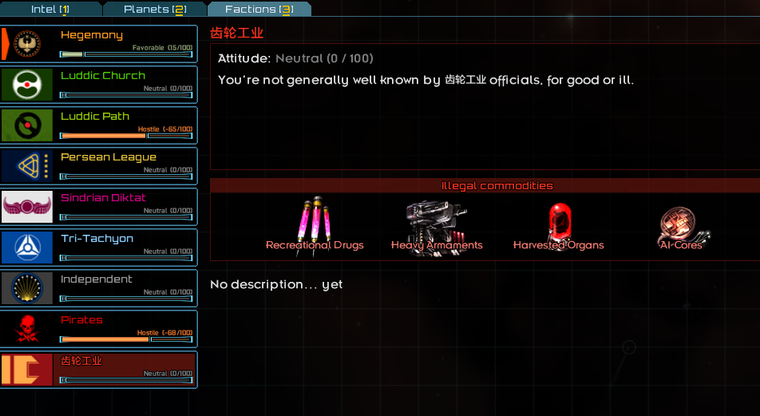

# 制作新常规势力：文件、学说与舰船池

本节把前面各页注册的船体、武器、战机和船插组织成一个可以进入生涯的可玩势力。势力注册、文件字段、舰船池、舰队学说与关系五条链路，构成一个势力从文件到运行时的完整流程。

*本节预期阅读时间：~20 分钟。*

*本节预期操作时间：~15 分钟。*

## 学习目标

完成后，您将能够：

- 用 `data/world/factions/factions.csv` 注册一个势力，说出势力注册与文件加载的完整链路；
- 说出 faction 文件的必填字段与可选字段，以及每个必填字段缺失时的可观察结果；
- 用 `factionDoctrine` 配置势力的舰队组成、质量与性格倾向，并说出玩家势力编辑器对同一组字段的取值约束；
- 用 `knownShips` / `knownWeapons` / `knownFighters` / `knownHullMods`、`hullFrequency`、`priority*` 配置势力舰船池，并说出 tags 展开与 `pickShip` 过滤的完整流程；
- 用 `default_ship_roles.json`（或势力文件内的 `shipRoles`）把装配引入生涯舰队；
- 说清势力间关系不是文件数据而是运行时状态：`FactionAPI.setRelationship` / `adjustRelationship`、`RepLevel` 阈值，以及默认 0.0（中立）的含义。

## 前置知识

本节建立在前面各页的注册成果之上，需要以下内容先就绪：

- MOD 目录、`mod_info.json` 与数据合并规则（C01-S01）；
- 船体注册：`GearIn_artizan`（C01-S02）；
- 战机与航母注册：`GearIn_slag_wing`、`GearIn_furnaceman`（C01-S03）；
- 武器注册：`GearIn_durin`、`GearIn_dwalin`（C01-S04）；
- 船插注册：`GearIn_stable_injector`（C02-S02）；
- 战役与装配：装配 `GearIn_artizan_combat` 等（C03-S01）。

本教程示例的 ID 语义（`examples.md` 约定）：

- MOD ID 是 `gear_in`，只用于 `mod_info.json` 与加载识别；
- **势力 ID** 是 `gear_industry`（小写），是游戏运行时的势力注册键，只在 faction 文件、`factions.csv` 与关系代码里出现；
- 数据与资源 ID 前缀 `GearIn_`（船体、武器、战机、船插），类 `GearIn<Subject>`，包 `data.scripts.gearin.<domain>`。

MOD ID 与势力 ID 互不相关，只是本例恰好同源。原版里 MOD 名与势力名相同也纯属惯例，不是约束。

## 术语

- **势力（faction）**：生涯里的政治实体。API 名保留源码大小写：`FactionAPI`、`FactionSpecAPI`。一个势力拥有身份信息（名称、颜色、旗帜）、舰船池、舰队学说、声望关系与随机人物生成数据。
- **舰队学说（doctrine）**：决定势力舰队组成倾向的一组数值。API 名保留：`FactionDoctrineAPI`。
- **舰船池（ship pool）**：势力"知道"的舰船、武器、战机、船插集合（`knownShips` 等），是舰队生成与蓝图分配的依据。
- **声望等级（RepLevel）**：把关系数值（float，-1 到 1）映射成的离散等级，从 `VENGEFUL`（复仇）到 `COOPERATIVE`（合作）。API 名保留源码大小写。

## 文件与 API 链路

### 链路一：势力注册（factions.csv）

1. 游戏在加载阶段读取 `data/world/factions/factions.csv`（spec 加载流程）。该 CSV 在所有来源（原版与各 MOD）之间**按行合并**，所以 MOD 只需要提交自己的一行；第一列列名是 `faction`（必须逐字一致），以 `#` 开头的行被跳过。
2. 每行的值是一个相对路径，指向一个 faction 文件（相对于 MOD 根目录，例如 `data/world/factions/gear_industry.faction`）。路径错了、文件缺失，加载直接失败。
3. 游戏打开该文件，**以文件内的 `id` 字段为注册键**（不是文件名，也不是 CSV 行号）。日志会打印 `Loading <id> faction`。
4. 每个势力注册为一张 `FactionSpecAPI`，存入按类分组的 spec 表。**两个注册行产生了相同的势力 ID 时**（无论来自同一文件还是两份文件），加载抛 `Spec of class com.fs.starfarer.loading.FactionSpecAPI with id [X] already exists`，加载中断。
5. 运行时入口：`Global.getSector().getFaction(id)` 按 ID 取 `FactionAPI`，`getAllFactions()` 枚举全部势力，`getPlayerFaction()` 取玩家势力。势力对象按 ID 缓存（构造时从 spec 表取数据），因此**势力 ID 在加载期就已经唯一**。

### 链路二：faction 文件字段与加载

spec 加载流程对每个 faction 文件按固定顺序解析字段。**必填**（缺失即 `JSONException`，加载中断）：

| 字段 | 加载器读取方式 | 缺失结果 |
|---|---|---|
| `id` | `getString` | 加载中断（`JSONObject["id"] not found`）|
| `logo` | `getString` + 贴图入资源队列 | 加载中断；贴图文件缺失还会在资源加载阶段报错（TEXTURE 无错误备用值，见 C01-S02）|
| `displayName` | `getString` | 加载中断 |
| `displayNameWithArticle` | `getString` | 加载中断 |
| `names` | `getJSONObject` | 加载中断（可以是空对象 `{}`，但键必须存在）|
| `portraits` | `getJSONObject` | 加载中断（其中 `standard_male` / `standard_female` 数组可选，条目同时入贴图资源队列）|

**可选**（带默认值或缺省行为）：

- `crest`、`shipNamePrefix`（默认 `ISS`）、`shipNameSources`（缺省回退为 `ALL` 一项权重 1）、`displayNameLong` / `displayNameLongWithArticle`（回退显示名）、`entityNamePrefix` / `personNamePrefix` / `personNamePrefixAOrAn` / `displayNameIsOrAre`、`barSound`（默认 `bar_ambience`）、`internalComms`、`tariffFraction`（默认取 `data/campaign/econ/economy.json` 的 `defaultTariff`，RC8 为 0.3）、`tollFraction`（0.1）、`fineFraction`（0.25）、 `color`（缺失回退白色）、`baseUIColor` / `darkUIColor` / `gridUIColor` / `brightUIColor` / `secondaryUIColor`、`music`
- `factionDoctrine`、`variantOverrides`、`voices`、四个 `*SellFrequency`、`hullFrequency`、`shipsWhenImporting` / `known*` / `priority*`、`fleetCompositions`、`flags`、`illegalCommodities`、`traits`、`custom`

加载期就会校验（不只是"存下来"）的字段：

- `illegalCommodities` 数组里的每个 ID 必须在 `data/campaign/commodities.csv` 中存在，否则抛 `Invalid illegal commodity id: [X]`，加载中断。**不要**把武器、补给这类商品之外的物品写进去。
- `variantOverrides` 的每个键是装配 ID，加载期就查装配并记下它所属的船体（`getOverriddenHulls`），装配不存在同样加载失败。
- `hullFrequency.tags` 的每个 tag 会当场展开：遍历**所有已注册船体**，把带该 tag 的船体的出现倍率乘以对应数值（基准 1.0），写进 `hullFrequency.hulls` 的同一张表。数值 0 表示绝不出现。
- `shipsWhenImporting` 如果既没有 tags 也没有 hulls（空列表），回退为 `knownShips` 的并集。
- `logo` / `crest` / 头像贴图路径全部进入 TEXTURE 资源队列，文件缺失在资源加载阶段直接报错。

### 链路三：舰船池（known* 与装配角色）

1. 加载期 `loadFactionList` 处理每个 `known*` / `priority*` 块：`tags` 数组里的每个 tag，遍历对应注册表（`knownShips` 遍历全部船体、`knownWeapons` 遍历全部武器、`knownFighters` 遍历全部战机联队、`knownHullMods` 遍历全部船插），凡对象带任一 tag 即加入集合；`hulls` / `weapons` / `fighters` / `hullMods` 数组则把 ID 直接加入集合。**拼错的 tag 或 ID 不会报错**——只是匹配不到任何对象，静默得到一个更小的舰船池。
2. 装配角色的来源有两层。第一层是**全 MOD 共享**的 `data/world/factions/default_ship_roles.json`：这是合并读取的 JSON（`readJSONMerged`），角色对象按键逐层合并、装配条目按 variant ID 覆盖，因此 **MOD 只提交自己的角色条目，不要整份复制原版文件**（复制会覆盖原版的角色对象，让所有原版势力失去对应角色的装配条目）。每个角色是一个对象： `variantId → 权重`，另有三个特殊键：`includeDefault: true`（把原版同名角色的条目复制进来）、`fallback` / `fallback2`（角色回退）。角色条目（`RoleEntryAPI`）创建时**立即按 ID 查装配**（`_wing` 结尾的 ID 走联队查找的历史兼容路径，原版数据不使用它）；装配查不到抛 `Ship hull variant [X] not found!`，加载中断。
3. 第二层是势力文件自己的 `shipRoles`（对象结构与 default_ship_roles.json 相同；内部 `doctrine` 键是旧版遗留，本节不展开）。`FactionAPI.pickShip(role, params)` 在选择时优先用势力自己的角色；角色缺失或为空时回退到共享的 `default_ship_roles.json`（`FactionSpecAPI.getDefaultShipRoles()`）。
4. **舰船池完整流程**：`pickShip` 内部对每个角色条目做过滤——条目装配的船体必须在该势力的 `knownShips` 里（`knowsShip`），再乘上 `hullFrequency` 里该船体的倍率；`variantOverrides` 命中的装配按覆盖权重参与。这就是"势力只出自己舰船池里的船"的机制。过滤结果按权重随机抽取，`ShipPickMode` 控制范围（`ALL` / `PRIORITY_ONLY` / `PRIORITY_THEN_ALL` / `IMPORTED`），`priorityShips` / `priorityWeapons` / `priorityFighters` 在优先级模式下优先被抽取。权重结果带缓存，运行时改动舰船池后要调 `clearShipRoleCache()` 才会反映（常见陷阱：缓存不会自动失效，改动池后容易漏调）。
5. 其它只读入口：`getNumAvailableForRole(role, mode)`、`getApproximateMaxFPPerFleet(mode)`、`knowsShip / knowsWeapon / knowsFighter / knowsHullMod`。

::: warning 拼错的 tag 或 ID 只会静默缩小舰船池

`known*` / `priority*` 里的 tag 或 ID 拼错时，加载期不会有任何报错：匹配不到任何对象，舰船池（或优先级）只是变小。排查"势力缺船"问题时，先对照各注册表的 tags 列逐字核对。

:::

### 链路四：舰队学说（factionDoctrine）

1. 加载期 `factionDoctrine` 对象（存在时）解析为 `FactionDoctrineAPI`：`warships`、`carriers`、`phaseShips`、`officerQuality`、`shipQuality`、`numShips` 六个键用 `getInt` **必读**——写了 `factionDoctrine` 块却漏掉其中任何一个，加载中断（`JSONObject["<键>"] not found`）；`shipSize` / `aggression` / `fleets` 是 `optInt`，默认 3； `autofitRandomizeProbability` 默认 0.25；`strictComposition` 默认 false；`commanderSkills` / `officerSkills` 数组与各自的 `*ShuffleProbability` 可选。
2. 加载后成为 `FactionDoctrineAPI`，运行时可经 `FactionAPI.getDoctrine()` 读写。
3. **玩家势力编辑器与文件是同一组字段**：游戏内玩家自定义势力时用的**势力编辑器界面**把前两组各三条的总和固定为 7、每一条取值 1–5（每行是五档按钮），`shipSize` / `aggression` 各 1–5 且不受总和约束。势力文件本身不校验这些范围，但建议按编辑器的值域填写，使势力观感与用户习惯一致。
4. 行为使用方（舰队生成、军官生成）读取这些值决定编队组成、船型倾向、军官质量与性格分布；`getShipQualityContribution()` 按 `(shipQuality - 1) * doctrineFleetQualityPerPoint` 计算，RC8 的 `settings.json` 里该系数为 0.125。

### 链路五：关系（关系不在文件里）

1. **faction 文件不定义任何势力间关系**。所有关系是运行时状态：关系数值默认 0.0，也就是所有势力两两之间默认中立。
2. 原版的关系表是代码播种的：`SectorGen`（原版生涯生成脚本）在生成生涯时对每个势力调用 `setRelationship(其它势力ID, 数值或 RepLevel)`，例如 `hegemony.setRelationship(pirates.getId(), RepLevel.HOSTILE)`。
3. MOD 势力的关系同样只能由代码设置：`FactionAPI.setRelationship(id, float)` 或 `setRelationship(id, RepLevel)` 直接写值；`adjustRelationship(id, delta[, RepLevel limit])` 增减并可选钳制到等级边界；`ensureAtBest` / `ensureAtWorst` 把数值推进/钳制到某个等级； `getRelationship(id)` 读 float，`getRelationshipLevel(id)` 读等级。
4. `RepLevel` 的阈值：`T1=0.09`、`T2=0.24`、`T3=0.49`、`T4=0.74`（`getLevelFor(float)` 按正负方向映射为 9 个等级；`getRepInt` 把 float 乘 100 四舍五入为整数显示）。`isHostileTo(id)` 的判据是关系等级为 `HOSTILE` 或更差（数值 ≤ -0.49）。
5. 把关系代码挂进 MOD 的哪个回调（`ModPlugin` 的生涯生成钩子），属于 ModPlugin 主题；本节给出原版写法作参照，并说明可观察结果。

## 完整最小例：注册齿轮工业

### 第一步：注册 factions.csv

在 MOD 中新建 `data/world/factions/factions.csv`，写入表头与一行路径。**不要**复制整份原版 `factions.csv`——这个文件按行合并，您只需要自己的行：

```csv
faction
data/world/factions/gear_industry.faction
```

第一行 `faction` 是列名（必须逐字一致，拼错会让整行解析失败），第二行是势力文件路径。多行时用 `#` 注释掉整行。

注册并启动后，游戏内的势力会以本节配置的身份信息显示（下图为本机实测画面，供对照）：



### 第二步：创建 faction 文件

把 `Starsector\starsector-core\data\world\factions\hegemony.faction` 复制到 `Starsector\mods\GearIndustry\data\world\factions\gear_industry.faction`，然后按下面的完整最小例替换内容。

势力 ID 是 `gear_industry`，以`齿轮工业`为显示名，舰船池只消费前面各页已注册的 `GearIn_` 内容，另加两艘原版辅助船。

```json
{
	id:"gear_industry",   # 势力的唯一 ID：注册键是文件里的这个 id，与文件名、CSV 行无关，重复即加载中断
	"color":[180,120,60,255],   # 势力主色 RGBA，用于星图与情报显示
	"displayName":"齿轮工业",
	"displayNameWithArticle":"齿轮工业",   # 带冠词的名称；中文环境下与 displayName 一致
	"logo":"graphics/factions/gear_industry.png",      # 大旗，贴图建议 410×256，入资源队列
	"crest":"graphics/factions/crest_gear_industry.png", # 小旗，贴图建议 256×256，入资源队列
	"shipNamePrefix":"GIS",   # 势力舰船名前缀
	"shipNameSources":{       # 舰船名词典：data/strings/ship_names 的分类 -> 权重
		"GENERAL":2,
		"SPACE":1,
	},
	"names":{                 # 人名词典：data/characters/person_names.csv 的分类 -> 权重
		"modern":2,
		"world":1,
	},
	# variantOverrides 限制个别装配的可用性并改写其权重；本节不展开，留空即可
	"variantOverrides":{
	},
	# 舰船出现倍率：tags 当场展开为所有带该 tag 的已注册船体，hulls 按 ID 指定；0 表示绝不出现
	"hullFrequency":{
		"tags":{
			"GearIn_bp":1,
		},
		"hulls":{
		},
	},
	# 引入其他势力蓝图时的可用舰船；留空则回退为 knownShips
	"shipsWhenImporting":{
		"tags":[],
		"hulls":[],
	},
		"knownShips":{            # 势力舰船池：tags 展开 + hulls 直列
			"tags":["GearIn_bp", "gear_industry"],   # gear_industry 是本节定义的势力专属 tag，后续单元可给船体打上
			"hulls":[
				"GearIn_artizan",
				"GearIn_furnaceman",
				"dram",
				"valkyrie",
			],
		},
	# priorityShips 会显著覆盖本势力其它舰船的出现率；无特殊要求留空
	"priorityShips":{
		"tags":[],
		"hulls":[],
	},
	"knownFighters":{
		"tags":["GearIn_bp"],
		"fighters":[
			"GearIn_slag_wing",
		],
	},
	"priorityFighters":{
		"tags":[],
		"fighters":[],
	},
	"knownWeapons":{
		"tags":["GearIn_bp"],
		"weapons":[
			"GearIn_durin",
			"GearIn_dwalin",
		],
	},
	"priorityWeapons":{
		"tags":[],
		"weapons":[],
	},
	"knownHullMods":{
		"tags":["standard", "GearIn_bp"],   # standard 是原版通用船插 tag（见 hull_mods.csv 的 tags 列）
		"hullMods":[
			"GearIn_stable_injector",
		],
	},
	"factionDoctrine":{
		# 组一：warships+carriers+phaseShips 总和建议 7，每一行 1–5（玩家势力编辑器即此约束）
		"warships":4,
		"carriers":2,
		"phaseShips":1,

		# 组二：officerQuality+shipQuality+numShips 总和建议 7，每一行 1–5
		"officerQuality":5,
		"shipQuality":1,
		"numShips":1,

		"shipSize":4,     # 越大越偏向大船，建议 1–5
		"aggression":2,   # 越大越偏向鲁莽军官，建议 1–5

		"combatFreighterProbability":0.1,                  # 用武装货舰替换部分货舰的概率
		"combatFreighterCombatUseFraction":0,              # 舰队损失到低于此比率时才把武装货舰当战舰用
		"combatFreighterCombatUseFractionWhenPriority":0,  # 标记为优先时武装货舰当战舰用的概率
		"autofitRandomizeProbability":0.1,                 # 自动装配打乱程度

		"officerSkillsShuffleProbability":1,
		"officerSkills":[
			"ballistic_mastery",
		],

		"commanderSkillsShuffleProbability":1,
		"commanderSkills":[
			"crew_training",
			"officer_training",
		],
	},
	"illegalCommodities":[    # 违禁品：ID 必须存在于 data/campaign/commodities.csv，否则加载中断
		"drugs",
		"organs",
	],
	"music":{                 # 各场景音乐，值为 sounds.json 已注册的音乐 ID（注册链见 C05-S02）
		"theme":"music_hegemony_market_neutral",
		"market_neutral":"music_hegemony_market_neutral",
		"market_hostile":"music_hegemony_market_hostile",
		"market_friendly":"music_hegemony_market_friendly",
		"encounter_neutral":"music_hegemony_encounter_neutral",
		"encounter_hostile":"music_hegemony_encounter_hostile",
		"encounter_friendly":"music_hegemony_encounter_friendly",
	},
	"internalComms":"hegemony_internal",  # 内部频道 ID，须在 data/campaign/channels.json 中注册（本节沿用原版频道）
	"portraits":{             # 人物头像池（键必须存在；数组可省略，条目入资源队列）
		"standard_male":[
			"graphics/portraits/portrait_hegemony01.png",
			"graphics/portraits/portrait_mercenary03.png",
		],
		"standard_female":[
			"graphics/portraits/portrait_hegemony03.png",
			"graphics/portraits/portrait16.png",
		],
	},
	"ranks":{                 # 自定义头衔；不写则回退 data/world/factions/default_ranks.json
		"ranks":{
			"factionLeader":{"name":"总工程师"},
		},
		"posts":{
			"factionLeader":{"name":"总工程师"},
		},
	},
	"voices":{                # 联络人类型权重（spacer/faithful/pather/business/official/soldier/scientist/villain/aristo）
		"LOW":{"soldier":5,"spacer":5},
		"MEDIUM":{"official":5,"soldier":5},
		"HIGH":{"official":5,"aristo":2},
	},
	"custom":{
		# 本地可核验的消费方只有 engageWhenEvenStrength（舰队 AI：势均力敌时也主动进攻）。
		# 其余键是原版文件的惯例内容（offersCommissions、buysAICores、caresAboutAtrocities、
		# punitiveExpeditionData、postsNoBounties、allowsTransponderOffTrade、decentralized、
		# pirateBehavior、makesPirateBases、fightToTheLast、gaVIPMission 等），它们的消费方大多在
		# 本教程可验证切片之外：照原样保留即可，但不要把势力行为的关键逻辑寄托在未核验的键上。
		"engageWhenEvenStrength":false,
		"offersCommissions":false,
		"engagesInHostilities":true,
		"buysAICores":false,
		"buysSurveyData":false,
		"caresAboutAtrocities":false,
		"postsNoBounties":false,
		"allowsTransponderOffTrade":false,
		"decentralized":false,
		"pirateBehavior":false,
		"makesPirateBases":false,
		"fightToTheLast":false,
		"gaVIPMission":false,
		"hostilityImpactOnGrowth":true,
		"punitiveExpeditionData":{
			"vsCompetitors":false,
			"vsFreePort":false,
			"canBombard":false,
			"territorial":false,
		},
	},
}
```

由于 faction 文件很长，无法逐字段列表，上文用注释注解了所有在本节有意义的字段。下面只总结必须遵守的规则（RC8，均来自 spec 加载期解析 faction 文件的实现）：

| 规则 | 违反后的可观察结果 |
|---|---|
| `id` / `logo` / `displayName` / `displayNameWithArticle` / `names` / `portraits` 必须存在 | 加载中断：`JSONObject["<键>"] not found` 异常堆栈，进不了主菜单 |
| `factionDoctrine` 块若存在，`warships` / `carriers` / `phaseShips` / `officerQuality` / `shipQuality` / `numShips` 必须存在 | 加载中断：同样的 JSON 异常 |
| 势力 ID 全局唯一（含原版与其它 MOD）| 加载中断：`Spec of class com.fs.starfarer.loading.FactionSpecAPI with id [X] already exists` |
| `illegalCommodities` 的 ID 必须是商品 ID | 加载中断：`Invalid illegal commodity id: [X]` |
| `logo` / `crest` / 头像贴图路径真实存在 | 资源加载阶段报错（TEXTURE 无错误备用值）|
| `factions.csv` 表头为 `faction`、行未被 `#` 注释 | 表头拼错：行解析失败，势力不出现；被注释：势力不出现，无报错 |

### 第三步：把装配引入生涯舰队（default_ship_roles.json）

faction 文件只决定"势力知道哪些船"，舰队生成时按角色（`combatSmall`、`combatMedium`、`combatLarge`、`combatCapital`、`carrierSmall` 等）从角色表里抽装配。

角色表就是共享的 `default_ship_roles.json`：没有它（或没有本 MOD 的条目），装配就不会出现在生涯舰队里，势力只能回退到原版装配。

在 MOD 中新建 `data/world/factions/default_ship_roles.json`，**只提交自己的角色条目**（这个文件跨来源按角色对象合并，整份复制原版文件会覆盖原版角色，害到所有原版势力）：

```json
{
	"combatSmall":{
		"GearIn_artizan_combat":10,
	},
}
```

::: caution 只提交自己的角色条目，禁止整份复制原版文件

`default_ship_roles.json` 跨来源按角色对象合并：整份复制原版文件会覆盖原版角色对象，让所有原版势力失去对应角色的装配条目——没有报错，很难察觉。MOD 只提交自己的角色条目。

:::

每个条目是 `装配 ID → 权重`。**查不到装配会当场抛 `Ship hull variant [X] not found!` 并中断加载**。`includeDefault: true` 可把原版同名角色的条目复制进来再叠加自己的条目（参考原版文件里各角色的写法；本例不需要）。

注意角色表里只放**舰船装配**：航母角色（`carrierSmall` 等）的条目是航母船体的装配，战机联队不进角色表——联队经由舰船装配的 `wings` 数组（C03-S01）与 `knownFighters` 池进入舰队。

角色条目（`RoleEntryAPI`）对 `_wing` 结尾的 ID 有按联队 ID 查找的历史兼容路径，原版数据不使用它，本教程也不建议使用。

想加更多装配（例如按 C03-S01 的导出流程为其它船体做的装配），按同一格式加行即可。

把装配文件放好之后，势力舰船池就形成了完整流程：`knownShips`（势力知道什么）∩ 角色表（能抽什么）→ 权重由 `hullFrequency` 与 `priority*` 调节 → `pickShip` 抽取。

### 第四步：设置关系（代码，由 ModPlugin 挂载）

势力文件无法声明关系。参照原版 `SectorGen` 的写法（原版数据脚本，关系播种的权威示例）：

```java
// 摘自原版 SectorGen 脚本的写法，用于本教程说明关系 API
FactionAPI gear = Global.getSector().getFaction("gear_industry");
FactionAPI pirates = Global.getSector().getFaction("pirates");
FactionAPI hegemony = Global.getSector().getFaction("hegemony");

gear.setRelationship(pirates.getId(), RepLevel.HOSTILE);        // 直接设到等级区间
gear.setRelationship(hegemony.getId(), 0.25f);                  // 或直接写数值
gear.adjustRelationship(pirates.getId(), -0.1f, RepLevel.HOSTILE); // 增减并钳制到等级
```

把这段代码挂进 MOD 的哪个回调（`ModPlugin` 的生涯生成钩子），属于 ModPlugin 主题，本节不展开。不设置任何关系的可观察结果：所有势力对这个新势力都是 0.0 中立——包括那些看起来应该敌对的势力，且没有任何报错。

::: warning 关系是运行时状态，不是文件数据

faction 文件不定义任何势力间关系，所有关系都是运行时数值，只能由代码设置。不设置的可观察结果：所有势力对新势力默认 0.0 中立（该敌对的也中立），且没有任何报错。

:::

### 验证方案（基于本例）

前置数据：

- C01-S01 的 `mod_info.json`
- C01-S02 的船体（`GearIn_artizan`）
- C01-S03 的联队与航母（`GearIn_slag_wing`、`GearIn_furnaceman`）
- C01-S04 的武器（`GearIn_durin`、`GearIn_dwalin`）
- C02-S02 的船插（`GearIn_stable_injector`）
- C03-S01 的装配（`GearIn_artizan_combat` 等）
- 本节的 `factions.csv`、`gear_industry.faction`、`default_ship_roles.json`

**操作与通过信号**：

1. 启动游戏，加载到主菜单，检查 `Starsector\starsector-core\starsector.log`。**通过信号**：出现 `Loading factions`、`Loading default_ship_roles.json`、`Loading gear_industry faction`，且无 `ERROR`。
2. 进入生涯（或读取已有生涯存档），按 `F` 打开情报。**通过信号**：齿轮工业出现在势力列表，名称、颜色、大旗（logo）与小旗（crest）与 faction 文件一致；若按第四步挂了关系代码，关系表显示设定值。
3. 在星区里遭遇或靠近齿轮工业的巡逻队/贸易队。**通过信号**：舰队由 `knownShips` 的船体组成，`GearIn_artizan` / `GearIn_furnaceman` 使用 `default_ship_roles.json` 里的装配；`hullFrequency` 为 0 的船体不出现。
4. （可选）与齿轮工业的市场互动（若有其殖民地，本节未建殖民地时可跳过）。**通过信号**：税率默认 0.3（`tariffFraction`），违禁品列表生效。

**故障注入**（可选，逐项做完恢复，用于反向确认通过信号）：

1. 注释掉 `factions.csv` 的行，重启确认 `Loading gear_industry faction` 消失、势力不出现（对应故障分析第 1 条）；
2. 删掉 faction 文件里 `displayName`，重启确认加载中断与 `JSONObject["displayName"] not found`（对应第 2 条）；
3. 把 `default_ship_roles.json` 的一个装配 ID 改错，重启确认 `Ship hull variant [X] not found!`（对应第 5 条）；
4. 把 `knownShips.tags` 里的 `GearIn_bp` 改成 `GearIn_bp2`，重启确认 `GearIn_` 舰船从势力舰队中消失且无报错（对应第 6 条）。

**清理**：恢复所有注入的故障；发布前确认 `factions.csv` 无 `#` 注释行、势力 ID 不与任何 MOD 冲突。

## 实用势力包(bp)与其它生成型 tags 速查表（RC8 核对）

下表全部经 RC8 数据核对（tag 存在性来自 `data/weapons/weapon_data.csv`、`data/hulls/ship_data.csv`、`data/hulls/wing_data.csv`、 `data/hullmods/hull_mods.csv`；"引用它的势力文件"来自 `data/world/factions/*.faction`）。

**不在本表上的数据均为与势力包(bp)和生成均无关的 tags。**

| tag | RC8 数据中存在性 | 引用它的原版势力文件 | 实际意义 |
|---|---|---|---|
| `base_bp` | 是（20 船体、16 武器、2 联队）| 海盗、卢德左径、derelict、余晖、欧米伽、玩家势力 | 通用默认池 tag，构成上述势力的舰船/武器池主体；玩家势力的 known* 也引用它 |
| `lowtech_bp` / `midline_bp` / `hightech_bp` / `missile_bp` | 是（低科/中科/高科/导弹各若干）| 海盗、卢德左径、余晖 | 科技线 tag。注意：**不是所有对应科技的组件都在其中**；RC8 的多数正规势力（霸主、自由联盟、英仙座联盟、辛达强权、卢德教会等）不再依赖这些 tag，而是在 `hulls` 数组里显式列出舰船 |
| `pirate_bp` | 是 | 海盗 | 海盗改造型（D 插变体）蓝图 tag |
| `LP_bp` | 是 | 卢德左径 | 左径安超(LP)型改造包，只有卢德左径拥有它 |
| `XIV_bp` / `heg_aux_bp` | 否（不在数据 CSV，只作势力内 tag）| 霸主 | 第十四军团(XIV) / 霸主辅助军(A)型改造包，只有霸主拥有它 |
| `hegemony` | 是 | 霸主 | 霸主势力专属 tag |
| `ind` / `independent` | 是 | 自由联盟、mercenary、拾荒者 | 自由联盟势力 tag（拾荒者的文件也用它，RC8 没有独立的 `scavenger` tag）|
| `persean` | 是 | 英仙座联盟 | 英仙座联盟势力 tag |
| `tritachyon` | 是 | 速子科技 | 速子科技势力 tag |
| `luddic_church` | 是 | 卢德教会 | 卢德教会势力 tag |
| `luddic_path` | 是 | 卢德左径 | 卢德左径势力 tag |
| `lions_guard` | 是 | 狮心守卫（文件也引用辛达强权 tag）| 狮心守卫势力 tag，辛达强权的少量特殊舰队使用 |
| `sindrian_diktat` | 是 | 辛达强权、狮心守卫 | 辛达强权势力 tag |
| `pirates` | 是 | 海盗 | 海盗势力 tag |
| `derelict` | 是 | derelict | 遗弃船（绿粽子）势力 tag |
| `remnant` | 是 | 余晖 | 余晖势力 tag |
| `omega` | 是 | 欧米伽 | 欧米伽势力 tag |
| `merc` | 是（大量武器与船插带此 tag，如 armoredweapons）| mercenary | 佣兵系 tag，自由联盟的佣兵舰队使用；使用方在生涯舰队生成代码 |
| `rare_bp` | 是（82 处）| 无（所有势力默认不拥有）| 稀有蓝图 tag：`campaign/procgen/drop_groups.csv` 的蓝图掉落池只挑带 `rare_bp` 的组件，因此它决定组件能否在野外掉落/挖坟得出 |
| `restricted` | 是（42 处）| 无 | 限制级：默认不出现在数据库与掉落（掉落池显式排除 `!restricted`），适合隐藏数据 |
| `no_drop` | 是 | 无 | 不会在战后掉落（掉落池显式排除）|
| `no_drop_salvage` | 是 | 无 | 不会在残骸区打捞得到（掉落池显式排除）|
| `no_sell` / `no_dealer` | 是 | 无 | 不出售 / 不被联络人任务提供；使用方在生涯市场代码 |
| `hist1t` / `hist2t` / `hist3t` | 是（20/3/2 处）| 无 | 与历史学家相关的蓝图筛选 tag，池内稀有度依次降低（使用方在生涯代码）|
| `standard` | 是（船插 tags 列大量使用，如 armoredweapons）| 11 个势力文件 | 通用船插 tag：`knownHullMods` 用它作为基础船插的默认来源，等价于武器侧的 `base_bp` |

如何给自家组件打 tag：船体在 `ship_data.csv` 的 `tags` 列、武器在 `weapon_data.csv` 的 `tags` 列、战机联队在 `wing_data.csv`、船插在 `hull_mods.csv` 的 `tags` 列（C01-S02 / C01-S04 / C02-S02 各自的注册页）。

打出 `GearIn_bp` 后，本节 `knownShips` 等块里写上 `"GearIn_bp"` 即自动导入。

::: info 为什么例子里的 tags 与旧教程不同

旧版教程示例给 `knownShips` 写了 `base_bp`、`lowtech_bp` 等一串 tag。

RC8 中这些 tag 仍然存在，但霸主等正规势力已经在 `hulls` 数组里显式列出全部舰船；势力专属 tag（`hegemony`、`GearIn_bp`、`gear_industry`）仍然是舰队池的推荐入口。

**给自家舰船打上专属 tag 并从 tags 导入，永远比逐个列举船体更省事。**

:::

## 预期结果

- 启动游戏加载到势力阶段时，`starsector.log` 出现 `Loading factions`、`Loading default_ship_roles.json` 与 `Loading gear_industry faction`，之后没有任何 `ERROR`。
- 进入生涯（或任意读取生涯的存档）后，按 `F` 打开情报（intel），齿轮工业出现在势力列表里，显示名、颜色、大旗（logo）与小旗（crest）与 faction 文件一致。
- 齿轮工业生成的巡逻队、贸易队使用 `knownShips` 里的舰船，组成符合 `factionDoctrine`（战舰/航母比例、船型大小、军官质量）；`GearIn_artizan` / `GearIn_furnaceman` 及其在 `default_ship_roles.json` 里的装配出现在其舰队中；`hullFrequency` 里倍率为 0 的船体永不出现。
- 未设置关系时，齿轮工业与所有势力的关系都是 0.0 中立；按第四步设置后，情报里对应关系显示为设定值（例如与海盗 `HOSTILE`），且海盗对该势力同样敌视（关系是对称存储、按对读取的）。
- 市场蓝图与打捞层面：带 `rare_bp` 的组件不出现在本势力默认池里，符合掉落池规则（本节不展开市场）。

## 实例驱动故障分析

下面每条都给出触发条件、可观察结果和修正。

1. **势力完全没有出现。**
   - 触发：`factions.csv` 没建、表头不是 `faction`、行首误加了 `#`、路径写错，或文件里没有 `id` 字段。
   - 可观察：日志里有 `Loading factions` 但**没有** `Loading gear_industry faction`；表头错误会让整行解析失败（同文件列名不符），`#` 注释与路径错误则静默跳过/打不开文件。
   - 修正：确认 MOD 自己的 `factions.csv` 第一行是 `faction`，第二行是相对 MOD 根目录的完整路径；用记事本检查文件是 UTF-8 无 BOM（C01-S01）。
2. **游戏加载中断，进不了主菜单。**
   - 触发：必填字段缺失（`id`、`logo`、`displayName`、`displayNameWithArticle`、`names`、`portraits` 任一）、faction 文件 JSON 语法错误、`factionDoctrine` 六个 `getInt` 键缺失、`illegalCommodities` 引用非商品 ID。
   - 可观察：加载流程在 `Loading factions` 之后抛 `JSONException` 或 `RuntimeException`（`JSONObject["<键>"] not found`、`Invalid illegal commodity id: [...]`），无保护地中断。
   - 修正：对照"必须遵守的规则"表补齐字段与商品 ID；商品 ID 参考 `data/campaign/commodities.csv`。
3. **势力 ID 与其它来源冲突。**
   - 触发：两份 faction 文件（或同一文件在合并后的 CSV 里出现两次）产生相同 `id`。
   - 可观察：加载中断，日志出现 `Spec of class com.fs.starfarer.loading.FactionSpecAPI with id [X] already exists`。
   - 修正：换一个全局唯一的势力 ID；原版势力 ID 清单见 `data/world/factions/factions.csv`。
4. **势力出现，但舰队里全是别人的船，自己的船一艘都没有。**
   - 触发：`default_ship_roles.json` 没建、装配 ID 拼错（大小写不一致）、装配还没做（C03-S01 的 `GearIn_artizan_combat` 不存在）。
   - 可观察：角色表里没有本 MOD 的条目时，`pickShip` 回退到共享默认角色表，这些船体虽然 `knowsShip` 但没有角色条目可抽，舰队只能抽原版装配。
   - 修正：只提交自己的角色条目并核对装配 ID 与 `data/variants` 里的一致；角色表只放舰船装配，联队不进角色表（经航母装配的 `wings` 数组进入舰队，见 C03-S01）。
5. **加载中断，日志出现 `Ship hull variant [X] not found!`。**
   - 触发：`default_ship_roles.json`（或势力文件 `shipRoles`）里的某个 ID 查不到装配——角色条目（`RoleEntryAPI`）创建时立即校验（`_wing` 结尾的 ID 按联队查，属历史兼容路径）。
   - 可观察：加载期直接抛 `Ship hull variant [X] not found!`。
   - 修正：删掉或改正该条目；核对 `data/variants` 与联队注册（C01-S03）。
6. **势力出现，但某些船永远不出现（无报错）。**
   - 触发：`hullFrequency` 里倍率写成 0、该船不在 `knownShips`（tags 拼错或漏列）、或在 `priorityShips` 之外的池子里被概率淹没。
   - 可观察：完全静默——没有日志，只是生成结果里没有这些船。
   - 修正：把倍率改回 >0；核对 `knownShips.tags` 与船体 `ship_data.csv` 的 tags 列逐字一致（ID 匹配区分大小写）；想强制出现就加进 `priorityShips`。
7. **关系错乱：该敌对的势力互相中立。**
   - 触发：只在 faction 文件里写了 `custom` 之类的键，以为关系是数据；或关系代码没挂进游戏回调。
   - 可观察：无任何报错，所有势力与新势力关系 0.0 中立（`RepLevel.NEUTRAL`），巡逻队相遇也不打。
   - 修正：关系只能由代码设置（第四步），把代码挂进 MOD 的生涯生成回调（C03-S03）；用 `isHostileTo` 验证结果时注意判据是等级 `HOSTILE` 或更差（≤ -0.49）。
8. **图标异常或加载报贴图错误。**
   - 触发：`logo` / `crest` / 头像路径指向不存在的文件。
   - 可观察：资源加载阶段直接报错（TEXTURE 无错误备用值，同 C01-S02 的贴图规则）。
   - 修正：路径以 MOD 根目录为基准，把 410×256 / 256×256 的 PNG 放到 `graphics/factions/` 并确认文件名逐字一致。
9. **情报里势力的颜色/名称不对。**
   - 触发：`color` 数组少于 4 个元素（抛 `Color array with id [color] has less than 4 elements`，加载中断），或 `displayName` 与 `displayNameWithArticle` 不一致（显示带冠词变体）。
   - 修正：`color` 写满 RGBA 四项；中文环境两个名称写同一个字符串。
10. **势力突然变"穷"：蓝图/打捞层面缺组件。**
    - 触发：给组件打了 `rare_bp` / `restricted` 却期待它出现在本势力的默认池或掉落里。
    - 可观察：掉落池（`drop_groups.csv`）只挑 `rare_bp` 且排除 `!no_drop` / `!restricted`，组件不会出现在掉落中（无报错）。
    - 修正：想让组件可掉落就打 `rare_bp`，不想让组件在任何场合出现才打 `restricted`。

## 附：数据 ID 归属（本节定义的 ID）

本节新定义的 ID 只有一个：势力 ID `gear_industry`（小写）与势力专属 tag `gear_industry`（可在 `ship_data.csv` 的 tags 列使用）。

`GearIn_bp` 由前面各页（C01-S02/P03/P04、C02-S02 的注册惯例）沿用，本节只消费。其余引用均为既有 ID。

## 总结

本节走通了势力注册与使用的完整流程：`factions.csv` 按行合并引入 faction 文件（必填六键、`factionDoctrine` 六必填、贴图入资源队列），注册为 `FactionSpecAPI` 后由 `Global.getSector().getFaction(id)` 供全部使用方读取；

舰船池由 `known*` / `priority*` 的 tags 展开、角色表（势力 `shipRoles` 优先、空则回退共享 `default_ship_roles.json`）与 `pickShip` 的过滤加权组成完整流程，`factionDoctrine` 与玩家势力编辑器同构。

关系侧：**关系不是文件数据**，是运行时数值（默认 0.0 中立），由代码经 `setRelationship` / `adjustRelationship` 播种，`RepLevel` 负责数值与等级的映射。

调试时先问四个问题：势力注册了吗（日志里有没有 `Loading gear_industry faction`）、必填字段齐吗（有没有 JSON 异常）、装配在角色表里吗（有没有 `Ship hull variant not found`）、关系设置了吗（没有就全中立，且无报错）。

逻辑上，关系的代码播种需要一个运行时挂载点（`ModPlugin` 的生涯生成钩子），挂载点与星系生成同属一个主题——那是势力注册之后的自然落点：本节的势力与关系 API 就绪后，相关代码即可在那里搬入生效。

## 建议参考项

- `com.fs.starfarer.api.Global` — 全局入口：`getSector().getFaction(id)` 取势力运行时对象
- `com.fs.starfarer.api.campaign.FactionAPI` — 势力运行时接口：关系读写、舰船池查询与角色抽取（`pickShip` 等）
- `com.fs.starfarer.api.campaign.FactionDoctrineAPI` — 舰队学说运行时接口
- `com.fs.starfarer.api.campaign.FactionSpecAPI` — 势力 spec 只读接口（`knownShips`、`hullFrequency`、`getDefaultShipRoles` 等）
- `com.fs.starfarer.api.campaign.RepLevel` — 关系等级枚举与阈值（`T1..T4` = 0.09 / 0.24 / 0.49 / 0.74）
- `data/world/factions/factions.csv` — 势力注册表（按行合并，表头 `faction`）
- `data/world/factions/gear_industry.faction` — 本节示例势力文件（完整字段形态）
- `data/world/factions/default_ship_roles.json` — 共享装配角色表（跨来源合并读取）
- `data/world/factions/hegemony.faction` — 原版势力文件结构参考
- `SectorGen`（原版生涯生成脚本类）— 关系播种的权威示例写法
- `data/campaign/econ/economy.json` — `defaultTariff`（RC8 为 0.3）
- `data/campaign/commodities.csv` — `illegalCommodities` 的 ID 校验对象
- `data/campaign/channels.json` — 内部频道注册表（`hegemony_internal`）
- `data/campaign/procgen/drop_groups.csv` — 蓝图掉落池（`rare_bp` / `restricted` 使用方）
- `data/config/settings.json` — `doctrineFleetQualityPerPoint`（RC8 为 0.125）
- `data/hulls/ship_data.csv` / `data/weapons/weapon_data.csv` / `data/hulls/wing_data.csv` / `data/hullmods/hull_mods.csv` — 各组件注册表（tags 列与 tag 存在性）
