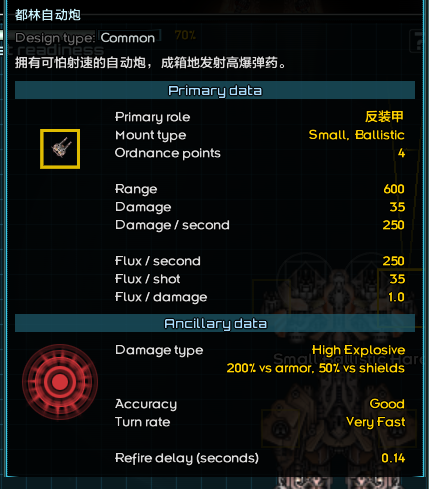
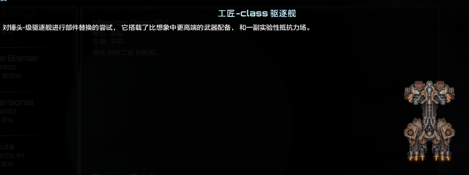

# 编写对象描述文本

本节完善 `descriptions.csv`，为战斗对象以外的游戏对象编写描述文本。重点是不同描述类型的查找键、使用范围与 CSV 转义边界；格式错误可能造成文本错位、截断，严重时会中止加载。

*本节预期阅读时间：\~15 分钟。*

*本节预期操作时间：\~20 分钟。*

## 学习目标

完成后，您将能够：

- 为 `Description.Type` 的 11 个枚举值选择正确的查找键和文本列；
- 正确转义含双引号、英文逗号和换行的 CSV 字段，并使用行首 `#` 注释数据行；
- 解释战机联队、船插 (hullmod)、市场条件、特殊物品为什么不在 `Description.Type` 里，以及它们各自的描述所在文件；
- 为商品、行星类型、势力和自定义实体写入已经关联的描述行，并按键唯一、`type` 合法和 UTF-8 无 BOM 的要求保存；
- 从加载期异常、文本错位/截断和对象键不匹配三类症状反推描述数据错误。

## 前置知识

- [C1-S7] 的 `descriptions.csv` 八列结构、`id + type` 键规则与加载失败表现；
- [C1-S2] 至 [C1-S6] 的船体、武器、战术系统及相关对象 ID 来源；
- 理解生涯 (campaign) 的基本界面与对象范围；
- 理解数据库 (codex) 是生涯界面中的图鉴；
- 理解 C2 命令是攻击、护航、撤退等战斗指挥命令；
- 理解地形 (terrain) 包括星云、小行星带和日冕等星系区域。

## 创建描述文件

在 MOD 内创建 `data/strings/descriptions.csv`。这个固定路径就是描述数据的入口，游戏会自动合并原版与全部已启用 MOD 的同名文件。

文件表头固定为 `id,type,text1,text2,text3,text4,text5,notes`。每一行由 `id + type` 确定唯一描述；`type` 必须逐字匹配 `Description.Type` 枚举，空键行会被跳过，非法类型会中止加载。

运行时可以调用 `Global.getSettings().getDescription(id, type)` 取得 `Description`，再按界面需要读取 text1–text5。键没有对应行时会得到带占位文本的描述对象，因此对象通常显示默认说明，而不会在查询位置抛出异常。

## CSV 转义规则

`descriptions.csv` 由 CSV 解析器解析：先把全文的 `\r\n` 归一为 `\n`，首行按逗号切分得到表头，其后逐字符扫描数据行。以下规则全部有效，**违反时必然出现所述的可观察结果**。

1. \*\*字段内含有英文逗号 (半角 `,`) 时，必须用一对双引号把整个字段包起来。\*\*违反后果：字段被按列切分，该行后续所有列整体错位一格 —— 文本串到别的列，`id`/`type` 键值被污染 (变成未关联行或显示占位文本)，列数异常。中文逗号 "，" 不是分隔符，无需处理。

```csv
# 错误：text1 未加引号，含英文逗号，被切成两列
GearIn_description_esc_comma,SHIP,This is a test ship, with a comma in its name.,,,,,,

# 正确
GearIn_description_esc_comma,SHIP,"This is a test ship, with a comma in its name.",,,,,
```

2. \*\*字段内含有双引号时，必须把每个引号写成两个连续的双引号 `""`，并且必须用一对双引号把整个字段包起来。\*\*违反后果：单独出现的 `"` 被解析器当作引号段的起点或终点；引号数量不成对时，加载期直接抛 `JSONException("Mismatched quotes in the string; ...")`，游戏无法启动；即使恰好成对，也会把不该引用的内容包进引号段造成错位。

```csv
# 错误：裸引号不成对，启动期报 Mismatched quotes
GearIn_description_esc_quote,SHIP,这艘船被称为 "工坊之锤"。,,,,,

# 正确：字段内引号写双份，整个字段加引号
GearIn_description_esc_quote,SHIP,"这艘船被称为""工坊之锤""。",,,,,
```

3. \*\*字段内含有换行 (多行文本) 时，必须用一对双引号把整个字段包起来。\*\*引号内的换行会被保留 (text1 的段落之间习惯用空行分隔，显示时按 `\n` 分段)。违反后果：换行被当作行结束符，该行被拦腰截断、后续列错位，断出来的 "新行" 要么成为未关联数据，要么直接触发加载期异常。

```csv
# 错误：多行未加引号，第二行被当作新的一行
GearIn_description_esc_multiline,SHIP,这是第一段介绍。

这是第二段介绍。,,,,,

# 正确：整个多行字段用引号包住
GearIn_description_esc_multiline,SHIP,"这是第一段介绍。

这是第二段介绍。",,,,,
```

4. **行首是 `#` 的整行被忽略** (注释)。可以用它暂时注释掉某条描述，或给文件写分节说明；`#` 必须位于行首第一列，行内其他位置的 `#` 是普通字符。

5. **键必须唯一**：同一文件内 `id + type` 组合重复时，加载期抛 `RuntimeException("Duplicate key [...] while loading [data/strings/descriptions.csv from [<路径>]]")`；跨文件 (原版与其他 MOD 之间) 重复时不报错，先被枚举到的文件的行生效，后到的同键行被静默跳过。

    - **不要重定义原版或其他 MOD 已有的 `id + type` 组合**，覆盖顺序不是可以依赖的约定。

6. **文件必须 UTF-8 无 BOM**：加载器按 UTF-8 读取；BOM 字符会粘在表头第一列的列名上 (`id` 变成 `\ufeffid`)，加载期抛 `JSONObject["id"] not found` 一类异常。含中文的文件必须确认保存为 UTF-8 无 BOM，CSV 字段引号必须使用半角直双引号 `"`。

7. **表头固定 8 列**：`id,type,text1,text2,text3,text4,text5,notes`。数据行缺列时对应键缺失；**比表头多的列被静默丢弃** —— 多写一列不会报错，只会让文本 "消失"，是排查文本丢失时容易漏掉的点。

稳定性建议

为所有含特殊字符的字段统一加引号、文本里能不用英文标点就不用，可以一次性避开规则 1–3 的所有坑。

## 按对象选择描述类型

### SHIP / WEAPON / SHIP\_SYSTEM

这三个战斗对象都使用注册 ID 或对象声明的描述 ID：

- `SHIP` 的键取 `.ship` 的 `descriptionId`，未填写时使用 `hullId`；text1 供数据库船体详情、舰队 tooltip、装配界面和蓝图或货舱 tooltip 使用。
- `WEAPON` 的键取 `weapon_data.csv` 的武器 ID；text1 是主要说明，text2 还可承担署名或装配列表副标题。
- `SHIP_SYSTEM` 的键取 `.system` 与 `ship_systems.csv` 共用的系统 ID；装配界面和数据库系统详情会读取对应文本。

此外还有两项界面规则：

- **武器 text2 的署名规则**：货舱武器 tooltip 与数据库武器详情中，若 text2 以 `-` 开头 (原版惯例为署名，如欧米伽武器)，text1 第一段渲染为斜体，并把 `-` 开头的 text2 作为署名行附加；text2 不以 `-` 开头时正常显示。装配列表副标题仍然优先取 `weapon_data.csv` 的 `primaryRoleStr`，text2 只是备用值。
- **舰船 text3 的 "未知条目" 用途**：数据库船体详情中，`variant` 带 `ship_limited_tooltip` tag 时，详情正文显示 text3；缺 text3 时显示默认的 `UNKNOWN ENTRY` 文本。该 tag 需写入 variant 文件 (原版欧米伽舰船不带此 tag；受限 tooltip 走 hull 级 `limited_tooltip_if_locked`)。

### RESOURCE：货物描述

- 键：`data/campaign/commodities.csv` 的 `id`(如 `supplies`、`fuel`)。
- 货舱与交易界面的货物 tooltip 取 text1 段落，正文较长时 tooltip 可展开。
- 注意：commodities.csv 自身也有 `desc` 列，但 `loadCommodities` 不读取它 —— **商品的显示文本一律以 `RESOURCE` 行为准**。

### PLANET：行星类型描述

- 键：行星类型键。`data/config/planets.json` 的每个类型对象可写 `descriptionId`，缺省等于类型键本身 (如 `terran`、`gas_giant`)；多个类型可共享同一个 `descriptionId`(原版若干冰冻/荒漠类类型共用 `frozen`、`barren`、`desert` 等键)。运行期 `PlanetAPI.setDescriptionIdOverride()` 可以逐颗行星换键。
- 行星悬停 tooltip 与行星详情面板显示 text1。
- 行星若设置了 `customDescriptionId`(`CUSTOM` 类型)，tooltip 与详情面板会优先显示 `CUSTOM` 行。

### ASTEROID：小行星描述

- 键固定为 `asteroid`，所有使用默认小行星说明的对象共享这一行。
- 小行星悬停 tooltip 读取 text1，标题使用对象名称或默认的 `Asteroid`。
- 这个键由对象类型固定，MOD 通常直接使用原版描述。

### FACTION：势力描述

- 键：势力 ID(faction 文件的 `id`)。
- 通讯界面的势力信息面板与数据库势力详情逐段显示 text1。
- 注意：势力本体属于生涯对象创建主题，本节只负责描述行的写法与键规则。

### TERRAIN：星系地形描述

- 键：地形插件的 `getTerrainId()`。公开 API 的 `com.fs.starfarer.api.impl.campaign.terrain` 包下 `*TerrainPlugin` 一族 (星云、小行星带、磁场、日冕、事件视界等) 各以 `getTerrainId()` 查询 `TERRAIN` 行；超空间地形 (`HyperspaceTerrainPlugin`) 按区域深度查询 `terrainId + "_abyssal"` / `"_normal"` / `"_deep"` / `"_storm"` 变体。
- 地形悬停 tooltip 显示 text1 正文。
- 注意：自定义地形需要让自己的 `terrainId` 与描述行键一致；`TERRAIN` 键同样无法另起别名。

### ACTION\_TOOLTIP：战斗命令描述

- 键：战斗命令名的小写形式，例如 `avoid`、`assault`、`escort`。
- 使用方：战斗中悬停对应 C2 命令时，tooltip 读取 text1，并按命令需要使用 text2。
- 命令键由游戏固定，MOD 通常直接使用原版描述。

### GALLERY：图库 (插图) 描述

- 键：`graphics/illustrations` 目录下插图贴图的键。`CodexDataV2.populateGallery`(公开 API) 遍历 `getSpriteKeys("illustrations")`，对每个贴图键查询 `getDescription(key, Type.GALLERY)`。
- 使用方与列语义：
    - text1：图库条目标题；**只有 `hasText1()` 为真的条目才会出现在图库列表**；
    - text2：详情页正文，按段落渲染；用 `"` 成对包裹的段落渲染为斜体 (引文)，其后的 `-` 开头段落渲染为灰色署名；
    - text3：小写后含 `HIDE_IN_CODEX` 的条目不列出；含 `unlocked` 的条目默认解锁，否则保持锁定直到玩家在游戏中见过该插图。
- 原版参考行：`ai_core_uninstall,GALLERY,AI Core Cradle,"The AI administrator control bunker ..."`。
- 注意：键必须与插图贴图键逐字符一致；行键没有对应贴图时是合法的未关联行 —— 不报错、图库不显示。

### CUSTOM：生涯实体自定义描述

- 键：任意字符串，由代码关联：`SectorEntityToken.setCustomDescriptionId(id)`(公开 API)。行星、跳跃点、空间站、自定义实体等 `SectorEntityToken` 都可以使用。**这是 11 个类型中唯一无默认绑定、"键完全自取" 的类型** (SHIP/PLANET 经 `descriptionId` 另起别名时，缺省仍各自回落 hull 类型与行星类型键)。
- 使用方与列语义：
    - text1：实体 tooltip 正文、自定义实体详情、`PrintDescription` 规则命令的第 1 段；
    - text2：实体的默认标题/名称，实体 tooltip 的标题优先取它 (空间站与带自定义描述的小行星：`hasText2() ? getText2() : 实体名`)；
    - text3：行星接触后显示的文本 (`PlanetInteractionDialogPluginImpl` 进入对话时若 `hasText3()` 先显示 text3)；
    - text4/text5：`SHIP_SYSTEM` 行的 text4/text5 会显示在装配面板和图鉴系统详情中；`CUSTOM` 行的 text4/text5 没有显示位置，写入后不生效。
- 优先级：行星/实体的 tooltip 与详情面板中，`customDescriptionId` 非空时 `CUSTOM` 行**覆盖** `PLANET` 行。
- 原版参考行：`orbital_dockyard,CUSTOM,"An orbital dockyard, ..."`；自定义行星描述的常见写法是每颗行星一个 `CUSTOM` 键。

### 非 descriptions.csv 描述来源速查表

常被误认为描述类型的几类对象，全部**不走 descriptions.csv**：

| 对象 | 描述所在文件 | 使用方 |
|---|---|---|
| 战机联队 | 对应战机 hull 的 `SHIP` 描述行 | 舰队、装配和数据库界面复用战机船体描述 |
| 船插 (hullmod) | `data/hullmods/hull_mods.csv` 的 `desc` 列 | `HullModSpecAPI.getDescription(HullSize)`(`%s` 代换船体等级) |
| 市场条件 (condition) | `data/campaign/market_conditions.csv` 的 `desc` 列 | 市场界面条件 tooltip |
| 特殊物品 (special item) | `data/campaign/special_items.csv` 的 `desc` 列 | 货舱 tooltip 由物品插件渲染 (`BaseSpecialItemPlugin.createTooltip` → `spec.getDesc()`) |
| 商品 (commodity) | 显示文本以 `RESOURCE` 行为准，commodities.csv 的 `desc` 列不被读取 | 货舱/交易 tooltip |

这些 CSV 的 `desc` 列由同一个 CSV 解析器解析，同样适用本节的转义规则。

### Description.Type 完整速查表

`Description.Type` 共有 11 个枚举值。逐类确定键与显示位置后，可以用下表核对完整范围：

| Type 枚举 | `id` 列 | 主要显示位置 |
|---|---|---|
| `SHIP` | `.ship` 的 `descriptionId`，未填时使用 `hullId`[C1-S7] | 数据库船体详情、舰队与装配 tooltip |
| `WEAPON` | `weapon_data.csv` 的武器 ID | 装配武器列表、武器 tooltip、数据库武器详情 |
| `SHIP_SYSTEM` | `.system` 与 `ship_systems.csv` 共用的系统 ID | 装配界面系统行、数据库系统详情 |
| `RESOURCE` | `commodities.csv` 的商品 ID | 货舱与交易界面 tooltip |
| `PLANET` | 行星类型键或该类型的 `descriptionId` | 行星悬停 tooltip、行星详情面板 |
| `ASTEROID` | 固定为 `asteroid` | 小行星悬停 tooltip |
| `FACTION` | 势力 ID | 通讯界面势力信息、数据库势力详情 |
| `TERRAIN` | 地形插件的 `getTerrainId()` | 星系地形 tooltip |
| `ACTION_TOOLTIP` | 战斗命令名的小写形式 | 战斗命令 tooltip |
| `GALLERY` | `graphics/illustrations` 下的插图贴图键 | 数据库图库标题、正文与解锁状态 |
| `CUSTOM` | 自定义键，由 `setCustomDescriptionId()` 关联 | 实体 tooltip、接触文本与规则命令 |

## 示例行要点

写示例行时覆盖三类写法：

- 含英文逗号、含双引号 (`""` 转义)、多行 (空行分段) 的文本全部用引号包络，列数与表头一致 (8 列)。
- 武器署名：text2 以 `-` 开头；武器 tooltip 读取该行时，text1 第一段会斜体渲染并附加署名。
- 键与对象的关系：`RESOURCE` 使用商品 ID，`PLANET` 使用类型的 `descriptionId`，`FACTION` 使用势力 ID，`CUSTOM` 使用实体的 `customDescriptionId`。示例用 [C3-S1] 注册的 `gear_industry` 连接 `FACTION` 行；`RESOURCE`、`PLANET` 与 `CUSTOM` 使用 [C3-S4] 已经投放的原版对象进行观察，教程不重复定义原版键。

原版参考行 (仅观察不修改)：

```csv
supplies,RESOURCE,"Assorted supplies required by ships and crew, ranging from rations and uniforms to munitions, spare parts, microfab feedstock, and prefab components.",,,,,
gas_giant,PLANET,"Primarily composed of hydrogen and helium gases. The temperature and pressure at the core are extreme, but not enough to sustain the deuterium fusion that would turn the planet into a brown dwarf star.",,,,,
luddic_church,FACTION,"Inspired by the martyrdom of a figure known as 'Ludd' during the fall of the Domain, the Church of Galactic Redemption is a hierarchical church with highly syncretic dogma formed from a core of Abrahamic texts and apocrypha along with Domain-era reaction against perceived corruption, depravity, hedonism, and transhuman abomination. The Church offers a vision of life lived more simply, of agrarian virtue and humanistic values and prayer against the violence and technological alienation that's torn the Sector apart in the years since the Fall.",,,,,
slipstream,TERRAIN,"A flow in hyperspace, akin to currents navigated by ancient seafarers back on Old Earth.",,,,,
avoid,ACTION_TOOLTIP,"Order your fleet to avoid this enemy if at all possible.

No ships will be assigned automatically. Any ships explicitly assigned will engage the enemy.",Avoid,,,,
orbital_dockyard,CUSTOM,"An orbital dockyard, with enormous gantries and other equipment required for ship construction or extensive modifications. Largely open to space.",,,,,
```

## 描述在界面中的显示位置

下面三张截图依次示意武器、舰船与行星/生涯实体描述在界面中的显示位置 (旧版界面截图，仅作位置示意)：






## 完整最小例

以下内容放在虚构示例 MOD `gear_in` 的 `data/strings/descriptions.csv` 中。转义演示键使用 `GearIn_description_*` 前缀，势力描述使用 [C3-S1] 注册的 `gear_industry`：

```csv
id,type,text1,text2,text3,text4,text5,notes
# ---- 本节示例行 ----
GearIn_description_esc_comma,SHIP,"This is a test ship, with a comma in its name.",,,,,
GearIn_description_esc_quote,SHIP,"这艘船被称为""工坊之锤""。",,,,,
GearIn_description_esc_multiline,SHIP,"这是第一段介绍。

这是第二段介绍，与第一段之间用空行分隔。",,,,,
GearIn_description_esc_attrib,WEAPON,一段用于演示署名斜体的武器说明。,- 武器测试员,,,,
gear_industry,FACTION,以重型制造、耐用结构和严格工序闻名的工业联合体。,,,,,
```

## 验证方案

前置数据：`gear_in` MOD[C1-S1]、[C3-S1] 的势力和 [C3-S4] 的新档星系已就绪。

1. 启动游戏进入生涯，观察 `Loading descriptions` 日志和新增演示行的加载情况。
2. 货舱或交易界面悬停 `supplies` 与任意 GearIn 武器：核对 `RESOURCE` 行 text1 和武器署名斜体规则。
3. 悬停使用 `terran` 类型的 GearIn Prime 与小行星：核对 `PLANET` 行 text1 与小行星 `ASTEROID` 行 (标题 `Asteroid`)。
4. 通讯 → 势力信息面板、数据库 → 势力详情：核对 `gear_industry` 的 `FACTION` 行 text1。
5. 数据库 → 图库：核对 `GALLERY` 行标题与详情正文 (斜体段落)。
6. 悬停超空间地形；进入战斗悬停 C2 命令：核对 `TERRAIN` 与 `ACTION_TOOLTIP` 行。
7. 靠近并悬停 GearIn 通讯中继：核对原版 `comm_relay,CUSTOM` 行的标题和正文。
8. 回归：观察 GearIn 舰船、武器和系统描述。

预期结果：

- **启动日志**：出现 `Loading descriptions` 与 `Loading CSV data from [DIRECTORY: <MOD根目录>]` 日志，`starsector.log` 无 `ERROR`。
- **原版行的使用位置**：不修改原版文件，分别观察各类型的显示位置。
- 货舱/交易界面悬停 `supplies`：tooltip 正文等于 `supplies` 的 `RESOURCE` 行 text1；
- 悬停行星 (如任一宜居行星) 与打开行星详情：正文等于该行星类型键的 `PLANET` 行 text1；
- 悬停小行星：tooltip 标题为 `Asteroid`，正文等于 `asteroid` 的 `ASTEROID` 行 text1；
- 通讯 → 势力信息面板与数据库 → 势力详情：`luddic_church` 等 `FACTION` 行 text1 逐段显示；
- 悬停超空间星云、环带等地形：`TERRAIN` 行 text1 显示；
- 进入战斗悬停 C2 命令 (攻击/护航/撤退等)：tooltip 正文等于对应 `ACTION_TOOLTIP` 行 text1；
- 数据库 → 图库：条目标题等于 `GALLERY` 行 text1，详情页正文为 text2 段落 (`"..."` 包裹段斜体)；
- 悬停空间站：tooltip 标题取 `CUSTOM` 行的 text2(无自定义描述的行显示站名)。
- **武器署名规则回归**：悬停任意 text2 以 `-` 开头的原版武器 (如欧米伽武器)，tooltip 的 text1 第一段为斜体且带署名行；GearIn 三门武器 (text2 无 `-` 前缀)tooltip 正常显示。
- **基础对象验证**：货舱显示 `supplies` 的 RESOURCE 文本，GearIn Prime 显示 `terran` 的 PLANET 文本，势力详情显示 GearIn 的 FACTION 文本，通讯中继显示 `comm_relay` 的 CUSTOM 标题与正文；GearIn 舰船、武器和系统描述照旧显示。

清理：恢复临时改动的描述行 (`""` 改回)，确认文件仍为 UTF-8 无 BOM。

## 故障分析

- **启动失败，日志含 `Mismatched quotes in the string; last quote: [...]`**：某个字段的引号不成对 (例如把示例行的 `""` 只写了一个)。CSV 解析器解析结束时检测到引号未闭合，直接抛 `JSONException`。

    - **解决方案**：保证引号成对，重启。

- **启动失败，日志含 `Key [type] has invalid value [...]`**：某行 `type` 列不是枚举名 (拼写、大小写或多余空格)。

    - **解决方案**：与 11 个枚举名逐字符一致，重启。

- **启动失败，日志含 `Duplicate key [...] while loading [data/strings/descriptions.csv from [...]`**：同一文件内出现相同 `id + type` 组合 (键串形如 `id | type |`)。

    - **解决方案**：保证键全文件唯一，重启。

- **启动失败，日志含 `JSONObject["id"] not found` 一类异常**：文件带 BOM 或表头被污染。BOM 字符粘在表头第一列列名上 (`id` 变成 `\ufeffid`)。

    - **解决方案**：以 UTF-8 无 BOM 重新保存。

- **文本错位、截断或串到别的列**：字段内含未加引号的英文逗号或换行，按列切分后错位；键列被污染时表现为未关联行或占位文本；比表头多的列被静默丢弃，表现为 "文本消失"。

    - **解决方案**：按转义规则补引号，重新执行前置讲解中的键检查脚本。

- **某个新增对象没有描述**：键与对象不匹配。描述行本身合法时，键不匹配不会阻止加载。

    - **解决方案**：逐项核对商品 ID、行星类型的 `descriptionId`、势力 ID 和实体的 `customDescriptionId`。

- **重定义原版或其他 MOD 已有键后没有任何效果**：跨文件同键先到先得、后到的同键行被静默跳过。

    - **解决方案**：不要重定义既有键。

- **图库没有新增条目**：`GALLERY` 行缺 text1(`hasText1()` 为假不列出)，或键与 `graphics/illustrations` 的贴图键不一致。

    - **解决方案**：补上 `GALLERY` 行的 text1，或统一键与 `graphics/illustrations` 的贴图键。

- **行星描述显示的是别的行**：行星类型经 `planets.json` 的 `descriptionId` 共享了另一个键，或行星被设置了 `customDescriptionId`(`CUSTOM` 行优先于 `PLANET` 行)。

    - **解决方案**：核对类型键与覆盖链。

## 总结

`data/strings/descriptions.csv` 会自动合并到描述注册表，每行由 `id + type` 唯一定位。11 个 `Description.Type` 分别使用对象 ID、`descriptionId` 或 `customDescriptionId` 找到文本，再由对应界面读取 text1–text5。

含英文逗号、双引号或换行的字段必须正确引用，字段内双引号必须写成两个连续双引号。键必须唯一，类型必须合法，文件必须使用 UTF-8 无 BOM；这些要求共同保证描述行能够加载并显示在目标对象上。

战机联队复用战机船体的 `SHIP` 描述，船插、市场条件和特殊物品从各自数据文件的描述列读取文本。完整类型表可以用于核对对象键与显示位置。

## 建议参考项

- `com.fs.starfarer.api.loading.Description`：11 个 `Type` 枚举、text1–text5 默认值与 `hasTextX()` 查询。
- `com.fs.starfarer.api.SettingsAPI`：`getDescription(id, type)` 查询描述。
- `com.fs.starfarer.api.campaign.PlanetAPI`：行星类型与 `descriptionId` 覆盖 (`getTypeId()`、`getDescriptionIdOverride()/setDescriptionIdOverride()`)。
- `com.fs.starfarer.api.campaign.SectorEntityToken`：`setCustomDescriptionId()` 把 `CUSTOM` 描述挂到实体上。
- `com.fs.starfarer.api.impl.codex.CodexDataV2`：图库填充逻辑 (GALLERY 键对应插图贴图键、text1 标题、text2 正文、text3 的 `HIDE_IN_CODEX`/`unlocked` 控制)。
- `com.fs.starfarer.api.impl.campaign.rulecmd.PrintDescription`：`CUSTOM` 行读取与 `PLANET` 备用关系。
- `com.fs.starfarer.api.impl.campaign.PlanetInteractionDialogPluginImpl`：行星接触对话，消费 `CUSTOM` 行 text3。
- `com.fs.starfarer.api.impl.campaign.terrain` 包：`*TerrainPlugin` 一族的 `getTerrainId()` 查询与超空间 `_abyssal`/`_normal`/`_deep`/`_storm` 变体键。
- `com.fs.starfarer.api.campaign.impl.items.BaseSpecialItemPlugin`：特殊物品 tooltip 渲染 (`spec.getDesc()`)。
- `data/strings/descriptions.csv`：本节核心数据文件，MOD 内同名文件自动合并。
- `data/config/planets.json`：行星类型 `descriptionId` 与缺省值。
- `data/campaign/commodities.csv`、`data/campaign/special_items.csv`、`data/campaign/market_conditions.csv`、`data/hullmods/hull_mods.csv`：各对象 `desc` 列边界。
- `graphics/illustrations/`：图库贴图键，`GALLERY` 行键必须与之逐字符一致。
