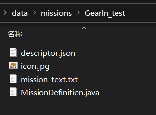
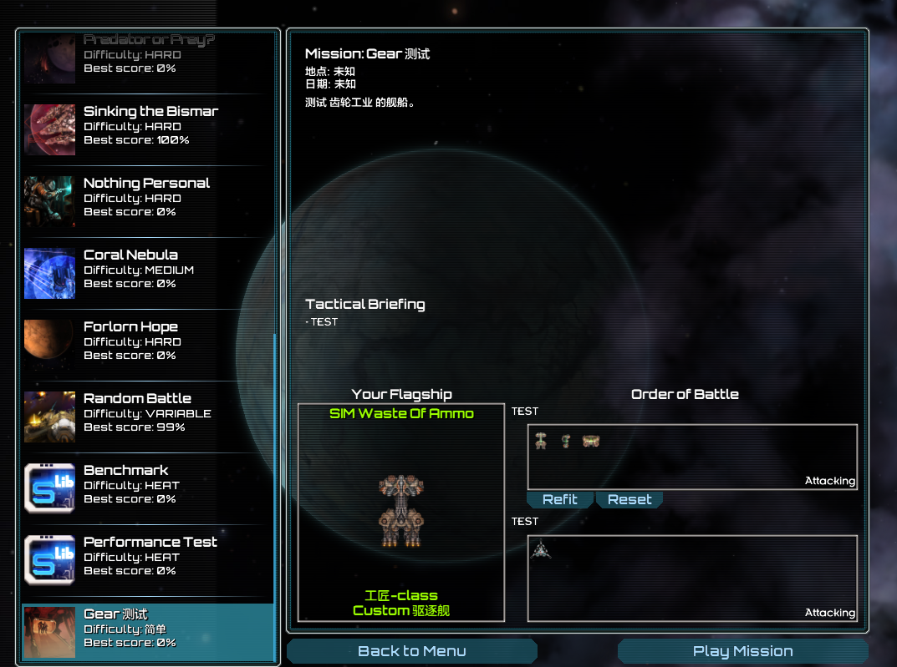
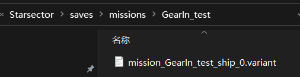

# 制作测试战役装配

第三章已经为势力准备了最小装配，本节改用游戏内装配界面制作和导出更多配置。测试战役会自动收集齿轮工业的舰船装配，提供武器、船插与战斗测试入口；导出的设计整理为正式装配后，继续用于生涯、模拟战和常规战役。

*本节预期阅读时间：\~12 分钟。*

*本节预期操作时间：\~15 分钟。*

## 学习目标

完成后，您将能够：

- 注册并配置一个测试战役；
- 使用自动收集自有舰船装配的战役定义；
- 从装配界面导出设计，保存为正式 variant；
- 核对装配字段与自动装配目标；
- 复制原版战役，替换成自己的舰队与地图。

## 前置知识

- [C1-S1] 的 MOD 目录与数据合并；
- [C1-S2] 的舰船登记、槽位与装配界面；
- [C1-S3] 的战机装配；
- [C1-S5] 的武器与 [C1-S6] 的内置配置；
- [C2-S2] 的船插；
- [C3-S2] 的 `GearIn_artizan_faction` 与舰队角色；
- [C1-S7] 的 CSV 表头和注释。

## 建立测试战役目录

游戏本身就能保存装配界面中的设计。这里先建立固定的测试战役，将自己的舰船列为候选；以后新增内容也能继续通过这个入口装配和测试。

创建 `data/missions/GearIn_test/`。从原版 `data/missions/afistfulofcredits/` 复制全部文件到这里，保留图标，准备修改描述、文本与定义类。

观察当前目录中的四项文件：



`descriptor.json` 提供条目名称与图标，`mission_text.txt` 提供详情文本，`MissionDefinition.java` 配置双方舰队和地图。图标在同一目录中，本例沿用 `icon.jpg`。

### 填写战役描述与文本

把 `descriptor.json` 写成：

```json
{
    "title": "Gear 测试",
    "difficulty": "简单",
    "icon": "icon.jpg",
    "background": "graphics/backgrounds/background4.jpg"
}
```

### 战役描述字段速查表

| 字段 | 是否必需 | 实际意义 |
|---|---|---|
| `title` | 是 | 战役名称，显示在 Missions 列表 |
| `difficulty` | 是 | 战役难度，可随意填写，只作显示 |
| `icon` | 是 | 战役图标贴图文件名，位于战役文件夹内 (本例沿用复制的 `icon.jpg`) |
| `background` | 否 | 战役背景贴图路径 (相对于 MOD 根目录，可指向原版 `graphics/`) |

三个必填键用于读取条目，背景可按实际地图选择。游戏接受原版文件的宽松 JSON，当前成品使用标准 JSON。

在 `mission_text.txt` 写入：

```text
地点：未知
日期：未知

测试齿轮工业的舰船。
```

这段文字显示在战役详情页，可以按需要修改；`mission_text.txt` 作为战役数据的一部分继续保留。

## 用代码列出自有装配

把目录中的源码改为完整例里的 `MissionDefinition.java`。**战役类的完整名字由目录 ID 决定**：本例是 `data.missions.GearIn_test.MissionDefinition`，包名与类名按这个位置填写。

游戏在选择战役时创建类，并调用 `defineMission(...)`。当前模板已经提供所需结构，舰队与地图的配置都由这个方法完成。下面说明改成其他测试项目时会涉及的位置。

### 收集已加载装配

模板通过 `getAllVariantIds()` 取得装配 ID，再按船体前缀收集，局部片段如下：

```java
for (String id : Global.getSettings().getAllVariantIds()) {
    ShipVariantAPI variant = Global.getSettings().getVariant(id);
    if (variant.getHullSpec().getHullId().startsWith(PREFIX)
            && variant.getHullSpec().getHullSize() != ShipAPI.HullSize.FIGHTER
            && !id.startsWith("mission_")) {
        variants.add(id);
    }
}
```

`PREFIX` 为 `GearIn_`，筛选时检查的是装配所用船体的 ID，符合前缀的装配才加入列表。战机与任务导出项按条件跳过。**这是按船体归属收集装配**，同一个船体有多个正式配置时，它们也会一起出现。

已注册船体还有自动生成的 `<hullId>_Hull` 空装配，因此尚未做正式设计的船也能进入测试。第三章的工匠势力装配则作为已有配置一同列出。

### 设置双方与地图

列表中的装配由 `addToFleet` 加入舰队。在此之前，`initFleet` 初始化玩家和敌方舰队，SIM 是自动命名前缀，5 为初始指挥点。`addToFleet` 按装配 ID 加入成员，第一个玩家成员设为旗舰。

当前模板使用原版 `remnant_station2_Standard` 作为敌方目标，并配置星云、点位和小行星带。舰队说明由 `setFleetTagline` 设置，简报项目由 `addBriefingItem` 设置。

若要制作另一套测试战役，调整包名中的战役 ID 和 `PREFIX`，再选择敌舰与地图。比较某项设计改动时，敌方配置与场地保持稳定，才能区分变化来自设计本身还是测试条件。

## 注册并保存完整战役

在 `data/missions/mission_list.csv` 追加：

```csv
mission
GearIn_test
```

表头为 `mission`，条目与目录同名。同路径文件按行合并，当前 MOD 只提交自己的战役。行首 `#` 可暂时关闭条目，`_test` 后缀本身不会隐藏战役。

## 完整最小例

描述、文本与图标采用上面的文件，完整类保存为 `data/missions/GearIn_test/MissionDefinition.java`。

::: details 完整成品：MissionDefinition

```java
package data.missions.GearIn_test;

import java.util.ArrayList;
import java.util.Collections;
import java.util.List;

import com.fs.starfarer.api.Global;
import com.fs.starfarer.api.combat.ShipAPI;
import com.fs.starfarer.api.combat.ShipVariantAPI;
import com.fs.starfarer.api.fleet.FleetGoal;
import com.fs.starfarer.api.fleet.FleetMemberType;
import com.fs.starfarer.api.mission.FleetSide;
import com.fs.starfarer.api.mission.MissionDefinitionAPI;
import com.fs.starfarer.api.mission.MissionDefinitionPlugin;

/** 自动列出本MOD非战机装配，用于测试与导出。 */
public class MissionDefinition implements MissionDefinitionPlugin {

    public static final String PREFIX = "GearIn_";

    @Override
    public void defineMission(MissionDefinitionAPI api) {
        api.initFleet(FleetSide.PLAYER, "SIM", FleetGoal.ATTACK, false, 5);
        api.initFleet(FleetSide.ENEMY, "SIM", FleetGoal.ATTACK, true, 5);

        api.setFleetTagline(FleetSide.PLAYER, "TEST");
        api.setFleetTagline(FleetSide.ENEMY, "TEST");

        api.addBriefingItem("TEST");

        List<String> variants = new ArrayList<>();
        for (String id : Global.getSettings().getAllVariantIds()) {
            ShipVariantAPI variant = Global.getSettings().getVariant(id);
            if (variant.getHullSpec().getHullId().startsWith(PREFIX)
                    && variant.getHullSpec().getHullSize() != ShipAPI.HullSize.FIGHTER
                    && !id.startsWith("mission_")) {
                variants.add(id);
            }
        }
        Collections.sort(variants);

        boolean first = true;
        for (String variant : variants) {
            api.addToFleet(FleetSide.PLAYER, variant, FleetMemberType.SHIP, first);
            first = false;
        }

        api.addToFleet(FleetSide.ENEMY, "remnant_station2_Standard", FleetMemberType.SHIP, false);

        float width = 10000f;
        float height = 10000f;
        api.initMap(-width / 2f, width / 2f, -height / 2f, height / 2f);

        float minX = -width / 2;
        float minY = -height / 2;

        api.addNebula(minX + width * 0.66f, minY + height * 0.5f, 2000);
        api.addNebula(minX + width * 0.25f, minY + height * 0.6f, 1000);
        api.addNebula(minX + width * 0.25f, minY + height * 0.4f, 1000);

        for (int i = 0; i < 5; i++) {
            float x = (float) Math.random() * width - width / 2;
            float y = (float) Math.random() * height - height / 2;
            float radius = 100f + (float) Math.random() * 400f;
            api.addNebula(x, y, radius);
        }

        api.addObjective(minX + width * 0.25f + 2000f, minY + height * 0.5f, "sensor_array");
        api.addObjective(minX + width * 0.75f - 2000f, minY + height * 0.5f, "comm_relay");
        api.addObjective(minX + width * 0.33f + 2000f, minY + height * 0.4f, "nav_buoy");
        api.addObjective(minX + width * 0.66f - 2000f, minY + height * 0.6f, "nav_buoy");

        api.addAsteroidField(-(minY + height), minY + height, -45, 2000f, 20f, 70f, 100);
    }
}
```

:::

启动游戏后，选择 Gear 测试，观察条目、简报与玩家装配入口：



图中 Refit 打开舰船装配，Play Mission 开始战斗。这里先选择需要配置的工匠，再进行修改。

## 从装配界面导出设计

进入测试战役的 Refit，给船体装上武器、船插和幅容幅散。游戏会把修改后的设计写入存档的 `missions/GearIn_test/`。

默认存档目录在 `Starsector/saves/`；实际路径由 `vmparams` 的 `-Dcom.fs.starfarer.settings.paths.saves` 决定。下面观察导出的任务装配：



文件形如 `mission_GearIn_test_ship_0.variant`，序号对应玩家舰队中的成员。当前模板列出多个装配，因此选择导出文件时要核对内部 `hullId`，确认它对应刚才修改的船体。

**正式装配需要自己的 ID。** 把工匠的导出文件移到 MOD 的 `data/variants/`，命名为 `GearIn_artizan_combat.variant`，将内部 `variantId` 同步改为 `GearIn_artizan_combat`，`displayName` 改为 "突击型"。

### 装配字段速查表

| 字段 | 是否必需 | 实际意义 |
|---|---|---|
| `variantId` | 是 | 装配 ID，全局唯一，建议与文件名一致 |
| `hullId` | 是 | 指向已注册船体，必须与 `.ship`、`ship_data.csv` 一致 |
| `displayName` | 是 | 装配显示名，出现在装配界面与舰队面板 |
| `fluxVents` / `fluxCapacitors` | 是 | 幅散 / 幅容数量 |
| `weaponGroups` | 是 | 武器组数组；每组含 `mode`(只能是 `LINKED` 或 `ALTERNATING`，`WeaponGroupType` 枚举仅这两个值)、`autofire`(可选，默认 `false`)、`weapons`(槽位 ID → 武器 ID 的对象) |
| `hullMods` | 否 | 已安装船插 ID 数组 |
| `permaMods` / `sMods` | 否 | 永久船插 / S 插数组，常规装配通常留空 |
| `wings` | 否 | 航母的机库装配，按甲板顺序列出战机 wing ID |
| `goalVariant` | 否 | 布尔，默认 `false`；为 `true` 时该装配作为自动装配目标出现 |
| `tags` | 否 | 字符串数组，`hullMods` 之外的自由标记 |
| `modules` | 否 | 模块舰 (空间站、超体等) 的模块装配，本节不展开 |

`displayName`、`hullId`、`variantId`、整数幅容幅散和武器组数组都要存在。`LINKED` 与 `ALTERNATING` 是两个可用武器组模式，`autofire` 缺省为 false。

本节整理后的工匠装配如下。内置都林继续由船体提供，普通槽位只记录本次装配的武器：

```json
{
    "displayName": "突击型",
    "fluxCapacitors": 0,
    "fluxVents": 0,
    "hullId": "GearIn_artizan",
    "hullMods": [],
    "permaMods": [],
    "sMods": [],
    "variantId": "GearIn_artizan_combat",
    "weaponGroups": [
        {
            "autofire": true,
            "mode": "ALTERNATING",
            "weapons": {
                "WS0001": "phasecl",
                "WS0002": "phasecl"
            }
        },
        {
            "autofire": true,
            "mode": "LINKED",
            "weapons": {
                "WS0005": "GearIn_durin",
                "WS0006": "GearIn_durin"
            }
        }
    ],
    "goalVariant": true
}
```

`goalVariant: true` 把这个装配作为对应船体的自动装配目标。文件名便于管理，`displayName` 提供显示名称，是否进入自动装配候选则由这个字段决定。改完后重启游戏，核对候选列表。

舰船和战机使用同一套装配结构。编者建议为自己的船体准备 2\~3 个不同定位的配置，例如突击、支援与长程。装配会决定舰船在势力舰队里的实际表现，也方便重复比较。

## 用正式装配制作常规战役

已有设计可以直接用于新的战役：

1. 确定战役名称与独立 ID，例如 `GearIn_artizan_demo`，复制原版战役到对应目录。
2. 修改描述、详情文本与 `MissionDefinition` 的包名。
3. 在舰队添加位置填写 `GearIn_artizan_combat` 等正式装配，替换敌方对象。
4. 按实际战役安排舰队说明、简报、地图、星云和点位。
5. 在 `mission_list.csv` 追加该 ID，重启后查看条目与战斗结果。

测试战役可以继续保留在自己的工作 MOD 中。发布时按预期决定哪些战役出现在 Missions 列表，调试条目可以用行首注释关闭。

## 验证方案

1. 保存注册表、战役描述、文本、图标与定义类，重启游戏，在 Missions 选择 Gear 测试。
2. 核对详情文本、TEST 简报与双方舰队，再进入装配界面修改工匠。
3. 查看实际存档目录的 `missions/GearIn_test/`，读取导出文件并核对 `hullId` 与装备。
4. 将导出设计整理为 `GearIn_artizan_combat`，保存到 MOD 的 `data/variants/`，重启后查看自动装配列表。
5. 打开使用该装配的常规战役，核对己方、敌方、文案与地图。
6. 在 `starsector.log` 中核对 missions 和 variant 的加载记录。

预期结果：

- Missions 显示 Gear 测试，详情包含图标、背景、文本与 TEST 简报。
- 玩家列表包含自有船体的空装配和正式装配，敌方使用原版余晖空间站。
- 导出文件与修改后的舰船设计对应，任务 ID 可从文件内部读取。
- 正式装配登记为 `GearIn_artizan_combat`，自动装配候选使用该 ID。
- 常规战役采用自己的装配、文案和地图。
- 地图包含模板设置的星云、传感器阵列、通讯中继、导航信标和小行星带。

## 故障分析

- **Missions 列表里没有您的战役**：战役行以 `#` 开头时列表不会出现条目；已注册的战役文件夹缺失不会静默缺条目，而是加载中断。`mission_list.csv` 缺失仅贡献 0 行、列表为空 (不中断加载)；表头不是 `mission` 时 `readCSV` 对每行取 `mission` 键会直接抛异常、中断整个加载。
    - **解决方案**：确认 CSV 第一行是 `mission`、第二行是战役 ID，且目录为 `data/missions/GearIn_test`，重启。

- **游戏加载中断，进不了主菜单**：已注册的战役文件夹、`descriptor.json`、`mission_text.txt` 或图标缺失，JSON 语法错误，或 `title`、`difficulty`、`icon` 任一必填字段缺失时，`Loading missions` 后会出现异常堆栈。
    - **解决方案**：补齐文件和字段并确认图标真实存在，重启。

- **战役出现但点击时报错无法进入**：`MissionDefinition` 源文件缺失，或包名、类名不是 `data.missions.<ID>.MissionDefinition` 时，点击会抛出 `Problem loading class [data.missions.<ID>.MissionDefinition]`。
    - **解决方案**：让包名逐字匹配战役 ID，并把类放入 `data/missions/<ID>/`。

- **战役里没有自己的船**：`PREFIX` 拼写或大小写错误，或过滤条件使用了错误前缀。`getAllVariantIds()` 遍历装配 ID，船体过滤应读取 `variant.getHullSpec().getHullId()`。
    - **解决方案**：将前缀统一为 `GearIn_`，重新进入战役。

- **战役里出现没有武器的空船**：每个注册船体都会生成 `<hullId>_Hull` 空装配，模板会在没有正式装配时把它列出。
    - **解决方案**：用测试战役完成武器装配并导出正式 variant，再重新进入战役。

- **导出文件放回 MOD 后仍读到旧内容**：只改文件名却保留 `mission_` 开头的 `variantId`，或新 ID 与其他来源重复时，旧注册项仍会命中，后注册项会被静默跳过。
    - **解决方案**：剪贴导出文件，将 `variantId` 改为与文件名一致的唯一 ID，例如 `GearIn_artizan_combat`，删除旧同名文件并重启。

- **装配里的武器不出现**：`weapons` 中的槽位 ID 不属于该船体、武器 ID 未注册，或 `hullId` 不一致时，部署会报告 `slot id not found`，装配构建会报告 `Weapon spec not found`。
    - **解决方案**：只使用 [C1-S2] 已确认的槽位和 [C1-S5] 注册的武器，不确定时重新在测试战役中导出，再次部署。

- **装配加载直接失败**：`weaponGroups` 的 `mode` 不是 `LINKED` 或 `ALTERNATING`，或必填字段缺失时，`Loading variant [...]` 后会抛出 `Key [mode] has invalid value [...]`。
    - **解决方案**：改用有效枚举值并补齐字段，重启。

- **自动装配列表没有目标装配**：`goalVariant` 键名拼错、值不是 `true`，或该 hull 没有其他可装配目标时，列表不会显示该 variant。
    - **解决方案**：精确写入 `"goalVariant": true` 并核对 `hullId`。

- **常规战役复制后仍是原版内容**：只改文件夹名而未同步 `MissionDefinition` 的包名、文本和装配 ID，会保留原版舰船与文案；包名不匹配时还会出现 `Problem loading class`。
    - **解决方案**：按 "制作常规战役" 的清单同步替换并在 `mission_list.csv` 注册，重启。

## 总结

测试战役通过注册表与同名目录提供入口，定义类收集装配并配置舰队与地图。装配界面把修改后的设计保存到存档，整理后的文件则用独立 ID 登记到 MOD。

第三章的势力角色表可以继续加入这些正式配置，后面的模拟战与标题画面也按装配 ID 使用它们。调试时沿注册条目、定义类和装配文件核对，实际画面与日志分别提供观察结果。

## 建议参考项

- `com.fs.starfarer.api.Global`：全局入口，`getSettings()` 提供 `SettingsAPI`。
- `com.fs.starfarer.api.mission.MissionDefinitionPlugin`：战役脚本入口；
- `com.fs.starfarer.api.mission.MissionDefinitionAPI`：战役定义接口；
- `com.fs.starfarer.api.mission.FleetSide`：舰队侧枚举；
- `com.fs.starfarer.api.fleet.FleetGoal`：舰队目标枚举；
- `com.fs.starfarer.api.fleet.FleetMemberType`：成员类型枚举。
- `com.fs.starfarer.api.combat.ShipVariantAPI`：装配信息读取；
- `com.fs.starfarer.api.combat.ShipHullSpecAPI`：船体规格读取；
- `com.fs.starfarer.api.combat.ShipAPI`：战斗实体读取 (`HullSize` 舰体等级)。
- `com.fs.starfarer.api.SettingsAPI`：按 ID 读装配、枚举全部装配 ID (`getVariant`、`getAllVariantIds`)。
- `com.fs.starfarer.api.loading.WeaponGroupType`：武器组模式枚举 (`LINKED`、`ALTERNATING`)。
- `data/missions/mission_list.csv`：原版战役注册表 (列名 `mission`)；
- `data/missions/afistfulofcredits/`：原版战役样例 (descriptor.json、mission\_text.txt、icon、`MissionDefinition` 类源文件)。
- `data/variants/fighters/broadsword_Fighter.variant`：原版战机装配样例；
- `data/variants/stations/remnant_station2_Standard.variant`：模板敌舰使用的原版空间站装配；
