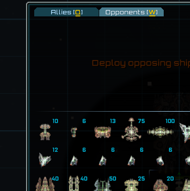

# 为模拟战与标题画面加入装配

上一节已经保存正式装配，本节把工匠的 `GearIn_artizan_combat` 加入模拟战对手与标题画面候选。两个入口都填写装配 ID，但出现时机和错误处理不同，分别从部署列表和背景战斗观察。

*本节预期阅读时间：\~6 分钟。*

*本节预期操作时间：\~8 分钟。*

## 学习目标

完成后，您将能够：

- 在模拟战清单登记既有装配；
- 在标题画面清单登记演示装配；
- 按候选选择和加载结果核对装配 ID；
- 区分两种入口遇到无效 ID 时的表现。

## 前置知识

- [C4-S1] 的 `GearIn_artizan_combat` 与装配注册；
- [C1-S2] 的船体和自动空装配；
- [C1-S3] 的联队 ID 与 `_wing` 后缀；
- [C1-S7] 的 CSV 表头、注释与合并；
- 能够启动模拟战并观察主菜单背景战斗。

## 把装配加入模拟战

创建 MOD 的 `data/campaign/sim_opponents.csv`：

```csv
variant id
GearIn_artizan_combat
```

`variant id` 为表头，后面每行登记一个已加载的装配。这里填写上一节成品的 `variantId`，船体仍是 `GearIn_artizan`，装备则由这份装配提供。

**同路径清单按行合并，MOD 只添加自己的装配行。** 保存后在下一次游戏启动时加载，无需另写注册入口。需要整份控制时，`mod_info.json` 的 `replace` 可以声明该路径。

进入装配界面的 Run simulation，在敌方候选中观察自制舰船：



列表按装配创建成员，装备与数据来自实际引用的 variant。因此，候选中的工匠也应采用刚才登记的武器配置，核对时同时比较船体、武器和装配内容。

### 模拟战的无效 ID 回退

模拟战通过 `FleetMemberAPI` 创建对手。查不到装配时，会打印 `[ID] is not a valid ship variant id`，再使用 `settings.json` 的 `errorShipVariant`，原版值为 `nebula_Standard`。

因此，对手变成星云级运输船时，错误可能来自装配 ID 或加载过程。战役的 `MissionDefinitionAPI.addToFleet` 采用同样的成员创建路径，也会使用这个回退目标，核对 ID 与加载记录即可沿用相同方法。

## 把代表装配加入标题画面

创建 `data/config/title_screen_variants.csv`，内容同样是表头与装配 ID：

```csv
variant id
GearIn_artizan_combat
```

游戏加载清单后，标题背景场景从合并的候选中随机选择旗舰。场景重建时再次抽取，因此工匠未必在这次主菜单场景中出现。`_wing` 结尾的条目按联队创建，其他条目按舰船创建。

**编者建议只放最具代表性的装配。** 这一列表展示 MOD 的外观与配置，几套明确的选择往往比把全部测试设计放进去更合适；候选少一些也便于核对。

验证时确认清单与装配有效，再多次观察场景重建后的抽取结果。

### 标题画面的无效 ID

标题背景战斗直接创建舰船对象，查不到装配时产生 `Ship hull variant [ID] not found!`，场景构建中断。这里的错误应通过日志和场景结果核对；星云回退属于前面的舰队成员创建路径。

## 验证方案

1. 保存两个 CSV，确认 `GearIn_artizan_combat.variant` 已登记，重启游戏进入主菜单。
2. 检查本次日志中的 CSV 加载和装配错误；CSV 来源记录本身不包含文件名。
3. 多次观察标题背景场景，比较工匠的外观和装备。
4. 进入生涯装配界面，运行模拟战，在敌方候选中选择工匠。
5. 部署该对手，核对船体和装备与正式装配一致。

预期结果：

- 游戏正常进入主菜单，两个清单随启动读取。
- 模拟战敌方候选包含工匠正式装配，实际装备与 variant 对应。
- 标题背景重建后可以随机选择工匠，显示该装配的船体与武器。
- 日志中的来源和错误记录与当前输入对应。

## 故障分析

- **模拟战里没有您的船**：文件不在 `data/campaign` 时，列表会静默缺少目标；表头不是逐字的 `variant id` 时，`getString("variant id")` 会抛出键缺失异常并中断加载。
    - **解决方案**：确认路径和表头后重启。

- **对手变成星云-级运输船**：装配 ID 错误或未注册时，模拟战会回退到 `nebula_Standard`，日志记录 `[ID] is not a valid ship variant id`。
    - **解决方案**：让 ID 与 `data/variants` 中的注册值逐字一致，重新进入模拟战。

- **敌方舰队出现重复装配**：复制原版清单会把原版行再次合并。
    - **解决方案**：MOD 文件只保留新增行，重新加载。

- **标题画面一直看不到自己的船**：候选池较大，且只在场景重建时重新抽选。
    - **解决方案**：确认条目已写入文件，多次重建标题场景。

- **标题画面背景战斗报错**：`title_screen_variants.csv` 含无效 ID 时，场景构建会直接抛出 `Ship hull variant [...] not found!`，不会使用星云回退。
    - **解决方案**：删除或改正无效行，重建标题场景。

- **以 `_wing` 结尾的条目无法按舰船创建**：这类 ID 会按战机联队解析，模拟战使用 `FIGHTER_WING`，标题画面通过 `FighterWingSpecAPI` 查询。
    - **解决方案**：舰船装配 ID 避免 `_wing` 后缀；需要战机对手时填写 [C1-S3] 已注册的 wing ID，重新加载。

## 总结

模拟战和标题画面都沿用已注册装配，通过各自的 CSV 清单加入候选。表头与装配 ID 对应后，再按不同的出现时机观察。

错误处理由创建路径决定：舰队成员路径会使用 `errorShipVariant` 回退，标题背景场景直接报告无效装配。错误对象的表现与当前入口对应，排查时据此核对注册和文件。

## 建议参考项

- `data/campaign/sim_opponents.csv`：模拟战候选清单。
- `data/config/title_screen_variants.csv`：标题背景装配候选。
- `data/config/settings.json`：`errorShipVariant` 回退目标。
