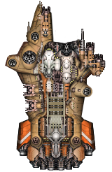
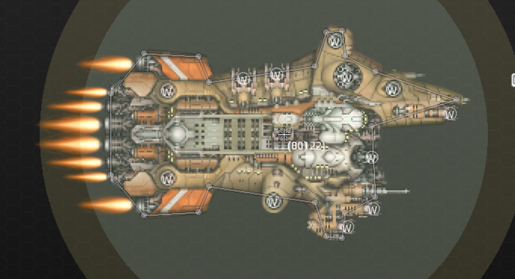
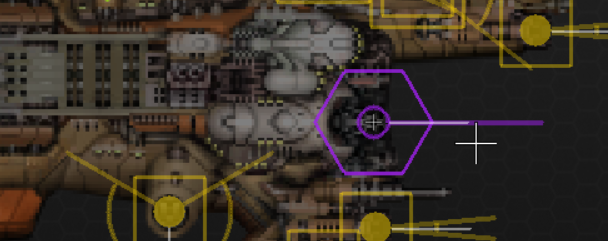
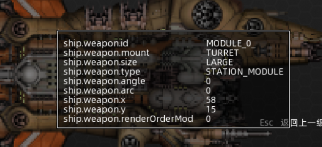
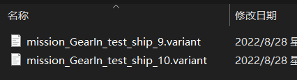
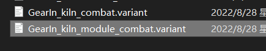
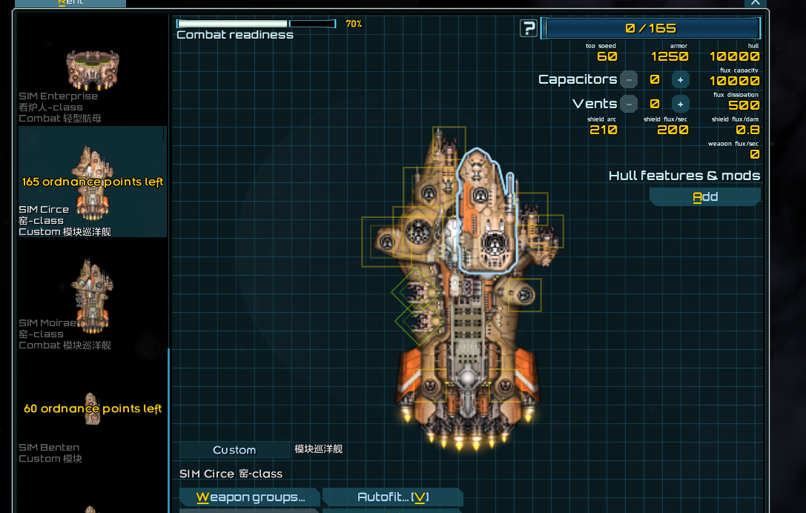

# 制作一艘模块船

本节制作 `窑-级 (Kiln)` 模块巡洋舰及其第一个舰体模块。主体与模块都按完整舰船注册，再由主体槽位和装配文件确定连接位置与所用模块。

*本节预期阅读时间：~10 分钟。*

*本节预期操作时间：~25 分钟。*

## 学习目标

完成后，您将能够：

- 在 `.ship` 中定义 `STATION_MODULE` 槽位，说出模块挂载位置与朝向的来源；
- 在 `ship_data.csv` 中登记主体行 (`SHIP_WITH_MODULES`) 与模块行 (`UNBOARDABLE`、`HIDE_IN_CODEX`、`MODULE`)，并说出每条硬性要求违反后的可观察结果；
- 在主体装配 `.variant` 中用 `modules` 字段把模块装配挂到槽位 (对象与数组两种写法都认识)；
- 说出模块的加载与运行态链路：`.ship` 槽位 → 装配 `modules` 映射 → 部署时模块船生成流程生成独立实体 → 每帧绑定到主体槽位；
- 从部署画面与 `starsector.log` 定位模块缺失、槽位 ID 错误、模块装配 ID 错误三类故障。

## 前置知识

- [C1-S2] 的舰船贴图、`.ship` 几何定义、槽位和 `ship_data.csv` 注册流程；
- [C1-S5] 的武器注册与 `GearIn_durin` 使用方法；
- [C4-S1] 的测试战役、装配导出和 `.variant` 字段结构。

## 文件与 API 链路

### 模块船文件速查表

模块船涉及 4 类文件，链路如下：

| 文件 | 注册入口 | 产物 | 使用方 |
|---|---|---|---|
| `data/hulls/GearIn_kiln.ship`(含 `STATION_MODULE` 槽位)| `.ship` 文件加载入口 | `ShipHullSpecAPI`(`WeaponSlotAPI` 的 `type: STATION_MODULE`)| 装配的 `getModuleSlots()`；部署时的模块生成 |
| `data/hulls/GearIn_kiln_module.ship` | 同上 | 模块船体 (含可选 `moduleAnchor`)| 模块实体创建；舰队列表预览的尺寸计算 |
| `data/hulls/ship_data.csv` 两行 | CSV 行加载入口 | 船体 hints 与 tags | `ShipAPI` 对象构造 (`isShipWithModules`)、部署分支、交易界面 |
| `data/variants/GearIn_kiln_combat.variant`(`modules` 字段)| 装配 JSON 解析与注册 | `ShipVariantAPI`(`stationModules`：槽位 ID → 模块装配 ID)| `getModuleVariant()`、部署生成、装配界面 |
| `data/variants/GearIn_kiln_module_combat.variant` | 同上 | 模块装配 (与普通装配同构)| 模块实体创建 |

公开 API(`com.fs.starfarer.api`)：

- `com.fs.starfarer.api.combat.ShipVariantAPI`：`getModuleSlots()`(只返回映射到 `STATION_MODULE` 槽位的槽位)、`getStationModules()`(返回槽位 → 装配 ID 的原始映射)、`getModuleVariant(slotId)` / `setModuleVariant(slotId, variant)`。
- `com.fs.starfarer.api.combat.ShipAPI`：`getParentStation()` / `setParentStation()`、`getStationSlot()` / `setStationSlot()`、`isShipWithModules()`、`getChildModulesCopy()`、`getModuleOffset()`、`isStation()` / `isStationModule()`。
- `com.fs.starfarer.api.loading.WeaponSlotAPI`：`isStationModule()`、`computePosition()`(槽位在舰船坐标系中的位置)、`computeMidArcAngle()`(槽位朝向的中间角)。
- `com.fs.starfarer.api.combat.ShipHullSpecAPI`：`getModuleAnchor()`、`ShipTypeHints` 枚举 (`STATION`、`SHIP_WITH_MODULES`、`MODULE`、`UNDER_PARENT`、`INDEPENDENT_ROTATION`)。

**两类模块船的 hint 分界**：可驾驶的模块船主体 (原版 `onslaught_mk1`、`station_small`) 用 `SHIP_WITH_MODULES`；空间站 (原版 `station1`–`station3`、`remnant_station2`) 用 `STATION`。

部署时两者都会生成模块，但 `STATION` 另有 "无法手动操控" 的 AI 语义 (hints 各取值的完整含义在舰船制作知识中有讲解)。

## 完整最小例

### 准备主体与模块贴图

一艘模块船往往由至少 2 个模块组成。这些模块本身都是舰船，因此需要先准备好它们的贴图。本例的主体 `窑-级` 由 `狮鹫`、模块由 `苍鹭` 的贴图简单修改而来，耗时不超过 20 秒：



主体贴图，宽高仍按舰船贴图的规则保持 2 的倍数。


模块贴图。模块通常比主体小得多，主体只挂这一个模块即可跑通全流程。

### 制作主体与模块船体

为它们分别分配 `GearIn_kiln` 和 `GearIn_kiln_module` 的舰船 ID，然后按舰船制作流程在编辑器里做出两个 `.ship` 文件：



主体的 `.ship` 制作：质量中心、碰撞圈、护盾、槽位与引擎照常设置。


模块的 `.ship` 制作。

::: tip 模块可以不设引擎

模块的位置和朝向由主体槽位决定，它自己几乎不需要推进引擎。原版的模块船体 (如 `derelict_mothership_pod_m_left.ship`) 就没有 `engineSlots`。

:::

::: caution 护盾中心与护盾范围必须保留

哪怕模块设计上无盾 (`shield type: NONE`)，`shieldCenter` 与 `shieldRadius` 也不能删：`.ship` 加载器无条件读取 `shieldCenter`(`getVector2f`) 与 `shieldRadius`(`getInt`)，缺失会让该船体加载失败 —— 日志抛 JSONException，启动阶段中断。

:::

### 添加模块槽位

主体必须带有 `STATION_MODULE` 类型 (编辑器里显示为 Station Module) 的槽位，这是安装模块所需的槽位：



在槽位编辑里把槽位类型改为 `STATION_MODULE`，并为它取一个语义化 ID(本例为 `MODULE_0`；原版空间站用 `WS 001` 这类编号，用 `SUPPORT_L`、`HEAVY_L` 这类语义名也可以)。



`STATION_MODULE` 槽位与普通武器槽共享同一套字段：`angle`(模块的基准朝向)、`arc`(模块朝向允许的摆动范围)、`locations`(槽位在主体坐标系中的位置，即模块的挂载点)。

槽位 ID 是大小写敏感的字符串，装配的 `modules` 字段必须逐字引用它。

### 登记舰船数据

打开 `data/hulls/ship_data.csv`，为主体与模块各加一行。

以下示例文件同时保留了原版标本行 (`#` 注释) 与本 MOD 已有舰船行 (`GearIn_slag`、`GearIn_forging`、`GearIn_furnaceman` 来自舰船制作示例，`GearIn_artizan` 来自舰船系统示例)，您需要追加的是最后两行：

```csv {10,11}
name,id,designation,tech/manufacturer,system id,fleet pts,hitpoints,armor rating,max flux,8/6/5/4%,flux dissipation,ordnance points,fighter bays,max speed,acceleration,deceleration,max turn rate,turn acceleration,mass,shield type,defense id,shield arc,shield upkeep,shield efficiency,phase cost,phase upkeep,min crew,max crew,cargo,fuel,fuel/ly,range,max burn,base value,cr %/day,CR to deploy,peak CR sec,CR loss/sec,supplies/rec,supplies/mo,c/s,c/f,f/s,f/f,crew/s,crew/f,hints,tags,logistics n/a reason,codex variant id,rarity,breakProb,minPieces,maxPieces,travel drive,number
#Lasher,lasher,Frigate,Low Tech,ammofeed,5,1750,300,2100,1750,140,55,,120,110,90,60,90,200,FRONT,,210,0.4,1,,,25,50,40,25,1,25,10,9000,8,10,240,0.25,4,4,,,,,,,,"lowtech_bp, merc, ind",,,,0.4,2,2,,204
#Hammerhead,hammerhead,Destroyer,Midline,ammofeed,10,5000,500,4200,4167,250,95,,90,60,40,30,60,400,FRONT,,300,0.4,0.8,,,50,100,100,60,2,30,9,40000,5,12,360,0.25,10,10,,,,,,,,"midline_bp, merc, ind",,,,0.5,2,3,,300
#Eagle,eagle,Cruiser,Midline,maneuveringjets,14,8000,1000,11000,14000,700,155,,60,40,30,15,20,1200,FRONT,,270,0.4,0.8,,,150,250,150,100,3,33,8,100000,3,12,480,0.25,20,20,,,,,,,,"rare_bp, merc, ind",,,,0.5,2,3,,401
#Conquest,conquest,Battlecruiser,Midline,maneuveringjets,24,12000,1200,20000,30000,1200,315,,45,20,15,6,4,2500,OMNI,,90,0.4,1.4,,,400,500,300,300,10,30,8,300000,3,15,600,0.25,40,40,,,,,,,,"rare_bp, merc",,,,0.5,2,4,,503
炉渣,GearIn_slag,,未知,flarelauncher_fighter,,750,100,200,,100,0,,180,400,350,90,180,30,NONE,,0,0,0,,,1,1,,,,,,,,,,,,,,,,,,,,,,,,0,,,,104
锻件,GearIn_forging,相位护卫舰,未知,ammofeed,6,2000,350,1200,2000,100,35,,90,120,90,45,90,200,PHASE,phasecloak,90,,,0.075,0.075,4,10,10,20,1,20,9,26000,10,20,180,0.25,6,6,,,,,,,PHASE,GearIn_bp,,,,0.5,2,2,,228
工匠,GearIn_artizan,驱逐舰,未知,GearIn_burstdrive,10,5000,500,3800,4167,200,95,,80,60,40,30,60,400,PHASE,GearIn_resistfield,,,,0.1,0,50,100,100,60,2,30,9,40000,5,12,360,0.25,10,10,,,,,,,,GearIn_bp,,,,0.5,2,3,,300
看炉人,GearIn_furnaceman,轻型航母,未知,targetingfeed,11,4500,400,3000,2813,225,75,2,75,50,30,25,25,450,FRONT,,300,0.4,0.8,,,90,150,40,40,2,20,9,52000,5,15,360,0.25,11,13,,,,,,,CARRIER,"GearIn_bp",,,,0.5,2,3,,318
窑,GearIn_kiln,模块巡洋舰,Midline,maneuveringjets,15,10000,1250,10000,,500,165,,60,40,30,15,20,1500,FRONT,,210,0.4,0.8,,,200,300,150,150,4,38,8,125000,4,12,480,0.25,25,25,,,,,,,SHIP_WITH_MODULES,"GearIn_bp",,,,0.5,2,4,,401.5
,GearIn_kiln_module,模块,Midline,,10,5000,500,3000,,250,60,,0,0,0,10,10,300,NONE,,0,0,0,,,0,0,0,0,1,0,,40000,,1,,,0,0,,,,,,,"UNBOARDABLE, HIDE_IN_CODEX, MODULE",,,,,0.5,2,3,,300
```

::: caution 船体行的 hints 必须写对

- 模块行的 `hints` 必须带 `UNBOARDABLE` 和 `HIDE_IN_CODEX`：前者保证它不可被打捞，后者保证它不出现在数据库中 (原版模块行全部带这两个值)。原版模块还带 `MODULE`，标记模块身份，交易界面等列表会按模块处理它。
- **主体行的 `hints` 必须带 `SHIP_WITH_MODULES`**，否则模块会在某些场合丢失：战斗部署时根本不生成模块 (详见 "运行态" 与 "战斗中模块完全不生成" 故障条目)。

:::

::: tip 模块的数据可以精简

- 模块的舰级名 (`designation`) 可以不填。
- 模块的后勤数据应当尽可能接近于 "无"：0 船员、0 货舱、0 燃料，`supplies/rec` 与 `supplies/mo` 为 0。
- 模块行的 `tags` 不应该包含任何诸如 `x_bp` 或 `merc` 之类的蓝图/销售 tag—— 模块不是通过蓝图或市场渠道获得的舰船。原版模块行 (如 `platform1`) 的 tags 为空。模块的行为类 tag(`module_unselectable` 等) 见下文运行态一节。

:::

测试战役模板会自动把本 MOD 所有非战机装配加入用户舰队，因此 `GearIn_kiln` 与 `GearIn_kiln_module` 都会出现。此时部署主体，可以看到它没有模块 —— 这正是下一步要解决的。

### 制作主体与模块装配

**因为模块只能通过装配文件的 `modules` 字段挂载，游戏内没有任何正常方法为它添加模块，必须要有一个 "带模块的主体装配"**，这艘船才会默认带有模块。

使用测试战役分别为主体和模块制作一个装配 (模块的自动空装配也在舰队列表里，直接改装它即可)：



在装配界面为 `窑-级` 装上武器与船插，并为模块也做一份装配，游戏会把它们导出到存档目录 (`\Starsector\saves\missions\GearIn_test\`)。

### 整理正式装配

把导出的两个文件放入 MOD 的 `data/variants` 文件夹，修改文件名并同步修改文件内部的 `variantId` 等参数 (装配导出-改名流程)：



本例得到两个文件：`GearIn_kiln_combat.variant`(主体，`hullId: GearIn_kiln`) 与 `GearIn_kiln_module_combat.variant` (模块，`hullId: GearIn_kiln_module`)。

模块装配与普通装配没有结构区别，只是它的 `hullId` 指向模块船体。

### 挂载模块装配

打开原版的 `data\variants\stations\station_small_Standard.variant`，可以看到类似这样的一段：

```json
    "modules": {
        "WS 001": "platform1_Standard",
        "WS 002": "platform1_Standard",
        "WS 003": "platform1_Standard",
        "WS 004": "platform1_Standard"
    }
```

这就是模块在装配文件里的设置方案：**槽位 ID → 模块装配 ID** 的对象。把它略加修改后，插入本例的 `GearIn_kiln_combat.variant`：

```json {15-18}
{
    "displayName": "Combat",
    "fluxCapacitors": 23,
    "fluxVents": 30,
    "hullId": "GearIn_kiln",
    "hullMods": [
        "heavyarmor",
        "auxiliarythrusters",
        "targetingunit"
    ],
    "permaMods": [],
    "sMods": [],
    "variantId": "GearIn_kiln_combat",
    "goalVariant": true,
    "modules": {
        # 注意：左边是槽位 ID，右边是模块的装配 ID
        "MODULE_0": "GearIn_kiln_module_combat"
    },
    "weaponGroups": [
        {
            "autofire": false,
            "mode": "LINKED",
            "weapons": {
                "WS0004": "GearIn_durin",
                "WS0005": "GearIn_durin",
                "WS0011": "GearIn_durin"
            }
        },
        {
            "autofire": false,
            "mode": "ALTERNATING",
            "weapons": {
                "WS0006": "sabotpod",
                "WS0007": "sabotpod"
            }
        },
        {
            "autofire": true,
            "mode": "LINKED",
            "weapons": {"WS0001": "heavyac"}
        },
        {
            "autofire": true,
            "mode": "LINKED",
            "weapons": {
                "WS0002": "vulcan",
                "WS0003": "vulcan",
                "WS0008": "vulcan",
                "WS0009": "vulcan",
                "WS0010": "vulcan"
            }
        }
    ]
}
```

几点说明：

- `modules` 的对象写法是 `"槽位 ID": "模块装配 ID"`；装配 JSON 解析也接受**数组写法**：`[{"WS 024": "remnant_armour3_Standard"}]`，原版 `remnant_station2_Standard.variant` 就用数组写法，且数组条目之间可以写 `#` 注释 (游戏的装配解析会剥离注释)。
- 槽位 ID 必须逐字等于主体 `.ship` 里 `STATION_MODULE` 槽位的 id；模块装配 ID 必须逐字等于模块装配文件的 `variantId`。两者都是大小写敏感字符串。
- 如果一个有模块槽位的 hull 不想挂模块，`modules` 可以写成空数组 `"modules": []`—— 主体部署时不会有模块，但加载完全合法。

`窑-级` 模块巡洋舰现在默认带有模块了：



### 验证方案

前置数据：本节制作的全部文件 ——、`GearIn_kiln.ship`(含 `MODULE_0` 的 `STATION_MODULE` 槽位)、`GearIn_kiln_module.ship`、`ship_data.csv` 两行、`data/variants/GearIn_kiln_combat.variant`(含 `modules`) 与 `GearIn_kiln_module_combat.variant`。

1. 启动游戏，在日志中观察两条 `Loading variant [...]` 记录。
2. 进入测试战役，观察舰队列表中的 `窑-级`，然后部署该舰船。
3. 在装配界面选中模块并改装其武器，再把主体的 `goalVariant` 装配加入自动装配候选。
4. 在战斗中击毁模块，退出战斗后重新部署并观察主体与模块状态。

预期结果：

- 启动后日志出现 `Loading variant [data\variants\GearIn_kiln_combat.variant]` 与 `Loading variant [data\variants\GearIn_kiln_module_combat.variant]`，没有相关 `ERROR`。
- 测试战役的舰队列表里 `窑-级` 的预览包含模块 (整体尺寸由 `getSizeWithModules` 计算)；部署后主体与模块实体同时出现，模块位置在槽位处、朝向沿槽位角，随主体平移旋转而移动。
- 装配界面里点击模块可以改装它的武器与船插 (本例模块 `ordnance points` 为 60，可选中)；`goalVariant: true` 让主体装配出现在自动装配候选里。
- 模块被摧毁后主体仍可继续作战；返回舰队后模块按战斗记录的状态呈现。
- 战场中模块与主体各自显示独立的血条与状态 (默认都显示；需要隐藏时用 `module_no_status_bar` / `module_hull_bar_only`)。

## 运行态：模块如何生成与绑定

### 部署时：模块船生成

把模块挂到主体上发生在**部署**阶段，而不是装配加载阶段：

1. `CombatFleetManagerAPI` 部署舰队成员时，先检查 `成员是空间站 (STATION) 或船体带 SHIP_WITH_MODULES`；只有命中才走模块船生成流程生成模块。
2. 模块船生成流程遍历主体装配的 `getStationModules()`(槽位 → 模块装配 ID)；对每个 `isStationModule()` 为真的槽位，用模块装配创建一个新 `FleetMemberAPI` 与 `ShipAPI` 实体。
3. 新实体被放置到 `槽位.computePosition(主体, 模块锚点)`，朝向设为 `槽位.computeMidArcAngle(主体)`(即槽位的中间角)，随后 `setParentStation(主体)`、`setStationSlot(槽位)`，并加入主体的 `getChildModules()`。
4. 模块实体和主体一样是完整的 `ShipAPI`：有自己的装甲格、幅能、武器组、战术系统和 AI(`pickShipAIPlugin` 为它挑选 AI)。

如果主体装配里根本没有 `modules` 字段，或模块 ID 无法解析，这一步会得到 "没有模块的主体" 或部署报错 (详见故障分析)。

### 每帧：模块被钉在槽位上

主体移动后，`CombatEngineAPI.updateStationModuleLocations` 每帧把每个子模块的位置重新设回 `槽位.computePosition(主体, 模块锚点)`，因此**模块永远跟随主体的平移与旋转**。

默认情况下模块的朝向也会被强制设为槽位中间角；只有模块船体的 hints 带 `INDEPENDENT_ROTATION` 时才保留自己的朝向 (位置仍跟随)。

模块船体的 `moduleAnchor`(可选字段，由 `.ship` 加载器读取) 决定模块以自身哪个点为锚挂到槽位上；缺省时以槽位位置为锚。视觉上模块贴图与槽位对不齐时，用 `moduleAnchor` 微调。

### 战斗外的模块

- 舰队列表与船体预览会显示模块：舰队列表界面直接读取装配的模块槽位渲染模块贴图，`getSizeWithModules()` 会把模块计入舰船整体预览尺寸。所以**即使主体缺 `SHIP_WITH_MODULES`，舰队列表里也看得到模块** —— 这正是 "某些场合模块丢失" 的反差来源。
- 模块的损伤状态按槽位记录在主体的 `FleetMemberStatusAPI` 里，部署时按槽位恢复；模块在战斗中被摧毁或脱离后，下次部署时按记录的状态呈现，而不只是 "满血复活"。

### 装配界面里的模块

主体在装配界面里会显示其模块；模块是否**可被选中改装**由模块船体的 `ordnance points` 决定：装配点上限为 0 的模块默认无法被选中 (装配面板按 `getOrdnancePoints() > 0` 判定)。

### 模块行为 tag 速查表

模块的下列行为 tag 放在模块行的 `tags` 列 (会被加载器复制到船体 tag 上)：

| 英文 | 实际意义 | 使用位置 |
| --- | --- | --- |
| `module_unselectable` | 模块无法被选中 | 装配界面的装配面板 (强制不可选)|
| `module_refit_bright` | 模块在装配界面时不会默认暗下 | 装配界面的装配面板 |
| `module_no_status_bar` | 模块在战斗中不显示状态属性条 | 战斗瞄准环渲染器 |
| `module_hull_bar_only` | 模块在战斗中不显示幅能属性条 | 战斗瞄准环渲染器 |

## 故障分析

- **战斗中模块完全不生成**：主体 CSV 行的 hints 缺少或拼错 `SHIP_WITH_MODULES` 时，部署分支不会进入模块船生成流程；舰队列表和预览仍可能显示模块。

    - **解决方案**：给主体 hints 加上 `SHIP_WITH_MODULES`，重新部署。

- **模块槽位被静默跳过**：`modules` 的键能找到真实槽位，但该槽位不是 `STATION_MODULE` 时，部署流程会跳过它。

    - **解决方案**：让键逐字对应 `.ship` 中的 `STATION_MODULE` 槽位 ID，重新部署。

- **部署模块时抛出空引用**：`modules` 的槽位 ID 在 hull 上不存在时，`getHullSpec().getWeaponSlot(id)` 返回 null，模块生成处会在部署期失败。

    - **解决方案**：用编辑器确认槽位 ID 并同步映射键，再次部署。

- **装配加载正常但进入战斗时报错**：`modules` 只保存字符串映射，加载期不会校验模块装配 ID；部署时 `getModuleVariant` 返回 null 才会抛出空引用或 variant 错误。

    - **解决方案**：确认模块装配已注册且 `variantId` 逐字一致，重新进入战斗。

- **模块装配在加载阶段直接失败**：模块 variant 的 `hullId` 与注册船体不一致时，`Loading variant [...]` 后会抛出 `Ship hull spec [...] not found!`。

    - **解决方案**：让 `hullId` 等于模块 `.ship` 和 `ship_data.csv` 的 ID，重启。

- **模块在装配界面无法选中**：模块船体的 `ordnance points` 为 0，或 tags 包含 `module_unselectable` 时，模块按钮不会接受点击。

    - **解决方案**：需要改装时提供装配点并移除该 tag。

- **无盾模块的船体文件加载失败**：删除 `shieldCenter` 或 `shieldRadius` 会让 `.ship` 加载器的 `getVector2f`、`getInt` 抛出 JSONException。

    - **解决方案**：保留这两个字段，只把 `shield type` 设为 `NONE`，重启。

## 总结

模块船是 "船中船"：主体与模块各自走完完整的舰船制作链 (贴图 → `.ship` → `ship_data.csv` 注册)，再通过两个文件组装 —— 主体 `.ship` 的 `STATION_MODULE` 槽位声明挂载点，主体装配的 `modules` 字段声明 "槽位 → 模块装配 ID" 的映射。

运行态上，模块不是主体的一部分渲染，而是部署时由模块船生成流程生成的独立 `ShipAPI` 实体，被逐帧钉在槽位上并随主体移动。

调试模块船时按三层排查：加载期 (`modules` 是字符串映射，**不校验** —— 所以加载期错误几乎都来自 `hullId` 或 `.ship` 本身)、部署期 (槽位 ID 错 → 静默跳过或抛异常；模块装配 ID 错 → 部署报错)、运行期 (`SHIP_WITH_MODULES` 缺失 → 战斗里根本没有模块，但列表里看得到)。

测试战役配合 `starsector.log` 足够覆盖这三层。遇到模块相关的加载或部署异常时，可以按这条流程分层定位到具体文件。

## 建议参考项

- `com.fs.starfarer.api.combat.ShipVariantAPI`：`getModuleSlots()`、`getStationModules()`、`getModuleVariant(slotId)` / `setModuleVariant(slotId, variant)`—— 模块槽位与模块装配映射的读写入口。
- `com.fs.starfarer.api.combat.ShipAPI`：`isShipWithModules()`、`getParentStation()` / `getStationSlot()`、`getChildModulesCopy()`、`getModuleOffset()`、`isStation()` / `isStationModule()`—— 主体与模块实体的运行态关系。
- `com.fs.starfarer.api.loading.WeaponSlotAPI`：`isStationModule()`、`computePosition()`、`computeMidArcAngle()`—— 模块槽位的判定与挂载几何。
- `com.fs.starfarer.api.combat.ShipHullSpecAPI`：`getModuleAnchor()` 与 `ShipTypeHints` 枚举 (`STATION`、`SHIP_WITH_MODULES`、`MODULE`、`UNDER_PARENT`、`INDEPENDENT_ROTATION`)。
- `data/hulls/GearIn_kiln.ship` 与 `data/hulls/GearIn_kiln_module.ship`：主体的 `STATION_MODULE` 槽位与模块船体 (含可选 `moduleAnchor`)。
- `data/hulls/ship_data.csv`：主体行 (`SHIP_WITH_MODULES`) 与模块行 (`UNBOARDABLE, HIDE_IN_CODEX, MODULE`) 的 hints/tags。
- `data/variants/GearIn_kiln_combat.variant` 与 `data/variants/GearIn_kiln_module_combat.variant`：`modules` 字段与模块装配示例。
- `data/variants/stations/station_small_Standard.variant` 与 `data/variants/stations/remnant_station2_Standard.variant`：原版 `modules` 对象/数组两种写法参照。
- `Starsector/starsector-core/starsector.log`：加载期与部署期异常的定位入口。
