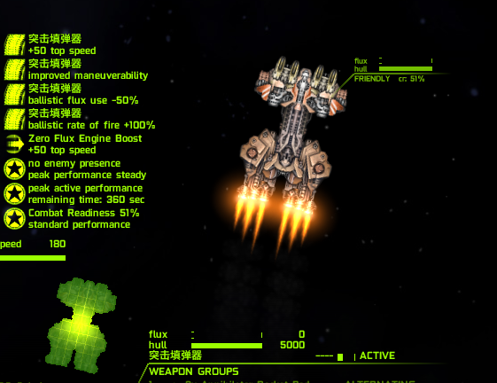
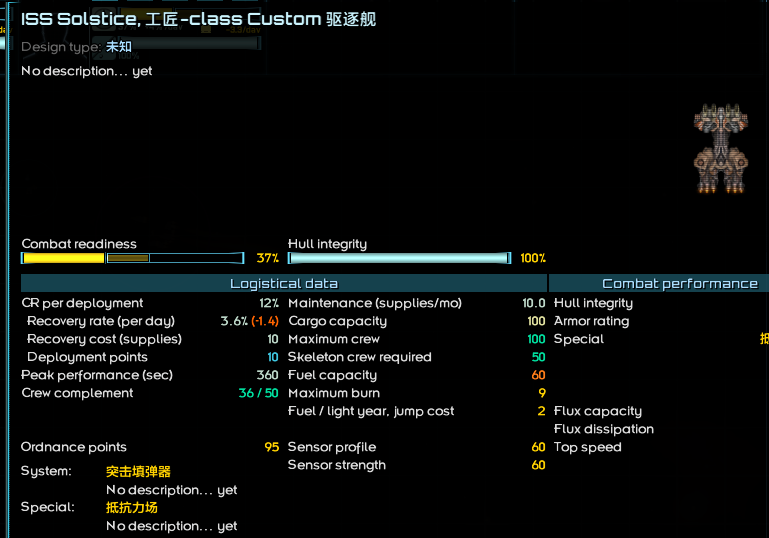
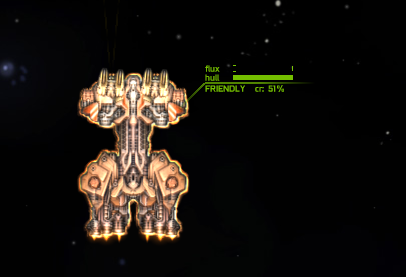

# 最小战术系统：燃烧驱动与状态回调

本节以最小战术系统为例，走通「`.system` 定义 → CSV 注册 → 效果脚本 → 舰船挂载」的完整流程，并拆解战术系统的状态机、`effectLevel` 与三个回调的调用时机。正文包含两个可直接照抄的完整示例（主系统与右键系统各一）以及配套的故障排查清单。

*本节预期阅读时间：~20 分钟。*

*本节预期操作时间：~25 分钟。*

## 学习目标

完成后，您将能够：

- 从原版复制并改造一个最小战术系统：`.system` 文件、`ship_systems.csv` 注册行、效果脚本类、`ship_data.csv` 挂载四段完整流程；
- 说出战术系统的状态机（`IDLE`/`IN`/`ACTIVE`/`OUT`/`COOLDOWN`）与 `apply`、`unapply`、`getStatusData` 三个回调的调用时机；
- 解释 `effectLevel` 的含义，以及为什么 `OUT`（退出）阶段要主动撤销速度加成；
- 按“注册入口 → 数据合并 → 类加载 → 状态回调”链路定位系统不出现、按键无反应和报错三类故障。

## 前置知识

本节假设您已完成以下单元的学习：

- MOD 目录、数据合并与 `GearIn_` 前缀（S01-P01）
- 舰船与 `ship_data.csv`（S01-P02）
- Java 类、接口与回调模型（S02-P01）
- 数据行 + 脚本类的最小模式（S02-P02）

战术系统与船插共用“数据行描述属性、脚本类实现行为”的结构，该最小模式（S02-P02）的阅读经验可以直接迁移；与船插不同的是，战术系统的脚本在战斗每帧被回调，并且状态随时间推进。

## 文件与 API 链路

一个战术系统由四段组成：

1. `data/shipsystems/<id>.system`：JSON 格式的系统定义，声明 `type`、`aiType`、效果脚本类名（`statsScript`）以及视觉、声音参数。
2. `data/shipsystems/ship_systems.csv`：注册行，提供名称、幅能、时长、充能与禁用项等数值。游戏按 `id` 把 CSV 行与 `.system` 合并成同一份 spec。
3. `data/hulls/ship_data.csv`：舰船行里的 `system id` 列是使用方，把战术系统挂到具体舰船上。
4. 效果脚本类：`.system` 的 `statsScript` 写完整类名，游戏用脚本类加载器实例化，并在战斗期间按状态机回调。

对应 API（0.98a-RC8 公开 API 面）：

- `com.fs.starfarer.api.combat.ShipSystemSpecAPI`：系统数据 spec，字段来自 `.system` 与 CSV 的合并；`getStatsScript()`、`getAIScript()` 按类名实例化脚本。
- `com.fs.starfarer.api.combat.ShipSystemAPI`：舰船上运行时系统实例，提供状态（`getState()`）、冷却（`getCooldownRemaining()`）、充能（`getAmmo()`）、效果强度（`getEffectLevel()`）。
- `com.fs.starfarer.api.plugins.ShipSystemStatsScript`：效果脚本接口，定义 `State` 枚举、`StatusData`、`apply`、`unapply`、`getStatusData`。
- `com.fs.starfarer.api.plugins.ShipSystemStatsScriptAdvanced`：进阶接口，追加 `isUsable`、`getInfoText`。
- `com.fs.starfarer.api.impl.combat.BaseShipSystemScript`：官方基类，空实现全部方法。效果脚本继承它，只覆写需要的回调。

### 注册：.system 与 CSV 的合并规则

游戏启动时，把所有 MOD 合并后的 `data/shipsystems` 目录里的 `.system` 文件逐个读入（`Loading ship system [...]` 日志）。

再读取按 `id` 合并的 `data/shipsystems/ship_systems.csv`（`Applying data from ship_systems.csv to [...]` 日志），把 CSV 数值覆盖到同名 spec 上。

两条必须遵守的规则：

**规则一：`.system` 中出现的 id 必须在 `ship_systems.csv` 中有对应行，否则加载直接失败。**

可观察结果：日志出现 `Ship system [<id>] not found in ship_systems.csv` 和 `Fatal: ship_systems.csv is missing systems`，游戏无法启动。

**规则二：`ship_systems.csv` 中的行没有对应 `.system` 文件时，只记一条警告** （`Ship system [<id>] from ship_systems.csv not found in store`）并跳过该行。

游戏能启动，但该 id 没有注册任何系统，之后谁引用它都会失败（见故障分析第 3 条）。

::: warning id 冲突：先加载者生效

同一个 id 被两个来源声明时，先加载者生效，后加载者被跳过。因此系统的 id 必须沿用 `GearIn_` 前缀，不能直接使用原版 id（例如直接把原版的 `ammofeed` 复制进 MOD，会静默继承原版系统而不是替换它）。

:::

### 状态机：五个状态与三个回调

战术系统在战斗中以固定顺序推进状态：`IDLE`（待机）→ 激活 → `IN`（前摇）→ `ACTIVE`（全功率）→ `OUT`（后摇）→ `COOLDOWN`（冷却）→ `IDLE`。

`ShipSystemStatsScript.State` 与 `ShipSystemAPI.SystemState` 是同一组状态的两种视图，回调里拿到的是 `State`。

按 U（或 AI 调用）激活时，游戏先检查激活许可（幅能是否足够、充能是否耗尽、引擎是否被禁用等），通过后进入 `IN`。`effectLevel` 是这个状态机对外暴露的“效果强度”：

| 状态 | effectLevel | 含义 |
|---|---|---|
| `IDLE` | 0 | 待机，脚本不调用 |
| `IN` | 0 → 1 | `charge up` 前摇期间线性增强 |
| `ACTIVE` | 1 | `active` 全功率段；开关式（`toggle=TRUE`）系统持续保持直到再次按键 |
| `OUT` | 1 → 0 | `down` 后摇期间线性减弱 |
| `COOLDOWN` | 0 | 冷却，脚本不调用 |

三个回调的时机：

- `apply(stats, id, state, effectLevel)`：`effectLevel > 0` 期间（`IN`/`ACTIVE`/`OUT`）每帧调用一次。效果脚本在这里按当前 `effectLevel` 写入 stat 修改。
   - 传入的 `id` 是系统 ID 加后缀 ` effect` （例如 `GearIn_burstdrive effect`），它是 stat 修改的“钥匙”：同一 stat 上不同来源的修改互不覆盖，`unapply` 必须用同一把钥匙撤销。
- `unapply(stats, id)`：`effectLevel` 归零时（进入 `COOLDOWN`/`IDLE`）由游戏自动调用一次；舰船在系统仍激活时撤退、解体也会被调用。用途是撤销 `apply` 写入的全部修改。
- `getStatusData(index, state, effectLevel)`：仅对用户舰船，每帧按 `index = 0、1、2、...` 依次查询（上限 7 个），返回的 `StatusData` 显示在左下角舰船状态栏，第二个参数为 `true` 时按减益样式显示（红色）。返回 `null` 的索引不显示。

暂停语义与前置单元的回调模型一致：战斗暂停时帧循环仍在运行，但系统状态机不推进，`effectLevel` 冻结在当前值。 `.system` 的 `runScriptWhilePaused` 字段（默认 `false`）控制暂停期间是否额外执行效果脚本；教程示例不开启它。

## 完整最小例：燃烧驱动

本例给 `工匠-级`（`GearIn_artizan`，见 S01-P02）制作一个 `燃烧驱动`，数据与效果照抄原版 `burn drive`：开启后大幅提升最大速度与加速度，关闭后立即撤销速度加成让舰船自然减速。

先翻译成英文 `Burst Drive`，加前缀形成系统 ID：`GearIn_burstdrive`。

### 第一步：复制并改名 .system 文件

把原版 `Starsector\starsector-core\data\shipsystems\burndrive.system` 复制到 MOD 的 `data\shipsystems` 同路径下，改名为 `GearIn_burstdrive.system`，修改 `id` 与 `statsScript`：

```json {2-4}
{
    "id": "GearIn_burstdrive",
    "type": "ENGINE_MOD",
    "aiType": "BURN_DRIVE_TOGGLE",

    "statsScript": "data.scripts.gearin.shipsystems.GearInBurstDriveSystem",

    "engineGlowLengthMult": 2.5,
    "engineGlowWidthMult": 3,
    "engineGlowGlowMult": 2,

    "flameoutOnImpactChance": 0.5,

    "clampTurnRateAfter": true,
    "clampMaxSpeedAfter": true,
    "alwaysAccelerate": true,

    "useSound": "system_burn_drive_activate",
    "loopSound": "system_burn_drive_loop",
    "deactivateSound": "system_burn_drive_deactivate",
    "outOfUsesSound": "engine_disabled",

    "aiHints": {
        "activeSpeedIncrease": 100,
        "burstMovementPotential": 0,
        "averageSpeedIncrease": 100
    }
}
```

::: info 为什么示例文件保持标准 JSON

`.system` 文件使用宽松 JSON 语法：原版文件带尾逗号和 `#` 注释，游戏解析时会剥离；教程示例保持标准 JSON，便于编辑器和静态工具检查。

:::

字段含义：

- `id`：战术系统 ID，与 CSV 行、`ship_data.csv` 引用的同一份键。
- `type`：系统运作方式。
   - `ENGINE_MOD` 是引擎类系统（引擎焰视觉、撞击熄火、退出时钳制速度由引擎处理）；
   - `STAT_MOD` 是纯属性类系统，另有 `WEAPON`、`SHIELD_MOD`、`FAST_RELOAD`、`AMMO_RELOAD`、`TELEPORTER`、 `PHASE_CLOAK`、`DISPLACER`、`DRONE_LAUNCHER`、`EMP`。
- `aiType`：内置 AI 行为。`BURN_DRIVE_TOGGLE` 让 AI 学会在追击、撤退、脱离时开启/关闭本系统。
   - 原版常用的对应组合：`ENGINE_MOD` 配 `BURN_DRIVE`/`BURN_DRIVE_TOGGLE`/`MANEUVERING_JETS`， `STAT_MOD` 配 `WEAPON_BOOST`（加速填弹器）或 `DAMPER_FIELD`（阻尼力场），`FAST_RELOAD` 配 `FAST_RELOAD`， `SHIELD_MOD` 配 `FORTRESS_SHIELD`，`PHASE_CLOAK` 配 `PHASE_CLOAK`。
- `statsScript`：效果脚本的完整类名，游戏用脚本类加载器按类名解析并实例化（见“效果脚本”一节）。
- 其余字段：引擎焰、撞击熄火概率、声音与 `aiHints`（AI 估算系统价值用），按需保留，不影响最简流程。

::: caution aiType 与 type 必须配对

`aiType` 决定 AI 类，而每个内置 AI 类在创建时会把系统实例当作它预期的类型来使用（例如引擎类 AI 只接受 `ENGINE_MOD` 系统、武器增益类 AI 只接受 `STAT_MOD` 系统）。

`type` 与 `aiType` 不配对时，游戏在舰船部署、生成 AI 的瞬间抛异常（`Error creating AI of type [...]`），该舰船无法进入战斗。**必须**按上表成对使用。

另有一条必须遵守的规则：`aiType` 为 `MANEUVERING_JETS` 时**禁止**与 `alwaysAccelerate: true` 同时使用。

游戏在加载该 `.system` 时直接抛出运行时异常（`The MANEUVERING_JETS AI assumes the system is useful for backing off and should not be used with alwaysAccelerate:true`）。

在后续进阶环节，需要自定义使用时机时用 `aiType: CUSTOM` 加 `aiScript` 类名自行编写 AI（`ShipSystemAIScript`）。

:::

### 第二步：注册行

在 MOD 的 `data\shipsystems\ship_systems.csv`（框架已提供该文件）里，从原版复制 `#Burn Drive` 那一行，只改 `name` 与 `id`：

```csv {5}
name,id,flux/second,f/s (base rate),f/s (base cap),flux/use,f/u (base rate),f/u (base cap),cr/u,max uses,regen,charge up,active,down,cooldown,toggle,noDissipation,noHardDissipation,hardFlux,noFiring,noTurning,noStrafing,noAccel,noShield,noVent,isPhaseCloak,tags,icon
,,,,,,,,,,,,,,,,,,,,,,,,,,,
#Burn Drive,burndrive,1,,,,,,,,,2,5,1,10,TRUE,,,,,TRUE,TRUE,TRUE,TRUE,,,movement,graphics/icons/hullsys/burn_drive.png
,,,,,,,,,,,,,,,,,,,,,,,,,,,
燃烧驱动,GearIn_burstdrive,1,,,,,,,,,2,5,1,10,TRUE,,,,,TRUE,TRUE,TRUE,TRUE,,,movement,graphics/icons/hullsys/burn_drive.png
```

这一行做了三件事：

- `name` 是装配界面与 HUD 显示名；
- `id` 必须与 `.system` 的 `id` 完全一致（规则一）；
- `icon` 指向图标贴图（示例直接复用原版贴图路径，MOD 未覆盖该路径时由原版提供；留空则默认 `graphics/ui/icons/damagetype_other.png`）。

### 实用战术系统数据速查表

| 英文 | 实际意义 |
|---|---|
| `name` | 战术系统的名称 |
| `id` | 战术系统 ID，与 `.system` 的 `id` 一致 |
| `flux/second` | 启动期间每秒产生的幅能 |
| `f/s (base rate)` | 每秒幅能占基础耗散速率的比率，与 `flux/second` 可共同作用 |
| `f/s (base cap)` | 每秒幅能占基础幅能容量的比率，与 `flux/second`、`f/s (base rate)` 可共同作用 |
| `flux/use` | 每次启动立即产生的幅能 |
| `f/u (base rate)` | 启动幅能占基础耗散速率的比率，与 `flux/use` 可共同作用 |
| `f/u (base cap)` | 启动幅能占基础幅能容量的比率，与 `flux/use`、`f/u (base rate)` 可共同作用 |
| `cr/u` | 每次启动消耗的 CR |
| `max uses` | 充能次数，不填为无限 |
| `regen` | 充能次数恢复速率（次/秒），不填则不可恢复 |
| `charge up` | 前摇时长，期间 `effectLevel` 从 0 增强到 1 |
| `active` | 全功率时长，期间 `effectLevel` 恒为 1 |
| `down` | 后摇时长，期间 `effectLevel` 从 1 减弱到 0 |
| `cooldown` | 冷却时长，期间无法再次激活 |
| `toggle` | `TRUE` 时变为开关式：保持 `ACTIVE` 直到再次按键；默认 `FALSE` |
| `noDissipation` | `TRUE` 时启动期间无法耗散幅能；默认 `FALSE` |
| `noHardDissipation` | `TRUE` 时启动期间无法耗散硬幅能；默认 `FALSE` |
| `hardFlux` | `TRUE` 时产生的幅能为硬幅能；默认 `FALSE` |
| `noFiring` | `TRUE` 时启动期间无法开火；默认 `FALSE` |
| `noTurning` | `TRUE` 时启动期间无法转向；默认 `FALSE` |
| `noStrafing` | `TRUE` 时启动期间无法左右平移；默认 `FALSE` |
| `noAccel` | `TRUE` 时启动期间无法向前加速；默认 `FALSE` |
| `noShield` | `TRUE` 时启动期间无法开启护盾或右键系统；默认 `FALSE` |
| `noVent` | `TRUE` 时启动期间无法按 V 排散；默认 `FALSE` |
| `isPhaseCloak` | `TRUE` 时系统被按相位处理（相位冷却加成、受击判定等）；默认 `FALSE` |
| `tags` | 自由编纂的标签。原版当前使用 `movement`、`offensive`、`defensive`、`restricted`、`uses_damper_ai`、`hide_in_codex`；引擎并不强制校验它们，`uses_damper_ai` 在 0.98a-RC8 引擎中没有任何使用方，保留它只是为了与原版阻尼力场数据保持一致 |
| `icon` | 系统图标贴图路径，留空用默认图标 |

### 第三步：效果脚本

在 MOD 的 `data\scripts\gearin\shipsystems` 目录新建类 `GearInBurstDriveSystem`。原版的 `BurnDriveStats` （位于原版 `data/shipsystems/scripts`）是这个效果的最短实现，本节示例在它基础上额外修改了加速度：

```java
package data.scripts.gearin.shipsystems;

import com.fs.starfarer.api.combat.MutableShipStatsAPI;
import com.fs.starfarer.api.impl.combat.BaseShipSystemScript;
import com.fs.starfarer.api.plugins.ShipSystemStatsScript;

public class GearInBurstDriveSystem extends BaseShipSystemScript {

    public static final float SPEED_BONUS = 200f;
    public static final float ACCELERATION_BONUS = 200f;

    @Override
    public void apply(MutableShipStatsAPI stats, String id, State state, float effectLevel) {
        if (state == ShipSystemStatsScript.State.OUT) {
            stats.getMaxSpeed().unmodify(id);
        } else {
            stats.getMaxSpeed().modifyFlat(id, SPEED_BONUS * effectLevel);
            stats.getAcceleration().modifyFlat(id, ACCELERATION_BONUS * effectLevel);
        }
    }

    @Override
    public void unapply(MutableShipStatsAPI stats, String id) {
        stats.getMaxSpeed().unmodify(id);
        stats.getAcceleration().unmodify(id);
    }

    @Override
    public StatusData getStatusData(int index, State state, float effectLevel) {
        if (index == 0) {
            return new StatusData("engine power increased", false);
        }
        return null;
    }
}
```

逐段解析：

- `extends BaseShipSystemScript`：基类空实现 `apply`/`unapply`/`getStatusData` 以及进阶接口的 `isUsable`、`getInfoText` 和全部覆写方法（`getInOverride`、`getActiveOverride` 等返回 `-1` 表示“用数据里的值”）。本示例只覆写三个回调。
- `apply`：`IN`/`ACTIVE` 阶段按 `effectLevel` 线性写入 `maxSpeed` 与 `acceleration`。
   - `modifyFlat(id, 200f * effectLevel)`：前摇两秒内速度加成从 0 爬到 200，全功率段保持 200。
   - `OUT` 阶段立即 `unmodify(id)` 撤销速度加成——这样后摇期间舰船以基础最大速度自然减速，而不是带着加成“漂”完整个后摇。这就是状态回调的典型用法：**按 `state` 区分阶段，按 `effectLevel` 平滑强度**。
- `unapply`：撤销 `apply` 写入的所有修改。游戏传入的 `id` 与 `apply` 相同（系统 ID + ` effect`），`unmodify(id)` 只清除本系统这一把钥匙的修改，不影响其他来源。
- `getStatusData`：用户舰船左下角状态栏的文字。返回 `new StatusData("engine power increased", false)`，第二个参数 `false` 表示这是增益（`true` 时显示为红色减益）。

::: warning apply 与 unapply 必须成对撤销

`apply` 里 `modify` 过的每一项，`unapply` 里都必须用同一个 `id` `unmodify`，否则系统结束后效果残留。

:::

类名与文件路径、`statsScript` 完全对应：游戏按 `data.scripts.gearin.shipsystems.GearInBurstDriveSystem` 在 MOD 根目录解析同名路径下的脚本源文件并运行时编译（脚本目录的运行时编译已在前置单元说明；进阶部分会改为编译进 JAR，类名规则不变）。

三者任何一处不一致都会让类加载失败（见故障分析第 4 条）。

### 第四步：挂载到舰船

打开 MOD 的 `data\hulls\ship_data.csv`，把 `工匠-级` 行的 `system id` 列从 `ammofeed` 改为 `GearIn_burstdrive`（该示例行有 56 列，`system id` 是第 5 列）：

```csv {5}
name,id,designation,tech/manufacturer,system id,fleet pts,hitpoints,armor rating,max flux,8/6/5/4%,flux dissipation,ordnance points,fighter bays,max speed,acceleration,deceleration,max turn rate,turn acceleration,mass,shield type,defense id,shield arc,shield upkeep,shield efficiency,phase cost,phase upkeep,min crew,max crew,cargo,fuel,fuel/ly,range,max burn,base value,cr %/day,CR to deploy,peak CR sec,CR loss/sec,supplies/rec,supplies/mo,c/s,c/f,f/s,f/f,crew/s,crew/f,hints,tags,logistics n/a reason,codex variant id,rarity,breakProb,minPieces,maxPieces,travel drive,number
工匠,GearIn_artizan,驱逐舰,未知,GearIn_burstdrive,10,5000,500,3800,4167,200,95,,80,60,40,30,60,400,FRONT,,300,0.4,0.8,,,50,100,100,60,2,30,9,40000,5,12,360,0.25,10,10,,,,,,,,GearIn_bp,,,,0.5,2,3,,300
```

至此完整流程完成：`ship_data.csv` 的 `system id` → `ShipSystemSpecAPI`（`.system` + CSV 合并）→ 舰船进入战斗时创建运行时系统 → 每帧回调效果脚本。

### 验证方案（基于本例）

**前置数据**：

- `GearIn_burstdrive.system`；
- `ship_systems.csv` 中的 `GearIn_burstdrive` 行；
- 效果脚本 `GearInBurstDriveSystem`；
- `ship_data.csv` 的挂载（`GearIn_artizan` 的 `system id` 列）。

**操作步骤**：

1. 启动游戏，确认能进入主菜单（验证注册规则一不触发）。
2. 控制台 `Addship GearIn_artizan`，进入模拟战。
3. 按 U：观察约 2 秒前摇内引擎焰变长、速度与加速度平滑提升到 +200；左下角状态栏出现 `engine power increased`；本系统是开关式（`toggle=TRUE`），再按 U 才关闭。
4. 关闭后约 1 秒后摇内舰船以基础速度减速；随后约 10 秒冷却，HUD 显示冷却进度，冷却结束后恢复可激活状态。
5. 退出模拟战，检查 `starsector.log`。

**通过信号**：

- 日志出现 `Loading ship system [data/shipsystems/GearIn_burstdrive.system]` 与 `Applying data from ship_systems.csv to [GearIn_burstdrive]`；
- 没有与 `GearIn_burstdrive` 相关的 `ERROR`。

游戏内前摇/全功率/后摇三段的时长与加减速数值、状态文字均与本例一致。

**清理**：本示例属教程虚构 MOD，保留或恢复 `ship_data.csv` 的 `system id` 均可；若需要回到前置状态，把 `system id` 改回 `ammofeed` 即可。

## 预期结果

1. 启动游戏，日志中应出现：`Loading ship system [data/shipsystems/GearIn_burstdrive.system]` 与 `Applying data from ship_systems.csv to [GearIn_burstdrive]`，且没有与 `GearIn_burstdrive` 相关的 `ERROR`。
2. 控制台 `Addship GearIn_artizan` 生成舰船，进入模拟战。按 U：前摇约 2 秒内引擎焰变长、速度与加速度平滑提升到 +200；左下角状态栏出现 `engine power increased`；系统处于开关式 （`toggle=TRUE`），再按 U 才关闭。
3. 关闭后约 1 秒后摇内舰船以基础速度减速；随后约 10 秒冷却，HUD 系统组件显示冷却进度，冷却结束后恢复可激活状态。
4. 系统激活期间按前进键：因为 `noAccel=TRUE` 且 `alwaysAccelerate=true`，引擎按系统自身逻辑保持加速而不受用户输入干扰。

模拟战中的实际观感：



## 实例驱动故障分析

1. **游戏加载直接失败：`Fatal: ship_systems.csv is missing systems`**
   - 触发条件：`.system` 文件已创建，但 `ship_systems.csv` 里没有对应 `id` 的行（或行首残留 `#` 被注释）。
   - 可观察结果：启动时日志出现 `Ship system [GearIn_burstdrive] not found in ship_systems.csv`，随后 `Fatal: ship_systems.csv is missing systems`，游戏无法启动。
   - 原因：`.system` 声明了系统，但 CSV 没有提供名称与数值（规则一）。
   - 修正：在 CSV 补齐同名 `id` 行，检查行首没有 `#`。

2. **游戏能启动，但系统表现异常**
   - 触发条件：CSV 行的 `id` 与 `.system` 的 `id` 不一致（例如 `GearIn_burstdirve`）。
   - 可观察结果：日志警告 `Ship system [GearIn_burstdirve] from ship_systems.csv not found in store`；系统仍然存在（来自 `.system`），但 CSV 的数值全部没生效——前摇、全功率、后摇、冷却全为 0，系统按下后几乎瞬间结束，HUD 显示异常。
   - 原因：CSV 行没有合并进任何 spec，数值停留在默认值。
   - 修正：两个 `id` 必须逐字符一致，注意大小写。

3. **`ship_data.csv` 引用了不存在的系统：`System with id [...] not found`**
   - 触发条件：`system id` 列打错字，或引用的系统因为故障 2 未注册。
   - 可观察结果：该舰船在战斗中生成时报 `System with id [GearIn_burstdirve] not found`，舰船无法部署。
   - 原因：舰船构造时按 `system id` 查 spec，查不到直接抛异常。
   - 修正：核对 `ship_data.csv` 的 `system id`、`ship_systems.csv` 与 `.system` 三方 id 一致。

4. **效果脚本没有生效或部署报错：`Problem loading class [...]`**
   - 触发条件：`statsScript` 类名写错、类文件路径与包名不符，或文件不在 MOD 根目录可解析的位置。
   - 可观察结果：舰船部署时日志出现 `Problem loading class [data.scripts.gearin.shipsystems.GearInBurstDriveSystem]` 及堆栈；若类名可解析但效果不出现，则是文件放错目录（如放进 `src\`，游戏不会按 `src\` 前缀查找）。
   - 原因：脚本类加载器按完整类名解析脚本源文件或 JAR 类。
   - 修正：让 `statsScript`、包声明、文件路径三者完全一致，并保持在 MOD 根目录下。

5. **系统结束后效果残留**
   - 触发条件：`apply` 里 `modify` 了某项 stat，但 `unapply` 漏掉了对应的 `unmodify`（例如只撤销 `maxSpeed` 忘了 `acceleration`）。
   - 可观察结果：冷却结束后加速度仍然异常（本例表现为舰船持续拥有高加速度）。
   - 原因：`unapply` 只清除显式撤销的修改。
   - 修正：`unapply` 里用同一个 `id` 撤销 `apply` 写过的每一项。判断标准：`apply` 里出现的每个 `modifyFlat`/`modifyPercent`/`modifyMult` 都必须在 `unapply` 有对应的 `unmodify`。

6. **部署瞬间报 `Error creating AI of type [...]`**
   - 触发条件：`aiType` 与 `type` 不配对，例如 `type: STAT_MOD` 配 `aiType: BURN_DRIVE_TOGGLE`。
   - 可观察结果：不是按键时，而是舰船部署（生成 AI）的瞬间报 `Error creating AI of type [BURN_DRIVE_TOGGLE] for ship system [...]`，该舰船无法进入战斗。
   - 原因：内置 AI 构造时把系统强转为预期子类，类型不符抛 `ClassCastException`。
   - 修正：按“状态机”一节的配对表成对使用 `type` 与 `aiType`；确实需要自定义决策时用 `aiType: CUSTOM` + `aiScript`。

## 第二个例子：右键战术系统

主系统与右键系统是同一套机制：右键系统只是由 `ship_data.csv` 的另一列挂载。`shield type` 为 `PHASE` 的舰船，其 `defense id` 列填写的系统 ID 就是右键系统（这两个列的定义已在前置知识中说明）。

::: tip 编者建议

您目前阶段只设计防御型右键战术系统：您还没有编写自定义 AI 的能力，原版为右键场景准备的成熟语义只有 `阻尼力场`（`DAMPER_FIELD`），照抄它最稳妥；强行套用其他 `aiType`，一旦与 `type` 不配对就会触发故障分析第 6 条。

:::

本例做一个 `抵抗力场`：`阻尼力场`的调整版，更倾向抵抗高爆伤害，系统 ID 为 `GearIn_resistfield`。把原版 `damper.system` 复制为 `GearIn_resistfield.system`：

```json {2-4}
{
    "id": "GearIn_resistfield",
    "type": "STAT_MOD",
    "aiType": "DAMPER_FIELD",

    "statsScript": "data.scripts.gearin.shipsystems.GearInResistFieldSystem",

    "jitterUnderColor": [255, 165, 90, 155],
    "jitterUnderCopies": 25,
    "jitterUnderMinRange": 0,
    "jitterUnderRange": 7,
    "jitterUnderRangeRadiusFraction": 0,

    "jitterColor": [255, 165, 90, 55],
    "jitterCopies": 2,
    "jitterMinRange": 0,
    "jitterRange": 5,
    "jitterRangeRadiusFraction": 0,

    "soundFilterType": "LOWPASS",
    "soundFilterGain": 0.75,
    "soundFilterGainHF": 0.25,

    "fadeActivationSoundOnChargedown": true,
    "useSound": "system_damper",
    "loopSound": "system_damper_loop",
    "deactivateSound": "system_damper_off",
    "outOfUsesSound": "gun_out_of_ammo",

    "aiHints": {
    }
}
```

效果脚本 `GearInResistFieldSystem` 与燃烧驱动同构——`apply` 按 `effectLevel` 写入四类减伤倍率，`unapply` 逐一撤销，`getStatusData` 返回状态文字：

```java
package data.scripts.gearin.shipsystems;

import com.fs.starfarer.api.combat.MutableShipStatsAPI;
import com.fs.starfarer.api.impl.combat.BaseShipSystemScript;
import com.fs.starfarer.api.plugins.ShipSystemStatsScript;

public class GearInResistFieldSystem extends BaseShipSystemScript {

    public static final float HE_REDUCTION = 75f;
    public static final float EMP_REDUCTION = 75f;
    public static final float OTHER_REDUCTION = 50f;

    @Override
    public void apply(MutableShipStatsAPI stats, String id, State state, float effectLevel) {
        stats.getHighExplosiveDamageTakenMult().modifyMult(id, 1f - HE_REDUCTION * 0.01f * effectLevel);
        stats.getKineticDamageTakenMult().modifyMult(id, 1f - OTHER_REDUCTION * 0.01f * effectLevel);
        stats.getEnergyDamageTakenMult().modifyMult(id, 1f - OTHER_REDUCTION * 0.01f * effectLevel);
        stats.getEmpDamageTakenMult().modifyMult(id, 1f - EMP_REDUCTION * 0.01f * effectLevel);
    }

    @Override
    public void unapply(MutableShipStatsAPI stats, String id) {
        stats.getHighExplosiveDamageTakenMult().unmodify(id);
        stats.getKineticDamageTakenMult().unmodify(id);
        stats.getEnergyDamageTakenMult().unmodify(id);
        stats.getEmpDamageTakenMult().unmodify(id);
    }

    @Override
    public StatusData getStatusData(int index, State state, float effectLevel) {
        if (index == 0) {
            return new StatusData("reduce damage taken", false);
        }
        return null;
    }
}
```

`ship_systems.csv` 里加上从 `阻尼力场` 抄来的一行（注意 `tags` 字段含逗号，必须用引号包住整个字段）：

```csv {5}
name,id,flux/second,f/s (base rate),f/s (base cap),flux/use,f/u (base rate),f/u (base cap),cr/u,max uses,regen,charge up,active,down,cooldown,toggle,noDissipation,noHardDissipation,hardFlux,noFiring,noTurning,noStrafing,noAccel,noShield,noVent,isPhaseCloak,tags,icon
,,,,,,,,,,,,,,,,,,,,,,,,,,,
#Burn Drive,burndrive,1,,,,,,,,,2,5,1,10,TRUE,,,,,TRUE,TRUE,TRUE,TRUE,,,movement,graphics/icons/hullsys/burn_drive.png
,,,,,,,,,,,,,,,,,,,,,,,,,,,
燃烧驱动,GearIn_burstdrive,1,,,,,,,,,2,5,1,10,TRUE,,,,,TRUE,TRUE,TRUE,TRUE,,,movement,graphics/icons/hullsys/burn_drive.png
抵抗力场,GearIn_resistfield,1,,,,,,,2,0.05,0.25,3,0.25,0,,,,,TRUE,,,,TRUE,TRUE,,"uses_damper_ai, defensive",graphics/icons/hullsys/damper_field.png
```

最后在 `ship_data.csv` 把 `工匠-级` 的 `shield type` 改为 `PHASE`，`defense id` 填 `GearIn_resistfield`。右键系统挂在同一艘船上即可，直接让这艘船同时演示主系统与右键系统：

```csv {5,21}
name,id,designation,tech/manufacturer,system id,fleet pts,hitpoints,armor rating,max flux,8/6/5/4%,flux dissipation,ordnance points,fighter bays,max speed,acceleration,deceleration,max turn rate,turn acceleration,mass,shield type,defense id,shield arc,shield upkeep,shield efficiency,phase cost,phase upkeep,min crew,max crew,cargo,fuel,fuel/ly,range,max burn,base value,cr %/day,CR to deploy,peak CR sec,CR loss/sec,supplies/rec,supplies/mo,c/s,c/f,f/s,f/f,crew/s,crew/f,hints,tags,logistics n/a reason,codex variant id,rarity,breakProb,minPieces,maxPieces,travel drive,number
工匠,GearIn_artizan,驱逐舰,未知,GearIn_burstdrive,10,5000,500,3800,4167,200,95,,80,60,40,30,60,400,PHASE,GearIn_resistfield,,,,0.1,0,50,100,100,60,2,30,9,40000,5,12,360,0.25,10,10,,,,,,,,GearIn_bp,,,,0.5,2,3,,300
```

`PHASE` 会改变这艘船的 AI 行为与生涯判定（前置知识已述），并把右键系统以相位的文字格式显示。游戏中的表现：





相位右键系统与非相位没有本质差别：数据上把 `isPhaseCloak` 置 `TRUE`，并在效果脚本里把舰船切换为相位状态；涉及相位自身的操作（隐身、碰撞等）留到后文。

### 验证方案（基于本例）

**前置数据**：

- `GearIn_resistfield.system`；
- `ship_systems.csv` 中的 `GearIn_resistfield` 行；
- 效果脚本 `GearInResistFieldSystem`；
- `ship_data.csv` 的挂载（`GearIn_artizan` 的 `shield type` 与 `defense id` 列）。

**操作步骤**：

1. 在例一验证通过的基础上，启动游戏，控制台 `Addship GearIn_artizan`，进入模拟战。
2. 右键：观察抵抗力场开启与关闭，出现 `reduce damage taken` 状态文字与阻尼力场同款视觉（jitter 抖动与低通音效）。
3. 确认左下角状态文字与 HUD 冷却进度；退出模拟战，检查 `starsector.log`。


**通过信号**：日志没有与 `GearIn_resistfield` 相关的 `ERROR`；游戏内抵抗力场的状态文字、时长与减伤数值（高爆/EMP 最高 75%、动能/能量最高 50%）均与本例一致。

**清理**：本示例属教程虚构 MOD；若需要回到前置状态，把 `shield type` 改回 `FRONT`、`defense id` 留空即可。

## 总结

战术系统的最简流程是四段：`.system` 定义类型与脚本、`ship_systems.csv` 提供名称与数值、`ship_data.csv` 的 `system id`/`defense id` 挂载、效果脚本类响应状态回调。

排错时按“数据合并（规则一、二）→ 类加载（第 4 条）→ 挂载（第 3 条）→ AI 配对（第 6 条）→ 回调撤销（第 5 条）”的顺序逐段检查。

脚本侧的核心是记住状态机与 `effectLevel`：`IN` 增强、`ACTIVE` 满值、`OUT` 撤销、 `unapply` 收尾、`getStatusData` 汇报。

这四段链路也是后续扩展的共同骨架：自定义 AI（`aiType: CUSTOM` 加 `aiScript`）、相位右键系统（`isPhaseCloak`）与时长覆写族（`getInOverride` 等）都只是在这套链路上更换数据与脚本内容，链路本身不再变化。

## 建议参考项

- `com.fs.starfarer.api.combat.ShipSystemSpecAPI`：系统数据 spec，字段来自 `.system` 与 CSV 的合并；`getStatsScript()`、`getAIScript()` 按类名实例化脚本。
- `com.fs.starfarer.api.combat.ShipSystemAPI`：舰船上运行时系统实例，提供状态、冷却、充能与效果强度访问器。
- `com.fs.starfarer.api.combat.ShipSystemAIScript`：自定义 AI 脚本接口（`aiType: CUSTOM` 时启用）。
- `com.fs.starfarer.api.plugins.ShipSystemStatsScript`：效果脚本接口，定义 `State` 枚举、`StatusData` 与 `apply`/`unapply`/`getStatusData` 回调。
- `com.fs.starfarer.api.plugins.ShipSystemStatsScriptAdvanced`：进阶接口，追加 `isUsable`、`getInfoText`。
- `com.fs.starfarer.api.impl.combat.BaseShipSystemScript`：官方基类，空实现全部方法，效果脚本继承它并只覆写需要的回调。
- `com.fs.starfarer.api.combat.MutableShipStatsAPI`、`com.fs.starfarer.api.combat.MutableStat`：stat 修改 API（`modifyFlat`/`modifyMult`/`unmodify`）。
- `data/shipsystems/<id>.system`、`data/shipsystems/ship_systems.csv`、`data/hulls/ship_data.csv`（MOD 侧）：三段式注册链路——系统定义、数值注册、舰船挂载。
- `data/shipsystems/burndrive.system`、`damper.system`、`ammofeed.system`、`maneuveringjets.system`（原版）：本页示例的复制来源与配对表参照。
- `data/shipsystems/scripts`（原版）：原版效果脚本（`BurnDriveStats`、`ManeuveringJetsStats` 等）所在目录。
- `data/scripts/gearin/shipsystems`（MOD 侧）：本页两个效果脚本类的存放目录。
