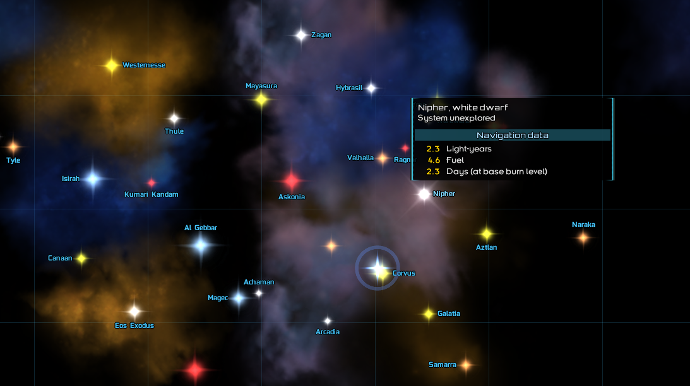
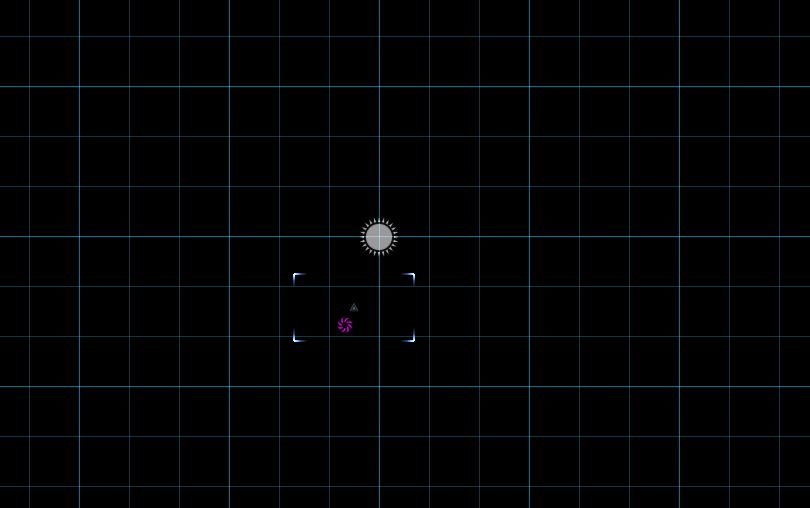
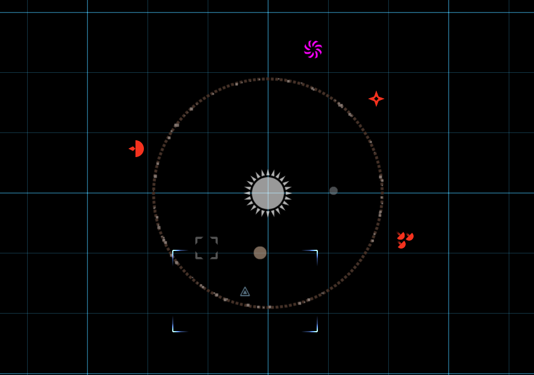
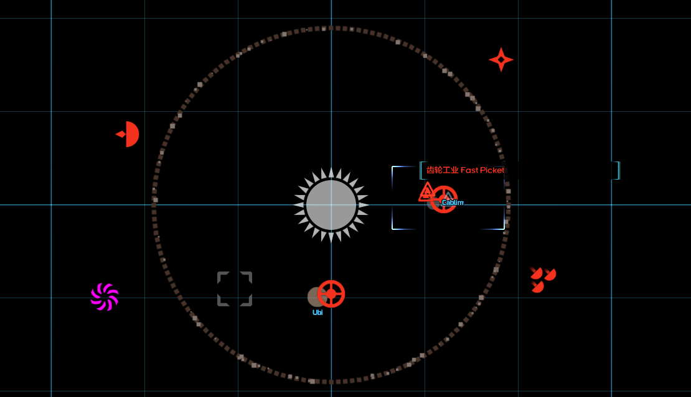

# 制作新星系与生成入口

本页是生涯篇的第一份 Java 内容：您将编写一个最小但完整的 MOD 生成器，让游戏在新建生涯时，把您自己定义的星系、恒星、行星、稳定点、跳跃点和市场放进星区。本页会接触少量代码——**若想把 MOD 做好，之后还会接触更多、更难的代码**——但每一行都会拆开讲清楚：谁创建实例、谁调用方法、每个参数是什么、数据文件如何与代码构成完整流程。

*本节预期阅读时间：~25 分钟。*

*本节预期操作时间：~35 分钟。*

## 学习目标

完成后，您将能够：

- 说出新建生涯的完整生成时序与四个注册入口（`settings.json` 的 `newGameCreationEntryPoint` / `newGameSectorProcGen`、`data/world/generators.csv`、`mod_info.json` 的 `modPlugin` → `onNewGame()`），并说出 MOD 的星系为什么放在 `onNewGame()` 里；
- 用 `SectorAPI.createStarSystem`、`StarSystemAPI.initStar` / `addPlanet`、`LocationAPI.addCustomEntity`、`JumpPointAPI` 与 `autogenerateHyperspaceJumpPoints` 建出带恒星、行星、稳定点、跳跃点、超空间入口的星系；
- 说出 `starmap.json` 的 `starSystemLocations` 键、`initStar` 的恒星 id 与市场文件（market.json）的 `starSystem` 字段三者必须一致的坐标完整流程；
- 用两条路径之一给实体建市场：数据路径（`economy.json` + market.json）或代码路径（`FactoryAPI.createMarket` + `EconomyAPI.addMarket` + `SectorEntityToken.setMarket`），并说出两条路径各自的强制校验与"二选一"规则；
- 说出本页每条必须遵守的规则被违反时的结果：星系不生成、星系不可达、市场缺失、加载中断或静默错乱。

## 前置知识

本页是生涯篇的第一份 Java 内容，需要您先具备以下基础：

- MOD 目录、`mod_info.json` 与 JSON 合并规则、UTF-8 无 BOM（S01-P01）；
- 类/接口/回调心智模型："注册入口 → 游戏创建实例 → 生命周期回调"（S02-P01）；
- 生涯与装配（S03-P01）；
- 势力 `gear_industry` 的注册，以及"关系不是文件数据、只能由代码播种"（S03-P02）——本页会正式给出关系代码的挂载点。

行星的自定义描述（`setCustomDescriptionId` 与 `descriptions.csv`）不在本页范围，本页只用行星类型的默认描述（该主题在描述文件单元讲解，S03-P04）。

市场的完整语义（稳定度、供需、移民、殖民）也不在本页范围（市场语义单元讲解，S08-P04），本页只建立"市场挂在实体上、注册进经济集合"的基础。

## 术语

| 词 | 本教程中的含义 |
|---|---|
| 星系 star system | 生涯星区（sector）里的一个地点容器（location），API 名保留 `StarSystemAPI`；有恒星、行星、实体与自己的背景。首次完整讲解在本页 |
| 实体 entity | 星系/超空间里的物体，恒星、行星、跳跃点、稳定点、空间站都是实体；API 名保留 `SectorEntityToken` |
| 跳跃点 jump point | 星系内或超空间里的航行出入口；API 名保留 `JumpPointAPI` |
| 轨道 orbit | 实体绕焦点的运行轨迹；`setCircularOrbit(focus, angle, orbitRadius, orbitDays)` 设置圆形轨道 |
| 市场 market | 挂在实体上的经济体（人口、条件、产业、子市场）；API 名保留 `MarketAPI`。首次完整讲解在市场语义单元（S08-P04），本页只讲注册 |
| 生成器 generator | 在生涯生成阶段往星区里放东西的插件；接口 `SectorGeneratorPlugin`（只有 `generate(SectorAPI)` 一个方法）|
| 程序化生成 procgen | 游戏自己随机生成星系、星云等内容的阶段，对应 `SectorProcGenPlugin` 与 settings 里的 `newGameSectorProcGen` |

## 文件与 API 链路

### 链路一：生成入口（谁调用您的生成器）

先看新建生涯（New Game）的生成时序：

1. `SectorProcGenPlugin.prepare(data)`：`settings.json` 的 `plugins` 段 `newGameSectorProcGen` 键登记类名的实例（原版是 `com.fs.starfarer.api.impl.campaign.procgen.SectorProcGen`），先做准备；
2. 入口生成器：`settings.json` 的 `plugins` 段 `newGameCreationEntryPoint` 键登记的类（原版是 `data.scripts.world.SectorGen`），以 `SectorGeneratorPlugin` 身份调用 `generate(sector)`——原版的核心星系（Corvus、Askonia、Naraka……）与势力关系播种都在这一步；
3. `data/world/generators.csv` 的插件：这个 CSV 只有一列 `className`，加载期按 spec 键 `sectorConfig` 读入生成器加载器，新档时逐个 `generate(sector)`；
4. **所有已启用 MOD 的 `ModPlugin.onNewGame()`**：`mod_info.json` 的 `modPlugin` 字段指向的类在游戏启动时被创建为实例，新档时回调 `onNewGame()`；
5. 程序化生成：`SectorProcGen.generate(data, progress)`——随机星系、星云、边缘世界等；
6. 所有 MOD 的 `onNewGameAfterProcGen()`；
7. 经济加载：读取 `data/campaign/econ/economy.json`——市场数据路径（market.json）在这里被读取；
8. 所有 MOD 的 `onNewGameAfterEconomyLoad()`。

把这张时序表记住，后面所有"为什么"都从它来。由此得出三条结论，前两条是事实，第三条是必须遵守的规则：

- **MOD 的星系放在 `ModPlugin.onNewGame()`**。`ModPlugin` 接口的 API 注释明确写着：`onNewGame()` "is the preferred way to generate the contents of the Sector, and is meant to replace generators.csv (which remains used for backwards compatibility)"——`generators.csv` 只是历史兼容入口。
- **本 MOD 的实体必须在这个时序的第 7 步之前存在**：market.json 的 `entities` 按实体 id 查找实体，查不到就抛异常（见链路三）。

::: caution 全局单键覆盖，禁止重写
`newGameCreationEntryPoint` / `newGameSectorProcGen` 是全局单键覆盖，**禁止在 MOD 里重写**。`settings.json` 跨来源合并时标量后写覆盖前写，一旦本 MOD 写了这两个键，原版 `SectorGen`（或原版程序化生成）就不再运行。

可观察结果：所有原版星系消失、势力关系不再播种、星区一片空白，而本 MOD 的代码没有报任何错。**不要覆盖这两个键**。
:::

`ModPlugin` 各回调（`onApplicationLoad`、`onGameLoad`、`beforeGameSave`……）的完整生命周期在专门讲解 ModPlugin 的单元里展开；本页只用到 `onNewGame()` 这一个生成入口。

### 链路二：星系与实体

#### 创建星系

```java
StarSystemAPI system = sector.createStarSystem("GearIn");
```

- `createStarSystem(name)` 由生涯引擎创建一个 `StarSystemAPI` 并登记进星区的星系集合；参数是**基名（base name）**，游戏显示为"`<基名> Star System`"。
- 查询入口：`SectorAPI.getStarSystem(name)` 把名字转小写后，与每个星系的 `optionalUniqueId`（若设置了）或基名小写比较，**大小写不敏感**。所以 `getStarSystem("GearIn")` 和 `getStarSystem("gearin")` 都能取到本页的星系。
- 星系在超空间中的位置：原版机制是 `initStar` 用**恒星 id** 去 `data/campaign/starmap.json` 的 `starSystemLocations` 里查坐标，查到就把 `system.getLocation()` 设为该坐标。这是本页最重要的数据完整流程之一：

```
initStar 的恒星 id  ==  starmap.json 的 starSystemLocations 键  ==  market.json 的 starSystem 值
```

三者必须一致（不一致的后果见"实例驱动故障分析"第 4、5 条）。

不想用 `starmap.json` 的话，也可以在 `initStar` **之前**显式 `system.getLocation().set(x, y)`——恒星不在原版 starmap.json 里的 MOD 可以这样定位（查不到键就不会被覆盖）。

两条路二选一；什么都不做时星系会定位在超空间原点 `(0,0)`。

- 背景与光照：`system.setBackgroundTextureFilename("graphics/backgrounds/background2.jpg")` 设置星系背景（路径以 MOD 根目录为基准，`graphics/backgrounds/` 里是原版背景图）；`system.setLightColor(new Color(...))` 设置全星系光照，**不设置光照的星系内一片漆黑**（行星背光面全黑，只有视觉影响）。

#### 恒星与行星

```java
PlanetAPI star = system.initStar("gearin", "star_white", 600f, 550f, 3f, 0.75f, 1f);
PlanetAPI prime = system.addPlanet("GearIn_planet1", star, "GearIn Prime", "terran", 55, 150, 3200, 120);
```

`initStar(id, type, radius, coronaSize, windBurnLevel, flareProbability, crLossMult)`：

- `id`：恒星实体 id（全星区唯一）；`type`：`data/config/planets.json` 里的恒星类型键，如 `star_white`、`star_yellow`、`star_orange`（有 `initStar(id, type, radius, coronaSize)` 四参重载，风烧等级/耀斑概率/CR 损失乘数用默认值 10 / 0.25 / 3.0）；
- `radius`：恒星半径（像素）；`coronaSize`：日冕外扩尺寸；`windBurnLevel`：日风烧灼等级；`flareProbability`：耀斑概率；`crLossMult`：恒星附近 CR 损失乘数（原版注释：合适范围 1–5）。
- **该重载不会自动生成通向超空间的虫洞/锚点**（API 注释明确说明），要靠后面的 `autogenerateHyperspaceJumpPoints`（或使用带超空间坐标的六参 `initStar` 重载，它自动创建恒星虫洞）。`initStar` 还会把恒星显示名登记进 `ProcgenUsedNames`，防止后面的程序化生成阶段（时序第 5 步）撞名。

`addPlanet(id, focus, name, type, angle, radius, orbitRadius, orbitDays)`：

- `id`：行星实体 id（唯一）；`focus`：轨道焦点（通常为恒星，也可以是另一颗行星——焦点行星成为"卫星/月亮"）；`name`：显示名；`type`：`planets.json` 里的行星类型键（`terran`、`barren`、`arid`、`lava`、`gas_giant`……）；`angle`：起始轨道角（度）；`radius`：行星半径；`orbitRadius`：轨道半径；`orbitDays`：公转周期（天）。

#### 自定义实体与轨道

```java
SectorEntityToken stable = system.addCustomEntity("GearIn_stable", "GearIn 稳定点", "stable_location", "neutral");
stable.setCircularOrbitPointingDown(star, 90, 2200, 100);
```

`LocationAPI.addCustomEntity(id, name, type, factionId)`：

- `type` 是 `data/config/custom_entities.json` 里的实体类型键：`stable_location`（稳定点）、`comm_relay`（通信中继）、`sensor_array`（传感器阵列）、`nav_buoy`（导航浮标）、`station_side00`（空间站）等；`factionId` 缺省为 `neutral`；`id` 传 `null` 时自动生成。
- 轨道：`setCircularOrbit(focus, angle, orbitRadius, orbitDays)`；空间站这类"脸朝焦点"的实体用 `setCircularOrbitPointingDown(...)`（效果相同，但实体朝向焦点）。

#### 跳跃点

```java
JumpPointAPI jump = Global.getFactory().createJumpPoint("GearIn_jump", "GearIn 跳跃点");
jump.setCircularOrbit(star, 300, 1800, 100);
jump.setRelatedPlanet(prime);
system.addEntity(jump);
```

- 手动跳跃点经 `Global.getFactory().createJumpPoint(id, name)` 创建，**创建后必须 `system.addEntity(jump)` 加入星系**，否则它不在实体集合里。
- `setRelatedPlanet(planet)` 把这个跳跃点与行星关联（命名/入口显示）；`setStandardWormholeToHyperspaceVisual()` 可让星系内跳跃点使用与超空间虫洞一致的外观（可选）。
- 关键一步：

```java
system.autogenerateHyperspaceJumpPoints(true, true);
```

`autogenerateHyperspaceJumpPoints(generateEntrancesAtGasGiants, generateFringeJumpPoint)`：依据星系内的跳跃点，在超空间里生成对应的入口跳跃点并建立双向连接；若恒星还没有虫洞，会顺带生成通向恒星的虫洞。

第一个参数为 `true` 时还在气态巨行星旁生成单向入口，第二个参数为 `true` 时在星系边缘生成一个双向跳跃点。

::: caution 必须打通超空间入口
**不调用这一步（又不使用带超空间坐标的 `initStar` 重载），星系就没有任何超空间入口，用户无法到达**——星系照常生成、日志没有任何报错。
:::

#### 还能加什么

一切创作的本质，不过是对现有元素的再次排列组合。上面只是最小骨架；原版 `data/scripts/world/corvus/`（Corvus 星系）与 `data/scripts/world/systems/`（几乎所有其它星系）的生成文件里，可以找到陨石带、碎片带、环带、极光、空间站、星门等物体的添加方法：

- `system.addAsteroidBelt(focus, numAsteroids, orbitRadius, width, minOrbitDays, maxOrbitDays)`——小行星带；
- `system.addRingBand(focus, category, key, bandWidthInEngine, bandAngleDiff, color, coreRadiusMult, bandRadiusInEngine, bandDaysPerOrbit, terrainId, name)`——行星环带（地形版还返回 terrain 实体）；
- `system.addTerrain(Terrain.MAGNETIC_FIELD, new MagneticFieldParams(...))`——磁层/极光等地形；
- `StarSystemGenerator.addOrbitingEntities(system, star, StarAge.AVERAGE, min, max, startRadius, nameOffset, withSpecialNames, allowHabitable)`——按程序化规则批量补行星、`StarSystemGenerator.addSystemwideNebula(system, StarAge.OLD)`——星系级星云。

把上面任意组合复制进您自己的 `generate()` 里，再按需微调即可。

### 链路三：市场（两条注册路径）

市场（`MarketAPI`）挂在一个实体上：`entity.setMarket(market)` 建立绑定，`entity.setFaction(factionId)` 设定势力归属，`Global.getSector().getEconomy().addMarket(market, true)` 把市场注册进全局经济集合。

除此之外市场还有三类内容：

- **条件（conditions）**（`data/campaign/market_conditions.csv`，如 `population_4`、`hot`）
- **产业（industries）**（`data/campaign/industries.csv`，如 `population`、`spaceport`）
- **子市场（submarkets）**（`data/campaign/submarkets.csv`，如 `open_market`、`storage`）

注册方式有两条互斥的路径。

#### 路径 A：数据路径（market.json，原版方式）

原版所有市场的"出生证"都是数据文件。加载链是：

```
data/campaign/econ/economy.json（starSystems 数组）
  └─> data/campaign/econ/<星系>.json（markets 数组）
        └─> 实体 id 在代码生成的实体里查找（时序第 7 步，早于一切市场操作）
```

`economy.json` 的字段（RC8，本地 `Starsector\starsector-core\data\campaign\econ\economy.json`）：`starSystems`（数组，每项是一个市场文件的相对路径）、`initialStepsToRun`、`defaultTariff`（0.3）、`map`（指向 `../starmap.json`）。

这个文件跨来源合并读取（`readJSONMerged`），**数组追加、对象按键合并、标量后写覆盖**——所以 MOD 只需要提交自己的 `starSystems` 数组项和自己的市场文件，**不要**复制整份原版文件，也不要写 `map` / `initialStepsToRun` / `defaultTariff` 键（标量会覆盖原版值，原版经济会被破坏）。

每个市场文件的字段（RC8 经济数据加载流程）：

| 字段 | 必填 | 读取方式 | 缺失/错误结果 |
|---|---|---|---|
| `starSystem` | 是 | `getString` | 该值必须存在于 `starmap.json` 的 `starSystemLocations`，否则抛 `Star system id [X] not found in <starmap路径>`，新档生成中断 |
| `markets` | 是 | `getJSONArray` | `JSONObject["markets"] not found`，中断 |
| `entities` | 是 | `getJSONArray` | 首项即主实体：市场 id = 首项、名称 = 实体名称（实体不存在时回退为首项 `ucFirst`）；实体查不到且 `economyExceptionOnMissingMarketEntity` 为 true（RC8 `settings.json` 默认 true）抛 `Market in <星系> system refers to invalid entity <id>`，中断；其余项成为关联实体并绑定同一市场 |
| `faction` | 是 | `getString` | `JSONObject["faction"] not found`，中断 |
| `size` | 是 | `getInt` | 同上 |
| `startingConditions` | 是 | `getJSONArray` | 同上；每个条件会被 `setSurveyed(true)`（新档即已勘探）|
| `tariff` | 否 | 只在模拟模式读取 | 正常新档的税率来自市场所属势力的 `tariffFraction`（faction 文件可选字段，缺省取 `economy.json` 的 `defaultTariff` 0.3，见 S03-P02）；该键在真实新档中被忽略 |
| `freePort` | 否 | `optBoolean` | 缺省 false；true 时设为自由贸易港 |
| `industries` | 否 | `getJSONArray` | 每项是产业 id，或 `[产业id, 参数...]` 数组（如 `["orbitalworks", "corrupted_nanoforge"]`，见原版 `askonia.json`）|
| `submarkets` | 否 | `getJSONArray` | **缺省自动加** `open_market`、`black_market`、`storage`，若市场有 `militarybase` / `highcommand` 产业还加 `generic_military` |

市场数据路径只在**新建生涯**时读取（时序第 7 步）；读档时市场从存档恢复。完整示例见"完整最小例"里的数据路径小节。

#### 路径 B：代码路径（常见做法）

`Global.getFactory().createMarket(id, name, size)` 创建市场对象（注意：**只创建对象，不注册**），然后补齐状态，最后三步收尾。最小顺序：

```text
createMarket(id, name, size)
  -> setFactionId(factionId)      # 势力归属
  -> setPrimaryEntity(entity)     # 主实体
  -> setSurveyLevel(FULL)         # 市场勘探状态
  -> getTariff().modifyFlat("generator", tariff)   # 税率（MutableStat，见 S07-P02）
  -> addCondition(condition)      # 无效 id 抛 Market condition [X] not found
  -> addIndustry(industry)        # 无效 id 抛 Industry [X] not found
  -> addSubmarket(submarket)      # 子市场
  -> economy.addMarket(market, true)   # 注册进经济集合
  -> entity.setMarket(market)          # 实体绑定（缺这步：市场存在但实体上没有）
  -> entity.setFaction(factionId)      # 实体势力（缺这步：实体仍是中立）
```

::: caution 一个实体至多一个市场，两条路径二选一
**两条路径二选一，不要同时启用**。一个实体至多注册一个市场；同时启用时同一实体出现两个同名市场，经济与市场界面错乱，且无加载报错。
:::

#### 两路径共用的 ID 对照（RC8 数据核对）

| ID | 出处 | 本页使用 |
|---|---|---|
| `population_4` / `thin_atmosphere` / `hot` / `ore_rich` / `rare_ore_abundant` / `no_atmosphere` / `meteor_impacts` | `data/campaign/market_conditions.csv` | 条件 |
| `population` / `spaceport` / `mining` / `refining` / `heavybatteries` / `orbitalworks` / `heavyindustry` / `militarybase` / `grounddefenses` | `data/campaign/industries.csv` | 产业 |
| `open_market` / `generic_military` / `black_market` / `storage` | `data/campaign/submarkets.csv` | 子市场 |
| `gear_industry` | S03-P02 定义的势力 id | 市场势力 |

市场**必须**带 `population_*` 人口条件：原版 `economy.json` 的 `starSystems` 列出的全部 20 个市场文件，其市场无一例外都带 `population_N`（本地数据核对）；代码路径的通用写法也是从 `population_` 条件解析市场规模。

缺少人口条件的市场在本页可核对范围内没有正常使用方，人口与移民机制会偏离预期——保持带 `population_N`。

## 完整最小例

文件清单（MOD 根目录为 `Starsector\mods\GearIndustry`，沿用此前单元建立的示例 MOD；路径以 MOD 根目录为基准）：

```
mod_info.json                                      # 已有，追加 modPlugin 字段
data/scripts/gearin/campaign/GearInSystemGenPlugin # 本页新增（modPlugin 注册入口）
data/scripts/gearin/campaign/GearInSystemGenerator # 本页新增（星系布局）
data/scripts/gearin/campaign/GearInMarketFactory   # 本页新增（代码路径建市场）
data/campaign/starmap.json                         # 本页新增（星系坐标注册）
```

### 第一步：注册 ModPlugin

`mod_info.json` 里补上 `modPlugin`（其余字段在 MOD 基础单元讲过，不赘述）：

```json
{
	"id":"gear_in",
	"name":"齿轮工业 [Gear Industry]",
	"version":{"major":0, "minor":0, "patch":1},
	"gameVersion":"0.98a-RC8",
	"modPlugin":"data.scripts.gearin.campaign.GearInSystemGenPlugin",
}
```

### 第二步：GearInSystemGenPlugin

保存为 `data/scripts/gearin/campaign/GearInSystemGenPlugin`（`data/scripts` 目录可能不存在，需要新建）。

它只做两件事：新档时调用星系生成器；挂载"关系只能由代码设置"的关系播种代码（该规则在势力注册单元讲清）。

本类是本页的生成入口类；`ModPlugin` 各回调的完整生命周期由 ModPlugin 所有权单元讲解（其所有权示例类 `GearInModPlugin` 位于 `data.scripts.gearin` 包），本页只用到 `onNewGame()` 这一个生成入口。

**绑定位置：modPlugin 注册**——`mod_info.json` 的 `modPlugin` 字段指向本类。

```java
package data.scripts.gearin.campaign;

import com.fs.starfarer.api.BaseModPlugin;
import com.fs.starfarer.api.Global;
import com.fs.starfarer.api.campaign.FactionAPI;
import com.fs.starfarer.api.campaign.RepLevel;
import com.fs.starfarer.api.campaign.SectorAPI;

/**
 * 本页示例：最小形态的 ModPlugin，本页的生成入口类。
 * mod_info.json 的 modPlugin 字段指向本类；游戏在新建生涯时调用 onNewGame()。
 * ModPlugin 各回调的完整生命周期由 S06-P02 讲解（其所有权示例类 GearInModPlugin
 * 位于 data.scripts.gearin 包），本页只保留 onNewGame() 这一个生成入口。
 */
public class GearInSystemGenPlugin extends BaseModPlugin {

	@Override
	public void onNewGame() {
		// 生成入口：新档时序里，所有 MOD 的 onNewGame 在原版 SectorGen、
		// generators.csv 插件之后、程序化生成（SectorProcGen）与经济加载（economy.json）之前调用，
		// 因此这里生成的星系与实体能被后续步骤消费（市场数据路径、程序化生成）。
		new GearInSystemGenerator().generate(Global.getSector());

		// 关系播种的挂载点：faction 文件不定义势力间关系，只能由代码设置（见势力单元的关系小节）
		seedRelations(Global.getSector());
	}

	private void seedRelations(SectorAPI sector) {
		FactionAPI gear = sector.getFaction("gear_industry");
		gear.setRelationship("player", 0f);
		gear.setRelationship("pirates", RepLevel.HOSTILE);
		gear.setRelationship("hegemony", RepLevel.FRIENDLY);
		gear.setRelationship("tritachyon", RepLevel.HOSTILE);
	}
}
```

要点：

- `modPlugin` 指向的类**必须继承 `BaseModPlugin`**（或实现 `ModPlugin`）；类名写错、包名写错时启动器报加载失败（加载失败的原因在 MOD 基础单元讲清）。
- `onNewGame()` 是"新档时生成星区内容"的推荐入口（API 注释原文），"关系只能由代码设置"在这里正式挂载。不调用 `seedRelations` 的可观察结果：齿轮工业对所有人 0.0 中立，无任何报错。

::: warning 中途启用只影响新档
如果您在用户存档中途**启用**了这个 MOD，`onNewGame()` 不会为已存在的旧档运行——旧档里不会出现本星系（新档专属内容）。
:::

### 第三步：GearInSystemGenerator

保存为 `data/scripts/gearin/campaign/GearInSystemGenerator`。

这是本页的星系布局类：生成星系、恒星、两颗行星、稳定点与跳跃点，并把市场构建委托给 `GearInMarketFactory`（见第四步）。

**绑定位置：星系生成链**——由 `GearInSystemGenPlugin.onNewGame()` 调用 `generate(sector)`；实现 `SectorGeneratorPlugin` 只是采用生成器的"约定"写法（原版 `data.scripts.world.SectorGen` 就是 `SectorGeneratorPlugin`）。

```java
package data.scripts.gearin.campaign;

import java.awt.Color;
import java.util.List;

import com.fs.starfarer.api.Global;
import com.fs.starfarer.api.campaign.JumpPointAPI;
import com.fs.starfarer.api.campaign.PlanetAPI;
import com.fs.starfarer.api.campaign.SectorAPI;
import com.fs.starfarer.api.campaign.SectorEntityToken;
import com.fs.starfarer.api.campaign.SectorGeneratorPlugin;
import com.fs.starfarer.api.campaign.StarSystemAPI;

/**
 * 本页示例：制作一个带恒星、行星、稳定点、跳跃点与市场的星系。
 * 实现 SectorGeneratorPlugin 只是采用生成器的"契约"写法（原版 data.scripts.world.SectorGen
 * 就是 SectorGeneratorPlugin）；实际调用入口是 ModPlugin.onNewGame，见 GearInSystemGenPlugin。
 * 市场部分委托给 GearInMarketFactory（代码路径建市场，见本页"链路三"）。
 */
public class GearInSystemGenerator implements SectorGeneratorPlugin {

	@Override
	public void generate(SectorAPI sector) {
		StarSystemAPI system = sector.createStarSystem("GearIn");
		system.setBackgroundTextureFilename("graphics/backgrounds/background2.jpg");
		system.setLightColor(new Color(200, 200, 210));

		// 恒星 id "gearin" 同时是星系在 starmap.json 里的注册键：initStar 会用它查
		// data/campaign/starmap.json 的 starSystemLocations，把结果设为星系在超空间中的坐标。
		// 不提供该键（又不手动 setLocation）时，星系会定位在超空间原点 (0,0)。
		PlanetAPI star = system.initStar("gearin", "star_white", 600f, 550f, 3f, 0.75f, 1f);

		// addPlanet(id, 轨道焦点, 显示名, 类型id, 轨道角, 半径, 轨道半径, 轨道周期天数)
		PlanetAPI prime = system.addPlanet("GearIn_planet1", star, "GearIn Prime", "terran", 55, 150, 3200, 120);
		PlanetAPI second = system.addPlanet("GearIn_planet2", star, "GearIn Second", "barren", 200, 90, 5200, 200);

		// 自定义实体：type 是 data/config/custom_entities.json 里的键，factionId 缺省为 neutral
		SectorEntityToken stable = system.addCustomEntity("GearIn_stable", "GearIn 稳定点", "stable_location", "neutral");
		stable.setCircularOrbitPointingDown(star, 90, 2200, 100);

		// 手动跳跃点：创建后必须 addEntity 加入星系，autogenerate 阶段才会为它生成超空间侧入口
		JumpPointAPI jump = Global.getFactory().createJumpPoint("GearIn_jump", "GearIn 跳跃点");
		jump.setCircularOrbit(star, 300, 1800, 100);
		jump.setRelatedPlanet(prime);
		system.addEntity(jump);

		// 必须调用（或用带超空间坐标的 initStar 变体），否则星系没有通向超空间的跳跃点，玩家无法到达
		system.autogenerateHyperspaceJumpPoints(true, true);

		// 代码路径建市场：委托给 GearInMarketFactory，条件/产业/子市场 ID 全部来自原版 CSV
		// （市场数据路径见本页"链路三"）
		GearInMarketFactory marketFactory = new GearInMarketFactory();
		marketFactory.createMarket(prime, "gear_industry", 0.35f,
				List.of("population_4", "thin_atmosphere", "hot", "ore_rich", "rare_ore_abundant"),
				List.of("population", "spaceport", "mining", "refining", "heavybatteries", "orbitalworks"),
				List.of("open_market", "generic_military", "black_market", "storage"));
		marketFactory.createMarket(second, "gear_industry", 0.35f,
				List.of("population_4", "no_atmosphere", "meteor_impacts", "ore_rich", "rare_ore_abundant"),
				List.of("population", "spaceport", "heavyindustry", "militarybase", "grounddefenses"),
				List.of("open_market", "generic_military", "black_market", "storage"));
	}
}
```

### 第四步：GearInMarketFactory

保存为 `data/scripts/gearin/campaign/GearInMarketFactory`。

这是代码路径建市场的入口类（角色：市场工厂）：每个实体一行 `createMarket(...)`，即可完成市场规模推导（`population_` 条件）、条件/产业/子市场填充与注册三步收尾（`economy.addMarket` / `entity.setMarket` / `entity.setFaction`）。

**绑定位置：市场构建链**——由 `GearInSystemGenerator.generate()` 对每颗行星调用一次（对应链路三的代码路径）。

```java
package data.scripts.gearin.campaign;

import java.util.List;

import com.fs.starfarer.api.Global;
import com.fs.starfarer.api.campaign.SectorEntityToken;
import com.fs.starfarer.api.campaign.econ.MarketAPI;
import com.fs.starfarer.api.campaign.econ.MarketConditionAPI;

/**
 * 本页示例：代码路径建市场的载体类（角色：市场工厂）。
 * 由 GearInSystemGenerator.generate 调用：每个实体一行 createMarket(...)，
 * 即可完成条件/产业/子市场填充与注册三步收尾（economy.addMarket / setMarket / setFaction）。
 */
public class GearInMarketFactory {

	public MarketAPI createMarket(SectorEntityToken entity, String factionId, float tariff,
									List<String> conditions, List<String> industries, List<String> submarkets) {
		// 市场规模来自 population_ 条件的数字，与 market.json 数据路径的 size 字段同理
		int size = 0;
		for (String condition : conditions) {
			if (condition.startsWith("population_")) {
				size = Integer.parseInt(condition.replace("population_", ""));
			}
		}

		MarketAPI market = Global.getFactory().createMarket(entity.getId(), entity.getName(), size);
		market.setFactionId(factionId);
		market.setPrimaryEntity(entity);
		market.setSurveyLevel(MarketAPI.SurveyLevel.FULL);
		market.getTariff().modifyFlat("generator", tariff);
		for (String condition : conditions) {
			market.addCondition(condition);
		}
		for (MarketConditionAPI condition : market.getConditions()) {
			condition.setSurveyed(true);
		}
		for (String industry : industries) {
			market.addIndustry(industry);
		}
		for (String submarket : submarkets) {
			market.addSubmarket(submarket);
		}

		// 三步缺一不可：注册进经济集合 -> 绑定到实体 -> 实体的势力归属
		Global.getSector().getEconomy().addMarket(market, true);
		entity.setMarket(market);
		entity.setFaction(factionId);
		return market;
	}
}
```

### 第五步：注册星系坐标（starmap.json）

在 MOD 里新建 `data/campaign/starmap.json`，提交您的星系坐标键：

```json
{
	"starSystemLocations":{
		"gearin":[12000,14000],
	},
}
```

::: tip 只提交自己的键
`starmap.json` 的 `starSystemLocations` 跨来源按键合并：只提交自己的一个键即可，整份复制原版文件没有任何必要，还会带来维护负担。本 MOD 的键会追加到原版键之后，不会影响原版星系。
:::

键名必须是 `initStar` 的恒星 id（`gearin`），值是星系在超空间中的 `[x, y]` 坐标。这个文件同时被两处使用：星系位置初始化（`initStar` 按恒星 id 查坐标设置星系位置）与经济数据加载（市场文件的 `starSystem` 校验与位置）。

### 第六步：运行

保存全部文件后新建生涯。游戏内就会出现您的星系：





虽然它现在内容不多，但恒星、行星、稳定点、跳跃点与市场都已经就位。想加更多星球与实体，参考"链路二：还能加什么"从原版星系文件复制粘贴即可：



### 市场数据路径的等价写法（二选一）

上面的最小例用代码路径建市场。

如果您愿意走原版的数据路径，把 `GearInSystemGenerator.generate()` 里对 `GearInMarketFactory` 的两次 `createMarket(...)` 调用删掉，换成下面的两个数据文件（`data/campaign/econ/gearin.json` 与 `data/campaign/econ/economy.json`）。

**注意：这是与代码路径互斥的替代方案，不要同时保留**——同一颗行星上会出现两个同名市场。

新建 `data/campaign/econ/gearin.json`（文件名随意，但建议与星系对应；`starSystem` 必须等于 starmap 键 `gearin`）。

注意：**不要**在这个文件里写 `tariff`——真实新档的税率来自势力文件的 `tariffFraction`，该键只在模拟模式读取；想调税率请改势力注册单元的 faction 文件或改用代码路径的 `modifyFlat`）：

```json
{
	"starSystem":"gearin",
	"markets":[
		{
			"entities":["GearIn_planet1"],
			"faction":"gear_industry",
			"size":4,
			"startingConditions":[
				"population_4",
				"thin_atmosphere",
				"hot",
				"ore_rich",
				"rare_ore_abundant",
			],
			"industries":[
				"population",
				"spaceport",
				"mining",
				"refining",
				"heavybatteries",
				"orbitalworks",
			],
			"submarkets":[
				"open_market",
				"generic_military",
				"black_market",
				"storage",
			],
		},
		{
			"entities":["GearIn_planet2"],
			"faction":"gear_industry",
			"size":4,
			"startingConditions":[
				"population_4",
				"no_atmosphere",
				"meteor_impacts",
				"ore_rich",
				"rare_ore_abundant",
			],
			"industries":[
				"population",
				"spaceport",
				"heavyindustry",
				"militarybase",
				"grounddefenses",
			],
			"submarkets":[
				"open_market",
				"generic_military",
				"black_market",
				"storage",
			],
		},
	],
}
```

再在 MOD 的 `data/campaign/econ/economy.json` 里**只写** `starSystems` 数组（跨来源追加；不要写 `map` / `initialStepsToRun` / `defaultTariff` 键）：

```json
{
	"starSystems":[
		"gearin.json",
	],
}
```

新档生成时，经济数据加载会在日志里打出 `Loading economy data from data/campaign/econ/economy.json` 与 `Loading star system: gearin.json`，然后按 `entities` 的 id 找到在 `onNewGame` 里生成的实体并绑定市场。

### 验证方案（基于本例）

本方案以完整最小例的最终形态为对象（代码路径建市场 + `starmap.json` 坐标注册）。

前置数据：

- `mod_info.json`（含本页的 `modPlugin` 字段，见 S01-P01）
- 势力文件（`factions.csv` 与 `gear_industry.faction`，见 S03-P02，市场势力）
- 本页的 `GearInSystemGenPlugin`、`GearInSystemGenerator`、`GearInMarketFactory`
- `data/campaign/starmap.json`

操作：

1. 启动游戏到主菜单，检查 `Starsector\starsector-core\starsector.log` 无 `ERROR`。
2. 新建生涯（本页内容只在新档生成时出现，读旧档不会触发），生成完成后按 `M` 打开星图：`GearIn` 星系出现在 `[12000,14000]` 附近（`system_out.png`），超空间有通向它的跳跃点。
3. 航行到星系并进入（`system_in.png`）：确认恒星有日冕与光照，`GearIn Prime` / `GearIn Second` 在轨道上，稳定点与跳跃点存在；通过跳跃点往返超空间一次。
4. 接近 `GearIn Prime`：出现市场交互（齿轮工业、税率 0.35、开放/军事/黑市/仓储四个子市场），条件与产业生效（`system_full.png`）。
5. 情报（`F`）里确认齿轮工业与海盗 `HOSTILE`、霸主 `FRIENDLY`、速子 `HOSTILE`、用户 0.0。

故障注入（逐项做完恢复）：

1. 注释掉 `mod_info.json` 的 `modPlugin` 行，重启新建生涯：星系不出现、无报错（对应故障分析第 1 条）；
2. 删掉 `starmap.json`，重启新建生涯：星系出现在超空间原点附近（对应第 2 条）；
3. 注释掉 `system.autogenerateHyperspaceJumpPoints(true, true);`，重启新建生涯：超空间无入口，星系无法进入（对应第 3 条）；
4. 若使用数据路径：把 `gearin.json` 的 `entities` 改为 `["GearIn_planetX"]`，重启新建生涯：生成中断，日志出现 `Market in gearin system refers to invalid entity GearIn_planetX`（对应第 4 条）；
5. 若使用数据路径：把 `gearin.json` 的 `starSystem` 改为 `"gearin2"`，重启新建生涯：生成中断，日志出现 `Star system id [gearin2] not found`（对应第 5 条）；
6. 把任一 `addCondition` 的条件 id 改错（如 `population_4` → `population_40`），重启新建生涯：生成中断，日志出现 `Market condition [population_40] not found`（对应第 6 条）。

清理：恢复所有注入的故障；发布前确认代码路径与数据路径没有同时启用（对应故障分析第 8 条）。

## 预期结果

- 启动到主菜单：`starsector.log` 没有任何 `ERROR`（星系生成代码不参与加载阶段，错误只会出现在新建生涯时）。
- 新建生涯，生成完成无异常。星图上出现 `GearIn` 星系（位置在 `[12000,14000]` 附近），超空间里能看到通向它的跳跃点/虫洞（`system_out.png`）。
- 进入星系（`system_in.png`）：白色恒星带日冕，`GearIn Prime`（terran）与 `GearIn Second`（barren）绕行，稳定点与跳跃点各就各位，星系有背景与光照。
- 沿跳跃点航行：星系内跳跃点与超空间跳跃点双向可用；未接近任何实体时星系呈"空"状态（`system_raw.png`）。
- 市场（代码路径）：靠近 `GearIn Prime` / `GearIn Second` 出现市场交互——势力为齿轮工业、税率 0.35、四个子市场（开放市场/军事/黑市/仓储）可用，条件与产业生效（`system_full.png`）。
- 市场（数据路径）：日志出现 `Loading economy data from data/campaign/econ/economy.json`、`Loading star system: gearin.json`，市场表现与代码路径一致。
- 关系：情报里齿轮工业与海盗 `HOSTILE`、与霸主 `FRIENDLY`、与速子科技 `HOSTILE`、与用户 0.0 中立（挂载点在 `onNewGame`）。

## 实例驱动故障分析

下面每条都给出触发条件、可观察结果和修正。

1. **星系完全没有出现。**
   - 触发：`mod_info.json` 没配 `modPlugin`、类名或包名写错、`onNewGame()` 里没调用生成器、Java 文件没放在 `data/scripts` 下（运行时按类名从 MOD 根目录解析 `data/scripts/...`，`src/` 不是查找前缀）。
   - 可观察：`modPlugin` 类找不到时启动器报加载失败；否则新档里没有 `GearIn` 星系，日志无任何报错。
   - 修正：核对 `modPlugin` 完整类名与文件路径/类名逐字一致；确认 `onNewGame()` 里调用了 `generate`。
2. **星系出现在超空间原点附近。**
   - 触发：没贡献 `starmap.json` 的 `starSystemLocations` 键（或恒星 id 与键不一致），也没手动 `system.getLocation().set(...)`。
   - 可观察：星系位置与跳跃点挤在原点 `(0,0)` 附近，可能与其他内容重叠；无报错。
   - 修正：补 `"gearin":[x,y]` 键（键 = 恒星 id），或在 `initStar` 前手动设置位置。
3. **星系可见但无法进入。**
   - 触发：`generate()` 末尾没调用 `autogenerateHyperspaceJumpPoints`（且 `initStar` 用的是不带超空间坐标的重载）。
   - 可观察：超空间里没有任何通向该星系的跳跃点或虫洞，用户舰队无法进入星系；日志无报错。
   - 修正：调用 `system.autogenerateHyperspaceJumpPoints(true, true)`。
4. **新档生成中断：`Market in <星系> system refers to invalid entity <id>`。**
   - 触发（数据路径）：`gearin.json` 的 `entities` 里的 id 与 Java 里 `addPlanet` / `addCustomEntity` 的 id 不一致（拼写、大小写）。
   - 可观察：`economyExceptionOnMissingMarketEntity` 在 RC8 `settings.json` 里默认 `true`，经济数据加载直接抛该异常，新档生成失败。
   - 修正：让 `entities` 与实体 id 逐字一致（实体 id 匹配区分大小写）。
5. **新档生成中断：`Star system id [X] not found in <starmap路径>`。**
   - 触发（数据路径）：`gearin.json` 的 `starSystem` 值与 `starmap.json` 的 `starSystemLocations` 键不一致或缺失。
   - 可观察：经济数据加载抛该异常，新档生成失败。
   - 修正：让三处一致——`initStar` 恒星 id = `starmap.json` 键 = market 文件 `starSystem`。
6. **新档生成中断：`Market condition [X] not found` / `Industry [X] not found`。**
   - 触发：条件 id 不在 `market_conditions.csv`、产业 id 不在 `industries.csv`（两条路径都会触发；代码路径在 `MarketAPI.addCondition` 与 `MarketAPI.addIndustry` 处抛，数据路径在经济数据加载时抛）。
   - 可观察：异常堆栈指向对应的 id，新档生成失败。
   - 修正：对照 `market_conditions.csv` / `industries.csv` 的 id 列逐字核对。
7. **星球上没有市场。**
   - 触发（代码路径）：`createMarket(...)` 的三步收尾缺了 `economy.addMarket`、`entity.setMarket`、`entity.setFaction` 之一。
   - 可观察：无报错；市场对象可能已创建但不在经济集合里，或实体上没有市场交互、实体势力仍是中立。
   - 修正：三步齐全。
8. **同一实体出现两个市场。**
   - 触发：代码路径的 `GearInMarketFactory.createMarket(...)` 与数据路径的 `gearin.json` 同时给 `GearIn_planet1` 建市场（两条路径都用）。
   - 可观察：经济里出现两个同名市场，`getMarket(id)` 只取到其中一个，市场界面与供需错乱；无加载报错。
   - 修正：二选一，删除另一路径。
9. **星系内一片漆黑。**
   - 触发：没调用 `system.setLightColor(...)`。
   - 可观察：星系内没有光照，行星背光面全黑；无报错（纯视觉）。
   - 修正：设置光照颜色。
10. **按 id 查询的机制拿到错误的实体。**
    - 触发：两个实体用了相同的 id（星区里已有同名实体，或自己重复使用）。
    - 可观察：`getEntityById`、市场 `entities` 绑定、跳跃点关联等按 id 工作的机制静默绑定到后注册的实体；日志无报错。
    - 修正：实体 id 全星区唯一，统一使用 `GearIn_` 前缀。
11. **加载期报贴图错误。**
    - 触发：`setBackgroundTextureFilename` 或 `addCustomEntity` 的 type 指向不存在的资源（背景 jpg / `custom_entities.json` 里没有该 type）。
    - 可观察：资源加载阶段直接报错（TEXTURE 无错误备用值，与贴图资源规则一致）。
    - 修正：背景用 `graphics/backgrounds/` 下真实存在的文件；自定义实体 type 对照 `data/config/custom_entities.json`。

## 附：本页定义 ID 归属

本页新定义的运行时 ID：

| ID | 用途 | 出现位置 |
|---|---|---|
| `GearIn`（基名，查询键 `gearin`）| 星系名 | `createStarSystem("GearIn")`；`getStarSystem("gearin")` 可查 |
| `gearin` | 恒星实体 id；**同时是** starmap.json 键与 market 文件 `starSystem` 值 | `initStar`、`data/campaign/starmap.json`、`data/campaign/econ/gearin.json` |
| `GearIn_planet1` / `GearIn_planet2` | 行星实体 id（= 市场 id）| `addPlanet`、`gearin.json` 的 `entities` |
| `GearIn_stable` | 稳定点实体 id | `addCustomEntity` |
| `GearIn_jump` | 跳跃点实体 id | `createJumpPoint` |
| `GearIn Prime` / `GearIn Second` | 行星显示名（非 ID）| `addPlanet` 的 `name` 参数 |

消费的既有 ID（本页不定义）：

- 势力 `gear_industry`（S03-P02）
- 行星/恒星类型 `star_white`、`terran`、`barren`（原版 `planets.json`）
- 实体类型 `stable_location`（原版 `custom_entities.json`）
- 条件、产业、子市场 ID（原版三张 CSV）
- 背景 `graphics/backgrounds/background2.jpg`（原版资源）

行星自定义描述 ID 留给描述文件单元（S03-P04）的 `descriptions.csv`，本页未使用 `setCustomDescriptionId`。

## 总结

本页走通了"星系 + 实体 + 市场 + 生成入口"四条链：

- **生成入口**：新建生涯的时序是入口生成器（`settings.json` 的 `newGameCreationEntryPoint`）→ `generators.csv` 插件 → 各 MOD 的 `ModPlugin.onNewGame()` → 程序化生成（`newGameSectorProcGen`）→ 经济加载（market.json）。MOD 星系放 `onNewGame()`（API 注释钦定的推荐入口）；`newGameCreationEntryPoint` / `newGameSectorProcGen` 两个 settings 键禁止覆盖。
- **星系与实体**：`createStarSystem` 建容器 → `initStar` / `addPlanet` 放恒星与行星（类型 id 来自 `planets.json`）→ `addCustomEntity` 放稳定点/中继/空间站（类型 id 来自 `custom_entities.json`）→ `createJumpPoint` + `addEntity` 放跳跃点 → `autogenerateHyperspaceJumpPoints(true, true)` 打通超空间。星系位置由 `starmap.json` 的 `starSystemLocations` 键（= 恒星 id）决定。
- **市场**：数据路径（`economy.json` 的 `starSystems` → market 文件 → 经济数据加载强制校验实体与 starmap 键）与代码路径（`createMarket` → 状态补齐 → `addMarket` / `setMarket` / `setFaction` 三步收尾，封装在 `GearInMarketFactory`）二选一；条件/产业/子市场 id 分别来自三张 CSV。
- **关系挂载**：势力注册单元的代码播种规则正式挂进 `onNewGame`。

调试时先问四个问题：`modPlugin` 配了吗（没有 → 星系不出现，无报错）、跳跃点生成了吗（没有 → 星系不可达）、`starmap.json` 键与恒星 id 一致吗（不一致 → 位置错乱或数据路径加载中断）、市场是两条路径同时开吗（是 → 重复市场）。

从逻辑上看，本页的星系还只是骨架：行星用类型默认描述、市场只完成注册。

这条链的自然延伸，是给行星配自定义描述、把市场推进到完整的经济语义（稳定度、供需、移民、殖民）；生成入口这半边，则由 `ModPlugin` 的完整生命周期承接——本页只用了 `onNewGame()` 一个回调，完整的回调族与示例 MOD 的最终编译形态（JAR）是它的逻辑后续。

## 建议参考项

- Java API（包路径）：
  - `com.fs.starfarer.api.ModPlugin` / `com.fs.starfarer.api.BaseModPlugin`——生成入口约定与默认实现（`onNewGame()` 是新档生成星区内容的推荐入口）
  - `com.fs.starfarer.api.campaign.SectorAPI`——`createStarSystem` / `getStarSystem` 星系容器
  - `com.fs.starfarer.api.campaign.StarSystemAPI`——`initStar` / `addPlanet` / `autogenerateHyperspaceJumpPoints` / `setLightColor`
  - `com.fs.starfarer.api.campaign.LocationAPI`——`addCustomEntity` / `addEntity` / `addAsteroidBelt` / `addRingBand` / `addTerrain`
  - `com.fs.starfarer.api.campaign.SectorEntityToken`——`setCircularOrbit` / `setCircularOrbitPointingDown` / `setMarket` / `setFaction`
  - `com.fs.starfarer.api.campaign.JumpPointAPI`——`setRelatedPlanet` / `setStandardWormholeToHyperspaceVisual`
  - `com.fs.starfarer.api.campaign.SectorGeneratorPlugin` / `com.fs.starfarer.api.campaign.SectorProcGenPlugin`——生成器约定
  - `com.fs.starfarer.api.FactoryAPI`——`createMarket` / `createJumpPoint`
  - `com.fs.starfarer.api.Global`——`getFactory` / `getSector`
  - `com.fs.starfarer.api.campaign.econ.MarketAPI` / `com.fs.starfarer.api.campaign.econ.EconomyAPI` / `com.fs.starfarer.api.campaign.econ.MarketConditionAPI`——市场对象、经济集合与市场条件
  - `com.fs.starfarer.api.impl.campaign.procgen.StarSystemGenerator` / `com.fs.starfarer.api.impl.campaign.procgen.ProcgenUsedNames`——按程序化规则批量补行星 / 名称登记
- 原版数据（以游戏安装根为基准）：
  - `data/config/settings.json`——`plugins` 段（`newGameCreationEntryPoint` / `newGameSectorProcGen`）与 `economyExceptionOnMissingMarketEntity`
  - `data/world/generators.csv`——历史兼容的生成器注册表
  - `data/campaign/starmap.json`——`starSystemLocations` 星系坐标注册
  - `data/campaign/econ/economy.json` 与 `data/campaign/econ/`——市场数据路径
  - `data/campaign/market_conditions.csv` / `data/campaign/industries.csv` / `data/campaign/submarkets.csv`——条件/产业/子市场 id
  - `data/config/planets.json` / `data/config/custom_entities.json`——行星/恒星类型与实体类型
  - `data/scripts/world/corvus/` / `data/scripts/world/systems/`——原版星系生成文件（扩充素材）
  - `graphics/backgrounds/background2.jpg`——示例星系背景
- 示例 MOD 内（以 MOD 根目录为基准）：
  - `data/scripts/gearin/campaign/`——本页三个类（`GearInSystemGenPlugin` / `GearInSystemGenerator` / `GearInMarketFactory`）所在目录
  - `data/campaign/starmap.json` / `data/campaign/econ/gearin.json` / `data/campaign/econ/economy.json`——本页新增数据文件
  - `mod_info.json`——`modPlugin` 注册字段
