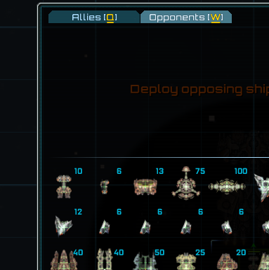

# 模拟战与标题演示装配

两张 CSV 清单决定两个展示入口各能看到哪些船：装配界面的模拟战敌方舰队，与标题画面的背景战斗。本页以既有装配 `GearIn_artizan_combat` 为对象，走查把它填进两张清单的工序，并梳理从注册到使用的链路、两文件共同的合并语义，以及无效装配 ID 的两类失败表现。

*本节预期阅读时间：~6 分钟。*

*本节预期操作时间：~8 分钟。*

## 学习目标

完成后，您将能够：

- 用 `data/campaign/sim_opponents.csv` 设置模拟战对手，说出"模拟战对手列表"从注册到使用的完整链路；
- 用 `data/config/title_screen_variants.csv` 设置标题画面演示舰船，说出它随机展示的机制；
- 说明这两个文件共同的合并语义（按行合并、`#` 注释、`replace` 整文件替换、表头逐字 `variant id`）；
- 区分两种"无效装配 ID"的失败表现：模拟战回退成星云-级并留下日志堆栈，标题画面直接抛异常。

## 前置知识

本页是装配使用页：不新增任何装配 ID，只把已注册的装配填进两张清单。建议先掌握以下基础：

- 装配注册与 `GearIn_artizan_combat` 的制作、持有（S03-P01）
- 船体注册，含 `GearIn_artizan` 与自动生成的 `<hullId>_Hull` 空装配（S01-P02）
- 战机联队注册与 `_wing` 后缀（S01-P03）
- 武器注册（S01-P04）
- CSV 跨 MOD 合并语义（S02-P02）

所有文件路径都相对 MOD 根目录（本教程示例 MOD 位于 `\Starsector\mods\GearIndustry`，路径自洽即可）。

## 模拟战对手

### 文件与注册链路

1. 文件位置：MOD 的 `data/campaign/sim_opponents.csv`。原版同路径：`\Starsector\starsector-core\data\campaign\sim_opponents.csv`（30 个对手条目）。
2. 注册入口：CSV spec 加载期调用 `loadCampaignData()`，它读取 `data/campaign/sim_opponents.csv`，把每行的 `variant id` 追加进 `simOpponentVariantIds`。
   - 这个调用在装配（`loadVariants`）之后执行，所以清单里可以引用任何已注册装配。
3. 合并语义：文件在核心与所有启用 MOD 之间**按行合并**，而且本文件**不按键去重**（`readCSVMerged(null, ...)` 不传键列表，它的键检查分支整体跳过）。由此推出三条必须遵守的规则：
   - **不要**把原版整份 `sim_opponents.csv` 复制进 MOD——原版 30 个对手会逐行追加、全部重复出现（敌方舰队直接翻倍），且没有任何报错；
   - 以 `#` 开头（行首第一个字符）的行整行跳过，可以当注释或分区标题（成熟实例常用 `#战列舰`、`#巡洋舰` 这类分区标题）；空行同样跳过；`#` 前有空格就不算注释；
   - 表头必须逐字是 `variant id`（含空格）：加载时每行执行 `getString("variant id")`，拼错（如 `Variant id`）会抛 JSON 键缺失异常，加载直接中断、进不了主菜单。
4. 整文件替换：在 `mod_info.json` 的 `replace` 数组里列出 `data/campaign/sim_opponents.csv`，该文件会整份替换合并结果（`ModManagerAPI` 把 `replace` 条目按整文件替换处理，`readCSV` 只保留替换源）。
   - 常规做法是"只写自己的行"，`replace` 是特殊情况。

### 使用方（这份列表被谁使用）

- 公开 API：`SettingsAPI.getSimOpponents()`（`com.fs.starfarer.api.SettingsAPI`）返回该列表；`getSimOpponentsDev()` 返回开发列表。
- 装配界面模拟战：装配界面点 "Run simulation" → 创建模拟战任务时，把列表中的每个 ID 加进敌方舰队。
  - ID 以 `_wing` 结尾的按战机联队（`FleetMemberType.FIGHTER_WING`）加入，否则按舰船（`SHIP`）加入。
- 模拟器插件：`settings.json` 的 `"simulatorPlugin":"com.fs.starfarer.api.impl.SimulatorPluginImpl"`——模拟战部署界面的 "Default" 对手类别正是这份列表。
- 生涯舰队面板：生涯界面的舰队教条面板在创建模拟战任务定义时使用同一列表。
- 开发列表 `sim_opponents_dev.csv`：与主文件同格式、同合并规则，独立成 `simOpponentDevVariantIds`，只通过 `getSimOpponentsDev()` 暴露，模拟器插件在 DevMode 类别里展示。常规 MOD 不需要它。

### 清单的最小形态

在 MOD 中新建 `\Starsector\mods\GearIndustry\data\campaign\sim_opponents.csv`：

```csv
variant id
# 本文件在所有启用 MOD 之间按行合并，只写自己的船
GearIn_artizan_combat
```

- 第一行 `variant id` 是表头（逐字一致），其余每行是一个装配 ID；
- `GearIn_artizan_combat` 是前序装配注册单元的既有装配（hull 为船体注册的 `GearIn_artizan`），本页只使用、不新增装配 ID；
- 保存即生效，无需其他注册：下次启动游戏时随 `loadCampaignData` 一起加载。



*模拟战中的敌方舰队（原版 30 个对手与 MOD 装配的混合）*

### 无效 ID 的可观察结果（星云-级回退）

模拟战构建敌方舰队时，每个 ID 都要构造一个 `FleetMemberAPI`。装配 ID 查不到时会发生两件事：

1. 打印堆栈 `[ID] is not a valid ship variant id`（`printStackTrace`，不中止战斗）；
2. 回退到 `settings.json` 的 `"errorShipVariant":"nebula_Standard"`——一艘星云-级（Nebula 级）运输船。

因此迁移原文"填错 ID 会导致它变成一艘星云-级"在 RC8 依然成立，且机制如上：**日志里能同时搜到该堆栈和这艘星云-级**。

所有经 `FleetMemberAPI` 加载装配 ID 的路径——模拟战对手、战役舰队、`MissionDefinitionAPI.addToFleet`（S03-P01）——都走这个回退，所以"这一条在以后几乎一切需要加载装配的情况下都适用"。

**唯一例外是标题画面演示**（见下节），它不走 `FleetMemberAPI`，失败表现完全不同。

## 标题演示装配

### 文件与注册链路

1. 文件位置：MOD 的 `data/config/title_screen_variants.csv`。原版同路径：`\Starsector\starsector-core\data\config\title_screen_variants.csv`（12 个条目，全是常规舰船装配）。
   - 表头同样是 `variant id`。
2. 注册入口：CSV spec 加载期调用 `loadTitleScreenVariants()`，读取后把每行追加进 `titleScreenVariantIds`。合并、注释、表头规则与模拟战清单完全相同。
3. 使用方：标题画面背景战斗的插件：
   - 每次构建背景场景时，从整份列表**随机取一个 ID** 作为旗舰；`_wing` 结尾的按战机联队生成，其余按舰船生成；
   - 场景每约 1 秒检查一次（`spawnIntervalTracker`）；旗舰飞出视口且距上次构建超过 10 秒才重建场景——这就是"刷新是随机的"的机制来源：展示的船不是每次都在；
   - 首次构建还会额外生成若干战机联队，以及第一艘非战机条目的一艘"受创"演示船（被施加 2 倍最大血量的高爆伤害）。

### 装配清单（本例）

在 MOD 中新建 `\Starsector\mods\GearIndustry\data\config\title_screen_variants.csv`：

```csv
variant id
GearIn_artizan_combat
```

保存即可：下次启动后，标题画面背景战斗的候选池就包含这艘船。

::: tip 减少演示装配数

整份列表是随机抽取的，每个条目都可能成为主角，因此**只放 MOD 内最具代表性的常规舰船**（原版只有 12 艘；成熟实例通常只放 5–8 艘），不要把自己的全部船塞进去。这是惯例建议，不是硬性限制。

:::

由于刷新是随机的，截图时机不好把握；教程沿用迁移版本的做法，不提供标题画面截图。

### 无效 ID 的表现（与模拟战不同）

标题画面建船直接走舰船对象创建流程：先按 ID 查变体装配，查不到时抛 `Ship hull variant [ID] not found!`，**没有星云-级回退**。

可观察结果是标题画面背景战斗的场景构建中断，`starsector.log` 出现该异常。

因此标题演示的 ID 必须保证有效，"星云-级"预期只适用于 `FleetMemberAPI` 路径。

### 验证方案（基于本例）

前置数据：装配注册单元的 `data/variants/GearIn_artizan_combat.variant`（S03-P01），以及本页新建的两个 CSV——`data/campaign/sim_opponents.csv` 与 `data/config/title_screen_variants.csv` （保持本例内容，UTF-8 无 BOM）。

操作：

1. 启动游戏（启用测试 MOD）：确认正常进入主菜单（无加载中断）。
2. 查看 `\Starsector\starsector-core\starsector.log`：出现 `Loading CSV data from [...] sim_opponents.csv` 与 `... title_screen_variants.csv`（核心与 MOD 各一条）。
3. 主菜单停留 10 秒以上：观察背景战斗是否随机出现 GearIn 的船（首次构建时第一艘非战机条目以受创形态出现）；多等几次或重启几次。
4. 读取或新建生涯存档，进入任意舰船装配界面，点 "Run simulation"：部署界面敌方包含原版 30 个对手与 `GearIn_artizan_combat`。
5. （可选）故障注入，对应「实例驱动故障分析」条目：
   - 把 `sim_opponents.csv` 表头改成 `Variant id`，重启观察加载中断（条目 1）；
   - 追加一行 `GearIn_no_such_ship`，重启后进模拟战观察星云-级回退与日志堆栈（条目 2）；
   - 在 `title_screen_variants.csv` 追加同一行，重启观察标题画面报错与 `Ship hull variant` 异常（条目 6）。完成后逐个恢复。

通过信号：

- 正常进入主菜单，日志中两个文件各出现两条加载记录（核心 + MOD）；
- 模拟战敌方舰队包含原版 30 个对手与 `GearIn_artizan_combat`；
- 标题画面背景战斗随机出现 GearIn 的船；
- 日志无 `is not a valid ship variant id`、无 `Ship hull variant` 异常。

清理：确认两个 CSV 恢复为本例内容；取消勾选测试 MOD 后可重新勾选。

## 预期结果

- 启动游戏（启用测试 MOD）：正常进入主菜单（没有加载中断）；
- `starsector.log` 出现 `Loading CSV data from [...] sim_opponents.csv` 与 `... title_screen_variants.csv`（核心与 MOD 各一条）。
- 进入生涯，打开任意舰船的装配界面，点 "Run simulation"：敌方舰队包含原版 30 个对手与 `GearIn_artizan_combat`；日志**没有** `is not a valid ship variant id`。
- 回到主菜单停留一段时间（或多次重启）：背景战斗的舰船池会随机出现 GearIn 的船（首次构建时第一艘非战机条目以受创形态出现）。
- 故障注入完成后恢复文件，一切如常。

## 实例驱动故障分析

1. **模拟战里没有您的船。** 触发：文件没放进 `data/campaign`、或表头不是逐字的 `variant id`。
   - 可观察：路径放错时无任何报错、列表里就是没有您的船；表头拼错时加载直接中断 （`getString("variant id")` 抛 JSON 键缺失异常，进不了主菜单）。
   - 修正：确认路径与表头。
2. **对手变成星云-级运输船。** 触发：装配 ID 填错或引用未注册装配（含 S03-P01 的重复 ID 静默跳过情形）。
   - 可观察：敌方出现 `nebula_Standard`（星云-级），`starsector.log` 有 `[ID] is not a valid ship variant id` 堆栈。
   - 修正：核对 ID 与 `data/variants` 实际注册一致（ID 匹配区分大小写）。
3. **敌方舰队对手数量翻倍。** 触发：把原版 `sim_opponents.csv` 整份复制进 MOD。可观察：原版 30 个对手每个出现两次，且无报错（本文件按行合并、不按键去重）。修正：只保留自己的行。
4. **`#` 注释不生效。** 触发：`#` 前有空格（如 ` #GearIn_x`）。可观察：该行被当成装配 ID 处理，ID 无效时触发第 2 条。修正：`#` 必须是行首第一个字符。
5. **标题画面一直看不到自己的船。** 触发：候选池条目多、刷新随机（场景重建才换船）。可观察：多数时候看到的是原版舰船。这**不是错误**。修正：确认条目在文件里，多等几次或重启观察。
6. **标题画面背景战斗报错。** 触发：`title_screen_variants.csv` 放了无效 ID。
   - 可观察：场景构建抛 `Ship hull variant [...] not found!`（无星云回退），日志出现异常。
   - 修正：删除无效行。
7. **以 `_wing` 结尾的条目建不出来。** 触发：`_wing` 结尾的 ID 会被当**战机联队 ID**（不是装配 ID）解析——若装配 ID 恰好以 `_wing` 结尾，或填的联队 ID 不存在。
   - 可观察：模拟战按 `FIGHTER_WING` 加入、标题画面按 `FighterWingSpecAPI` 查询，找不到时报错。
   - 修正：装配 ID 不要以 `_wing` 结尾；要加战机对手就填已在战机联队注册中登记的真实联队 ID（S01-P03）。

## 总结

本节完成了两张清单的完整走查：把装配 ID（或 `_wing` 联队 ID）填进 `data/campaign/sim_opponents.csv` 与 `data/config/title_screen_variants.csv`，分别供给模拟战敌方舰队与标题画面背景战斗随机展示。

两个文件共享同一套合并语义——按行合并、不按键去重、`#` 行首注释、表头逐字 `variant id`、文件 UTF-8 无 BOM（带 BOM 的表头会让键解析失败）；

关键区别在无效 ID 的失败表现：经 `FleetMemberAPI` 的路径（模拟战、战役）回退成 `nebula_Standard` 星云-级并打印堆栈，标题画面直接抛 `Ship hull variant [...] not found!`。

这套"装配 → 展示"的思路会继续延伸：装配注册之后，样式与声音等观感要素同样沿类似的注册与挂载链路落到船体上，渲染层最终呈现的正是这些注册成果的组合。

## 建议参考项

- `Starsector/starsector-core/data/campaign/sim_opponents.csv`：原版模拟战对手清单（30 条，可对照 `#` 注释与表头写法）
- `Starsector/starsector-core/data/config/title_screen_variants.csv`：原版标题画面演示清单（12 条常规舰船装配）
- `data/campaign/sim_opponents.csv`：MOD 模拟战对手清单（相对 MOD 根目录，只写自己的行）
- `data/config/title_screen_variants.csv`：MOD 标题画面演示清单（相对 MOD 根目录）
- `data/campaign/sim_opponents_dev.csv`：独立开发列表，仅经 `getSimOpponentsDev()` 暴露
- `data/config/settings.json`：`errorShipVariant` 无效装配回退目标与 `simulatorPlugin` 模拟器插件注册
- `data/variants/GearIn_artizan_combat.variant`：本页两张清单使用的装配（由装配注册单元持有）
- `com.fs.starfarer.api.SettingsAPI`：`getSimOpponents()` / `getSimOpponentsDev()` 公开 API
- `com.fs.starfarer.api.impl.SimulatorPluginImpl`：模拟器插件，"Default" 类别使用主列表、DevMode 类别使用开发列表
- `com.fs.starfarer.api.util.Misc`：`getSimulatorPlugin()` 获取模拟器插件实例
